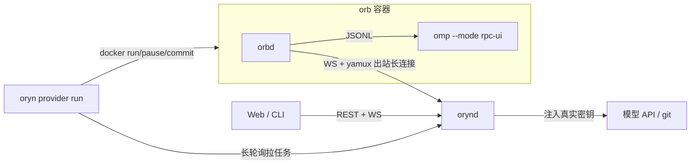

# Oryn

为 [omp](https://github.com/can1357/oh-my-pi) 打造的高级环境系统与跨平台客户端：每个线程一台隔离机器（orb），对话能力按 omp 做全，外围（环境面板、Portal、分享、统计）参照 Amp 最新版。

> 状态：M1（协议骨架）已完成，M2（线程核心）进行中。完整计划见 [`docs/plan-m1-m2.md`](docs/plan-m1-m2.md)。

## 组成

| 组件 | 说明 |
|---|---|
| `orynd` | 控制面：REST + WebSocket、SQLite 存储、Passkey/设备鉴权、orb 生命周期、密钥注入出站代理 |
| `orbd` | orb 内守护进程：经出站长连接（WebSocket + yamux）与控制面通信，监督 omp 进程、复制会话 JSONL、提供本地出站代理 |
| `oryn` | 命令行客户端，含 `oryn provider run`（在 Docker 主机上执行 orb 任务） |
| `web/` | React + TypeScript 客户端（Web/PWA；桌面与移动端以 Tauri 2 套壳，后续里程碑） |
| `images/orb/` | orb 基础镜像（Debian 13 + Node/bun/Python/uv/Go/Rust/gh + omp） |



关键约束：真实 API key 从不进入 orb——下发的 `models.yml` 只含占位令牌，请求经 orbd 的 `127.0.0.1:7811` 回到控制面，在那里按路由绑定替换为真实值，响应中的回显会被换回占位符。

## 开发

依赖：Go 1.27、bun 1.4、Docker、`sqlc`（`go install github.com/sqlc-dev/sqlc/cmd/sqlc@v1.31.1`）。

```bash
make gen          # 由 schema/openapi.yaml 与 SQL 生成 Go / TS 代码
make web          # 构建前端并嵌入 orynd
make build        # bin/orynd bin/orbd bin/oryn bin/fakeomp
make test
scripts/fetch-agent.sh && make image   # 拉取钉定的 omp 发行版并构建 oryn-orb:dev
./bin/orynd --config dev/orynd.yaml    # 首次启动打印 Passkey 初始化链接
```

`dev/orynd.yaml` 的第二个 `listen` 是本机 docker0 网桥地址（用 `ip -4 addr show docker0` 查看），供本机 orb 直连。

## 常用命令

```bash
oryn login --url https://oryn.example.com     # 设备配对（在网页上输入设备显示的验证码并批准）
oryn config push ~/.omp/agent                  # 上传 omp 文本配置，明文 key 自动移入加密密钥库
oryn config pull                               # 拉回文本配置（models.yml 默认另存为 models.oryn.yml）
oryn provider create local > provider.token    # 创建 orb provider，令牌只显示一次
oryn provider run --config /etc/oryn/provider.yaml
oryn secrets set git/github.com/token          # git 令牌，经出站代理注入 clone/push
```

## 文档

- [`docs/deploy.md`](docs/deploy.md)：部署到 1Panel OpenResty 反代之后
- [`docs/protocol.md`](docs/protocol.md)：协议索引与相对计划的偏差
- [`docs/research/`](docs/research/)：Amp / omp / 参考 GUI / Tauri 移动端调研
- agent fork：[`Lynricsy/oryn-agent`](https://github.com/Lynricsy/oryn-agent)（钉定版本见 `agent/agent-source.json`）
