<div align="center">

<picture>
  <source media="(prefers-color-scheme: dark)" srcset="docs/assets/hero-dark.png">
  
</picture>

<br>

**自托管的 Coding Agent 工作台：每个对话线程独占一台隔离环境，模型与 Git 凭据默认经控制面出站代理注入，<br>在浏览器、桌面、手机与终端里接续同一份工作。**

[快速开始](#快速开始) · [功能详解](docs/features.md) · [生产部署](docs/deploy.md) · [桌面端](docs/desktop.md) · [移动端](docs/mobile.md) · [协议](docs/protocol.md)

</div>

<br>

<table>
<tr>
<td width="33%" valign="top">

**🖥️ 一个线程，一台机器**<br>
Docker、Sysbox、Firecracker microVM 或你自己的电脑；空闲自动冻结，用时唤醒。

</td>
<td width="33%" valign="top">

**🔐 凭据默认不进环境**<br>
API Key 与 Git 令牌默认由控制面出站代理按主机注入，环境里只有占位符。

</td>
<td width="33%" valign="top">

**🧭 全局助手与 Space**<br>
一个能联网、能派线程、有自己电脑的助手；Space 并行协调多条线程。

</td>
</tr>
<tr>
<td valign="top">

**🧠 记忆、GitHub 与 SSH**<br>
项目内共享、跨项目隔离的记忆；PR 与 CI 回流；SSH 私钥不进环境。

</td>
<td valign="top">

**🎨 Artifacts**<br>
Agent 做出页面、画布、文档与幻灯片，带版本、评论、演示与发布。

</td>
<td valign="top">

**📱 全端同源**<br>
Web、Windows / macOS / Linux、Android、iOS 与 CLI，服务端升级即全端同步。

</td>
</tr>
<tr>
<td colspan="3" valign="top">

**📦 [Boxes](docs/features.md#boxes)**<br>
常驻机器托管多个应用，各有独立地址、密钥与数据目录；线程可直接开在线上应用目录。

</td>
</tr>
</table>

## 工作台

<sub>本页截图均由 `bun run shots:readme` 在 mock 模式下用演示数据生成（手机三联来自 iOS 模拟器里的真实 App，桌面任务栏图来自真实 orb），图中的线程、报告与数字（如基准耗时、成本）不是实测结果。</sub>

<picture>
  <source media="(prefers-color-scheme: dark)" srcset="docs/assets/workbench-dark.png">
  
</picture>

左边是按项目组织的线程树，中间是对话，右边是这台环境的一切：资源曲线、上下文构成、待办、Git 改动、文件、终端、Portal、远程桌面与 Artifacts。「信息」页把 orb、服务、浏览器 Profile 与 SSH 主机收成一层入口行，服务故障就地重启并显示进度，停机的环境在这里一键唤醒。

<picture>
  <source media="(prefers-color-scheme: dark)" srcset="docs/assets/tool-cards-dark.png">
  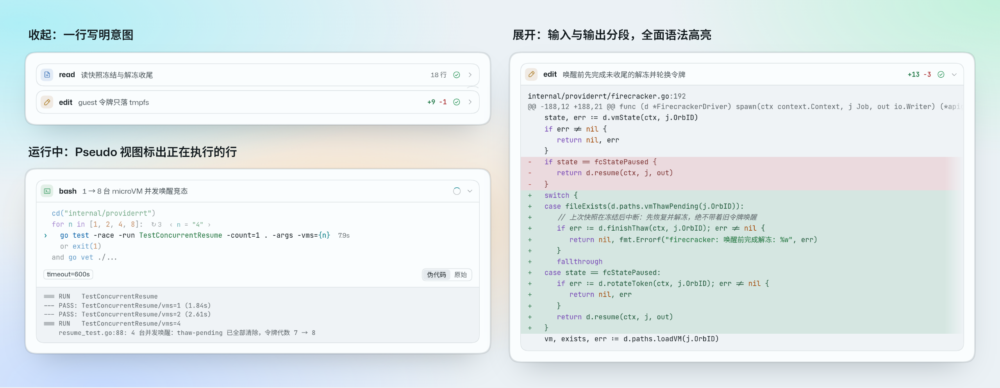
</picture>

- **工具卡**：收起、展开时头部都显示意图，右侧读数一眼说清结局（todo 的完成进度格、wait 等待中的任务与结局、搜索命中数、`+N −M`……）；运行中实时走表。展开后输入、输出按各工具的原生形态排版：搜索答案按 Markdown 渲染并附来源卡片，网页正文直接排版（外部内容不自动加载远程图片），子 agent 名册、问卷回执、调试器面板、终端窗口等；约 60 种语言的语法高亮；当前一批调用自动展开。
- **bash 的 Pseudo 视图**：运行中逐行显示执行轨迹，正在执行的那行标出，失败与跳过一眼可见。
- **后台任务**：转入后台的调用在卡片头部带一枚随任务走的标记；任务完成、失败、输出命中提醒都成为转录里的事件行；信息页像子 agent 一样列出后台任务，点开看输入、实时输出与事件时间线，运行中可以停止。
- **思考档位**：模型胶囊右下角的图标就是这一回合实际生效的档位；回合头已经标出的模型与档位切换不再另起一行。
- **输入框**：选中回复一键引用、`#` 引用 GitHub issue / PR，可选的「下一条消息预测」按 Tab 插入；`/` 命令菜单给每条命令配图标（与 omp TUI 一致），skill、MCP prompt 等按来源区分；输入命令参数时光标后有灰字参数提示（如 `/btw [question]`），子命令边输边补全名字与用法。
- **右键菜单与「解释」**：转录消息、代码块、链接与图片、工具卡、侧栏线程行、收件箱、终端、编辑器与改动列表都有右键菜单，部分界面也支持菜单键或长按；选中一段文字可让模型解释、翻译、就此提问或跑自定义快捷动作，走旁路提问复用主会话的前缀缓存，结果显示在选区旁的解释卡里。快捷动作在「设置 → 选区快捷动作」里增删排序。

<picture>
  <source media="(prefers-color-scheme: dark)" srcset="docs/assets/explain-changes-dark.png">
  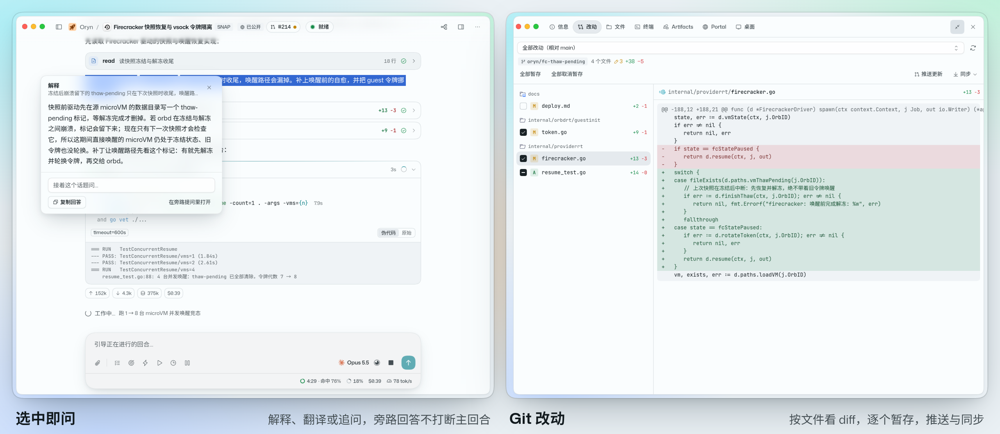
</picture>

解释卡走旁路提问，不打断正在运行的主回合，可以接着追问或转到「旁路提问」对话框。改动面板按文件列出相对基线分支的改动，可逐个暂存、推送或同步，范围也可以切到未提交的改动或单个提交。

<picture>
  <source media="(prefers-color-scheme: dark)" srcset="docs/assets/file-preview-dark.png">
  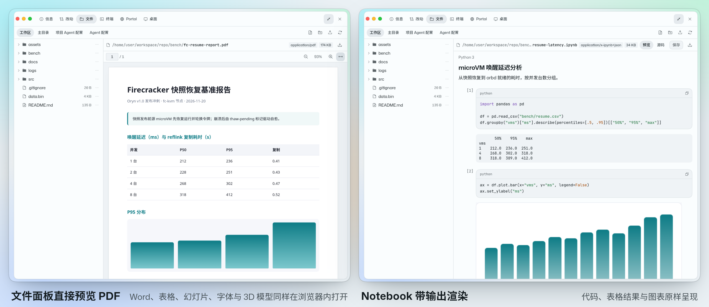
</picture>

文件面板在浏览器里直接预览 PDF、Office、Notebook、音视频、HEIC / PSD 图片、压缩包与 3D 模型，不经第三方服务；环境停机时也能只读浏览，不会唤醒它。

<picture>
  <source media="(prefers-color-scheme: dark)" srcset="docs/assets/desktop-control-dark.png">
  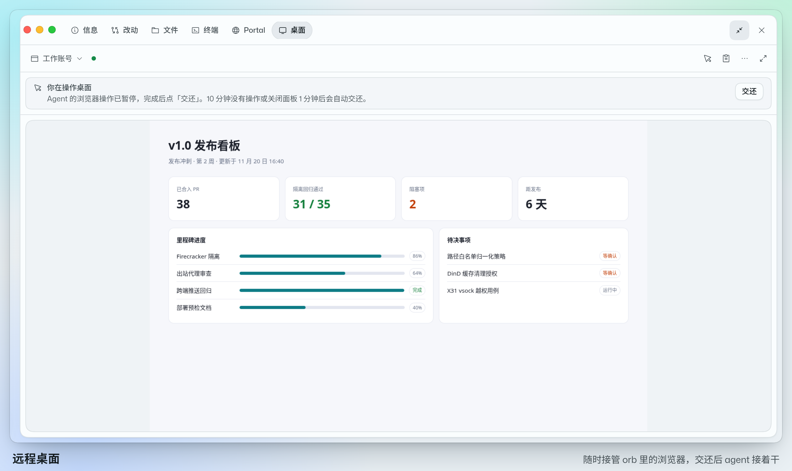
</picture>

远程桌面里 Agent 操作浏览器时你只读观看；遇到登录、验证码时它停下来等你接管，交还后接着干，手机通知上也能点「完成」。

<picture>
  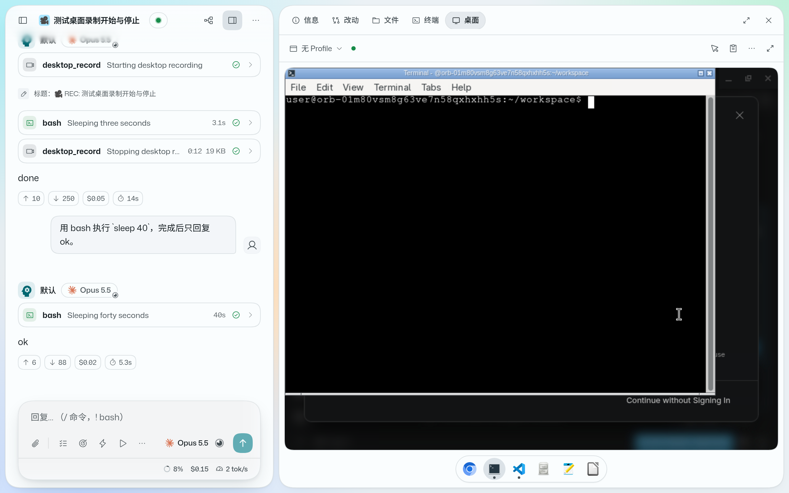
</picture>

画面下方的任务栏内置 Chromium、终端、VS Code、文件管理器、文本编辑器与 LibreOffice；Agent 可直接读取窗口无障碍树、按 `.oryn/desktop/resume` 自启动桌面环境，并用 `desktop_record` 把操作录成视频放进对话。

远程桌面的底色与外面的面板同色（浅色 `--panel`），两者只靠一圈细边框分隔；窗口用 orbd 自带的扁平 openbox 主题 Oryn：浅色标题栏与 GTK 应用的菜单栏连成一块，1px 细外框，标题居中，只留最大化与关闭按钮。已有的 orb 需升级并重启 orbd 后才换上新底色与标题栏。

## 执行环境

| 后端 | 隔离方式 | 适合 |
|---|---|---|
| Docker | 普通容器，剥离 `NET_RAW` / `NET_ADMIN` | 默认选择 |
| Sysbox | 非特权 UID 映射，容器里可跑 `dockerd` | 需要 Docker-in-Docker 的项目 |
| Firecracker | 独立内核的 microVM | 不可信代码、需要内核级隔离 |
| 本机 Runner | 你自己机器上的普通用户进程，跑 Oryn Core，配置不含密钥 | 本地目录、本地硬件 |

- **环境跟着线程走**：新线程总有一台新环境，删掉最后一个线程环境即回收，全部归档即冻结，不用手动管理。
- **快照与预热池**：项目首次 `.oryn/setup` 后自动快照，之后的新线程跳过构建；高频项目可留常驻预热池。
- **冻结与唤醒**：空闲自动冻结，打开线程或访问受管服务时自动唤醒。
- **开发镜像**：Arch Linux（x64 / ARM64），预装主流语言、语言服务器、文档与媒体工具链和图形桌面；已启用 BlackArch 源，安全工具按需用 pacman 安装。

## Boxes

<picture>
  <source media="(prefers-color-scheme: dark)" srcset="docs/assets/boxes-dark.png">
  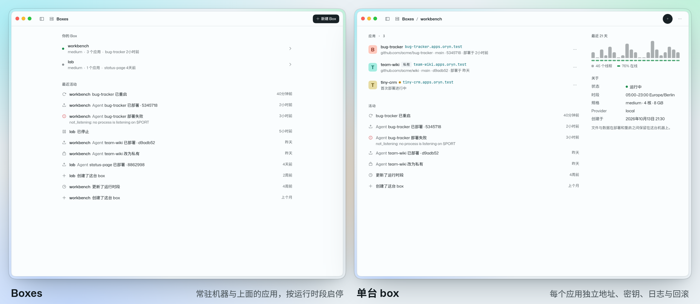
</picture>

线程的环境负责构建，box 负责常驻运行：在线程里 `oryn boxes deploy`，把仓库 `HEAD` 构建成 release 送上 box。

- **多应用**：一台 box 至多 16 个应用，各有 `https://<app>.<portal_domain>/` 地址、密钥与数据目录；默认公开，可设为仅主人可见。
- **激活与回滚**：新 release 起不来就退回上一个；保留最近三个 release，可在 box 页或 `oryn boxes rollback` 回滚。
- **运行时段**：按每日开机、关机时刻与时区启停；box 不空闲冻结，掉线后自动拉起。
- **在线上目录开线程**：线程可以直接开在 box 或某个应用的线上目录，排查线上数据不用另配环境。

## 收件箱、项目与 Artifacts

<picture>
  <source media="(prefers-color-scheme: dark)" srcset="docs/assets/artifacts-inbox-dark.png">
  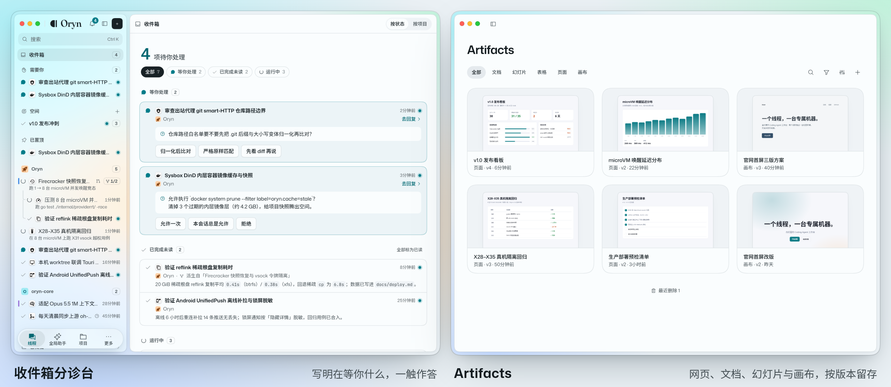
</picture>

- **收件箱分诊台**：按紧急程度列出等你处理、出错、已完成未读与运行中的线程，每行写明在等你什么，选项题在行内直接作答。
- **Artifacts**：Agent 产出的页面、画布、文档与幻灯片在沙箱里渲染；有版本历史、评论、画布编辑器、演示模式，可导出 Word / PowerPoint / PDF，也可发布成链接。

<picture>
  <source media="(prefers-color-scheme: dark)" srcset="docs/assets/project-palette-dark.png">
  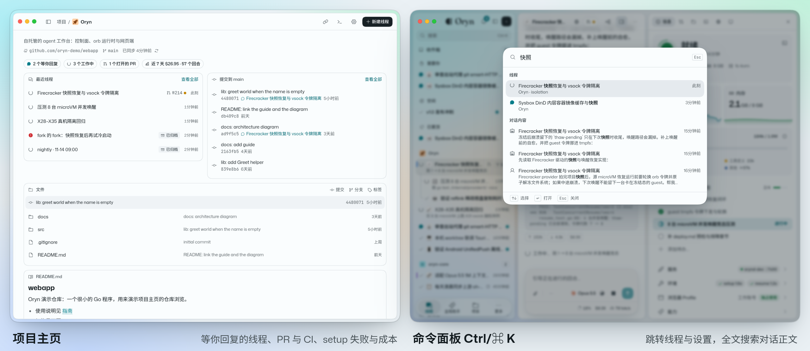
</picture>

- **命令面板 `Ctrl/⌘ K`**：跳转任何线程、项目与设置，并对全部对话正文全文搜索。
- **项目主页**：总览列出每个项目的线程数、近 14 天活动曲线与最后活跃时间；项目主页一屏看到描述与仓库、等你回复和工作中的线程、打开的 PR 与失败的 CI、最近的 setup 失败与近 7 天成本；线程子页可按标题、标签与状态筛选，设置按分组放在独立子页。

## 全局助手与 Space

<picture>
  <source media="(prefers-color-scheme: dark)" srcset="docs/assets/assistant-dark.png">
  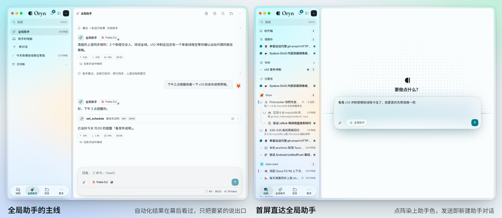
</picture>

- **全局助手**：能自己搜索、读网页、生图、调 MCP；能遥控一台属于它的电脑；也能替你开线程、发话，并经内置的 `oryn` 技能操作 Oryn 里几乎所有功能（项目、Space、box、分享、各项设置…）。删除、公开分享与密钥类设置要你点确认卡。对话标题与线程一样按 omp 标题卡（`<图标> <代码>: <标题>`，使用 Nerd 字形）展示：侧栏与页头带图标，页头另有代码徽标。
- **主线**：一条置顶的永久对话，定时与 GitHub 规则的结果汇到这里，助手判断值得说才打扰你。
- **主人记忆**：助手记得关于你的长期偏好，可查看出处、让事实失效或按来源遗忘。

<picture>
  <source media="(prefers-color-scheme: dark)" srcset="docs/assets/research-dark.png">
  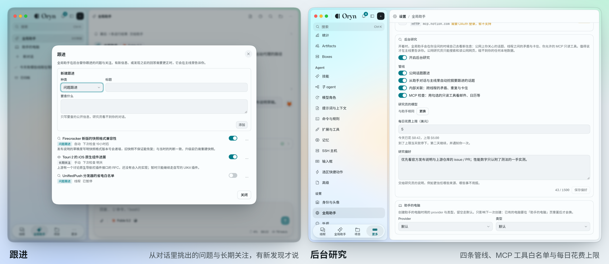
</picture>

- **后台研究**：打开后，助手替你跟进问过的问题与关心的主题（话题从对话里自动挑出，你在「跟进」里改删）、翻看线程找出跨线程的矛盾与卡住、用你勾选的 MCP 只读工具查邮件与日历；有值得说的才在主线里说，每日花费有硬上限。

<picture>
  <source media="(prefers-color-scheme: dark)" srcset="docs/assets/coord-stats-dark.png">
  
</picture>

- **Space**：协调者在严格沙箱里拆解目标、并发派出工作线程，需要你决策时汇总提醒。
- **定时任务**：在已有线程里按 Cron 巡检，或每次拉起全新线程并自动归档旧运行；新线程可指定开场的 role 或模型。运行前闸门先跑一条检查命令（默认在控制面本机的沙箱里，也可放到 SSH 主机上），没事就跳过、不调模型；agent 回复 `[SILENT]` 即安静结束。
- **成本统计**：按模型、项目、Space 穿透成本、缓存命中率与首字延迟，支持日 / 月预算告警。

## Agent 配置、记忆与集成

<picture>
  <source media="(prefers-color-scheme: dark)" srcset="docs/assets/settings-dark.png">
  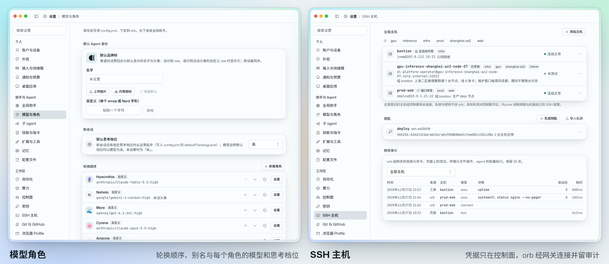
</picture>

- **图形化 Agent 配置**：技能、子 Agent、模型角色、规则、扩展与 MCP 做成表单，保存后数秒内下发到所有运行中的环境。
- **项目级配置**：每个项目另有一层规则与技能，镜像进环境但不写进仓库，`git status` 保持干净；还可以有自己的环境变量与 Git 令牌，只注入本项目的环境，同名时覆盖全局密钥。
- **Hindsight 记忆**：同一项目的线程共享记忆，不同项目互不可见；跨项目的经验要你批准才生效。
- **GitHub**：环境里 `git` 与 `gh` 免登录；PR 状态与 CI 结果显示在线程页头，评审与 CI 失败回流进线程；回流消息与定时运行、线程报告等自动消息一样，在转录里显示为独立的系统卡片，不会和你亲手发的消息混淆，CI 失败、要求修改等需要留意的事件会标色，长正文自动折叠，评论里的图片只显示为链接、不会自动加载；分诊、PR 评审、发布哨兵三个自动化预设。
- **SSH 主机**：登记一次，Agent 就能用主机名读写远端文件、并发执行命令；私钥留在控制面，每条命令记审计。

## 全平台客户端

<picture>
  <source media="(prefers-color-scheme: dark)" srcset="docs/assets/mobile-views-dark.png">
  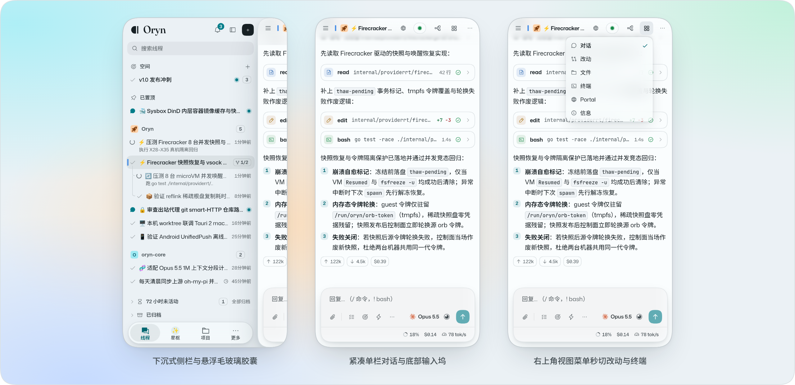
</picture>

| 平台 | 形态 | 亮点 |
|---|---|---|
| 浏览器 | Web / PWA | 无需安装 |
| Windows / macOS / Linux | Tauri 2 桌面 App | 无系统标题栏，macOS 原生红绿灯（侧栏字标按剩余宽度显示）；托盘、全局快捷键、`oryn://` 深链接 |
| Android | Tauri 2 App（`foss` / `gms`） | UnifiedPush 或 FCM 端到端加密推送，通知上直接作答 |
| iOS | Tauri 2 App（TestFlight） | iOS 26 原生 Liquid Glass：系统底栏悬浮在内容之上（按住冒出液珠、横滑换项），页头与新建线程页的侧栏钮跟随下沉卡片开合，见 [附录 A](docs/mobile.md#附录-aios) |
| 终端 | `oryn` CLI | `thread attach` 流式交互，`sync` 把远端改动实时镜像到本机 |

客户端只带一个配对页，配对后加载服务器自己的 Web UI；设备令牌存在系统凭据库，网页脚本读不到；桌面 App 中的 HTTP(S) 外链交给系统默认浏览器打开。

服务端、桌面与移动 App 统一发版：推送 tag `v<版本>`（预发布 `v<版本>-rc.N`）后，[`release.yml`](.github/workflows/release.yml) 在同一个 GitHub Release 里发布服务端二进制（Linux x64 / ARM64，另有 macOS Runner 用的 `orbd`）、三平台安装包与 Android APK / AAB，并把 iOS 包上传 TestFlight；全部成功才发布。步骤见 [桌面端「发版」](docs/desktop.md#发版)，服务端安装见 [部署第 1 节](docs/deploy.md#1-安装二进制与镜像)。

## 架构与安全

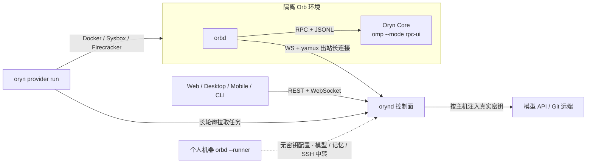

| 组件 | 路径 | 职责 |
|---|---|---|
| `orynd` | `cmd/orynd` | 控制面单二进制：REST + WebSocket、SQLite、Passkey 与设备配对、调度、协调沙箱、出站密钥注入代理、内嵌 Web 前端 |
| `orbd` | `cmd/orbd` | 环境内守护进程：出站长连接回控制面，监督 Oryn Core，托管服务、桌面与本地出站代理；`--runner` 模式接入个人机器 |
| `oryn` | `cmd/oryn` | 命令行客户端与宿主机 Provider 执行器（`docker`、`firecracker`、脚本 `dispatch`） |
| `web/` | `web/src` · `web/src-tauri` | React 19 + Tailwind CSS 4 前端，以及桌面与移动端的 Tauri 2 壳 |
| `images/` | `images/orb` · `images/fc` | Arch Linux 开发镜像与锁定摘要的 Firecracker 内核及根盘 |

四条安全边界：

1. **凭据隔离**：默认 `proxy` 模式下，环境里的配置只有 `oryn-ph-…` 占位符，真实值由控制面按上游主机注入，响应里的回显也会被脱敏回去；显式设为 `env` 模式的密钥和未绑定上游主机的模型 Key 会以环境变量下发。
2. **Git 访问范围**：github.com 用 OAuth 账号令牌，能读写哪些仓库取决于账号自身权限，项目可另开推送 / 开 PR 门禁；其它 Git 主机（PAT）上，绑定仓库的环境只能读写那一个仓库，未绑定的只能只读克隆。
3. **单向信任**：环境令牌每次创建、唤醒、快照后轮换；个人机器 Runner 只接收不含密钥的配置并经控制面中转访问模型、记忆与 SSH 主机（密钥从不下发），普通环境里的 Agent 也无法操控 Runner。
4. **后台研究不外泄**：上网的研究员只拿到话题的标题与问题，`read` 只能读公网网址，读不到本地文件与别的对话；读私有数据的研究员不能上网、没有内置工具，MCP 工具只能调你勾选的那几个（由出站代理逐个请求过滤）。网页、邮件、日历带来的发现只交给一轮只读的主线处理。

完整说明见[功能详解 · 安全边界](docs/features.md#安全边界)与[部署文档第 7 节](docs/deploy.md#7-安全)；后台研究的边界见[部署文档 · 后台研究](docs/deploy.md#后台研究m26)。

## 快速开始

在本机拉起一套控制面与 Docker Provider，然后在浏览器里开第一个线程。

**前置依赖**：Go `1.27+`、Bun `1.4+`、Docker；改 SQL 时还需要 `sqlc`（`go install github.com/sqlc-dev/sqlc/cmd/sqlc@v1.31.1`）。

**1. 构建**

```bash
# 构建前端并编译四个静态链接二进制（bin/orynd、bin/orbd、bin/oryn、bin/fakeomp）
make web
make build

# 拉取钉定版本（core/source.json）的 Oryn Core，构建本机开发镜像 oryn-orb:dev
scripts/fetch-core.sh
make image
```

`make image` 结束时会在断网容器里以非 root 用户跑冒烟，输出 `orb 镜像离线冒烟：通过`。

**2. 启动控制面**

```bash
# 生成纯 Docker 本地配置（监听 docker0 网桥地址）并启动
mkdir -p .dev
DOCKER_IP=$(ip -4 -o addr show docker0 | awk '{print $4}' | cut -d/ -f1)
cat > .dev/quickstart-orynd.yaml <<EOF
listen: ["127.0.0.1:7600"]
public_url: "http://localhost:7600"
portal_domain: "localhost"
data_dir: "./.dev/quickstart-data"
orb_tls: { listen: ["${DOCKER_IP}:7643"] }
EOF
./bin/orynd --config .dev/quickstart-orynd.yaml
```

首次启动会在日志里打印一次性的 `http://localhost:7600/setup#token=ost_…`。在浏览器打开它，注册管理员 Passkey 并保存恢复码。

> [!NOTE]
> 仓库里的 `dev/orynd.yaml` 额外监听 Firecracker 网段 `172.31.255.1`，没有初始化该网卡时请用上面的纯 Docker 配置。

**3. 登录 CLI 并启动 Provider**（第二个终端）

```bash
# 登录并上传本机 omp 配置，明文 API Key 自动转入控制面加密密钥库
./bin/oryn login --url http://localhost:7600
./bin/oryn config push ~/.omp/agent

# 创建名为 local 的 Provider 并启动 Docker 执行器
DOCKER_IP=$(ip -4 -o addr show docker0 | awk '{print $4}' | cut -d/ -f1)
./bin/oryn provider create local > .dev/quickstart-provider.token
chmod 0600 .dev/quickstart-provider.token
cat > .dev/quickstart-provider.yaml <<EOF
url: "http://127.0.0.1:7600"
token_file: ".dev/quickstart-provider.token"
orb_url: "https://${DOCKER_IP}:7643"
driver: docker
docker:
  image: "oryn-orb:dev"
EOF
./bin/oryn provider run --config .dev/quickstart-provider.yaml
```

**4. 开始工作**：打开 `http://localhost:7600`，新建线程，它会在一台独立的 Docker 环境里启动。

生产部署（反代、通配符 Portal 证书、网络隔离、Sysbox 与 Firecracker）见 **[`docs/deploy.md`](docs/deploy.md)**。

## CLI 速查

<details>
<summary><strong>控制面上的 <code>oryn</code> 命令</strong></summary>

```bash
# ── 认证、配置与密钥 ──
oryn login --url https://oryn.example.com                    # 设备配对登录（浏览器输入配对码批准）
oryn config push ~/.omp/agent                                # 上传 omp 配置，明文 Key 自动抽入加密密钥库
oryn config pull                                             # 拉回文本配置（models.yml 默认存为 models.oryn.yml）
oryn config push --project myproj                            # 在仓库根目录把 ./.omp 上传为该项目的 Agent 配置（整体替换）
oryn config pull --project myproj                            # 把项目的 Agent 配置拉回 ./.omp
oryn secrets set git/github.com/token                        # 写入 Git 令牌（只写不读，由出站代理按需注入）
oryn secrets set FOO bar --project myproj --plain            # 项目级环境变量（只注入该项目的 orb，同名时覆盖全局；--plain = 不保密，可读回）
oryn secrets set git/gitlab.com/token --project myproj       # 项目级 Git 令牌（只给该项目的 orb 与仓库镜像用）
oryn git-identity set --name "Ada" --email ada@example.com   # 设置 orb 内 Git 提交身份的全局默认值
oryn ssh key gen main                                        # 生成 SSH 钥匙，公钥打印到标准输出（加到目标机的 authorized_keys）
oryn ssh add web1 --host 10.0.0.5 --user deploy --key main   # 登记主机并立即测试连接（--project 限定到项目，--jump 走跳板）
oryn ssh ls --all && oryn ssh audit --host web1             # 列出主机与最近测试结果；查看网关审计

# ── Oryn 托管仓库 ──
oryn project create notes --hosted                           # 新建 Oryn 托管的空白仓库（带初始提交），输出项目 id
oryn clone notes                                             # 克隆托管仓库，登记 oryn git-credential 作凭据助手（用设备令牌认证）
oryn project create myapp --push --remote oryn               # 在本机仓库里运行：建成托管项目，基线 = 当前分支，推上去（含 LFS 对象）

# ── 执行后端（Provider 与个人机器 Runner）──
oryn provider create prod-fc > provider.token                # 创建 Provider（令牌仅在标准输出显示一次）
sudo oryn provider preflight --config /etc/oryn/fc.yaml      # 启动前逐项核查 KVM / nftables / UID 区间
oryn provider run --config /etc/oryn/provider.yaml           # 运行宿主机 Provider 守护循环
oryn runner create macbook                                   # 注册个人开发机 Runner，获取 ort_… 令牌
# 在个人开发机上以普通用户接入目录：
# ORYN_URL=https://oryn.example.com orbd run --runner --dir /home/ada/code/app --terminal

# ── 线程、流式挂接与本地镜像同步 ──
oryn thread new --project myproj "排查登录重定向循环并补单测"  # 在指定项目的新 orb 中启动线程
oryn thread new --runner macbook --dir /home/ada/code/app --worktree fix-auth "修复鉴权中间件"
oryn thread attach <线程>                                     # 流式查看转录，支持实时输入引导（steer）、作答与计划审批
oryn thread rpc <线程> '{"type":"get_state"}'                # 向 agent 下发任意 omp RPC 命令并打印应答
oryn thread abort <线程>                                      # 中止当前回合
oryn thread fork <线程> [--entry <条目>] [--env share|copy]   # 分叉线程，打印新线程 id
oryn sync <线程>                                              # 将 orb 内的改动实时镜像至当前干净检出（--apply 落盘）

# ── Space 协调、定时任务与统计分析 ──
oryn space create "v1.2 发布周" --project myproj --goal "完成迁移回归与变更日志"
oryn schedule set <线程> --cron "0 9 * * 1-5" --tz Asia/Shanghai --prompt "汇总昨日 CI 失败"
oryn schedule add --project myproj --every 6h --prompt "检查依赖安全更新并提 PR"
oryn schedule add --project ops --name watch --cron "0 * * * *" --prompt-file watch.md \
  --gate-command "./check.sh"                                # 闸门在本机沙箱里跑数据目录 gates/ 下的脚本，输出 {"wakeAgent": false} 时跳过
oryn schedule update <定时> --gate-host UltraServerUS --gate-command "python3 s2a_health.py --gate"   # 改到 SSH 主机上执行
oryn stats --since 30d --by model                            # 按模型汇总近 30 天 Token、缓存与成本（支持 --csv / --json）
oryn stats budget set --daily 20 --monthly 300 --warn 80     # 配置日/月成本预算与预警百分比

# ── Boxes（常驻机器与应用）──
oryn boxes create workbench && oryn boxes list               # 新建常驻机器并查看状态与已部署应用数
oryn boxes secrets set DATABASE_URL --box workbench --app wiki --value "postgres://localhost/wiki"
oryn boxes restart workbench --app wiki                      # 重启应用服务以加载最新密钥与环境变量
oryn boxes exec workbench --app wiki -- ./migrate            # 在应用线上目录执行命令（流式输出，Ctrl-C 中断）
oryn boxes cp ./seed.db workbench:seed.db --app wiki         # 与应用数据目录互传文件
oryn thread new --box workbench --app wiki "排查线上慢查询"    # 在 box 应用的线上目录直接启动线程
```

</details>

<details>
<summary><strong>环境内部的 <code>oryn</code> 命令</strong>（Agent 与开发者在 orb 里使用）</summary>

```bash
oryn orb setup run [--resume]                         # 手动重跑 setup 或 resume 生命周期脚本并上报控制面
oryn orb setup status | logs [--resume]               # 查看最近一次环境配置状态与完整输出
oryn orb service ls | start <名> | logs <名>           # 查看或启停 .oryn/services.yaml 定义的受管服务
oryn orb desktop status | browser start               # 查看虚拟桌面状态或拉起受管 Chromium
oryn thread new "跑一遍全量集成测试" && oryn thread wait <id>   # 派生子线程并等待其静止（退出码 0/3/4/124）
oryn boxes deploy --on workbench --name wiki --create        # 将当前仓库 HEAD 构建打包并部署到 box（首次可顺手建 box）
```

</details>

## 文档

| 文档 | 内容 |
|---|---|
| [`docs/features.md`](docs/features.md) | 每项能力的完整行为、边界与约束 |
| [`docs/deploy.md`](docs/deploy.md) | 生产部署：反代、Portal 证书、网络隔离、协调沙箱、快照与预热池、Sysbox、Runner、Firecracker、Hindsight、SSH 网关；[第 16 节](docs/deploy.md#16-developserverus-本机生产实例)是本机生产实例的入口与维护方式 |
| [`docs/desktop.md`](docs/desktop.md) | 桌面客户端：安装、配对、窗口与标题栏、托盘、快捷键、自动更新、App 图标；服务端、桌面与移动 App 的统一发版（`v*`） |
| [`docs/mobile.md`](docs/mobile.md) | 移动客户端：Android 双包、扫码配对、推送与省电、发版；[附录 A](docs/mobile.md#附录-aios) 是 iOS |
| [`docs/protocol.md`](docs/protocol.md) | 以 [`schema/openapi.yaml`](schema/openapi.yaml) 为唯一源的协议索引与状态机 |
| [`docs/development.md`](docs/development.md) | 代码生成、构建目标、测试约定、验收脚本、截图、UI 排版审计与 ARM64 交叉构建 |
| [`docs/design/`](docs/design/) | 界面设计说明与前端开发守则 |
| [`docs/ui-audit/`](docs/ui-audit/inventory.md) | UI 排版审计：全部界面与浮层清单（含打开路径）、各区域问题记录与修复提交 |

## 内核与第三方组件

- **Agent 内核**：[`Lynricsy/oryn-core`](https://github.com/Lynricsy/oryn-core)，fork 自 [`can1357/oh-my-pi`](https://github.com/can1357/oh-my-pi)（MIT）；钉定版本与 SHA-256 见 [`core/source.json`](core/source.json)。
- **远程桌面客户端**：[`@novnc/novnc`](https://github.com/novnc/noVNC) `1.7.0`（MPL-2.0，未修改源码，按需独立分块加载）。
- **本机浏览器扩展**：`oryn-core/packages/browser-relay`（Chrome MV3 扩展，支持「Oryn 云端模式」直连控制面，按标签页授权与非阻塞审批，见 [`docs/features.md`](docs/features.md#本机浏览器中继chrome-扩展)）。
