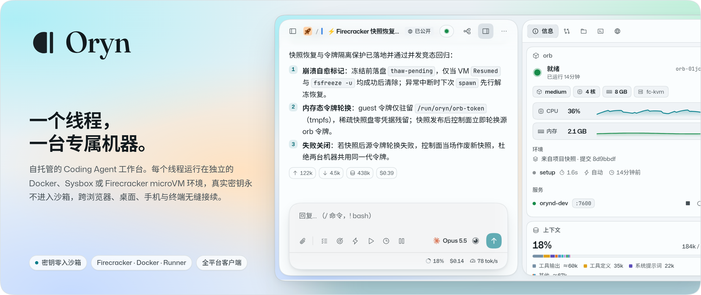
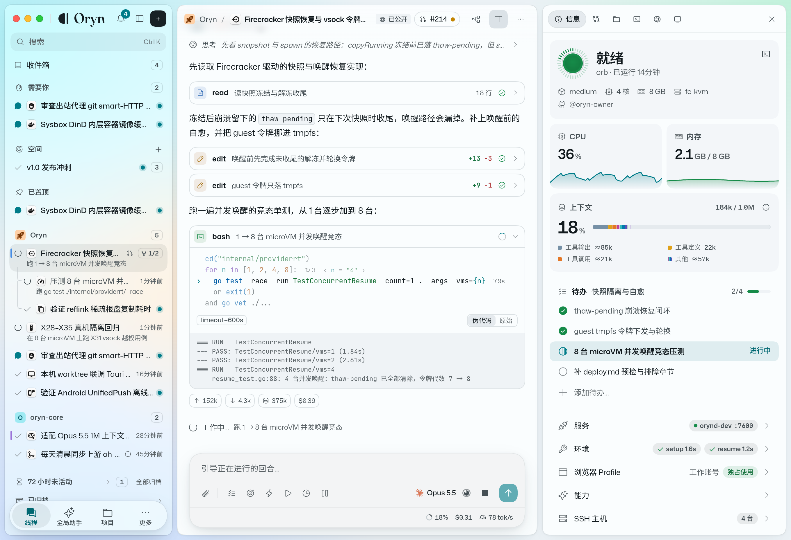
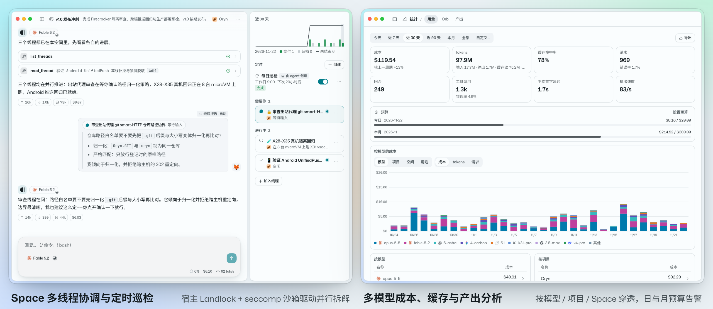

<div align="center">

<picture>
  <source media="(prefers-color-scheme: dark)" srcset="docs/assets/hero-dark.png">
  
</picture>

<br>

**自托管的跨平台 Coding Agent 工作台：每个对话线程独占一台隔离环境，模型与 Git 凭据默认经控制面出站代理注入，在浏览器、桌面、手机与终端里无缝接续同一份工作。**

[快速开始](#快速开始) · [核心能力](#核心能力) · [系统架构与安全边界](#系统架构与安全边界) · [CLI 常用命令](#cli-常用命令) · [生产部署](docs/deploy.md) · [桌面端](docs/desktop.md) · [移动端](docs/mobile.md) · [协议规格](docs/protocol.md)

</div>

## 核心能力

### 1. 一个线程，一台专属机器（Orb & Runner）

<picture>
  <source media="(prefers-color-scheme: dark)" srcset="docs/assets/workbench-dark.png">
  
</picture>

Oryn 以 [Oryn Core](https://github.com/Lynricsy/oryn-core)（fork 自 [`can1357/oh-my-pi`](https://github.com/can1357/oh-my-pi)，MIT）为 Agent 内核，为每个线程分配独立的计算环境，并提供从对话到交付的完整操作面：

- **四种执行后端混排**：同一控制面可同时接入 **Docker 容器**（默认剥离 `NET_RAW` 与 `NET_ADMIN`）、**Sysbox 嵌套容器**（非特权 UID 映射运行内层 `dockerd`，无需 `--privileged`）、**Firecracker microVM**（独立 Linux 内核、`/30` 点对点 tap 网络与 jailer 槽位隔离）以及 **本机 Runner**（个人工作站或笔记本以普通用户运行 `orbd run --runner` 直连指定目录；目录已有活动线程时提示报错，可通过界面选项或 `--worktree <名>` 在仓库旁新建独立 `git worktree`）。
- **项目快照与预热池**：项目首次完成 `.oryn/setup` 后自动生成干净磁盘快照（Docker 镜像提交或 Firecracker `reflink` 稀疏盘复制），后续新线程跳过构建直接运行 `.oryn/resume`；高频项目可配置 1–3 台常驻预热池，新建线程即刻认领。
- **自动冻结与按需唤醒**：Agent 与用户空闲达到阈值后自动冻结（暂停容器或 vCPU），打开线程或访问受管服务时自动唤醒。冻结超时后转为停机，磁盘状态完整保留；停机的 orb 唤醒要冷启动，所以打开线程时不会自动唤醒它，只有发消息或手动唤醒才会。
- **全功能工程面板**：工作台右侧内置 **环境信息**（CPU / 内存采样曲线、10 段彩色上下文构成、可交互待办与子 Agent 状态）、**Git 改动**（实时 Diff、暂存与取消暂存）、**文件树与编辑器**、**Web 终端**（256K 字符快照续传与流控背压恢复）、**受管服务与 Portal**（经泛域名 `https://t-<短码>-p<端口>.<portal_domain>/` 安全暴露开发服务器，支持限时公开预览）以及 **远程桌面**（内置 TigerVNC + Openbox + Chromium，支持跨线程读写锁复用登录态 Profile）。
- **浏览器内文件预览**：文件面板按格式自动选择预览，无需下载。
  - **代码与文本**：语法高亮编辑。
  - **可渲染的文本**：Markdown、CSV / TSV 表格、HTML、Jupyter Notebook、mermaid 与 SVG 可在「预览 / 源码」之间切换，预览跟随未保存的草稿。
  - **文档**：PDF（pdf.js 懒渲染、可缩放、可选中文字）；Word、Excel / ODS / Numbers 与 PowerPoint 在本地解析渲染，不经第三方服务。
  - **图片**：常见位图可缩放，并显示透明底；HEIC/HEIF、TIFF（多页）与 PSD 在本地解码。
  - **其它格式**：音视频按 Range 流式播放；字体显示样张与字形；zip / tar / tar.gz 列出目录；STL / OBJ / PLY / glTF / GLB 3D 模型可交互查看。
  - **安全隔离**：HTML 类内容只进不执行脚本、不发网络请求的沙箱帧。
  - **停机 orb 只读浏览**：orb 停机后，文件面板仍可浏览和预览其中的文件，且不会唤醒 orb。支持 docker 与 firecracker provider：docker 从已停止的容器里读取，firecracker 在用户态解析 VM 磁盘（不挂载）；需要编辑时一键唤醒。
- **收件箱与命令面板**：侧栏顶部的「需要你」分组汇总等待输入或出错的线程（子线程状态上卷到父行），`/inbox` 收件箱按「等你处理 / 已完成未读 / 出错 / 运行中」跨项目列出全部线程；`Ctrl/⌘ K` 命令面板可跳转线程、项目、Space、设置与常用操作，并对全部对话正文做全文搜索（SQLite FTS5 trigram 索引，中文无需分词；fork 拷贝的同一条消息只计一次，命中后直接定位到该条消息）。
- **引用回复**：在 agent 回复里选中一段文字即可「引用回复」，引用以 Markdown 引用块随消息发出（运行中自动走 steer）；有选区时转录暂停自动贴底，流式输出不会把选区冲走。
- **下一条消息预测**：在 设置 › Agent › 输入框 打开后，每轮正常完成都会用当前模型猜你接下来要发的消息，以灰色文字显示在空输入框里（omp `composer.predictions`，Oryn Core 把它接进了 RPC 模式）。按 Tab 或 → 插入，不会发送；触屏上点一下灰色文字也能插入。打开「多个候选」后最多给出 4 条，插入一条后再按 Tab 换下一条。草稿只要还是某条预测的开头，提示就一直跟着显示；新回合开始、清空上下文或跳转会话树时，旧预测会自动撤回。默认关闭：每完成一轮都会多发一次计费请求，请求带着整段对话。
- **桌面人机控制**：远程桌面有统一的控制状态（空闲 / Agent 操作中 / 用户已接管 / 等你操作），由 orbd 权威维护、所有设备一致；Agent 回合中面板默认只读观看，用户一键接管后 Agent 的浏览器 CDP 命令被挂起并经 steer 告知，交还或超时自动恢复。遇到登录、验证码、二次验证时，Agent 调用 `desktop_ask_user` 阻塞等待，桌面面板横幅、线程卡片、推送与 Telegram 都能点「完成 / 跳过」作答。
- **图形化 Agent 配置，保存即生效**：设置页「Agent」分组把技能、子 Agent、模型角色、提示词与上下文、命令 / 规则 / 提示片段、扩展 / hook / 工具做成表单（编辑 `config.yml` 保留原有注释，启停沿用 Oryn Core 的 `disabledExtensions` 与 `task.disabledAgents`），原始文件浏览器保留为「高级」入口；保存后数秒内下发到所有运行中的 orb，技能、命令、规则、上下文文件与 MCP 在会话空闲时热重载，hook、扩展模块、自定义工具等需重启的改动在页面顶部列出受影响会话，一键安排空闲时懒重启。
- **项目级中央 Agent 配置**：每个项目在控制面另有一层 Agent 配置，内容可以是规则、技能、子 Agent、命令、提示片段、扩展、hook、工具、`mcp.json`、`config.yml` 与 `AGENTS.md`。这一层在项目页的「Agent 配置」卡片里编辑，或用 `oryn config push|pull --project <项目>` 同步。每次 setup / resume 时，这一层原样镜像到 orb 的 `~/.oryn/project-config/.omp/`，不写进仓库工作区，`git status` 保持干净。同名条目的优先级是「项目层 > 仓库 `.omp/` > 全局」，`AGENTS.md` 与仓库里的并存。`/omfg` 生成规则后可以选「本项目」或「全局」，规则会写回中央，由新建或唤醒的 orb 拿到。约束如下：
  - 全局与项目两层合计的下发编码不能超过 88 MiB，超过时写入返回 413。
  - `models.yml` 只能放在全局层。
  - 规则、`.md`、`.yml`、`.json` 都必须是 UTF-8 文本。
  - 为防止不可信仓库借符号链接把本机文件（如 `~/.ssh`）传上去，`config push --project` 拒绝以下情况：推送目录本身是符号链接，或其中有指向目录外、无法解析、指向被排除路径的链接。全局推送仍照常跟随 `~/.omp/agent` 里指向别处的链接。两种推送都只收普通文件，`--exclude` 与 `.orynignore` 会同时按链接名和真实路径匹配。
  - 同一线程同时只能有一个 `/omfg`。
  - `/omfg` 写回中央的规则必须与确认时的预览一致；中央已有同名但内容不同的规则时不覆盖，需要到 Agent 配置里手工合并。
- **中央模型目录**：控制面用钉定版本的 Oryn Core 一次性运行 `omp models` 生成模型列表（`models.yml` 自定义 provider 与有密钥的内置 provider，附各自的思考档位），设置页、首屏与线程内三处共用，无需打开线程或唤醒 orb；配置变化后自动重算，24 小时过期，也可手动刷新。
- **头像体系**：默认 Agent 身份、全局助手、每个 role（含内置 role 与不在轮换里的 role）和每个子 Agent 都能设头像，内置 role / Agent 自带默认 Nerd 字形；子 Agent 总览、详情与 task 卡片用头像加光环动效区分运行、排队、完成、失败与仅存转录，公开分享页只带出分享范围内实际用到的 Agent 头像。
- **GitHub 深度集成**（部署见 [docs/deploy.md](docs/deploy.md) 第 13 节）：
  - **OAuth App 授权**：在设置页填入自己注册的 GitHub OAuth App，连接「我的账号」与「Agent 账号」。触发规则、项目级定时与发布哨兵建的全自动线程默认用 Agent 账号。
  - **orb 内免登录**：账号连接后，任何工作 orb 里的 git 与 `gh` 都可以直接使用（runner 与协调宿主除外）。真实令牌由出站代理注入，不进 orb。
  - **PR 与回流**：项目按仓库地址自动绑定。线程推送的提交成为 PR 的头提交后，线程页头显示 PR 状态与 CI 结果，合并即标记已交付。评审、评论与 CI 失败会回流进线程，agent 自己的写操作不会回流。
  - **事件来源**：有 admin 权限的仓库走仓库 webhook，并轮询投递日志补漏；其余仓库走 REST 轮询。
  - **robomp 预设**：「分诊」「PR 评审」「发布哨兵」三个触发规则预设。分诊会登记 issue 状态，并支持实现授权、任务时限、完成提醒与问题自动关闭；PR 评审只发 COMMENT。
  - **门禁**：项目级的推送 / 开 PR 门禁由出站代理强制执行，推送或开 PR 前须先用 `github_prepare` 跑过检查。
  - **发布哨兵**：发布提交的 CI 被阻塞时开线程修复，至多 5 轮，直到版本变为 green 或 failed。
  - **审计**：agent 的每个 GitHub 写操作都记审计，保留 30 天。输入框键入 `#` 可以把 issue / PR 连同评论作为附件引用。
- **内置 Hindsight 记忆，同项目共享、跨项目隔离**：orb 与 Runner 里的 agent 共用一个自托管的 [Hindsight](https://github.com/vectorize-io/hindsight) 记忆库，回合结束自动写入，下一轮自动召回。控制面网关替 agent 填写项目标签：同一项目的各个线程共享记忆，不同项目互不可见。写进全局层的内容（个人偏好、跨项目经验）先进候选队列，主人批准后才对所有项目生效。Hindsight 自己调用的模型、嵌入与重排全部经控制面中转，可在同一协议内随时换模型。「更多 → Agent → 记忆」可以浏览、搜索、按线程遗忘、审核候选、刷新 mental model、查看用量和导出；删除项目时，它的记忆一并删除。部署见 [docs/deploy.md](docs/deploy.md) 第 14 节。

### 2. Space 多线程协调、定时巡检与全量统计

<picture>
  <source media="(prefers-color-scheme: dark)" srcset="docs/assets/coord-stats-dark.png">
  
</picture>

- **Space 与全局助手**：控制面内置 `@host` 协调宿主，按需在独立系统账号、Landlock LSM、seccomp-bpf 与 Linux 命名空间围成的严格沙箱中拉起协调进程，沙箱里唯一能连的是回环上通往 orynd 的出站代理端口。
  - **Space 协调者**只开放内置 `read` / `write`，拆解阶段目标、并发创建与检视工作线程，并在需要人工决策时汇总提醒；它不能联网、没有 MCP，也不能读写或操控 Runner 线程。
  - **全局助手**按三层执行，能自己做的就不派线程。第一层是自己动手：omp 自带的 `web_search`、用 `read` 读网页、`generate_image` 生图，全局 `mcp.json` 里的 HTTP / SSE MCP 服务器，以及 artifact（含截图、导出进文件库、导入、从回收站恢复）。第二层是遥控「助手的电脑」（见下）。第三层是派出与管理 agent，操作面接近主人：在项目、Space 或 Runner 目录里开线程（可指定 provider、类型、已有 orb、role），给工作线程或 Space 的协调对话发话并收回报，改标题与模型、中止、fork、唤醒，读写线程 orb 里的文件并查看 git 改动，新建和修改项目、Space、项目 Agent 配置、定时与 GitHub 触发规则，暂停和唤醒 orb，管理分享。
  - **联网的边界**：沙箱本身仍连不到外网。助手的请求只经 orynd 的正向代理出去，代理在连接时按实际 IP 判定，只连公网地址；MCP 的鉴权头由 orynd 注入，不进沙箱。「设置 → 全局助手」有联网总开关，MCP 服务器可以逐个关掉。
  - **确认卡**：删除（线程、项目、Space、定时、触发规则、orb）和让未登录的人能访问的分享（线程分享链接、Portal 公开预览、以访问码或公开方式发布 artifact）不会直接执行。对话里先出现确认卡，同时推送带「是 / 否」的通知；主人点了「是」才由 orynd 执行，结果以自动消息回到对话，24 小时没人答就过期。新建、修改、归档、发消息不需要确认。密钥、provider、设备与登录相关设置不对助手开放。
- **首屏直达全局助手**：首屏输入框的 role 胶囊可选全局助手、轮换里的 role，或直接指定模型与思考强度；选全局助手时执行位置与项目胶囊收起、输入框换上流光描边，发送即新建助手对话并带上首条消息、附件与所选模型。「新对话默认对象」存在服务端，各设备一致。
- **全局助手的主人记忆**：全局助手有一份只关于主人的记忆（bank `oryn-owner`，与工程记忆同一个 Hindsight）。助手对话与工作线程空闲 30 分钟、归档或交付后，主人的话连同助手的最后一条回复按回合写入；写入前用与分享相同的密钥扫描规则和密钥库值脱敏，工具调用、thinking 与长代码块不写。每天整理出主人的长期主题（固定的「主人画像」加至多 12 个动态主题），在助手启动时附在系统提示词末尾；助手还能用 `recall_memory`（判断模型重排、带出处与可信度分档）、`search_history`（原文全文搜索）、`recall_engineering`（只读工程记忆）和 `remember`（主人原话直接生效，否则待确认）。「更多 → Agent → 记忆 → 助手记忆」可查看注入预览、主题、事实与出处，让事实失效、按来源遗忘、排除对话或项目，审核明确记忆。
- **助手文件库**：以下文件统一进入文件库：助手对话里的附件；助手写到 `~/library/out/` 的文件和生图结果（`~/tmp/`），用 `save_file` 存入；从工作线程的 orb（`fetch_thread_file`）或助手的电脑（`computer_download`）取回的文件；`export_artifact` 的导出物；orb 内 Agent 用 `oryn library put` 存入的文件。文件库同步进协调宿主沙箱，供 omp 自带的 `read` 读取（PDF、Office、图片、压缩包、SQLite 等）。助手开新线程时可以附带库文件，也能用 `put_thread_file` / `computer_upload` 把库文件放进线程的 orb 或自己的电脑。全局助手页的文件库面板可以预览、下载、删除、切换共享并查看来源。
- **主线**：助手分区最上面置顶一条永久对话，显示助手的名字和头像。它不能归档或删除，不进对话列表；打开助手分区时仍落在最近的普通对话。主线里的消息有三个来源：勾了「交给助手」的定时（`new_thread`）与 GitHub 触发规则的运行结果、主人在主线里让助手派出的线程的回报、助手在主线里给自己设的提醒。
  - **交给助手**：每次运行的结果在 15 秒内合并成一条自动消息进主线，该运行不再单独推送完成通知（出错、等输入照常通知）。助手结合记忆判断值不值得说；不值得就调用 `stay_silent`，这一轮不置未读、不推送。
  - **提醒**：主线可以有多条线程内定时（按名字管理，至多 50 条）。
  - **分段运行**：为了让每次输入的上下文保持很短，主线一段一段地跑。每段开头清空上下文，只带一份备忘和最近 12 条消息（主人的话与助手说出口的话，沉默的回合不算）。备忘由助手用 `update_main_notes` 整体改写，1500 字以内，主人可以在页头查看和编辑。主线静止 10 分钟或满 8 个回合后，下一条消息开始新的一段。
  - **页面**：只加载最近 600 条，可以向前翻页。自动来料和沉默的回合折叠显示；每条助手消息下有「在新对话中继续」，会把那段话作为引用带进一个新对话。
- **助手的电脑**：全库只有一台属于助手的普通 orb，主线与所有助手对话共用。第一次用到时创建，空闲时照常冻结，调用前自动唤醒。助手进程仍留在协调宿主沙箱里，经 `computer_bash`、`computer_read` / `computer_write` / `computer_edit`、`computer_grep` / `computer_glob` / `computer_find`、`computer_ast_grep` / `computer_ast_edit`、`computer_eval`、`computer_lsp`、`computer_wait` 遥控 orb 里一个不调模型的 omp 工具执行器（Oryn Core 的 `oryn_tool_*` RPC）。输出流式回传，图片原样到达，取消会传到 orb 里；`computer_upload` / `computer_download` 在电脑与文件库之间搬文件。这些工具的卡片与对应的普通工具相同。`/assistant/computer` 页面可以查看状态，唤醒、暂停或重置（删除后下次用到时重建），浏览文件，查看远程桌面并接管。provider 与类型在「设置 → 全局助手」里选。
- **双模式定时任务**：支持在单个已有线程内按 Cron 或固定间隔触发巡检提示词（`oryn schedule set`），也支持项目级定时每次拉起全新隔离线程并按 `keepLast` 自动归档历史运行（`oryn schedule add`）。
- **事实级成本与产出统计**：控制面直接从会话条目入库模型调用、工具执行与生命周期事件（自动剔除分支 fork 造成的历史重复计费），按模型、项目、Space 或用途穿透统计成本、缓存命中率、TTFT 与交付提交数，支持 CSV 导出与日 / 月度预算阈值系统通知。

### 3. 全平台同源体验

<picture>
  <source media="(prefers-color-scheme: dark)" srcset="docs/assets/mobile-views-dark.png">
  
</picture>

- **零版本漂移的原生壳**：Windows / macOS / Linux 桌面端与 Android 客户端共用一套 Tauri 2 工程（`web/src-tauri`）。客户端本身只携带极简配对连接页，配对后加载所连服务器自身的 Web UI，服务端升级即全端同步；设备令牌仅驻留 Rust 进程与系统凭据库（macOS 钥匙串、Windows 凭据管理器、Linux Secret Service、Android Keystore），网页脚本无法读取。
- **精细的平台交互适配**：桌面端采用无系统标题栏同源设计（macOS 融合原生红绿灯，Windows / Linux 自绘窗口按钮并遵循 GTK 标题栏布局），支持系统托盘、全局唤醒快捷键与 `oryn://` 深链接；移动端针对 `<600dp` 窄屏提供屏幕圆角同心的下沉式侧栏、右上角快捷视图菜单、系统分享接收以及 RFC 8291 端到端加密的 **UnifiedPush（零 Google 依赖）** 与加密 **FCM** 双通道后台推送。工具审批、确认这类可一触作答的提问直接在通知上带「允许 / 拒绝」等按钮（Android 需解锁后点按，浏览器 Web Push 同样支持），后台作答不拉起界面；请求在别处作答后旧按钮自动撤回。
- **终端流式挂接与本地实时镜像**：偏爱本地 IDE 与编辑器的开发者可使用 `oryn thread attach` 在终端内流式交互，或运行 `oryn sync <线程>` 将远端 orb 内的提交与未提交改动实时镜像至本机干净检出（`Ctrl-C` 自动还原，`--apply` 一次性落盘）。

### 4. Artifacts：可版本化的交付物

- **Agent 产出成品**：orb 线程、Runner 线程与全局助手的 Agent 都能用 `create_artifact` / `update_artifact` 等工具做出页面、画布、文档（Markdown）与幻灯片。每次写入生成一个新版本，冲突按文件粒度检查；可以恢复旧版本，删除的进「最近删除」保留 30 天。
- **隔离渲染**：每个 artifact 在不透明源的沙箱帧里显示（配置了 `portal_domain` 时用 `a-<令牌>` 泛域名，否则用主域的 `/_af/` 路径），只能加载自身文件与白名单 CDN。控制面主机上带沙箱的 headless Chromium 负责渲染缩略图、PNG 与 PDF。
- **入口**：「更多」分区的 `/artifacts` 总览页（类型、筛选、搜索、导入、回收站）；线程右面板的 Artifacts 标签；转录里的 artifact 卡片；命令面板。整页查看器 `/artifacts/<id>` 提供版本历史、评论（可发给线程）、元素直接编辑、画布编辑器、演示、导出（HTML / zip、Word、Markdown、PowerPoint、PDF）和分享。
- **页面能力与发布**：页面可通过 `oryn.use("db" | "files" | "sample")` 存数据、只读项目文件、向用户的模型提问，后两项首次使用需要用户同意，可在 设置 › Artifacts 收回。可以发布成私有、访问码或公开的链接；发布访问码与公开链接前会做密钥扫描。

## 系统架构与安全边界

| 组件 | 路径 | 职责说明 |
|---|---|---|
| `orynd` | `cmd/orynd` · `internal/` | 控制面单二进制：REST + WebSocket、SQLite 存储（`sqlc` + `goose`）、WebAuthn Passkey 与设备配对鉴权、orb 调度、宿主协调沙箱、出站密钥注入代理、内嵌 Web 前端 |
| `orbd` | `cmd/orbd` · `internal/orbdrt/` | 环境内守护进程：经出站长连接（WebSocket + `yamux` 多路复用）回连控制面，监督 Oryn Core（`omp --mode rpc-ui`）、增量同步会话 JSONL、托管本地服务 / VNC 桌面与 `127.0.0.1:7811` 出站代理；亦支持 `--runner` 模式接入个人机器 |
| `oryn` | `cmd/oryn` · `internal/providerrt/` | 命令行客户端与宿主机 Provider 执行器（`oryn provider run`，支持 `docker`、`firecracker` 与脚本 `dispatch` 三类驱动） |
| `web/` | `web/src` · `web/src-tauri` | React 19 + TypeScript + Tailwind CSS 4 Web/PWA 客户端，以及桌面与 Android 的 Tauri 2 宿主壳 |
| `images/` | `images/orb` · `images/fc` | Agent 优先的 Arch Linux 开发镜像（x64 / ARM64）与锁定 SHA-256 的 Firecracker 内核及根盘构建脚本 |

```mermaid
flowchart LR
  C[Web / Desktop / Android / CLI] -- REST + WebSocket --> D[orynd 控制面]
  P[oryn provider run] -- 长轮询拉取任务 --> D
  P -- Docker / Sysbox / Firecracker --> O
  subgraph O[隔离 Orb 环境]
    B[orbd] -- RPC + JSONL --> A[Oryn Core<br/>omp --mode rpc-ui]
  end
  R[个人机器 orbd --runner] -- 仅同步转录与状态 .-> D
  B -- WS + yamux 出站长连接 --> D
  D -- 按主机路由注入真实密钥 --> U[模型 API / Git 远端]
```

系统围绕三条核心安全不变量构建（完整威胁模型与加固清单见 [`docs/deploy.md`](docs/deploy.md)）：

1. **出站代理凭据隔离**：默认 `proxy` 模式下，导入的 `models.yml` 明文 API Key 与 `git/*` 令牌存入控制面主密钥加密库，下发至 orb 的配置仅含 `oryn-ph-…` 占位符；请求经 `orbd` 本地端口 `127.0.0.1:7811` 回到 `orynd` 按绑定上游主机注入真实值，并将响应中的凭据回显脱敏回占位符（仅显式设为 `env` 模式的自定义密钥或未绑定上游 `hosts` 的模型 Key 降级路径会以环境变量下发）。
2. **Git 最小权限放行**：绑定了 `https://` 仓库地址的项目 orb 仅允许对该单一仓库执行读写（`git-upload-pack` / `git-receive-pack`），同主机其它仓库一律 `403`；未绑定项目的 orb 对已配置令牌的 Git 主机仅放行只读克隆，拒绝一切推送。
3. **动态令牌轮换与单向信任隔离**：Orb 连接令牌 `oot_…` 由 `HMAC(key, orbID : 代数)` 派生，每次创建、唤醒及拍摄快照后立即轮换，快照磁盘内不留有效令牌（Firecracker guest 令牌仅驻留内存 `tmpfs`）；本机 Runner 采用严格单向边界：控制面永不向 Runner 下发模型配置或环境变量密钥，只开一条仅通往记忆网关 `/memory/` 的专用通道（其它出站路径一律 403，Hindsight 的 key 不进 Runner）。能操控 Runner 线程的只有主人与全局助手：全局助手可以像主人一样在 Runner 上新建线程、发消息、读取、归档、读写线程目录里的文件，删除要主人点确认卡；Space 协调者与 orb 内 Agent 仍禁止读写或操控任何 Runner 线程，普通 orb 里产出的内容不能经它们变成你机器上的指令。全局助手所在的协调沙箱同样只有一个出口：沙箱里只能连回环上的出站代理端口，联网与 MCP 都经 `orynd` 的正向代理（只连公网地址，MCP 鉴权头由 `orynd` 注入）；网页、搜索结果与 MCP 的返回都作为不可信数据交给助手。

## 快速开始

### 前置依赖

- **Go** `1.27+`、**Bun** `1.4+`、**Docker**（运行本机容器 orb 与构建镜像）
- **`sqlc`**（代码生成时使用：`go install github.com/sqlc-dev/sqlc/cmd/sqlc@v1.31.1`）

### 本地构建与启动

在仓库根目录按顺序执行以下命令，即可在本地拉起一套完整的 Oryn 服务与 Docker Provider：

```bash
# 1. 构建前端并编译静态链接的四个二进制（bin/orynd、bin/orbd、bin/oryn、bin/fakeomp）
make web
make build

# 2. 拉取钉定版本（core/source.json）的 Oryn Core 二进制并构建本机 orb 开发镜像 oryn-orb:dev
scripts/fetch-core.sh
make image
```

`make image` 构建完成后会自动以非 root 用户在断网容器内执行冒烟脚本，终端输出 `orb 镜像离线冒烟：通过`。

生成与本机 `docker0` 网桥地址匹配的最小本地配置并启动控制面（仓库内的 `dev/orynd.yaml` 额外监听了 Firecracker 网段 `172.31.255.1`，未初始化该网卡时请使用下方纯 Docker 配置）：

```bash
# 3. 生成纯 Docker 本地开发配置并启动控制面（首次启动会在日志中打印一次性的 Passkey 初始化链接）
mkdir -p .dev
DOCKER_IP=$(ip -4 -o addr show docker0 | awk '{print $4}' | cut -d/ -f1)
cat > .dev/quickstart-orynd.yaml <<EOF
listen: ["127.0.0.1:7600"]
public_url: "http://localhost:7600"
portal_domain: "localhost"
data_dir: "./.dev/quickstart-data"
orb_tls: { listen: ["${DOCKER_IP}:7643"] }
EOF
./bin/orynd --config .dev/quickstart-orynd.yaml
```

复制终端输出的 `http://localhost:7600/setup#token=ost_…` 在浏览器中打开，注册管理员 Passkey 并保存恢复码。随后在第二个终端配对命令行并启动本机 Provider：

```bash
# 4. 登录 CLI、上传本地 omp 模型配置（明文 API Key 自动转入控制面加密密钥库）
./bin/oryn login --url http://localhost:7600
./bin/oryn config push ~/.omp/agent

# 5. 创建名为 local 的 Provider 令牌并启动 Docker 执行器
DOCKER_IP=$(ip -4 -o addr show docker0 | awk '{print $4}' | cut -d/ -f1)
./bin/oryn provider create local > .dev/quickstart-provider.token
chmod 0600 .dev/quickstart-provider.token
cat > .dev/quickstart-provider.yaml <<EOF
url: "http://127.0.0.1:7600"
token_file: ".dev/quickstart-provider.token"
orb_url: "https://${DOCKER_IP}:7643"
driver: docker
docker:
  image: "oryn-orb:dev"
EOF
./bin/oryn provider run --config .dev/quickstart-provider.yaml
```

打开 `http://localhost:7600` 即可新建线程并在独立的 Docker orb 中开始工作。生产环境部署（1Panel / OpenResty 反代、通配符 Portal 证书、网络防火墙隔离、Sysbox 与 Firecracker microVM 配置）请参阅 **[`docs/deploy.md`](docs/deploy.md)**。

## CLI 常用命令

```bash
# ── 认证、配置与密钥 ──
oryn login --url https://oryn.example.com                    # 设备配对登录（浏览器输入配对码批准）
oryn config push ~/.omp/agent                                # 上传 omp 配置，明文 Key 自动抽入加密密钥库
oryn config pull                                             # 拉回文本配置（models.yml 默认存为 models.oryn.yml）
oryn config push --project myproj                            # 在仓库根目录把 ./.omp 上传为该项目的 Agent 配置（整体替换）
oryn config pull --project myproj                            # 把项目的 Agent 配置拉回 ./.omp
oryn secrets set git/github.com/token                        # 写入 Git 令牌（只写不读，由出站代理按需注入）
oryn git-identity set --name "Ada" --email ada@example.com   # 设置 orb 内 Git 提交身份的全局默认值

# ── 执行后端（Provider 与个人机器 Runner）──
oryn provider create prod-fc > provider.token                # 创建 Provider（令牌仅在标准输出显示一次）
sudo oryn provider preflight --config /etc/oryn/fc.yaml      # 启动前逐项核查 KVM / nftables / UID 区间
oryn provider run --config /etc/oryn/provider.yaml           # 运行宿主机 Provider 守护循环
oryn runner create macbook                                   # 注册个人开发机 Runner，获取 ort_… 令牌
# 在个人开发机上以普通用户接入目录：
# ORYN_URL=https://oryn.example.com orbd run --runner --dir /home/ada/code/app --terminal

# ── 线程、流式挂接与本地镜像同步 ──
oryn thread new --project myproj "排查登录重定向循环并补单测"  # 在指定项目的新 orb 中启动线程
oryn thread new --runner macbook --dir /home/ada/code/app --worktree fix-auth "修复鉴权中间件"
oryn thread attach <线程>                                     # 流式查看转录，支持实时输入引导（steer）、作答与计划审批
oryn thread rpc <线程> '{"type":"get_state"}'                # 向 agent 下发任意 omp RPC 命令并打印应答
oryn thread abort <线程>                                      # 中止当前回合
oryn thread fork <线程> [--entry <条目>] [--env share|copy]   # 分叉线程，打印新线程 id
oryn sync <线程>                                              # 将 orb 内的改动实时镜像至当前干净检出（--apply 落盘）

# ── Space 协调、定时任务与统计分析 ──
oryn space create "v1.2 发布周" --project myproj --goal "完成迁移回归与变更日志"
oryn schedule set <线程> --cron "0 9 * * 1-5" --tz Asia/Shanghai --prompt "汇总昨日 CI 失败"
oryn schedule add --project myproj --every 6h --prompt "检查依赖安全更新并提 PR"
oryn stats --since 30d --by model                            # 按模型汇总近 30 天 Token、缓存与成本（支持 --csv / --json）
oryn stats budget set --daily 20 --monthly 300 --warn 80     # 配置日/月成本预算与预警百分比
```

在隔离 **orb 环境内部**，Agent 与开发者同样可以直接调用 `oryn` 编排环境与子线程：

```bash
oryn orb setup run [--resume]                         # 手动重跑 setup 或 resume 生命周期脚本并上报控制面
oryn orb setup status | logs [--resume]               # 查看最近一次环境配置状态与完整输出
oryn orb service ls | start <名> | logs <名>           # 查看或启停 .oryn/services.yaml 定义的受管服务
oryn orb desktop status | browser start               # 查看虚拟桌面状态或拉起受管 Chromium
oryn thread new "跑一遍全量集成测试" && oryn thread wait <id>   # 派生子线程并等待其静止（退出码 0/3/4/124）
```

## Orb 环境自配置与开发镜像

项目的开发环境通过生命周期脚本声明：仓库内的 `.oryn/setup`（兼容 `.agents/setup`）在新 orb 首次创建时执行一次；`.oryn/resume` 在每次冻结唤醒时执行（最长等待 10 秒）；不便入库的脚本也可保存在控制面的项目设置中。脚本退出非零不会阻塞 orb 就绪：工作台顶部会展示诊断条，支持一键查看日志或直接交由当前线程的 Agent（内置 `oryn-setup` 技能）自动修复。

### 基础镜像预装能力

`images/orb/` 基于滚动更新的 Arch Linux 构建（x64 采用官方 [`archlinux:latest`](https://hub.docker.com/_/archlinux)，ARM64 采用每日构建的 [`menci/archlinuxarm:latest`](https://github.com/Menci/docker-archlinuxarm)），默认非 root 用户、UTF-8、`UTC` 时区，用户级全局路径（`~/.local/bin`、`~/.cargo/bin`、`~/go/bin`、npm 全局目录）开箱即用：

| 类别 | 预装工具链 |
|---|---|
| 语言与构建 | C/C++ (GCC/Clang)、Make、CMake、Ninja、Autotools、Go、Rust (`rustfmt`/`clippy`/`rust-src`)、Python (`pip`/`uv`/`pipx`/`ruff`)、Node.js (`npm`/`pnpm`/Bun)、Ruby/Bundler、PHP/Composer、Lua |
| 语言服务器 | 按 Oryn Core 内置 LSP 配置预装：`clangd`、`rust-analyzer`、`gopls`、`typescript-language-server`、`pyright`、`ruff`、`ruby-lsp`、`phpactor`、`lua-language-server`、`bash-language-server`、YAML / JSON / HTML / CSS / Dockerfile 语言服务器、`marksman` |
| 代码与协作 | Git、Git LFS、`gh`、OpenSSH、`rsync`、`ripgrep`、`fd`、`jq`、`yq` v4、`patch`/`diff`、ShellCheck、`shfmt`、常见归档解压工具（含 `unrar`/`cabextract`） |
| 排障与数据 | `ip`/`ss`/`dig`/`nc`/`socat`/`whois`/`nmap`/`iperf3`、`lsof`/`strace`/`ltrace`/`gdb`、`htop`/`ncdu`、SQLite / PostgreSQL / MariaDB / Valkey(Redis) 客户端、DuckDB、Miller、HTTPie、`aria2`、`yt-dlp` |
| 文档与媒体 | Pandoc、LibreOffice（`soffice --headless`）、Poppler/`qpdf`/Ghostscript/MuPDF/`img2pdf`、Tesseract OCR（英文、简繁中文）、ImageMagick、librsvg、WebP/AVIF/JPEG XL/HEIF 编解码、`optipng`/`pngquant`/`jpegoptim`/`gifsicle`、ExifTool、Graphviz、`qrencode`/`zbar`、FFmpeg、SoX、MediaInfo |
| Python 库 | 系统 Python 可直接 `import`：numpy、pandas、scipy、matplotlib、Pillow、requests、BeautifulSoup、lxml、PyYAML、openpyxl、XlsxWriter、python-docx、pypdf、ReportLab |
| 图形桌面 | TigerVNC (`Xvnc`)、Openbox、受管策略加固的 Chromium、中英文与彩色 Emoji 字体 |

系统软件包记录于 `/usr/local/share/oryn/packages.txt`，从上游 GitHub 发行版安装（ARM 仓库缺包，双架构统一来源）的 ShellCheck、Pandoc、rust-analyzer、marksman、phpactor 版本记录于 `/usr/local/share/oryn/upstream-versions.txt`；在项目 `setup` 脚本中增装系统包时请使用 `sudo pacman -Syu --needed --noconfirm <包名>`。

<details>
<summary><strong>跨架构构建 ARM64 镜像与 QEMU / binfmt 离线冒烟说明</strong></summary>

在 x64 宿主上执行 `scripts/build-orb-image.sh arm64` 构建 ARM64 镜像时，跨架构离线冒烟需要宿主的 QEMU `binfmt_misc` 注册开启 `C`（凭据）标志，否则容器内 `sudo` 会报告 effective uid 不为 0。

在装有 `qemu-user-static` 的 Arch Linux 宿主上，可将 `/usr/lib/binfmt.d/qemu-aarch64-static.conf` 复制到 `/etc/binfmt.d/qemu-aarch64-static.conf`，仅将规则末尾的 `FP` 改为 `FPC`，随后重载 ARM64 注册并运行验收（无需重启 Docker）：

```bash
sudo sh -c 'printf "%s\n" -1 > /proc/sys/fs/binfmt_misc/qemu-aarch64'
sudo /usr/lib/systemd/systemd-binfmt /etc/binfmt.d/qemu-aarch64-static.conf
docker run --rm --platform linux/arm64 --network none --entrypoint bash oryn-orb:arch-arm64 /usr/local/lib/oryn/smoke-test.sh
```

验收通过将输出 `orb 镜像离线冒烟：通过`。

</details>

## 文档与工程索引

| 文档 | 内容 |
|---|---|
| **[`docs/deploy.md`](docs/deploy.md)** | 生产部署全指南：OpenResty 反代、Portal 通配证书、容器网络隔离、宿主协调沙箱、统计保留期、项目快照/预热池、Sysbox DinD、本机 Runner、Firecracker microVM 与 Hindsight 记忆服务 |
| **[`docs/desktop.md`](docs/desktop.md)** | Windows / macOS / Linux 桌面客户端安装、Passkey 配对、无边框窗口控件、系统托盘、全局快捷键、签名自动更新，以及各端 [App 图标](docs/desktop.md#app-图标)（黑白，macOS 26 随浅色 / 深色 / 着色切换）的生成与打包 |
| **[`docs/mobile.md`](docs/mobile.md)** | Android 客户端（`foss` 与 `gms` 双包）安装校验、扫码配对、UnifiedPush / FCM 端到端加密推送与省电策略；iOS 经 TestFlight 分发（[附录 A](docs/mobile.md#附录-aios)），App 图标随系统浅色 / 深色 / 着色切换，可在「设置 → 外观 → App 图标」换成品牌色版本 |
| **[`docs/protocol.md`](docs/protocol.md)** | 以 [`schema/openapi.yaml`](schema/openapi.yaml) 为唯一源的 C1 Provider、C2 Orb Link、C3 REST/WebSocket 协议索引与状态机说明 |
| **[`docs/design/ui-redesign.md`](docs/design/ui-redesign.md)** | Web 界面设计说明：D 稿「晴·手作」视觉方向、四层材质、色彩令牌与超椭圆几何规范 |
| **[`docs/design/web-guidelines.md`](docs/design/web-guidelines.md)** | 前端开发守则：不可回退的视觉约束、响应式断点、无障碍对比度与截图回归验证流程 |

### 构建与校验目标

```bash
make gen            # 由 schema/openapi.yaml 与 SQL 生成 Go / TypeScript 代码
make check-gen      # 校验生成物与源码完全同步（CI 门禁）
make lint-spec      # 使用 Redocly 校验 OpenAPI 规格
make test           # 运行 Go 全量单元与集成测试（前端测试于 web/ 目录执行 bun run test）
make desktop        # 构建当前平台 Tauri 2 桌面安装包
make android        # 构建 Android APK（DIST=foss 或 DIST=gms）
make fc-artifacts   # 构建锁定摘要的 Firecracker 二进制、vmlinux 内核与 ext4 根盘
```

### Artifacts 端到端验收

```bash
# 需要 root、git、curl、sqlite3、/usr/bin/chromium；先 make web && make build（或用 M14A_BIN 指向含四个二进制的目录）
cd web && bun run accept:m14-artifacts                    # mock 与真机两部分，逐条打印 K1–K43 的 PASS / FAIL / SKIP
bun run accept:m14-artifacts -- --part real --only K24,K25 # 只跑指定部分与条目
```

真机部分自建一套隔离的 orynd、vite 与 fakeomp。K37（`sample` 能力）要真实模型回答，fakeomp 下打印 SKIP；控制面渲染器不可用时，K22、K23、K26 的 PDF 与 K31 的附图同样 SKIP。截图与结果默认写到 `.dev/m14-artifacts/`。

## 内核与第三方组件

- **Agent 内核**：[`Lynricsy/oryn-core`](https://github.com/Lynricsy/oryn-core)（fork 自 [`can1357/oh-my-pi`](https://github.com/can1357/oh-my-pi)，MIT 许可；钉定版本与 SHA-256 见 [`core/source.json`](core/source.json)）。
- **远程桌面客户端**：[`@novnc/novnc`](https://github.com/novnc/noVNC) `1.7.0`（MPL-2.0 许可，未修改源码，按需独立分块加载）。
