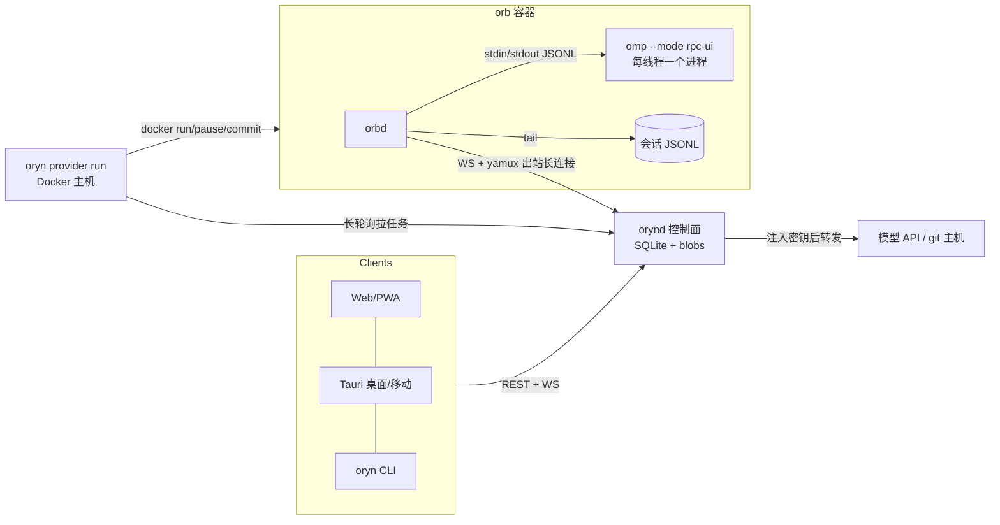
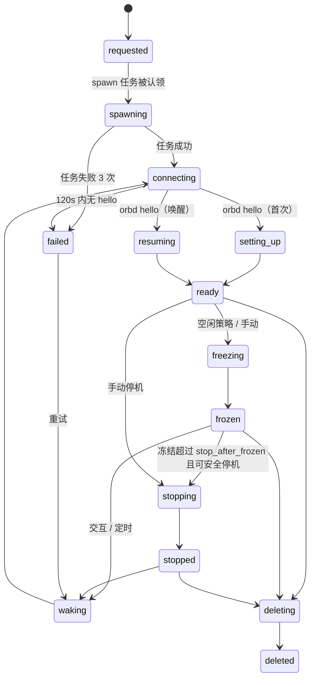

# Oryn — 实施计划

## Context

为 omp（oh-my-pi）做一套「高级环境系统 + 跨平台客户端」：orb（每线程一台隔离机器）、自有 orb provider、Space、Portal、实时多端同步、文件管理、浏览器 Profile、公开分享、统计分析，客户端覆盖 Web / 桌面 / 移动 / CLI。Amp（ampcode.com，最新版）是 **agent 外围**的参照；**agent 对话与会话能力一律按 omp 做全**。本计划一次定稿全局架构、协议、数据模型和全部里程碑的验收标准；逐步骤的实现细节写到 M1（协议骨架）与 M2（线程核心），M3 起各里程碑开工前各自再开一次计划。

工作目录 `/root/Projects/Ling/Oryn`：空仓库，分支 `master` 无提交，`origin = https://github.com/Lynricsy/Oryn.git`，仅有 `.gitignore`（内容 `.agent-logs/`）。

## 范围约束（用户确认，不可自行改动）

- omp 的配置**不做 GUI**，保持文本；客户端只提供文本文件编辑与 `oryn config push/pull`。
- **不做计费**；orb 等要有统计与分析。
- **只做单用户**（一个所有者、多台设备）。不做 workspace / groups / multiplayer / 对他人协作 / service account / 共享 runner / Huddle。Space 按「仅自己」形态做。
- **公开分享要做**：线程只读链接（实时与快照）、Portal 限时公开、文件与 artifact 公开 URL。不做可被搜索发现的公开目录。
- **参照边界**：Amp 只参照 agent 外围，且只参照最新版（2026-05 Neo 重写之后）。fork / branch / 会话树 / handoff / compact / todo / 计划模式 / 审批 / slash 命令 / 队列与 steer / 子 agent / goal / btw 等 agent 能力按 omp 做全，与 Amp 是否删除同名功能无关；Amp 对话区「折叠过程只看结论」的取向不采用。
- 参考 GUI（nornzach/oh-my-pi-gui，Electron）只作参考，重新实现。

## 已定决策（用户已确认）

| # | 决策 |
|---|---|
| 1 | orb 内 agent = 自己的 omp fork，基于 `nornzach/oh-my-pi` 再 fork，并独立同步上游 `can1357/oh-my-pi` |
| 2 | orb provider 协议可插拔（`spawn / pause / delete` + 环境变量契约，provider 主动拉任务，可多主机）；首个内置 provider = Docker（空闲先冻结、久置再停机、快照 = 镜像提交）；Firecracker 放 M11 |
| 3 | 客户端 = 一套 React + TypeScript Web UI；Web/PWA 直接用，桌面与移动用 Tauri 2 套壳 |
| 4 | Web/PWA、桌面（Win/macOS/Linux）、CLI、iOS、Android 全部要做，适配手机 / 平板 / 折叠屏 |
| 5 | 后端全 Go，一个 module 产出 `orynd` / `orbd` / `oryn` |
| 6 | 控制面只听本地 HTTP，放在现有反代（1Panel OpenResty）后；主域名 + 泛域名（每个 portal 一个子域名） |
| 7 | 密钥不进 orb：omp 文本配置下发时把 API key 换成占位令牌，模型 / git 请求经隧道回控制面注入真实密钥 |
| 8 | runner（自有机器作执行位置）排在 orb 之后（M11）；`orbd` 从第一天起设计成两种宿主通用 |
| 9 | 计划分期（见 Context） |
| 10 | orb 是独立对象，默认一线程一台；fork 线程时可选「连环境一起分叉」（快照出副本 orb）或「共用当前 orb」 |
| 11 | Space 与全局助手都做，底层同一种协调 agent：控制面宿主上的无代码工具 omp 会话 + Oryn 宿主工具 |
| 12 | 公开线程分享提供实时页与快照页两种 |
| 13 | 里程碑顺序见「里程碑与验收标准」 |
| 14 | agent fork 放新建的独立仓库 `Lynricsy/oryn-agent`（普通仓库，非 GitHub fork） |
| 15 | agent fork 同时合并 `upstream/main` 与 `nornzach/main`；Oryn 新增命令只写在新文件并补进协议 DSL |
| 16 | 网页端 Passkey + 恢复码；原生 App 与 CLI 走设备配对，下发可逐台吊销的设备令牌 |
| 17 | 通知渠道：应用内 + 桌面系统通知、Web Push、Telegram（可回复）、APNs/FCM、通用 Webhook/ntfy/Bark |
| 18 | 有 Apple 开发者账号：iOS 走 TestFlight，macOS 签名公证 |
| 19 | 界面：布局与外围沿用最新 Amp（三栏、按项目分组侧边栏、带快捷键胶囊的新建线程框、右侧环境面板、克制配色）；对话区按 omp 的信息量全量展示 |

## Approach

### A. 总体架构



核心规则（所有后续设计由此推出）：

1. **agent 循环在 orb 内**（omp 是单体进程，工具在本地执行）。`orbd` 是 omp 进程与控制面之间的**透明帧桥**：omp RPC 的命令与帧以不解释内容的 JSON 原样转发，Go 侧只解析信封字段与少数生命周期帧。协议类型的权威在 agent 仓库，前端直接使用其类型。
2. **持久真相 = 会话 JSONL 的行**。`orbd` tail 每个线程的会话文件，把新行作为「条目（entry）」复制到控制面入库；orb 暂停 / 删除后历史仍可读。**实时帧是瞬态的**，不落库。
3. 客户端视图 = 已复制条目（活动分支）+ 实时叠加层（在途消息、运行中的工具）。
4. 所有 orb 连接都是 **orb → 控制面的出站连接**；控制面从不主动连 orb 或 provider。
5. 控制面拦截极少数 omp 命令（会话绑定、fork、登录类），其余全部透传 —— omp 新增能力无需改控制面。

### B. 仓库与技术栈

两个仓库：

- `Lynricsy/Oryn`（本目录，Go module `github.com/Lynricsy/Oryn`）。
- `Lynricsy/oryn-agent`（agent fork；检出到 `/root/Projects/Ling/oryn-agent`）。Oryn 用 `agent/agent-source.json` 钉死 `{repo, tag, commit, sha256:{"linux-x64","linux-arm64"}}`。

Oryn 目录结构：

```
cmd/{orynd,orbd,oryn,fakeomp}/main.go
internal/apigen/        # oapi-codegen 生成物（类型 + chi strict server 接口）
internal/api/           # REST 处理器
internal/auth/          # passkey、会话、设备配对
internal/store/         # migrations/*.sql（goose）、queries/*.sql（sqlc）、db/（生成）
internal/realtime/      # 客户端 WS hub
internal/threads/       # 线程状态机、条目入库、实时缓冲、命令路由
internal/orbs/          # orb 生命周期与空闲策略
internal/jobs/          # provider 任务队列（服务端）
internal/providerrt/    # provider 运行时：认领循环 + 驱动（docker / dispatch / process）
internal/link/          # orb link：WS + yamux、流头编解码（orynd 与 orbd 共用）
internal/orbdrt/        # orbd 运行时：agent 监督、tailer、setup、egress 监听、指标
internal/omprpc/        # JSONL 分帧、rpc_chunk 重组、最小帧结构体
internal/egress/        # 控制面侧密钥注入反向代理
internal/agentcfg/      # omp-home 存储与 models.yml 变换
internal/secrets/  internal/stats/  internal/webui/（//go:embed dist）
schema/openapi.yaml     # 唯一协议源（OpenAPI 3.0.3；WS / link / provider 消息放在 components.schemas）
web/                    # React 应用
images/orb/Dockerfile
deploy/{systemd,openresty}/
agent/agent-source.json
docs/{research,architecture.md,protocol.md}
Makefile
```

技术选型（实现时取各自最新稳定版并锁定）：

- Go：`go-chi/chi/v5`、`coder/websocket`、`hashicorp/yamux`、`modernc.org/sqlite`（纯 Go）+ `pressly/goose/v3` + `sqlc`、`go-webauthn/webauthn`、`fsnotify/fsnotify`、`spf13/cobra`（仅 `oryn` CLI）、`gopkg.in/yaml.v3`、`log/slog`、`stretchr/testify`。Docker 驱动**用 `docker` CLI（os/exec）**，不用 Go SDK（与本机已验证的 `/opt/amp-orbs/dispatch.sh` 同路径，无 API 版本耦合）。
- 代码生成：Go 用 `oapi-codegen/v2`（models + chi strict-server），TS 用 `openapi-typescript` + `openapi-fetch`。**不要**用 OpenAPI 3.1 语法（oapi-codegen 对 3.1 支持未验证——先确认；规格固定写 3.0.3）。
- Web：React 19、Vite、TypeScript strict、Tailwind CSS 4、zustand、TanStack Query、react-router 7（SPA）、react-markdown + remark-gfm + rehype-sanitize + highlight.js、`@tanstack/react-virtual`、i18next（`zh-CN`、`en`，默认跟随系统）、Vitest + Testing Library、Playwright、Biome；包管理与脚本用 bun。
- 复用而非重写：前端工具卡片移植 agent 仓库的 `packages/collab-web/src/tool-render/`（MIT，React，约 30 个工具渲染器：`ask ast-edit ast-grep bash browser debug edit eval fetch generate-image github glob goal grep irc job lsp memory-* read resolve task todo wait web-search write yield`）。不要照抄 `oh-my-pi-gui` 的 Electron 主进程代码；其 `src/renderer/stores/{messages,tools,subagents}.ts` 只作 reducer 逻辑参考。

命名：二进制 `orynd`（控制面）、`orbd`（orb 守护进程）、`oryn`（CLI，含 `oryn provider run`）；环境变量前缀 `ORYN_`；仓库内约定目录 `.oryn/`（`setup`、`resume`、`services.yaml`），读取时回退兼容 `.agents/setup`、`.agents/resume`、`.amp/services.yaml`。

ID 与令牌格式：

| 对象 | 格式 |
|---|---|
| 线程 | `T-<uuidv7>` |
| orb | `orb-<26 位小写 ULID>`（同时是容器名与 hostname） |
| 其它 | `prj_<ulid>`、`prov_<ulid>`、`dev_<ulid>`、`job_<ulid>`；快照 `oryn-snap-<小写 ulid>`（Docker 镜像名） |
| 令牌 | provider `opv_…`、orb `oot_…`、设备 `odt_…`、初始化 `ost_…`（均为前缀 + 32 字节随机 base64url）；库中只存 SHA-256 十六进制 |
| 网页会话 | Cookie `oryn_session`（HttpOnly、Secure、SameSite=Lax）；变更类请求须带头 `X-Oryn-CSRF: 1` |

`orynd` 配置 `/etc/oryn/orynd.yaml`（全部键）：

```yaml
listen: ["127.0.0.1:7600"]          # 本机 Docker orb 直连时追加 "172.17.0.1:7600"
public_url: "https://oryn.example.com"   # WebAuthn RP ID = 其主机名
portal_domain: ""                    # M4 起使用，如 orb.example.com
data_dir: "/var/lib/oryn"            # oryn.db、blobs/、omp-home/、master.key
log_level: "info"
idle: { agent_idle: "5m", user_idle: "20m", stop_after_frozen: "24h", wake_on_focus: true }
orb_defaults: { provider: "", type: "" }
```

provider 配置 `/etc/oryn/provider.yaml`：

```yaml
url: "http://127.0.0.1:7600"         # 控制面地址
token_file: "/etc/oryn/provider.token"
orb_url: "http://172.17.0.1:7600"    # 注入 orb 的 ORYN_URL；缺省 = url
driver: docker                       # docker | dispatch | process（process 仅测试）
docker:
  image: "oryn-orb:dev"
  extra_run_args: []                 # 预留：runtime / privileged 等
  types: { small: {cpus: 2, memory: "4g"}, medium: {cpus: 4, memory: "8g"}, large: {cpus: 8, memory: "16g"} }
  default_type: medium
dispatch: { script: "" }             # driver=dispatch 时的可执行文件
```

### C. 协议

#### C1. Provider 协议（provider → 控制面，HTTP，Bearer `opv_…`）

| 端点 | 请求 | 响应 |
|---|---|---|
| `POST /provider/v1/hello` | `{instanceId, driver, version, capabilities:{freeze, snapshot}, types:[{name,cpus,memoryMB}], defaultType, allowMultiple}` | `200 {providerId, leaseSeconds:45}`；另一实例租约未过期且未声明 `allowMultiple` → `409 {code:"provider_already_connected"}` |
| `POST /provider/v1/jobs/claim` | `{instanceId, waitSeconds:30}` | `200 {job:{id, op, orbId, params, attempt}}` 或超时 `204` |
| `POST /provider/v1/jobs/{id}/complete` | `{ok, output(≤64KB 尾部), error?, durationMs}` | `204` |
| `POST /provider/v1/bye` | `{instanceId}` | `204` |

任务语义（每个操作必须幂等，5 分钟超时；认领租约 6 分钟，过期重排，`attempt` 上限 3，超过则任务 `failed`、orb 进入 `failed`）：

| `op` | `params` | Docker 驱动行为 |
|---|---|---|
| `spawn` | `{image, snapshotId?, type, env:{ORYN_URL, ORYN_ORB_ID, ORYN_ORB_TOKEN}}` | 容器存在：paused → `docker unpause`；exited → `docker start`；running → 无操作。不存在：`docker run -d --init --name <orbId> --hostname <orbId> --label oryn-orb=1 --cpus <c> --memory <m> --shm-size 1g --add-host host.docker.internal:host-gateway -e ORYN_URL -e ORYN_ORB_ID -e ORYN_ORB_TOKEN <extra_run_args> <snapshotId 或 image> orbd run` |
| `pause` | `{mode:"freeze"\|"stop"}` | freeze：`docker pause`；stop：若 paused 先 `docker unpause`，再 `docker stop -t 30` |
| `snapshot` | `{snapshotId}` | `docker commit <orbId> <snapshotId>` |
| `delete` | `{}` | `docker rm -f <orbId>` |
| `delete_snapshot` | `{snapshotId}` | `docker rmi <snapshotId>` |

`dispatch` 驱动：每个任务执行一次配置的脚本，无参数，输入为环境变量 `ORB_OPERATION`（`spawn|pause|snapshot|delete|delete_snapshot`）、`ORB_ID`、`ORB_IMAGE`、`ORB_SNAPSHOT_ID`、`ORB_TYPE`、`ORB_PAUSE_MODE`、`ORYN_ORB_TOKEN`、`ORYN_URL`；退出码 0 = 成功，stdout/stderr 作为 `output`。与 Amp 的 dispatch 契约同形，脚本须在 spawn 后于机器内以分离方式启动 `orbd run`。

#### C2. Orb link（orbd → 控制面）

- `GET /orb/v1/link`，WebSocket，子协议 `oryn.orb.v1`，头 `Authorization: Bearer oot_…`。升级后在 WS 二进制消息流上跑 yamux（orbd = yamux client，orynd = yamux server；keepalive 10s）。
- 每条 yamux 流的第一行是 JSON 流头 `{"t":"<type>",…}\n`：

| `t` | 发起方 | 内容 |
|---|---|---|
| `ctl` | orbd（建连后第一条，唯一） | 双向 JSON 行：请求 `{id, method, params}`、应答 `{id, result}` / `{id, error:{code,message}}`、通知 `{method, params}` |
| `agent` | orbd（agent 启动时，头带 `threadId`） | 双向裸管道：orbd → orynd 为 omp 的逻辑帧（已重组 `rpc_chunk`，一行一个 JSON）；orynd → orbd 为写入 omp stdin 的命令帧 |
| `egress` | orbd（每个出站代理连接一条） | 裸 HTTP/1.1 字节流；控制面侧由 `http.Server` 在虚拟 listener 上服务 |
| `blob` | orbd（应 `blob.fetch` 请求） | 头 `{sha256,size}` + 原始字节 |
| `portal` / `fs` / `desk` | M3/M4/M8 定义 | — |

`ctl` 方法表（M2）：

| 方向 | method | params → result |
|---|---|---|
| orbd→orynd 通知 | `hello` | `{orbdVersion, agentVersion, os, arch, threads:[{threadId, agentRunning}]}` |
| orbd→orynd 请求 | `entries.cursors` | `{threadId}` → `{cursors:[{file, offset}]}` |
| orbd→orynd 通知 | `entries.append` | `{threadId, file, baseOffset, endOffset, lines:[string]}` |
| orbd→orynd 通知 | `entries.reset` / `entries.reset_done` | `{threadId, file}`（文件被重写：之后从 0 重发） |
| orbd→orynd 通知 | `agent.status` | `{threadId, status:"starting"\|"ready"\|"exited", exitCode?, stderrTail?}` |
| orbd→orynd 通知 | `agent.gap` | `{threadId}`（断连期间帧缓冲溢出，实时状态不连续） |
| orbd→orynd 通知 | `setup.log` | `{phase, stream, data}` |
| orbd→orynd 通知 | `metrics.sample` | `{ts, cpuPct, memUsedMB, memLimitMB, diskUsedMB, netRxBytes, netTxBytes}` |
| orynd→orbd 请求 | `setup.run` | `{workdir, repo?:{url, branch?, shallow}, gitHosts:[string], scripts:{setup?, resume?}, ompHome:[{path, mode, contentB64}], env:{}}` → `{ok, setupRan, durationMs}` |
| orynd→orbd 请求 | `resume.run` | 同上但不 clone、不跑 setup |
| orynd→orbd 请求 | `agent.start` | `{threadId, sessionDir, cwd, env:{}, initFrames:[object]}` → `{pid}` |
| orynd→orbd 请求 | `agent.stop` | `{threadId, graceSeconds}` → `{exitCode}` |
| orynd→orbd 请求 | `blob.fetch` | `{sha256}` → `{found}`（找到则另开 `blob` 流） |
| orynd→orbd 请求 | `fs.copyTree` / `fs.move` | `{from, to}` → `{ok}`（fork 用） |
| orynd→orbd 请求 | `shutdown` | `{graceSeconds}` → `{ok}` |

重连：orbd 指数退避 0.5s→15s 重连，重发 `hello`，对每个线程先 `entries.cursors` 再从服务端游标续传。断连期间 omp 帧在内存排队，单线程上限 32MiB，溢出即丢弃并在重连后发 `agent.gap`。

权限边界：orb 令牌只对本 orb 有效 —— 控制面对每个 `entries.*` 通知、`agent` 流、`egress` 流校验 `threadId` 属于该 orb，否则关闭 link。

#### C3. 客户端 API

REST（前缀 `/api/v1`，Cookie 会话或 `Authorization: Bearer odt_…`；错误体 `{code, message}`）：

| 资源 | 端点 |
|---|---|
| 初始化与登录 | `POST auth/setup/begin\|finish`（需 `ost_` 令牌）、`POST auth/login/begin\|finish`、`POST auth/recovery`、`POST auth/logout`、`GET me` |
| 设备 | `POST devices/pair/start`（免鉴权）`{name, kind, platform}` → `{code, verifier, verifyUrl, expiresAt, interval:2}`；`POST devices/pair/approve {code}`（需网页会话）；`POST devices/pair/poll {code, verifier}` → `202` 或 `200 {deviceToken}`；`GET devices`；`DELETE devices/{id}` |
| 项目 | `GET\|POST projects`、`GET\|PATCH\|DELETE projects/{id}`（字段 `name, repoUrl?, baseBranch?, defaultProvider?, defaultOrbType?, setupScript?, resumeScript?, shallowClone, color?`） |
| provider | `POST providers {name}` → `{provider, token}`（令牌只显示一次）；`GET providers`；`DELETE providers/{id}` |
| 线程 | `POST threads`；`GET threads?state=&project=&archived=&q=`；`GET\|PATCH\|DELETE threads/{id}`（PATCH 字段 `title, color, pinned, labels, archived, snoozedUntil, unread`）；`GET threads/{id}/entries?after=<seq>&limit=≤500`；`POST threads/{id}/fork {entryId?, env:"copy"\|"share"}`；`POST threads/{id}/wake` |
| orb | `GET orbs`、`GET orbs/{id}`、`POST orbs/{id}/pause {mode}`、`POST orbs/{id}/resume`、`DELETE orbs/{id}`、`GET orbs/{id}/metrics?from=&to=&step=` |
| blob | `GET blobs/{sha256}`（转录中的图片；上传接口随 M3 附件一起定义） |
| 密钥 | `GET secrets`（仅名称与元数据）；`PUT secrets/{name} {value, mode:"proxy"\|"env", hosts?}`；`DELETE secrets/{name}` |
| agent 文本配置 | `GET agent-config/files`；`GET\|PUT\|DELETE agent-config/files/{path}`；`POST agent-config/import`（tar，`oryn config push` 用） |
| 统计 | `GET stats/usage?groupBy=day\|model\|thread\|project&from=&to=`；`GET stats/orbs?from=&to=` |
| 其它 | `POST ws-ticket` → `{ticket, expiresIn:30}`；`GET /healthz`（免鉴权）→ `{ok:true, version}` |

`POST threads` 请求体：

```json
{ "projectId": "prj_…", "prompt": "…",
  "images": [{"type":"image","data":"<base64>","mimeType":"image/png"}],
  "executor": {"kind":"new_orb","provider":"<名称>","type":"<类型名>"},
  "model": {"provider":"…","id":"…"}, "thinkingLevel": "…", "title": "…", "labels": ["…"] }
```

`projectId`、`images`、`model`、`thinkingLevel`、`title`、`labels` 可省；`executor` 另一形态 `{"kind":"orb","orbId":"orb-…"}`（挂到已有 orb）；省略 `provider` / `type` 时依次取项目默认、`orb_defaults`、provider 的 `defaultType`。返回 `201 {thread}`。

WebSocket `GET /api/v1/ws?ticket=…`，JSON 文本消息：

| 方向 | `type` | 字段 |
|---|---|---|
| C→S | `focus` | `threadId \| null`（当前正在看的线程；用于未读、通知抑制、唤醒） |
| C→S | `sub` / `unsub` | `threadId`，`sub` 带 `afterSeq` |
| C→S | `cmd` | `threadId, id, frame`（`frame` = 不带 `id` 的 omp RPC 命令对象） |
| C→S | `ui.response` | `threadId, frame`（`extension_ui_response` 等侧通道应答；先到先得） |
| C→S | `ping` | — |
| S→C | `index` / `index.patch` | 线程摘要全量 / 增量（`upsert[]`、`remove[]`、`rev`） |
| S→C | `thread.snapshot` | `threadId, thread, orb, agent:{status, state?, queue?, pendingUi[], planProposal?, subagents[], live[]}, leafEntryId, lastSeq` |
| S→C | `entries` | `threadId, entries:[{seq, file, entryId, parentId, type, ts, payload}], leafEntryId, lastSeq`（每条消息 ≤200 条） |
| S→C | `frame` | `threadId, frame`（实时 omp 帧，除 `response` 外广播给该线程全部订阅者） |
| S→C | `res` | `threadId, id, response`（只发给发起 `cmd` 的连接） |
| S→C | `ui.resolved` | `threadId, requestId` |
| S→C | `live.reset` | `threadId`（丢弃叠加层，仅按条目渲染，直到下一个 `message_start`） |
| S→C | `orb` | `orb` |
| S→C | `error` / `pong` | `code, message, threadId?` |

#### C4. agent 桥接规则（控制面 `internal/threads`）

agent 启动序列（orbd 执行 `agent.start`）：

1. 启动 `omp --mode rpc-ui --cwd <cwd> --session-dir <sessionDir>`，环境 `HOME=/home/user PI_RPC_EMIT_TITLE=1 PI_NOTIFICATIONS=off ORYN_ORB=1 ORYN_ORB_ID ORYN_THREAD_ID` + env 模式密钥。
2. 读到 `ready` 后发 `negotiate_protocol{protocolVersion:2}`，之后重组所有 `rpc_chunk`。
3. 依次发送 `initFrames`（由控制面给出）：`open_session{sessionDir[, provider, modelId]}`、`set_event_filter{events:null, messageUpdates:"delta"}`、`set_ask_dialog{enabled:true, form:true}`、`set_subagent_subscription{level:"progress"}`，可选 `set_thinking_level`。**M2 不发 `terminal_configure`**（终端面板在 M3 才有，提前开启会让 `pty:true` 的命令卡在无人可见的终端里）。
4. 全部应答成功后上报 `agent.status{ready}`；控制面随后发首条 `prompt`。
5. 进程异常退出：orbd 上报 `exited`（带 stderr 尾部 20 行），按 1s/2s/4s 重启至多 3 次（重新走 1–4），仍失败则线程进入 `error`。
6. `orbd` 收到 SIGTERM 或 `shutdown`：关闭各 omp 的 stdin，持续读 stdout 至进程退出或 20s 超时后 SIGKILL。

会话目录：`/home/user/.oryn/threads/<threadId>/`。tailer 监视该目录下所有 `*.jsonl`（主会话文件）以及各会话同名产物子目录内的 `*.jsonl`（子 agent 转录），`file` 字段为相对路径。一个线程可先后拥有多个主会话文件（计划「执行」会开新会话）；转录按文件创建顺序拼接，文件之间渲染「新会话」分隔线。

命令路由：

| 类别 | 命令 | 处理 |
|---|---|---|
| 拒绝，`code:"managed_by_oryn"` | `new_session`、`switch_session`、`open_session`、`move_session`、`collab_start`、`collab_join`、`collab_leave`、`browser_host_start`、`browser_host_stop`、`worktree_create`、`worktree_remove`、`get_omp_update`、`login`、`logout`、`set_api_key` | 线程↔会话绑定、凭据、宿主浏览器由 Oryn 管理 |
| 拒绝，`code:"use_oryn_fork"` | `fork`、`fork_from` | 客户端改调 `POST threads/{id}/fork` |
| 透传 | 其余全部 | 注入唯一 `id`，应答回发起连接 |

- 每个 `cmd` / `ui.response` / `focus` 记为一次用户交互。
- orb 未就绪时收到 `cmd`：触发唤醒，命令排队（上限 100 条，超出回 `error{code:"queue_full"}`），agent `ready` 后按序下发。
- 叶子指针：收到新主会话条目时 `leafEntryId = 该条目 id`；`switch_leaf` / `navigate_tree` 的应答携带 `activeLeafId` 时以其为准。

实时缓冲（每线程，供迟到订阅者与重连使用；只保存未被条目覆盖的部分）：

| 槽 | 写入 | 清除 |
|---|---|---|
| `openMessage` | `message_start` 起的全部帧（含 `message_update`、`message_end`） | 收到 `payload.message.role` 与 `timestamp` 相同的条目，或下一个 `message_start` |
| `openTools[toolCallId]` | `tool_execution_start` + 最新一条 `tool_execution_update` + 最新一条 `tool_stream_update` + `tool_execution_end` | 收到同 `toolCallId` 的 `toolResult` 条目 |
| `subagents[index]` | 最新 `subagent_lifecycle` / `subagent_progress` | 父工具清除时 |
| `pendingUi[id]` | `extension_ui_request`（`select / confirm / input / editor / ask`） | 任一客户端应答、或 `method:"cancel"` 指向它 |
| `planProposal` | `plan_proposal` 帧 | 透传的 `plan_approval` 成功应答 |
| `queue` / `state` | 最新 `queue_update`；`get_state` 应答（在 `agent.status ready`、`agent_end`、`model_changed`、`thinking_level_changed`、`goal_updated`、`config_update` 后由控制面主动刷新） | 覆盖 |

客户端渲染规则：已提交条目永远渲染；叠加层只渲染缓冲里尚未被条目覆盖的消息与工具；匹配键 = 消息 `(role, timestamp)`、工具 `toolCallId`。

线程状态（单一枚举，全端统一）：

| 状态 | 条件（自上而下取首个成立） |
|---|---|
| `provisioning` | orb 未到 `ready` 且 agent 从未 `ready` |
| `awaiting_input` | `pendingUi` 非空或 `planProposal` 存在 |
| `working` | 已见 `agent_start` 且尚无 `isTerminal !== false` 的 `agent_end`，或最新 `state.hasPendingAsyncWork` 为真 |
| `error` | 所在 orb 为 `failed`（附 `Thread.error{kind:"orb_failed", reason}`），或最近一次 `prompt_result.status == "error"`，或 agent 重启耗尽 |
| `idle` | 其它 |

未读：线程由 `working` 转入 `idle / awaiting_input / error` 且当时没有任何连接 `focus` 于它 → `unread = 1`；被 `focus` 或收到该线程的 `cmd` → 清零。

#### C5. 密钥与 omp 文本配置下发

- `<data_dir>/omp-home/` 保存用户的 omp 文本配置（`config.yml`、`models.yml`、`AGENTS.md`、`mcp.json`、`skills/`、`extensions/`、`agents/`、`commands/` 等）。`oryn config push [dir]`（默认 `~/.omp/agent`）打包上传，排除 `sessions/ blobs/ cache/ logs/ natives/ terminal-sessions/ *.db *.db-* auth.json history*`。
- 导入时：`models.yml` 中每个 `providers.<key>.apiKey` 若是字面值（不以 `!` 开头，且不是全大写下划线的环境变量名形态）→ 写入密钥库 `omp/models/<key>/apiKey`（`mode:"proxy"`），模板里替换为 `${oryn:secret:omp/models/<key>/apiKey}`。控制面磁盘上不留明文 key。
- 下发到 orb 时（`setup.run` / `resume.run` 的 `ompHome`）对 `models.yml` 做变换：`apiKey` → 字面占位符 `oryn-ph-<secretId>`；`baseUrl` → `http://127.0.0.1:7811/llm/<key>` + 原 `baseUrl` 的路径部分；控制面记录 `<key> → 原 baseUrl`。provider 没有写 `baseUrl` 时用内置表（`anthropic → https://api.anthropic.com`、`openai → https://api.openai.com/v1`、`google → https://generativelanguage.googleapis.com`、`deepseek → https://api.deepseek.com`、`openrouter → https://openrouter.ai/api/v1`）。不在表内且无 `baseUrl` 的 provider 走**环境变量降级**：下发的 `apiKey` 写成变量名 `ORYN_MODEL_KEY_<key 大写并把非字母数字替换为 _>`（omp 会先把 `apiKey` 当环境变量名解析），真实值以同名环境变量注入 agent 进程，`baseUrl` 不动，并在导入结果里给出警告。
- `orbd` 监听 `127.0.0.1:7811`，每个连接开一条 `egress` 流。控制面在虚拟 listener 上用 `httputil.ReverseProxy`：`/llm/<key>/…` → 原 baseUrl；`/git/<host>/…` → `https://<host>/…`。Director 把请求头值与 query 中出现的占位符替换成真实密钥；git 路由注入 `Authorization: Basic base64("x-access-token:<密钥 git/<host>/token>")`。响应流式回传（SSE 逐块 flush；支持 `Upgrade`）。
- `setup.run` 为 `gitHosts` 里的每个主机写全局 git 配置 `url."http://127.0.0.1:7811/git/<host>/".insteadOf "https://<host>/"`。
- `mode:"env"` 的密钥以环境变量注入 agent 进程；其名称必须是合法环境变量名（`[A-Z_][A-Z0-9_]*`），变量名 = 密钥名。
- `models.yml` 里自定义模型条目自带的 `baseUrl`（`providers.<key>.models[i].baseUrl`）按同样方式改写，路由键为 `<key>.m<i>`。
- `omp-home` 中除 `models.yml` 外的文件原样下发，不做密钥抽取；`oryn config push` 对这些文件里形似密钥的字符串（`sk-`、`ghp_`、`AKIA`、长度 ≥32 的 base64/hex 串）只给出警告。
- 密钥值用 `<data_dir>/master.key`（32 字节随机，0600，首次启动生成）做 AES-256-GCM 加密。

### D. 数据模型（SQLite，WAL）

M2 建表（列为要点，时间一律 UTC 毫秒整数）：

| 表 | 关键列 |
|---|---|
| `owner` | `id=1, display_name, created_at` |
| `passkeys` | `id(credential id), public_key, sign_count, transports, name, created_at, last_used_at` |
| `recovery_codes` | `code_hash PK, used_at` |
| `web_sessions` | `id_hash PK, created_at, expires_at, last_seen_at, user_agent` |
| `devices` | `id, name, kind(cli\|desktop\|mobile), platform, token_hash UNIQUE, created_at, last_seen_at, revoked_at` |
| `device_pairings` | `code PK, verifier_hash, name, kind, platform, created_at, expires_at, approved_device_id` |
| `projects` | `id, name UNIQUE, repo_url, base_branch, default_provider, default_orb_type, setup_script, resume_script, shallow_clone, color, created_at, updated_at, archived_at` |
| `providers` | `id, name UNIQUE, token_hash, driver, capabilities JSON, orb_types JSON, default_type, instance_id, lease_until, created_at, disabled_at` |
| `orbs` | `id, provider_id, type, cpus, memory_mb, image, project_id, state, state_changed_at, token_hash, snapshot_of, last_agent_activity_at, last_user_interaction_at, orbd_version, agent_version, created_at, deleted_at` |
| `orb_events` | `id, orb_id, ts, from_state, to_state, detail JSON`（统计用生命周期日志） |
| `jobs` | `id, provider_id, orb_id, op, params JSON, state(queued\|claimed\|succeeded\|failed), attempt, claimed_at, lease_until, finished_at, output, error, created_at` |
| `threads` | `id, project_id, orb_id, title, title_source(auto\|user), state, state_changed_at, parent_thread_id, forked_from_entry_id, session_dir, leaf_entry_id, model, thinking_level, color, pinned, snoozed_until, archived_at, unread, created_at, updated_at, last_message_at` |
| `thread_labels` | `thread_id, label` |
| `entries` | `thread_id, seq, file, entry_id, parent_id, type, ts, payload BLOB, stale`；`PK(thread_id, seq)`、`UNIQUE(thread_id, file, entry_id)` |
| `entry_cursors` | `thread_id, file, offset` |
| `blobs` | `sha256 PK, size, mime, created_at`（文件在 `blobs/<前2位>/<sha256>`） |
| `secrets` | `id, name UNIQUE, mode, value_enc, hosts JSON, created_at, updated_at` |
| `orb_samples` | `orb_id, ts, cpu_pct, mem_used_mb, mem_limit_mb, disk_used_mb, net_rx_bytes, net_tx_bytes` |
| `usage_records` | `id, thread_id, entry_seq, ts, provider, model, input_tokens, output_tokens, cache_read_tokens, cache_write_tokens, cost_usd, duration_ms, ttft_ms, is_subagent` |
| `tool_calls` | `id, thread_id, ts, tool, is_error` |

条目入库规则：每行 JSON 的 `id` / `parentId` / `type` / `timestamp` 进对应列，原始行进 `payload`；无 `id` 的行（标题槽、会话头）用合成 id `__title__` / `__session__`。`entries.append` 的 `baseOffset` 必须等于游标，否则应答要求从游标重发；`entries.reset` 把该文件现有行标 `stale=1`，重发时 upsert 清除标记并保留原 `seq`，`reset_done` 后删除仍为 stale 的行。入库时扫描 `blob:sha256:<hex>` 引用，缺失的 blob 经 `blob.fetch` 拉取；`role=assistant` 且带 `usage` 的 `message` 条目写一行 `usage_records`（子 agent 文件置 `is_subagent=1`）；`toolResult` 条目写一行 `tool_calls`。

后续里程碑新增实体（开工时细化列）：`attachments`、`portals`、`services`、`thread_shares(slug, mode, until_seq, revoked_at)`、`published_files`、`notification_channels`、`push_subscriptions`、`notifications`、`browser_profiles`、`spaces`、`space_threads`、`schedules`、`snapshots(project_id, type, base_commit, config_hash, image, created_at)`、`runners`。

### E. orb 状态机与空闲策略



- 冻结条件（`orbs` 服务每 30s 评估一次 `ready` 的 orb）：其全部线程均已 `session_settled`，且 `now − last_agent_activity_at ≥ agent_idle`，且 `now − last_user_interaction_at ≥ user_idle`。
- 停机条件：`frozen` 持续 ≥ `stop_after_frozen`，且全部线程 settled、`pendingUi` 为空、无 `planProposal`。流程：`spawn`（解冻）→ link 恢复 → `shutdown{graceSeconds:20}` → `pause{mode:"stop"}`。
- 唤醒触发：线程收到 `cmd`；`idle.wake_on_focus` 为真时客户端 `focus`；`POST threads/{id}/wake`。
- 手动删除 orb：先 `shutdown`，再 `delete`；其线程保留条目，`orb_id` 置空，可只读浏览。
- 每次状态变化写一行 `orb_events`。

### F. 里程碑与验收标准

| # | 里程碑 | 验收标准（可观察） |
|---|---|---|
| M1 | 协议骨架 | 见「M1 步骤」 |
| M2 | 线程核心 | 见「Verification」 |
| M2.5 | orb 环境自配置 | 见「M2.5 步骤」 |
| M3 | 终端 / 文件 / 改动面板与附件 | 右侧面板出现 `Changes \| Files \| Terminal`；终端用 agent 的 `terminal_*` 命令（开启 `terminal_configure{interactiveCommands:true, agentTools:true}`），刷新页面后经 `terminal_snapshot` + `seq` 无重复无丢失地恢复；`pty:true` 的 agent 命令自动出现在终端面板并可作答；Files 可浏览 / 预览 / 文本编辑保存 / 新建 / 重命名 / 删除 / 拖拽上传（单文件 512MB）/ 下载；Changes 显示相对基线的文件列表与 diff、暂存、按 commit 查看；消息附件（单文件 100MB）随线程保存且不进仓库；agent 文本配置可在同一文件编辑器里改 |
| M4 | Portal 与受管服务 | `.oryn/services.yaml`（字段 `command, cwd, port, env, health, portal, portals`；注入 `PORT`、`PUBLIC_URL`、`ORYN_THREAD_ID`）由 orbd 监督；orb 内 `oryn orb service start demo --command 'python3 -m http.server "$PORT"' --portal` 打印 `https://t-<线程短码>-p<端口>.<portal_domain>/`；未登录访问 302 到主域名授权后回跳；WebSocket 透传；可限时公开（1h/3h/1d/7d，可续期 / 终止，仅该端口）；已授权 portal 请求算用户交互并唤醒 orb；向应用注入 `X-Oryn-Authenticated: owner=yes\|no` |
| M5 | 公开分享 + 通知 + CLI 补全 | `/s/<128 位 slug>` 匿名可读实时页与快照页，撤销后立即 404，页面带 `noindex`；`/s/<slug>.md` 导出；开启分享前列出密钥扫描命中项；附件可发布为公开 URL 并可撤回。通知：线程转入 `idle / awaiting_input / error` 且无设备 focus 时，按配置经 Web Push / Telegram / Webhook / ntfy / Bark 发送；Telegram 里回复即 steer / 作答 ask。CLI：`oryn thread new\|list\|show\|send\|attach\|archive`、`oryn sync <thread>`（把 orb 的提交与未提交改动镜像到本地干净检出，`--apply` 一次性）、`oryn orb …`、`oryn secrets …`、`oryn provider …` |
| M6 | 桌面 App | Tauri 2.12.x，Windows / macOS / Linux 安装包由 CI 产出；首次运行填服务器地址并经系统浏览器完成设备配对，令牌存系统凭据库；托盘常驻、系统通知、`oryn://thread/<id>` 深链接 + 单实例、全局快捷键、窗口状态恢复、自动更新（updater 签名）；Linux 上 xterm 默认 DOM 渲染器；macOS 包已签名公证 |
| M7 | 移动 App | 同一 Tauri 工程的 iOS / Android 目标；compact（<600）单栏 + 顶部同级标签（`Agent \| Changes \| Files \| Terminal …`）、medium（600–839）双栏、expanded（≥840）三栏；安全区、软键盘（`visualViewport`）、横竖屏、分屏多任务、折叠 / 展开不重建页面，Android WebView 138 及以上按 Viewport Segments 做双窗格增强；APNs / FCM 推送点击直达线程；系统分享入口（Android `ACTION_SEND`、iOS Share Extension）把文本 / 图片 / 文件送入新线程；iOS 经 TestFlight 分发 |
| M8 | Desktop 面板 + 浏览器 Profile | orb 镜像带 X11 桌面（Xvnc + 窗口管理器 + Chromium）；Desktop 标签经隧道显示并可操作（noVNC）；agent 的 `browser` / `computer` 工具作用于同一桌面，用户可随时接管；命名 Profile（Chromium 用户数据）加密保存在控制面，新线程可选，登录态跨 orb 保留，同一 Profile 同时只被一台 orb 使用 |
| M9 | Space / 全局助手 + 定时自动化 | 协调 agent（控制面宿主上的 omp 进程，经 `set_host_tools` 获得 `create_thread / send_message / read_thread / list_threads / archive_thread / set_schedule / get_stats`）；Space = 名称 + 目标 + 项目 + 聊天，线程以实时卡片出现，近 30 天 Shipped / Archived / Open 进度图；每线程至多一个定时（cron 或一次性 + 提示词），到点唤醒 orb 并追加消息；orb 内 `oryn thread new\|send\|wait` 供 agent 间协作 |
| M10 | 统计分析面板 | orb：按类型 / 日的运行时长、状态时间线、CPU / 内存曲线、setup 耗时、快照命中率；用量：按模型 / 日 / 线程 / 项目的 token 与成本、TTFT、tokens/s、工具调用数与错误率；CSV / JSON 导出；保留期可配置；全局助手可回答「用量花在哪」 |
| M11 | 加速与扩展 | 项目快照（键 = 项目 + 类型；命中 = 基线分支 HEAD + 配置哈希；最长复用 72h；setup ≥2 分钟在线程内告警）；预热池；Firecracker provider（借鉴 `/root/Projects/Ling/AgentLoom/agentloom-firecracker-runtime`）；runner（`orbd run --runner --dir …` 跑在自有机器上，面板能力按宿主声明）；orb 内嵌套 Docker 的可选运行时 |

### G. M1 步骤（协议骨架）

每步结束即按仓库规则原子提交。

1. **仓库初始化**：`git branch -m master main`；`.gitignore` 追加 `bin/ .dev/ web/node_modules/ web/dist/ internal/webui/dist/* !internal/webui/dist/index.html build/`；首个提交后 `git push -u origin main` 并 `git remote set-head origin main`。完成标志：`git rev-parse --abbrev-ref origin/HEAD` 输出 `origin/main`。
2. **归档调研**：把 `/root/.omp/agent/sessions/-Projects-Ling-Oryn/2026-11-12T10-27-28-059Z_01a1cf4c-52bb-74e9-8f36-b62ef0b97bc7/local/research-*.md`（12 个文件）复制到 `docs/research/`，同目录下的 `oryn-plan.md`（本计划）复制为 `docs/plan-m1-m2.md`；另把 `/opt/amp-orbs/dispatch.sh` 复制为 `docs/research/amp-docker-dispatch.sh`（不含任何令牌）。用 `record-agent-log` 记录调研与决策过程。
3. **Go 骨架**：`go mod init github.com/Lynricsy/Oryn`；建立 B 节目录；`cmd/orynd` 支持 `--config`、`--version`，读取并校验 `orynd.yaml`，`listen` 多地址启动 chi，`/healthz` 返回 `{"ok":true,"version":"<ldflags 注入>"}`；`internal/webui/dist/index.html` 放占位页并由 `/` 提供；新增 `dev/orynd.yaml` 与 `dev/provider.yaml`（内容见 Verification 的前置）。
4. **存储**：`internal/store/migrations/0001_init.sql` 建 D 节 M2 全部表；启动时 goose 自动迁移；`sqlc.yaml` + 各表基础查询。
5. **协议规格**：`schema/openapi.yaml` 写全 C1（provider）、C3（REST 全部端点与模型）、以及 components 里的 `WsClientMessage` / `WsServerMessage`（`type` 为 discriminator 的 oneOf）、`LinkStreamHeader`、`LinkCtl*`（C2 方法表逐个定义 params / result）。`Makefile`：`gen`（oapi-codegen → `internal/apigen`；sqlc；`openapi-typescript` → `web/src/api/schema.d.ts`）、`check-gen`（`gen` 后 `git diff --exit-code`）、`build`、`test`、`web`、`image`、`dev`。
6. **`internal/omprpc`**：JSONL 读写器（单行上限 1MiB 物理帧）、`rpc_chunk` 重组器（字段 `chunkId / index / count / byteLength / data(base64)`，重组上限 64MiB，乱序或缺块即报错丢弃该 chunkId）、信封结构体（`type`、`id`、`command`、`success`、`error`、`code`）。单元测试覆盖：普通帧、3 块重组、超限、缺块。
7. **`internal/link`**：WS ↔ `net.Conn` 适配、yamux 两端封装、流头读写；测试用 `httptest` 起服务端，客户端开 `ctl` 流做一次请求 / 应答往返，并在一条 `agent` 流上双向各传 1MiB。
8. **`cmd/fakeomp`**：脚本化的 omp RPC 替身。行为：启动写 `ready`（`protocolVersion:1, supportedProtocolVersions:[1,2], maxFrameBytes:1048576, maxReassembledFrameBytes:67108864`）；应答 `negotiate_protocol / open_session / set_event_filter / set_ask_dialog / set_subagent_subscription / get_state`；收到 `prompt` 时向 `sessionDir` 追加 user 与 assistant `message` 条目（256 字节标题槽 + 会话头 + 条目，`id` 8 位十六进制，带 `parentId` 与 `timestamp`），并按序发出 `agent_start → message_start → message_update(text_delta)×N → message_end → tool_execution_start → tool_execution_update → tool_execution_end → message_start/…/message_end → agent_end{isTerminal:true, yielded:true} → prompt_result{status:"completed", sessionSettled:true} → session_settled`；`--script <file>` 可替换帧序列；提示词含 `ask` 时发一条 `extension_ui_request{method:"select"}` 并等待应答。
9. **Web 骨架**：`web/` 用 Vite + React + TS + Tailwind + Biome + Vitest 初始化；`bun run build` 产物由 `make web` 复制到 `internal/webui/dist/`；首页显示 `/healthz` 的版本号。
10. **CI**：`.github/workflows/ci.yml` 两个 job —— go（`make check-gen`、`go vet ./...`、`go test ./...`）与 web（`bun install --frozen-lockfile`、`bun run check`、`bun run test`、`bun run build`）。

M1 完成标志：`make gen && make build && make test` 全绿；`./bin/orynd --config dev/orynd.yaml` 启动后 `curl -s http://127.0.0.1:7600/healthz` 输出 `{"ok":true,"version":"…"}`，浏览器打开 `http://127.0.0.1:7600/` 显示版本号；`sqlite3 .dev/data/oryn.db .tables` 列出 D 节全部 M2 表。

### H. M2 步骤（线程核心）

依赖关系：H1 与 H2 互不依赖可并行；H3 依赖 M1；H4 依赖 H1 + H3；H5 依赖 H2 + H4 的协议（可先对 `fakeomp` 开发）；H6 依赖 H4；H7 无依赖。

#### H1. agent fork 与 orb 镜像（先做 —— 最大的未知数）

1. `git clone https://github.com/nornzach/oh-my-pi.git /root/Projects/Ling/oryn-agent`；`git remote rename origin nornzach`；`git remote add upstream https://github.com/can1357/oh-my-pi.git`；`gh repo create Lynricsy/oryn-agent --private`；`git remote add origin https://github.com/Lynricsy/oryn-agent.git`；`git checkout -b oryn 4b67dcb3174b412f2c236b7c993e3ad244520654`；推送并把 `oryn` 设为默认分支。
2. 只新增文件，不改动也不删除 nornzach 的任何现有文件（避免每次合并出现 modify/delete 冲突）：
   - `ORYN.md`：三个远端的含义；同步规程；规则「Oryn 新命令只写在 `packages/coding-agent/src/modes/rpc/oryn-*.ts`，`rpc-mode.ts` 只加 import 与 case，并补进 `modes/rpc/wire/commands.ts` 后 `bun run gen:rpc`」「只用本仓库自带的 oxfmt / oxlint，不引入其它格式化器」「生成物冲突不手工解，解完源文件后重新生成」。
   - `scripts/oryn/build-agent.ts`：以 `oh-my-pi-gui/scripts/build-bundled-omp.ts`（MIT）为蓝本，去掉 GUI 协议检查与 GUI 路径，保留 natives 准备（按目标下载 `@oh-my-pi/pi-natives-<tag>@<version>`，x64 取 `-baseline` 变体）与对 `packages/coding-agent/scripts/compile-binary.ts` 中 `compileCodingAgent` 的调用；参数 `--target bun-linux-x64-baseline|bun-linux-arm64 --out <path>`。
   - `scripts/oryn/smoke-rpc.mjs`：以 `oh-my-pi-gui/scripts/smoke-sidecar.mjs` 为蓝本（`ready → negotiate_protocol → get_state → get_available_models(≤6s) → set_thinking_level → get_settings → set_setting` 往返，输出 `VERDICT PASS|FAIL`）。
   - `scripts/oryn/emit-rpc-dts.ts`：以 `packages/coding-agent/src/modes/rpc/rpc-types.ts` 为入口用 `dts-bundle-generator` 产出自包含的 `dist/omp-rpc-types.d.ts`（含 `RpcCommand`、`RpcResponse`、全部帧与其传递依赖类型）。
   - `scripts/oryn/sync.sh`：`git fetch --all` → `git merge nornzach/main` → `git merge upstream/main` → `bun install` → `bun run gen:rpc` → 构建 x64 → `--smoke-test` → `smoke-rpc.mjs`。
   - `.github/workflows/oryn-release.yml`：tag `oryn-v*` 触发；`ubuntu-24.04` 构建 x64、`ubuntu-24.04-arm` 构建 arm64；各自跑 `omp --smoke-test` 与 `smoke-rpc.mjs`；产出 `omp-linux-x64`、`omp-linux-arm64`、`omp-rpc-types.d.ts`、`SHA256SUMS` 并发布 Release。
3. 本机先验证：`bun install && bun scripts/oryn/build-agent.ts --target bun-linux-x64-baseline --out dist/omp-linux-x64`。完成标志：`./dist/omp-linux-x64 --version` 输出 `omp/18.19.0`；`./dist/omp-linux-x64 --smoke-test` 退出码 0；`node scripts/oryn/smoke-rpc.mjs ./dist/omp-linux-x64` 末行 `VERDICT PASS`；`docker run --rm -v $PWD/dist:/d debian:13-slim /d/omp-linux-x64 --version` 同样输出版本号。
4. 打 tag `oryn-v18.19.0-1` 并等待 Release；在 Oryn 仓库写 `agent/agent-source.json` 与 `scripts/fetch-agent.sh`（`gh release download` 到 `build/agent/<arch>/omp`，校验 sha256）；把 `omp-rpc-types.d.ts` 提交为 `web/src/omp/rpc-types.d.ts`。
5. `images/orb/Dockerfile`：`FROM debian:13-slim`；安装 `ca-certificates curl git openssh-client sudo bash procps less jq ripgrep fd-find unzip zstd xz-utils build-essential pkg-config python3 python3-venv python3-pip tmux locales`、Node.js 当前 LTS、bun、uv、Go、rustup（minimal profile）、gh；创建用户 `user`（uid 1000，免密 sudo）；`COPY` `omp`、`orbd`、`oryn` 到 `/usr/local/bin/`；以 `user` 身份执行一次 `omp --version`（预解压 natives 到 `~/.omp/natives/`）；`ENV ORYN_ORB=1`；`WORKDIR /home/user/workspace`；`USER user`；`CMD ["orbd","run"]`。`scripts/build-orb-image.sh` 以 `CGO_ENABLED=0 GOOS=linux` 构建 `orbd` / `oryn` 后 `docker build -t oryn-orb:dev`。完成标志：`docker run --rm oryn-orb:dev omp --version` 输出版本号。

#### H2. 控制面基础：认证、设备、项目、provider、密钥、文本配置

1. 首次启动无 `owner` 时生成 `ost_` 令牌并打印 `<public_url>/setup?token=…`；`orynd setup-token` 可重新生成。`auth/setup/*` 完成 Passkey 注册后返回 10 个恢复码（仅此一次）；`auth/login/*` 为可发现凭据登录；`auth/recovery` 用一个恢复码换取「重新注册 Passkey」的一次性会话。网页会话有效期 30 天，滑动续期。
2. 设备配对按 C3；配对码 8 位（`ABCD-EFGH`，去易混字符），有效 10 分钟；`verifier` 仅发起方持有。另提供本机管理命令 `orynd --config <file> admin create-device --name <n> --kind cli`：直接打开同一 SQLite 库（`busy_timeout` 5s）写入设备并在 stdout 只打印设备令牌，供无浏览器环境与自动化测试使用。
3. 项目 / provider / 密钥 / agent-config 的 REST 处理器与存储；`internal/agentcfg` 实现 C5 的导入抽取与下发变换，单元测试用一份含 3 个 provider（带 `baseUrl` + 字面 key、内置 provider 仅 key、环境变量名形态的 key）的 `models.yml` 断言变换结果。
4. `oryn` CLI：`oryn login --url <public_url>`（发起配对、打印验证地址、轮询、把令牌写入 `~/.config/oryn/credentials.json`，权限 0600；`--token <odt_…>` 直接写入）、`oryn config push [dir]`、`oryn secrets set|ls|rm`、`oryn provider create <name>`、`oryn project create|ls`。

#### H3. provider 协议、Docker 驱动、orb 生命周期、orb link

1. `internal/jobs`：C1 的入队 / 认领（长轮询）/ 完成 / 租约过期重排；provider 单实例租约。
2. `internal/providerrt` + `oryn provider run --config <file>`：`hello` → 认领循环（并发度 4）→ 驱动执行 → `complete`；SIGTERM 时 `bye`。三个驱动：`docker`（C1 表中的命令）、`dispatch`（环境变量契约）、`process`（仅测试：把 `orbd run` 作为本机子进程启动，`pause` 用 SIGSTOP / SIGCONT，`snapshot` 复制目录）。
3. `cmd/orbd`：`orbd run` 读 `ORYN_URL`、`ORYN_ORB_ID`、`ORYN_ORB_TOKEN`，建立 link（C2）、发 `hello`、服务 `ctl` 请求；实现 `setup.run` / `resume.run`：写入 `ompHome` 文件到 `/home/user/.omp/agent/`（按 `mode` 设权限）→ 配置 git `insteadOf` → `repo` 存在且 `<workdir>` 无检出时 `git clone [--depth 1] [--branch <b>] <url> <workdir>` → 依次执行项目 `scripts.setup`、仓库内可执行的 `.oryn/setup` 或 `.agents/setup`（合计 20 分钟超时，输出写 `/home/user/.cache/oryn/logs/setup.log` 并以 `setup.log` 通知流式上报；成功后写标记 `/home/user/.oryn/setup.done`，标记存在则跳过）→ 执行 `scripts.resume` 与 `.oryn/resume` 或 `.agents/resume`（等待至多 10 秒后放到后台，日志 `resume.log`）。无仓库时 `workdir = /home/user/workspace`，有仓库时为 `/home/user/workspace/repo`。
4. `internal/orbs`：E 节状态机、30s 空闲评估器、唤醒、停机与删除流程；`connecting` 超过 120s 未收到 `hello` → `failed`。
5. 集成测试（`process` 驱动 + 进程内 orynd）：创建 orb → 到达 `ready`；空闲计时器调到 2s 后进入 `frozen`；`wake` 回到 `ready`；删除后 `deleted`；`orb_events` 行序列与预期一致。

#### H4. agent 桥接、条目复制、线程服务、egress

1. `internal/orbdrt` agent 监督器：C4 启动序列、`agent` 流双向转发、崩溃重启、优雅退出。agent 可执行文件取环境变量 `ORYN_AGENT_BIN`（默认 `omp`；测试设为 `fakeomp`）；本计划中所有 `/home/user/…` 路径在代码里一律以 `$HOME` 为根拼出（orb 内 `$HOME=/home/user`，`process` 驱动的测试用临时目录）。
2. tailer：fsnotify + 每 2s 轮询兜底；按 `entries.cursors` 续传；检测到文件变小或 inode 变化即 `entries.reset` 全量重发；只发送以 `\n` 结尾的完整行。
3. `internal/threads`：线程创建流程（建线程 `provisioning` → 需要时建 orb 并入队 `spawn` → orb `ready` 后 `agent.start` → 首条 `prompt`）；C4 的命令路由、实时缓冲、状态推导、未读；条目入库与 D 节的派生写入（blob、`usage_records`、`tool_calls`）；标题跟随 `session_info_update`（`title_source=auto` 时），用户改名后发 `set_session_name`。
4. `internal/realtime`：C3 的 WS hub（票据校验、`index` 推送、`sub` 时先发 `thread.snapshot` 再分批补发条目再转实时、`cmd` 的 id 映射与应答回送、`ui.response` 先到先得并广播 `ui.resolved`、慢消费者超过 8MiB 待发即断开让其重连补拉）。
5. fork：`env:"share"` → 向源 agent 发 `fork_from{entryId}`（无 `entryId` 时取当前叶子）得到 `{sessionPath}` → 新建线程（同 `orb_id`、`parent_thread_id`、`forked_from_entry_id`）→ `fs.move` 把新会话文件移入新线程的会话目录 → `agent.start`。`env:"copy"` → 源 orb 入队 `snapshot` → 新建 orb（`snapshot_of`，`spawn` 带 `snapshotId`）→ 新 orb 就绪后 `fs.copyTree` 把源线程会话目录复制为新线程的会话目录 → `agent.start` →（给了 `entryId` 时）向新 agent 发 `fork{entryId}`。
6. egress：`orbd` 的 `127.0.0.1:7811` 监听与流转发；`internal/egress` 反向代理（C5）。集成测试：用 `httptest` 假上游断言收到的 `Authorization` 是真实密钥而请求来源处只有占位符，并验证 SSE 分块实时到达。
7. 真机验证密钥方案（H1 的二进制 + 用户 `models.yml` 导入后）：在 orb 内对用户实际使用的每个 provider 跑一次 `omp -p "reply with the single word ok"`，全部成功才算通过；失败的 provider 按 Assumptions 里的回退处理并记录。
8. `oryn` CLI 的线程最小集（Verification 依赖）：`oryn thread new [--project <name>|--no-project] [--provider <name>] [--type <name>] [--json] "<prompt>"`、`oryn thread list [--json]`、`oryn thread show <id> [--json|--entries]`（`--entries` 按活动分支逐条打印角色与文本）、`oryn thread send <id> "<message>"`；`oryn provider create <name>` 在 stdout 只打印令牌。

#### H5. Web 客户端（对话按 omp 做全）

1. 应用壳与页面：`/setup`、`/login`、`/pair`、`/`（线程列表 + 新建）、`/t/:threadId`、`/settings/{devices,providers,projects,secrets,agent-config,about}`。三档自适应（<600 单栏 + 抽屉侧边栏；600–839 可折叠侧边栏 + 内容；≥840 侧边栏 + 内容 + 可开关的右侧信息面板），`env(safe-area-inset-*)` 与 `visualViewport` 键盘处理从第一天就位。
2. 侧边栏：搜索、新建按钮、分区 `Pinned` → 按项目分组的活跃线程 → `Inactive 72h`（带一键归档）→ `Snoozed` → `Archived`；线程行 = 颜色标记 + 状态图标 + 标题 + 未读点；子线程缩进并显示 `n/m`。
3. 新建线程框：居中卡片；提示词输入、图片附加（粘贴 / 拖放 / 选择；每张压到长边 ≤2000px 的 JPEG/WebP，整条消息内联图片总量 ≤900KB，超出提示改小）；底部胶囊 —— 执行位置（新 orb：provider + 类型 / 已有 orb，快捷键 `Ctrl+M`）、项目（`Ctrl+J`）、模型与思考级别（`Ctrl+S`）、发送。
4. 线程页：标题栏（状态、可编辑标题、More Actions：置顶 / 稍后提醒 / 归档 / 重命名 / 标签 / 颜色 / 复制链接 / orb 子菜单（状态、冻结、唤醒、删除）/ 删除）；虚拟滚动转录；状态栏（模型、思考级别、上下文占用、本线程成本、tokens/s、orb 状态）；排队条；输入区（忙时 `Enter` = steer、`Ctrl/Cmd+Enter` = 排队、`Esc Esc` = 中断；`/` 唤出命令菜单）；右侧信息面板（orb 状态与 CPU / 内存迷你曲线、todo、子 agent、上下文占用）。
5. 状态层：按线程作用域的 store（条目表、树与叶子、实时叠加层、队列、state 快照、待答 UI、子 agent、todo）+ 线程索引 store + 连接 store；帧 reducer 覆盖 omp 全部 33 种会话事件与非会话帧，未识别的帧类型记入调试面板而不是丢弃；断线自动重连并以 `afterSeq` 补拉。
6. 转录渲染：用户消息、assistant 文本（流式 Markdown、代码高亮、Mermaid、数学公式）、思考块（流式可见，可折叠）、工具卡片（移植 `collab-web/src/tool-render`，未注册工具走通用渲染器；卡片头摘要只依赖调用参数；输出预览限高、可展开全文；渲染器必须容忍残缺的 `args` / `details`）、图片（`blob:sha256:` 经 `GET blobs/{sha}`）、compaction 分隔、分支摘要、自定义消息、新会话分隔、每轮用量行。
7. 交互与会话操作（下表全部在 M2 交付；RPC 名以 `web/src/omp/rpc-types.d.ts` 为准）：

| 功能 | 入口 | RPC / 机制 |
|---|---|---|
| 发送 / steer / 排队 / 中断 | 输入区 | `prompt{streamingBehavior}`、`steer`、`follow_up`、`abort`、`abort_and_prompt` |
| 队列管理 | 排队条：编辑、删除、拖动、提前发送、清空 | `get_queue`、`queue_edit\|remove\|move\|clear`、`promote_queued_message`；帧 `queue_update` |
| ask 表单 / 选择 / 确认 / 输入 / 编辑器 | 停靠在输入区上方的对话框，多端镜像，先答者生效 | 帧 `extension_ui_request`；应答 `extension_ui_response`（`ask` 超时取 `recommended`） |
| 工具审批 | 同上 | `select` 请求，原样回传所选标签字符串 |
| 计划模式 | 开关 + 提案对话框（执行 / 压缩后执行 / 保留上下文执行 / 仅保存 / 提修改意见） | `set_plan_mode`、`get_plan_mode`、帧 `plan_proposal`、`plan_approval{approved, option, feedback, savePath}` |
| 会话树与分支 | 树对话框（过滤、搜索、标签、带摘要跳转） | `get_session_tree`、`switch_leaf{entryId, summarize, customInstructions}`、`abort_branch_summary`、`set_label` / `set_entry_label` |
| fork | 消息菜单与标题栏：选择「连环境分叉」或「共用 orb」 | `POST threads/{id}/fork` |
| handoff / compact / shake / fresh / clear / retry | 命令菜单 | `handoff`、`compact`、`prompt "/compact <mode>"`、`shake_context`、`fresh`、`clear_context`、`retry`；事件 `auto_/manual_compaction_*`、`auto_retry_*`、`retry_fallback_*` |
| goal / vibe / loop / prewalk / 暂停全部 agent | 模式条与命令菜单 | `get/set_goal`、`guided_goal`、`get/set_vibe_mode`、`get/set_loop_mode`、`set_prewalk`、`set_agents_paused`；帧 `goal_updated`、`loop_mode_update` |
| 模型 / 思考级别 / fast / slow | 状态栏选择器 | `get_available_models`、`set_model`、`get/set_thinking_level`、`set_fast_mode`、`set_slow_mode` |
| 子 agent | 行内 task 卡片的进度树 + 信息面板列表 + 转录查看器 | 帧 `subagent_lifecycle\|progress`；`get_subagents`、`get_subagent_messages{fromByte}`、`steer_subagent`、`cancel_subagent`、`abort_subagent`、`revive_subagent` |
| todo | 信息面板，可编辑 | `state.todoPhases`、`set_todos`；事件 `todo_reminder`、`todo_auto_clear` |
| btw 旁路提问 / tan / omfg | 侧面板与命令菜单 | `btw`、`btw_cancel`、`get_btw_history`、帧 `btw_delta\|record`；`tan`、`omfg` |
| `!` / `!!` bash | 输入区前缀 | `bash{excludeFromContext}`、`abort_bash` |
| slash 命令 | `/` 菜单，带参数补全 | 列表来自 `get_available_commands` 与帧 `available_commands_update`；有 `handle` 的命令经 `prompt "/xxx"` 发送并显示 `command_output`；补全 `get_command_arg_completions` |
| TUI 专属命令的拦截映射 | 客户端内置表，**不得**当文本发给模型 | `/plan`→计划开关；`/tree` `/branch` `/rewind`→树对话框；`/fork`→fork 对话框；`/new`→新建线程框；`/resume`→线程搜索；`/clear`→`clear_context`；`/queue`→`follow_up`；`/btw` `/tan` `/omfg` `/vibe` `/loop` `/goal` `/guided-goal` `/pause`→对应 RPC；`/settings` `/setup` `/skills` `/collab` `/join` `/leave` `/live` `/record` `/seance` `/debug` `/cleanse` `/restart` `/exit` `/quit` `/copy` `/open`→提示「Oryn 中不可用」 |
| 报告类 | 命令菜单 | `get_context_report`、`get_usage`、`get_jobs`、`get_active_tools`、`get_session_stats` 以结构化卡片呈现 |
| 线程管理 | 标题栏与侧边栏 | `PATCH threads/{id}`；改名同时发 `set_session_name` |
| 通知类帧 | 转录内联提示 | `notice`、`ttsr_triggered`、`irc_message`、`cache_warming_*`、`config_warnings_changed` |

8. 设置页：设备（列表、吊销、批准配对）、provider（新建并一次性显示令牌、类型列表、在线状态）、项目（表单）、密钥（名称列表、写入值）、agent 配置（omp-home 文件列表 + 纯文本编辑器，无表单化）、关于。
9. i18n：全部界面字符串走 i18next；测试强制 `zh-CN` 与 `en` 的 key 集合一致。

#### H6. 指标采集与统计接口

1. `orbd` 每 15s 采样：`/sys/fs/cgroup/cpu.stat` 的 `usage_usec` 差分换算 CPU%、`memory.current`、`memory.max`、`statfs("/")`、`/sys/class/net/eth0/statistics/{rx,tx}_bytes` → `metrics.sample` → `orb_samples`。
2. `GET orbs/{id}/metrics`（按 `step` 降采样）、`GET stats/usage`（`usage_records` 分组聚合）、`GET stats/orbs`（由 `orb_events` 计算各类型的运行 / 冻结 / 停机时长与次数）。
3. 信息面板与状态栏接入上述接口。

#### H7. 部署物（对应「放在现有反代后面」）

1. `deploy/systemd/orynd.service`（`ExecStart=/usr/local/bin/orynd --config /etc/oryn/orynd.yaml`，`Restart=always`）与 `deploy/systemd/oryn-provider.service`（`ExecStart=/usr/local/bin/oryn provider run --config /etc/oryn/provider.yaml`，`After=docker.service`，`KillSignal=SIGTERM`，`TimeoutStopSec=60`）。
2. `deploy/openresty/oryn.conf`：主域名 server 块反代到 `127.0.0.1:7600`，带 `proxy_http_version 1.1`、`Upgrade` / `Connection` 头、`proxy_read_timeout 3600s`、`proxy_buffering off`、`client_max_body_size 600m`；泛域名 server 块（`server_name *.<portal_domain>`）同样反代并透传 `Host`（M4 启用）。
3. `docs/deploy.md`：安装步骤、两个域名与通配证书在 1Panel 中的配置方法、首次初始化（setup 链接）、本机 Docker provider 的 `listen` / `orb_url` 写法。

### I. M2.5 步骤（orb 环境自配置）

目标：agent 能根据项目自己写出 orb 的环境配置（`.oryn/setup`、`.oryn/resume`，或不进仓库的项目脚本），在当前 orb 里试跑验证，提交后让以后的新 orb 自动配好环境；setup 失败、过慢、缺失时用户与 agent 都看得到，并能一键交给 agent 修复。参照 Amp 的 `orb-setup` 技能（要点见 `docs/research/amp-orb-setup-skill.md`；Oryn 仓库公开，不收录原文，技能文本由 Oryn 自行编写）与系统提示词中的 orb 段落。

生命周期文件（Oryn 约定，读取时回退 `.agents/*`）：

|文件|何时运行|用途|
|---|---|---|
|项目 setup 脚本（存在控制面项目设置里）|每次 setup 运行时，先于仓库内脚本|不能或不想提交进仓库的准备步骤|
|`.oryn/setup`|新 orb 首次就绪时运行一次（`~/.oryn/setup.done` 标记存在则跳过；M11 后快照命中也跳过）|安装工具链、依赖、数据库等；必须非交互、可重复执行、不留常驻进程|
|项目 resume 脚本 / `.oryn/resume`|首次激活与每次唤醒，最多等 10 秒后放到后台|快速、幂等的认证 / 重连 / 修复|

1. **失败语义与线程状态**（setup 脚本失败已在 `e166b1d` 改为 `ok=false` 继续就绪）：
   - orb 进入 `failed` 时，其全部线程进入 `error`，`thread.error = {kind:"orb_failed", reason}`（取自导致 failed 的 `orb_events.detail.reason`）；C4 状态表在 `error` 行加「所在 orb 为 `failed`」。
   - `POST threads/{id}/wake` 对 `failed` 的 orb 触发 `failed → waking`（状态机已允许），线程回到 `provisioning`。
   - resume 脚本在 10 秒内非零退出也算失败，与 setup 失败同样上报（不阻塞就绪）。
2. **setup 运行记录**：新表 `orb_setup_runs(id, orb_id, phase(setup|resume), trigger(auto|manual), started_at, finished_at, ok, setup_ran, error, duration_ms, has_repo_script, has_project_script, log_tail BLOB)`；`log_tail` 为该次运行 `setup.log` 通知的末尾 256KiB。新增 ctl 通知 `setup.result{phase, trigger, ok, setupRan, durationMs, error?, hasRepoScript, hasProjectScript}`，orbd 在每次 setup / resume 结束（含手动重跑）时发送；控制面据此落库并推送 `orb` 更新。REST：`GET orbs/{id}/setup-runs`（最近 20 次，不含日志）、`GET orbs/{id}/setup-runs/{runId}/log`（`text/plain`）。`Orb` 模型新增 `lastSetup`（最近一次 `phase=setup` 的记录摘要）与 `lastResume`。
3. **orbd 本地控制口**：`$HOME/.oryn/orbd.sock`（unix socket，0600，JSON 行协议），方法：
   - `setup.rerun{resume?:bool}`：用最近一次 `setup.run` / `resume.run` 的参数（orbd 内存中保存）重跑 setup（忽略标记；不重新 clone）或 resume，输出流式写回调用方、写 `setup.log`、上报 `setup.log` 通知与 `setup.result{trigger:"manual"}`；成功时写标记。同一 orb 同时只允许一个 setup / resume 运行，其余返回 `busy`。
   - `setup.status` → 最近一次各阶段的结果。
   - `project.scripts.get` / `project.scripts.set{setup?, resume?}`：经 ctl 请求 `project.scripts.get|set` 读写**本 orb 所属项目**的项目脚本（无项目的 orb 返回 `no_project`）；控制面只接受该 orb 的项目，不提供其它项目或其它设置的写入。
4. **orb 内 CLI**（`oryn orb setup …`，只在 `ORYN_ORB=1` 时可用，经 `orbd.sock`）：`run [--resume]`（实时输出，退出码 = 脚本结果）、`status [--json]`、`logs [--resume] [-n N]`（读 `~/.cache/oryn/logs/{setup,resume}.log`）、`project-script get|set setup|resume [--file <path>]`。
5. **给 agent 的环境说明**：orbd 内嵌并写出 `$HOME/.oryn/core/extensions/oryn-orb.ts`，启动 omp 时加 `-e <该文件>`（不影响用户自己的扩展与 `APPEND_SYSTEM.md`）。扩展在 `before_agent_start` 里向系统提示词追加一段「Oryn orb 环境」：生命周期文件约定、`oryn orb setup` 命令、日志位置、「改动合入项目基线分支后才对新 orb 生效」、长期进程不要放 setup；并读取 `$HOME/.oryn/setup-status.json`（orbd 维护）在最近一次 setup / resume 失败或 ≥2 分钟时附上一行现状（错误摘要与日志路径）。
6. **`oryn-setup` 技能**：orbd 内嵌并写出 `$HOME/.agents/skills/oryn-setup/SKILL.md`（omp 从用户主目录的 `.agents/skills` 发现技能；该目录不属于 omp-home，不受配置下发清理影响）。内容按 Amp `orb-setup` 的结构改写为 Oryn：调查仓库（锁文件、版本钉、env 模板、数据库、CI 安装步骤、已有脚本）→ 写 / 更新 `.oryn/setup`（已有 `.agents/setup` 则原地更新）→ 持久化开发环境（login shell 钩子）→ 写 `.oryn/resume` → `chmod +x`、`oryn orb setup run` 跑两次并计时（冷 / 暖）、`oryn orb setup run --resume`、用干净的 `bash -lc` 验证环境 → 提交并推送到基线分支（未推送不得宣称完成）；另有「不提交仓库文件」路径：脚本写临时文件 → `bash -n` → 在仓库根运行两次 → `oryn orb setup project-script set setup --file …`。orb 基础镜像为 Debian 13，用户 `user` 有免密 sudo。
7. **Web 客户端**：线程页输入区上方的环境提示条（可按线程关闭）：
   - setup / resume 失败：显示错误摘要 +「查看日志」（对话框，`GET …/setup-runs/{id}/log`）+「让 agent 修复」（发送预置提示词：附失败阶段、错误、日志末尾 80 行，要求使用 `oryn-setup` 技能修复并重跑验证）。
   - 最近一次 setup ≥2 分钟：「环境配置耗时 N 分钟」+「让 agent 优化」。
   - 项目有仓库、仓库与项目都没有 setup 脚本、且 setup 已完成过一次：「这个项目还没有环境配置」+「让 agent 生成」。
   - orb `failed`：线程 `error` 横幅显示原因 +「重试」（`POST threads/{id}/wake`）。
   - 信息面板的 orb 区加「环境」小节：最近 setup / resume 的结果、耗时、触发方式与日志入口。
8. **项目设置页**：setup / resume 脚本的纯文本编辑（已有字段），并显示「仓库内脚本：有 / 无」（取最近一次 `setup.result`）。

完成标志（M2.5 验收）：

|#|输入|期望观察|
|---|---|---|
|S1 自动化|`make test`|新增测试全绿：项目 setup 失败 → 线程照常 `idle`、`orb_setup_runs` 一行 `ok=0`；orb `failed` → 线程 `error` 且 `wake` 后恢复；`oryn orb setup run` 经 socket 重跑并上报 `trigger=manual`；`project.scripts.set` 只能改本 orb 的项目；扩展与技能文件被写出且 omp 启动参数带 `-e`|
|S2 真机自配置|私有沙盒仓库（含 Node + Python 依赖与一个需要的系统包，无任何 setup 脚本）建为项目；新线程提示「为这个项目配置 Oryn orb 环境」|agent 加载 `oryn-setup` 技能，写出 `.oryn/setup`（与按需的 `.oryn/resume`），`oryn orb setup run` 运行两次（第二次明显更快），提交并推送到基线分支|
|S3 新 orb 生效|同一项目再开一个新线程|新 orb 的 `orb_setup_runs` 有 `trigger=auto, ok=1, setup_ran=1, has_repo_script=1`；agent 在其中直接运行项目测试成功，无需再装依赖|
|S4 失败闭环|把 setup 改成必定失败的版本后新开线程|线程照常就绪；提示条显示错误与日志；点「让 agent 修复」后 agent 修好脚本、`oryn orb setup run` 成功，提示条消失|
|S5 不进仓库路径|对另一个沙盒项目要求「配置环境但不要提交任何文件」|仓库无改动；项目设置里出现 setup 脚本；新 orb 自动执行它并成功|


## Critical files & anchors

| 路径 | 锚点 | 用途 |
|---|---|---|
| `oryn-agent/packages/coding-agent/src/modes/rpc/rpc-types.ts` | `RpcCommand` 联合（约 L86–L613）、`RpcResponse`、帧接口 | 扩展命令 / 帧的唯一权威类型；前端类型由此生成 |
| `oryn-agent/packages/coding-agent/src/modes/rpc/rpc-mode.ts` | `handleCommand` switch、`BACKGROUND_COMMANDS`（约 L628–L720）、`open_session` case | 哪些命令串行、哪些绕过队列；会话绑定语义 |
| `oryn-agent/packages/collab-web/src/tool-render/` | `registry.ts`、`types.ts`、`tools/*.tsx` | 工具卡片的移植来源与渲染契约 |
| `oryn-agent/docs/rpc.md` | 「Yield vs settled」「open_session payload」「Extension UI Sub-Protocol」 | `prompt_result` / `session_settled` / UI 应答的精确语义 |
| `/opt/amp-orbs/dispatch.sh`（已归档到 `docs/research/`） | 全文 56 行 | 已在本机运行的 Docker dispatch 参照实现 |

## Verification

前置：H1 的镜像 `oryn-orb:dev` 已构建；`dev/orynd.yaml`（`listen: ["127.0.0.1:7600","172.17.0.1:7600"]`、`public_url: http://localhost:7600`、`data_dir: ./.dev/data`、`idle: {agent_idle: "30s", user_idle: "30s", stop_after_frozen: "24h"}`）；`dev/provider.yaml`（`url: http://127.0.0.1:7600`、`token_file: .dev/provider.token`、`orb_url: http://172.17.0.1:7600`、`driver: docker`、`docker.image: oryn-orb:dev`）；已 `oryn config push` 并确认至少一个模型可用。

```bash
make build && ./bin/orynd --config dev/orynd.yaml &
TOKEN=$(./bin/orynd --config dev/orynd.yaml admin create-device --name verify --kind cli)
./bin/oryn login --url http://localhost:7600 --token "$TOKEN"
./bin/oryn provider create local > .dev/provider.token
./bin/oryn provider run --config dev/provider.yaml &
```

| # | 输入 | 期望观察 |
|---|---|---|
| V1 自动化 | `make test`（含 `process` 驱动 + `fakeomp` 的端到端集成测试） | 全绿；该测试创建线程后断言：线程 `provisioning → working → idle`；`entries` 含 user 与 assistant 两条 `message`；WS 订阅者依次收到 `message_start`、`message_update`、`message_end`、`tool_execution_start`、`tool_execution_end`、`agent_end`；第二个订阅者在流式中途加入，从 `thread.snapshot.live` 拿到在途消息的已有帧 |
| V2 真实 orb | `T=$(./bin/oryn thread new --no-project "用 bash 执行 uname -a 并只回复其输出" --json \| jq -r .id)` | `docker ps --format '{{.Names}}'` 出现 `orb-…`；`./bin/oryn thread show $T --json \| jq -r .state` 在 3 分钟内由 `provisioning` 经 `working` 变为 `idle`；`./bin/oryn thread show $T --entries` 的最后一条 assistant 消息包含 `Linux` |
| V3 密钥不进 orb | `docker exec <orb> sh -c 'cat ~/.omp/agent/models.yml; env'` | 输出中只有 `oryn-ph-…` 占位符与 `http://127.0.0.1:7811/llm/…`，`grep` 不到任何真实 key |
| V4 多端实时 | 两个浏览器窗口登录同一线程，在其一发送「数到 20，每个数字一行」 | 另一窗口同步出现流式文本；刷新任一窗口后转录完整且无重复；在流式过程中新开第三个窗口也能看到已输出的部分 |
| V5 omp 会话能力 | 在 Web 上依次：开启计划模式并发一条需求 → 出现计划提案对话框 → 选「提修改意见」再选「执行」；打开会话树跳回较早消息；对某条消息 fork（共用 orb）再 fork（连环境）；发一条会触发 `ask` 的提示并在第二个窗口作答 | 每一步界面与 `threads` / `orbs` 表状态一致：fork（共用）产生同 `orb_id` 的新线程；fork（连环境）产生新 orb 且 `docker images` 出现 `oryn-snap-…`；`ask` 在两个窗口同时出现，一处作答后另一处自动关闭 |
| V6 冻结与唤醒 | 线程空闲后等待约 60s，再发一条消息 | `docker ps -a` 显示该容器 `(Paused)`，`orbs.state = frozen`；发消息后 15s 内回到 `ready` 并正常应答；`orb_events` 记录了 `ready→freezing→frozen→waking→connecting→resuming→ready` |
| V7 断线续传 | 流式过程中 `kill -STOP` orynd 10s 后 `kill -CONT`（或重启 orynd） | 恢复后条目无缺失无重复（`select count(*), count(distinct entry_id) from entries where thread_id=…` 两数相等），客户端自动重连并补齐 |
| V8 统计 | `curl -s -H "Authorization: Bearer $TOKEN" 'http://localhost:7600/api/v1/stats/usage?groupBy=model'` 与 `…/orbs/<id>/metrics` | 前者返回含非零 `inputTokens` / `outputTokens` 的分组；后者返回非空采样序列 |
| V9 Passkey 与配对 | 浏览器走 `/setup` 注册 Passkey → 退出 → 登录；另一终端 `oryn login --url …` 并在网页批准 | 登录成功；设备页出现新设备，吊销后该设备的请求返回 401 |

## Assumptions & contingencies

用户可推翻的默认值：

- 仓库名 `Lynricsy/oryn-agent`，创建为**私有**；Go module 路径 `github.com/Lynricsy/Oryn`。
- orb 基础镜像预装 Node LTS、bun、Python + uv、Go、Rust、gh，不预装 Flutter / Android 工具链 / Docker daemon；orb 类型默认 `small 2C/4G`、`medium 4C/8G`、`large 8C/16G`，默认 `medium`。
- 空闲策略默认 5 分钟（agent）+ 20 分钟（用户）后冻结，冻结 24 小时后停机；打开线程即唤醒。
- 数据库用 SQLite，附件与快照元数据存本机 `data_dir`（单节点部署）。
- M2 只支持以 API key 配在 `models.yml` 里的模型 provider；需要 OAuth 订阅登录的 provider（`login` RPC）被拦截，留待后续里程碑决定。
- 界面语言 `zh-CN` 与 `en`。
- orb 内不提供嵌套 Docker（M11 再定）。

执行中可能不成立的前提与预定回退：

| 前提 | 若不成立 |
|---|---|
| `scripts/oryn/build-agent.ts` 能在本机产出可运行的 linux-x64 二进制 | 改为在 `oven/bun` 官方镜像的容器内构建；仍失败则 orb 镜像改用「bun + agent 源码」形态：镜像内 `bun install` 后 `/usr/local/bin/omp` 为 `exec bun /opt/oryn-agent/packages/coding-agent/src/cli.ts "$@"` 的包装脚本（上游官方 Dockerfile 即此形态） |
| `dts-bundle-generator` 能打出自包含的 `omp-rpc-types.d.ts` | 改用 `rollup-plugin-dts`；仍不行则把 `oh-my-pi-gui/src/shared/rpc-types.ts`（MIT，对应同一 commit 的手写镜像）复制为 `web/src/omp/rpc-types.ts` |
| GitHub Actions 可用于私有的 `oryn-agent` | 在本机构建两个架构（arm64 用 `--target bun-linux-arm64` 交叉编译），产物放 `build/agent/`，`agent-source.json` 记录本地 sha256 |
| 内置 provider 在 `models.yml` 里设置 `baseUrl` 后请求确实走代理（H4 第 7 步验证） | 对验证失败的 provider 改走 C5 的环境变量降级（真实 key 以环境变量进入 orb 的 agent 进程），并在 `oryn config push` 输出与设置页明确标注 |
| 条目的 `message.timestamp` 与 `message_end` 帧里的一致 | 叠加层改用顺序匹配：本轮第 n 个 `message_end(assistant)` 对应本轮开始后新增的第 n 条 assistant 条目 |
| `docker pause` 解冻后 orbd 能自行重连 | 解冻后由 Docker 驱动追加 `docker exec <orb> pkill -HUP -x orbd`，orbd 收到 SIGHUP 立即重建 link；仍不稳定则把默认暂停方式改为 `stop`，`freeze` 作为可选项 |
| `fork_from` 写出的会话文件可被 `fs.move` 后由新进程 `open_session` 正常接续 | 改为：新线程的 agent 以源会话目录的副本启动（`fs.copyTree`），再发 `fork{entryId}` |
| `oapi-codegen` 对含 discriminator 的 oneOf 生成可用的 Go 联合类型 | WS 与 link 消息在 Go 侧改为手写 `struct{Type string; Raw json.RawMessage}` + 按 `type` 分派，规格文件保持不变（TS 侧仍生成） |
