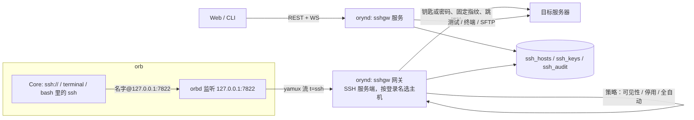

# M18 — SSH 主机与控制面 SSH 网关：实施计划

## 修订记录

- **v1（2026-11-17）**：初稿。

## Context

主人原话：「规划实现下 omp 的 ssh 服务器管理功能的完整接入」。

Oryn Core（`oryn-v18.19.0-10`）自带 SSH 主机管理：主机目录 `ssh.json`、RPC `get_ssh_hosts` / `ssh_manage` / `ssh_test`、`/ssh` 命令、`ssh://主机/路径` 内部 URL、`terminal` 工具的 `host` 参数。Oryn 目前只把这些 RPC 原样直通，orb 里既没有主机目录也没有任何钥匙，功能实际不可用。

本里程碑的终态：主人在 Oryn 里登记主机与钥匙；orb 里的 agent 用 Core 原有的 `ssh://`、`terminal` 工具和裸 `ssh <名字>` 就能连上，但私钥与密码始终只在控制面，所有连接都经 orynd 内置的 SSH 网关代为登录并留审计。

### 确认后的决定

| 编号 | 决定 | 来源 |
|---|---|---|
| D1 | 钥匙托管用「控制面 SSH 网关」：私钥 / 密码只存 orynd，orb 内的 ssh 经 orb link 连到 orynd，由 orynd 校验主机指纹并代为登录目标机 | 表单一 |
| D2 | 网关支持跳板链（≤5 级）等高级功能 | 表单一 |
| D3 | 每台主机一个「允许全自动线程使用」开关，默认关 | 表单一 |
| D4 | 范围含：项目级主机、线程右栏卡片（Runner 线程直通管理那台机器自己的 `ssh.json`）、审计、`oryn ssh` 命令行、密码登录的主机、orb 内 `ssh <名字>` 别名 | 表单一 |
| D5 | 在新 worktree + 分支 `m18-ssh` 上实施，做完合回 `main`（M17 正在主工作区进行） | 表单一 |
| D6 | 从 OneSSH 移植：跳板链与环检测、指纹固定与重置、带口令私钥导入转存、生成 ed25519、密码登录安全回退、标签、停用、引用保护、握手独立超时与 30 秒保活、审计带名称快照 | 表单二 |
| D7 | 另加：本地端口转发（每主机开关，默认关）、点「测试」时采一次状态快照、主机页网页终端、主机页 SFTP 文件浏览、给 agent 的批量执行工具 `ssh_exec_many`。**不做**持续监控 | 表单二 |
| D8 | 审计粒度：每条 exec 命令一行（原文、退出码、耗时）；交互式会话只记起止 | 表单二 |
| D9 | 指纹首次成功连接即固定；之后不一致一律拒绝，页面可「重置指纹」 | 表单二 |
| D10 | orb 内用回环别名：`ssh.json` 里登记为 `名字@127.0.0.1:<网关端口>`，真实地址与登录用户写进描述；主人起的名字就是 orb 里的主机名与 `ssh <名字>` 别名 | 表单二 |

### 现状（已核对代码；行号只作提示，动手前按符号重读）

**Oryn Core（`/root/Projects/Ling/oryn-core`，HEAD = `oryn-v18.19.0-10`）**

- 主机目录：用户级 `~/.omp/agent/ssh.json`，项目级 `<cwd>/.omp/ssh.json`；格式 `{"hosts":{"<名>":{"host","username?","port?","keyPath?","description?","compat?"}}}`（`packages/coding-agent/src/ssh/config-writer.ts`、`discovery/ssh.ts`）。主机名规则 `/^[a-zA-Z0-9_.-]+$/`、≤100。
- `discovery/oryn-project-config.ts` 的 Oryn 项目层 provider **没有**注册 `sshCapability`，所以 `$ORYN_PROJECT_CONFIG_ROOT/.omp/ssh.json` 不会被发现；项目级主机只能由控制面合并进用户级 `ssh.json`。
- 连接用系统 `ssh`（`ssh/connection-manager.ts`）：`-o ControlMaster=auto -o ControlPath=~/.omp/ssh-control/%C.sock -o ControlPersist=3600 -o BatchMode=yes -o StrictHostKeyChecking=accept-new`，有端口加 `-p`，有 `keyPath` 加 `-i`；目标是 `username@host`。单次 helper 超时 30 秒。`terminal` 工具的交互登录不带 `BatchMode` 与 `StrictHostKeyChecking`。
- 主机列表每次按需读，但 `capability/fs.ts` 的 `contentCache` 只在 `resetCapabilities()` 时清；`reload_plugins` 会清。所以运行中改了 `ssh.json` 之后要发一次 `reload_plugins`。
- RPC：`get_ssh_hosts`、`ssh_manage {action: create|update|delete, scope, name, …}`、`ssh_test`（`modes/rpc/rpc-types.ts`、`rpc-operations.ts`）。文本 `/ssh add|remove|rm|list|help`（`slash-commands/helpers/ssh.ts`）在 RPC 的 `prompt` 里被当内置命令执行。
- `terminal` 工具只在宿主发了 `terminal_configure{agentTools:true}` 后注册；Oryn 已经在发（`internal/threads/agent.go:134`）。

**Oryn**

- `get_ssh_hosts` / `ssh_manage` / `ssh_test` 不在 `managedCommands`（`internal/threads/route.go:33`），对工作线程直通；协调线程拒绝（`internal/threads/coordinator.go` 的 `coordinatorCommands` 白名单与 `coordinatorDeniedQueries`）。
- 中央 Agent 配置是磁盘文件（`internal/agentcfg`），`ssh-keys/` 被硬排除（`agentcfg.go` 的 `excludedDirs`）；`ssh.json` 现在可以原样写入全局层，下发后被 `internal/threads/apply.go` 的 `configEffectOf` 归为「需重启」。
- setup / resume / 立即下发都经 `orbs.DefaultSetup.plan`（`internal/orbs/setup.go:194`）按 orb 生成参数；立即下发是 `internal/orbs/apply.go`（按层算 `Changed` → `omphome.apply` → `threads.ConfigApplied`）。
- orbd→orynd 的流按流头 `t` 分派：`orbs.Service.HandleStream(t, fn)`（`internal/orbs/link.go:70`），`default` 分支**不检查** runner（`link.go:342-355`），处理器要自己拒绝。orb 侧「本机 TCP ↔ yamux 流」的样板是 `internal/orbdrt/egress.go`。
- 出站代理只懂 HTTP（`internal/egress/egress.go`）；加固部署下 orb 到私网地址被丢弃（`docs/deploy.md` 第 155–196 行、`deploy/firecracker/oryn-fc-net.sh`）。
- 加密存储的惯例：功能自己的表 + `*_enc BLOB` 列 + `secrets.Box.Seal(<AAD>, plain)`，不进 `secrets` 表（`internal/store/migrations/0028_github.sql:2-3`）。
- orb 有 `github_identity` 列但没有「全自动」标记；`threads.CreateParams.Automation`（`internal/threads/threads.go:59`）只用来选 GitHub 身份。
- orb 镜像已装 `openssh`（`images/orb/Dockerfile:33`）；`go.mod` 里 `golang.org/x/crypto v0.58.0` 是间接依赖，`github.com/pkg/sftp` 没有（模块缓存里有 `v1.13.11`）。
- 最新迁移是 `0040_owner_memory.sql`。

**OneSSH（`/root/Projects/Ling/OneSSH`，可直接抄的实现）**

- `internal/sshpool/pool.go`：拨号、跳板链递归（`jc.DialContext` → `ssh.NewClientConn`）、TOFU、握手独立超时（`context.AfterFunc` 关连接）、密码登录的 `ssh.Password` + `ssh.KeyboardInteractive` 双注册与多因素中止、30 秒保活。
- `internal/hostmanager/manager.go`：主机校验、跳板链环与深度检测（`maxJumpChain = 5`）、标签规范化。
- `internal/webapi/api.go:228-325`：生成 ed25519、导入带口令私钥后转存为无口令 OpenSSH 格式。
- `internal/monitor/monitor.go:17`：采样命令（`/proc/stat`、`/proc/meminfo`、`/proc/loadavg`、`df -P -k`）。
- `internal/files/`：基于 `pkg/sftp` 的读写、临时文件加 rename。
- `internal/webapi/terminal.go`：WebSocket + `RequestPty("xterm-256color")` + `Shell()` + `WindowChange`。

### 架构



- orb 里的 `ssh.json` 由 orbd 生成，每台主机是 `{"host":"127.0.0.1","port":<orbd 实际监听端口>,"username":"<主机名>","description":"<真实用户>@<真实地址>:<端口> — <描述> [标签]"}`。
- 网关是 SSH 服务端：对 orb 接受 `none` 认证（流已由 orb link 鉴权），用 SSH 登录名查主机；通过后才向目标拨号，再把会话通道与请求双向转发。
- Runner 与协调宿主不接入网关：Runner 用那台机器自己的 `~/.ssh` 与 `ssh.json`（保持「控制面的密钥不去 Runner」），协调宿主没有 bash / 网络。

## Approach

通用规则（每一步都适用）：

- 工作目录是 worktree `/root/Projects/Ling/Oryn-m18-ssh`（步骤 0 建立），不要动 `/root/Projects/Ling/Oryn` 主工作区。
- 每完成一个编号步骤就提交一次（`commit` 命名空间；格式 `<type>(<scope>): <gitmoji> <subject>`，正文加 `Co-authored-by: Wine Fox <fox@ling.plus>`），并用 `record-agent-log` 记一条日志（做了什么、为什么）。
- 代码注释、错误文案、界面文案用中文；界面文案同时写进 `web/src/i18n/locales/zh-CN.json` 与 `en.json`。
- 新增 Go 代码放在包 `internal/sshgw`（文件划分见各步骤）。除特别说明外不新增抽象层。

### 步骤 0：准备

1. `git -C /root/Projects/Ling/Oryn worktree add -b m18-ssh /root/Projects/Ling/Oryn-m18-ssh main`。
2. 把本计划原文存为 `docs/plan-m18.md`（标题下加「修订记录：v1（日期）」一行），提交。
3. `go get golang.org/x/crypto@v0.58.0 github.com/pkg/sftp@v1.13.11 && go mod tidy`（`x/crypto` 提升为直接依赖）。
4. 迁移编号取分支上 `internal/store/migrations/` 的最大编号加一（当前应为 `0041`），文件名 `00NN_ssh.sql`。下文写作 `0041`。

### 步骤 1：契约冻结（规格、迁移、生成代码）

做完这一步树能编译、`make test` 通过；未实现的接口由 `apigen.Unimplemented` 返回 501。

**1.1 迁移 `internal/store/migrations/0041_ssh.sql`**

```sql
-- +goose Up
-- M18：SSH 主机与网关。私钥、密码经 secrets.Box 加密后存本表列，不进 secrets 表（不出现在「密钥」设置页）。
CREATE TABLE ssh_keys (
    id              TEXT    PRIMARY KEY,               -- sshk_<ULID>
    name            TEXT    NOT NULL UNIQUE,
    key_type        TEXT    NOT NULL,                  -- ssh-ed25519 | ssh-rsa | ecdsa-sha2-nistp256 | …
    public_key      TEXT    NOT NULL,                  -- authorized_keys 一行，注释为钥匙名
    fingerprint     TEXT    NOT NULL,                  -- SHA256:…
    private_key_enc BLOB    NOT NULL,                  -- AAD "ssh/key/<id>"；无口令的 OpenSSH PEM
    created_at      INTEGER NOT NULL
);
CREATE TABLE ssh_hosts (
    id               TEXT    PRIMARY KEY,              -- ssh_<ULID>
    project_id       TEXT    REFERENCES projects (id) ON DELETE CASCADE,   -- NULL = 全局
    name             TEXT    NOT NULL,
    address          TEXT    NOT NULL,
    port             INTEGER NOT NULL DEFAULT 22,
    username         TEXT    NOT NULL,
    auth_type        TEXT    NOT NULL CHECK (auth_type IN ('key', 'password')),
    key_id           TEXT    REFERENCES ssh_keys (id),
    password_enc     BLOB,                             -- AAD "ssh/host/<id>/password"
    jump_host_id     TEXT    REFERENCES ssh_hosts (id),
    description      TEXT    NOT NULL DEFAULT '',
    tags             TEXT    NOT NULL DEFAULT '[]',    -- JSON 数组：标签
    enabled          BOOLEAN NOT NULL DEFAULT 1,
    allow_automation BOOLEAN NOT NULL DEFAULT 0,
    allow_forward    BOOLEAN NOT NULL DEFAULT 0,
    compat           BOOLEAN,                          -- Core 的 compat 开关；NULL = 不写进 ssh.json
    host_key         TEXT,                             -- 固定的主机公钥（authorized_keys 格式，无注释）；NULL = 尚未固定
    host_key_at      INTEGER,
    last_test_at     INTEGER,
    last_test_ok     BOOLEAN,
    last_test_error  TEXT,
    last_test_os     TEXT,
    created_at       INTEGER NOT NULL,
    updated_at       INTEGER NOT NULL
);
CREATE UNIQUE INDEX ssh_hosts_global_name  ON ssh_hosts (name) WHERE project_id IS NULL;
CREATE UNIQUE INDEX ssh_hosts_project_name ON ssh_hosts (project_id, name) WHERE project_id IS NOT NULL;
CREATE INDEX ssh_hosts_jump ON ssh_hosts (jump_host_id);
CREATE INDEX ssh_hosts_key  ON ssh_hosts (key_id);
-- 无外键：行比主机、线程与 orb 活得久，保留 30 天。
CREATE TABLE ssh_audit (
    id          INTEGER PRIMARY KEY,
    at          INTEGER NOT NULL,
    source      TEXT    NOT NULL CHECK (source IN ('orb', 'owner', 'tool')),
    orb_id      TEXT,
    thread_id   TEXT,
    host_id     TEXT    NOT NULL,
    host_name   TEXT    NOT NULL,                      -- 名称快照
    kind        TEXT    NOT NULL CHECK (kind IN ('connect', 'deny', 'exec', 'shell', 'subsystem', 'forward', 'test', 'sftp')),
    detail      TEXT    NOT NULL DEFAULT '',
    exit_code   INTEGER,
    duration_ms INTEGER,
    ok          BOOLEAN NOT NULL
);
CREATE INDEX ssh_audit_host   ON ssh_audit (host_id, id);
CREATE INDEX ssh_audit_thread ON ssh_audit (thread_id, id);
CREATE INDEX ssh_audit_at     ON ssh_audit (at);
ALTER TABLE orbs ADD COLUMN automation BOOLEAN NOT NULL DEFAULT 0;

-- +goose Down
ALTER TABLE orbs DROP COLUMN automation;
DROP TABLE ssh_audit;
DROP TABLE ssh_hosts;
DROP TABLE ssh_keys;
```

时间戳都是 Unix 毫秒。把 `ssh_audit`、`ssh_hosts`、`ssh_keys` 按字母序插进 `internal/store/store_test.go` 的 `m2Tables`，上方注释块加一行 `// M18：ssh_audit、ssh_hosts、ssh_keys`。

**1.2 查询 `internal/store/queries/ssh.sql`**（风格抄 `github.sql`：`@x` 具名参数、可空用 `sqlc.narg`）

| 名称 | 类型 | 语义 |
|---|---|---|
| `ListSshKeys` | `:many` | 列出除 `private_key_enc` 外的列，按 `name` |
| `GetSshKey` | `:one` | 按 `id` 取整行 |
| `InsertSshKey` | `:exec` | 插入整行 |
| `RenameSshKey` | `:execrows` | `UPDATE … SET name, public_key WHERE id` |
| `DeleteSshKey` | `:execrows` | 按 `id` 删 |
| `CountSshHostsByKey` | `:one` | `SELECT COUNT(*) … WHERE key_id = @key_id` |
| `ListSshHosts` | `:many` | 整行，按 `project_id IS NOT NULL, project_id, name` |
| `GetSshHost` | `:one` | 按 `id` |
| `InsertSshHost` | `:exec` | 插入整行 |
| `UpdateSshHost` | `:execrows` | 按 `id` 更新除 `id`、`project_id`、`created_at`、`host_key*`、`last_test_*` 外的全部列 |
| `DeleteSshHost` | `:execrows` | 按 `id` 删 |
| `CountSshHostsByJump` | `:one` | `WHERE jump_host_id = @id` |
| `CountEnabledSshHostsByJump` | `:one` | `WHERE jump_host_id = @id AND enabled` |
| `PinSshHostKey` | `:execrows` | `UPDATE … SET host_key = @host_key, host_key_at = @at WHERE id = @id AND host_key IS NULL` |
| `ClearSshHostKey` | `:execrows` | `SET host_key = NULL, host_key_at = NULL, updated_at = @at WHERE id` |
| `SetSshHostTest` | `:exec` | 写 `last_test_at/ok/error/os` |
| `InsertSshAudit` | `:exec` | 插入一行 |
| `ListSshAudit` | `:many` | 抄 `ListGithubAudit`：可选 `host_id`、`thread_id` 过滤，`id < @before`，`ORDER BY id DESC LIMIT @limit` |
| `DeleteSshAuditBefore` | `:exec` | `WHERE at < @before` |
| `SetOrbAutomation` | `:exec` | `UPDATE orbs SET automation = @automation WHERE id = @id`（放 `orbs.sql`） |

`CreateOrb`（`internal/store/queries/orbs.sql`）加 `automation` 列，取值 `COALESCE(CAST(sqlc.narg(automation) AS BOOLEAN), 0)`，写法与同语句里的 `github_identity` 一致。

`internal/ids/ids.go` 加 `func SSHHost() string { return New("ssh") }` 与 `func SSHKey() string { return New("sshk") }`。

**1.3 规格 `schema/openapi.yaml`**

tags 表加 `- name: ssh`，`description: SSH 主机、钥匙与网关审计（M18）`。所有写操作的 `security` 抄 `putSecret`（`cookieAuth + csrfHeader` 或 `deviceBearer`），每个操作以 `default: { $ref: '#/components/responses/Error' }` 结尾。

路径（operationId 即生成的处理器名）：

| 方法与路径 | operationId | 请求 → 响应 |
|---|---|---|
| `GET /api/v1/ssh/hosts` | `listSshHosts` | → `SshHostList`（全部主机，全局在前） |
| `POST /api/v1/ssh/hosts` | `createSshHost` | `SshHostCreate` → 201 `SshHost` |
| `GET /api/v1/ssh/hosts/{id}` | `getSshHost` | → `SshHost` |
| `PATCH /api/v1/ssh/hosts/{id}` | `updateSshHost` | `SshHostUpdate` → `SshHost` |
| `DELETE /api/v1/ssh/hosts/{id}` | `deleteSshHost` | → 204 |
| `POST /api/v1/ssh/hosts/{id}/test` | `testSshHost` | → `SshTestResult`（连接失败也是 200，`ok=false`） |
| `POST /api/v1/ssh/hosts/{id}/reset-host-key` | `resetSshHostKey` | → `SshHost` |
| `GET /api/v1/ssh/keys` | `listSshKeys` | → `SshKeyList` |
| `POST /api/v1/ssh/keys` | `createSshKey` | `SshKeyCreate` → 201 `SshKey` |
| `PATCH /api/v1/ssh/keys/{id}` | `renameSshKey` | `{name}` → `SshKey` |
| `DELETE /api/v1/ssh/keys/{id}` | `deleteSshKey` | → 204 |
| `GET /api/v1/ssh/audit` | `listSshAudit` | 查询 `host`（主机 id）、`thread`、`before`、`limit`（1–200，默认 50）→ `SshAuditList` |
| `GET /api/v1/threads/{id}/ssh-hosts` | `listThreadSshHosts` | → `ThreadSshHosts` |
| `GET /api/v1/ssh/hosts/{id}/fs/roots` | `getSshFsRoots` | → `SshFsRoots` |
| `GET /api/v1/ssh/hosts/{id}/fs/list` | `listSshFs` | `path` → `FsListing` |
| `GET /api/v1/ssh/hosts/{id}/fs/stat` | `statSshFs` | `path` → `FsEntry` |
| `GET /api/v1/ssh/hosts/{id}/fs/file` | `readSshFile` | `path`，支持 `Range` → 200 / 206 `application/octet-stream` |
| `PUT /api/v1/ssh/hosts/{id}/fs/file` | `writeSshFile` | `path`、`overwrite`（默认 true）、`If-Match`，体 `application/octet-stream` → `FsEntry` |
| `POST /api/v1/ssh/hosts/{id}/fs/mkdir` | `mkdirSshFs` | `FsPathRequest` → `FsEntry` |
| `POST /api/v1/ssh/hosts/{id}/fs/rename` | `renameSshFs` | `FsRenameRequest` → `FsEntry` |
| `POST /api/v1/ssh/hosts/{id}/fs/delete` | `deleteSshFs` | `FsPathRequest` → 204 |
| `GET /api/v1/ssh/hosts/{id}/terminal` | `sshHostTerminal` | WebSocket，`tags: [websocket, ssh]`、`security: [{}]`、查询参数 `ticket`（必填）、`cols`、`rows`；写法抄 `orbDesktopSocket`（`openapi.yaml:1733-1757`），不进 Go 的 `ServerInterface`（步骤 9.2 手工挂载） |

`fs/*` 的参数、响应头与错误码逐项抄 `/api/v1/orbs/{id}/fs/*`（`openapi.yaml:1088-1285`），复用 `FsEntry`、`FsListing`、`FsPathQuery`、`FsPathRequest`、`FsRenameRequest`；不带 `thread` / `bg` / `offline` 参数。

新 schema（字段名即 JSON 键；标 `?` 的可缺省）：

```yaml
SshHostId:   { type: string }   # ssh_<ULID>
SshKeyId:    { type: string }   # sshk_<ULID>
SshAuthType: { type: string, enum: [key, password] }
SshHost:
  required: [id, name, address, port, username, authType, hasPassword, description, tags, enabled, allowAutomation, allowForward, createdAt, updatedAt]
  properties:
    id: SshHostId
    projectId?: ProjectId            # 缺省 = 全局
    name, address, username: string
    port: integer
    authType: SshAuthType
    keyId?: SshKeyId
    hasPassword: boolean
    jumpHostId?: SshHostId
    description: string
    tags: string[]
    enabled, allowAutomation, allowForward: boolean
    compat?: boolean
    hostKey?: { type: string, fingerprint: string, pinnedAt: TimestampMs }     # schema 名 SshHostKey
    lastTest?: { at: TimestampMs, ok: boolean, error?: string, os?: string }   # schema 名 SshHostTest
    createdAt, updatedAt: TimestampMs
SshHostList: { required: [hosts], hosts: SshHost[] }
SshHostCreate:
  required: [name, address, username, authType]
  properties: projectId?, name, address, port?, username, authType, keyId?, password?, jumpHostId?, description?, tags?, enabled?, allowAutomation?, allowForward?, compat?
SshHostUpdate:   # 全部可缺省；没有 projectId（作用域建后不可改）
  properties: name?, address?, port?, username?, authType?, keyId?, password?, description?, tags?, enabled?, allowAutomation?, allowForward?,
              jumpHostId?: { nullable: true }   # null = 取消跳板
              compat?: { nullable: true }       # null = 不写
SshTestResult:
  required: [ok, checkedAt, latencyMs]
  properties: ok, checkedAt: TimestampMs, latencyMs: integer, error?: string, os?: string, hostKeyFingerprint?: string,
    snapshot?: SshSnapshot
SshSnapshot:
  properties: load1?: number, cpuPct?: number, memUsedKb?: integer, memTotalKb?: integer,
    disks: [{ mount: string, usedKb: integer, totalKb: integer }]
SshKey:
  required: [id, name, type, publicKey, fingerprint, hostCount, createdAt]
SshKeyList: { required: [keys], keys: SshKey[] }
SshKeyCreate:
  required: [name, mode]
  properties: name, mode: { enum: [generate, import] }, privateKey?: string, passphrase?: string
SshKeyRename: { required: [name], name: string }
SshAuditEntry:
  required: [id, at, source, hostId, hostName, kind, detail, ok]
  properties: id: int64, at: TimestampMs, source: { enum: [orb, owner, tool] }, orbId?: OrbId, threadId?: ThreadId,
    hostId: string, hostName: string, kind: { enum: [connect, deny, exec, shell, subsystem, forward, test, sftp] },
    detail: string, exitCode?: integer, durationMs?: integer, ok: boolean
SshAuditList: { required: [entries], entries: SshAuditEntry[], nextBefore?: int64 }
ThreadSshHosts:
  required: [managed, automation, hosts]
  properties:
    managed: boolean        # false = Runner / 协调线程，主机不由 Oryn 管
    automation: boolean     # 这台 orb 是否全自动
    hosts: [{ required: [host, usable], host: SshHost, usable: boolean, blocked?: { enum: [automation] } }]   # 项 schema 名 ThreadSshHost
SshFsRoots: { required: [home], home: string }
```

实时事件：仿 `WsServerGitHubChanged` 加 `WsServerSshChanged`（`type: ssh.changed`），并加进服务端消息的联合类型。

link 协议：

- `LinkStreamHeader` 的 `oneOf` 与 `mapping` 加 `LinkStreamSsh`（`required: [t]`，`t: { enum: [ssh] }`，说明「orbd→orynd：orb 内到 SSH 网关的一条 TCP 连接，其后是裸 SSH 字节流；runner 与协调宿主不可用」）。
- 新 schema `LinkCtlSshConfig`：`required: [hostKey, hosts]`；`hostKey: string`（网关主机公钥，authorized_keys 一行）；`hosts: LinkCtlSshHost[]`；`LinkCtlSshHost`：`required: [name, description]`，`name: string`、`description: string`、`compat?: boolean`。
- `LinkCtlSetupRunParams` 与 `LinkCtlOmpHomeApplyParams` 各加可选 `ssh: { $ref: LinkCtlSshConfig }`，说明「缺省 = 不动 orb 内的 SSH 配置」。
- `LinkCtlMethod` 的 `enum` 与 `x-enum-varnames` 末尾加 `ssh.call` / `MethodSshCall`；加 `LinkCtlSshCallParams`（`required: [threadId, tool, params]`，同 `LinkCtlGithubCallParams`）与 `LinkCtlSshCallResult`（`required: [text]`，`text: string`，`details?: object`）。
- `LinkCtlHelloParams.features` 的说明加一句「M18 起：`ssh`（orbd 监听本机 SSH 网关端口并认识 `setup.run` / `omphome.apply` 的 `ssh`；runner 与协调宿主不上报）」。
- `Orb` schema 加只读 `automation: boolean`。

`make gen`，然后 `make check-gen`、`make lint-spec`、`make test` 通过。

命名提示：oapi-codegen 的 `ToCamelCaseWithInitialisms` 会把 Go 标识符里的 `Ssh` 写成 `SSH`（如 `apigen.SSHHost`、`ListSSHHosts`、`LinkCtlSSHConfig`、字段 `SSH`）；下文一律按规格里的拼写书写，Go 代码以 `make gen` 实际生成的名字为准。`x-enum-varnames` 里显式给出的名字（`MethodSshCall`、`WsServerSshChangedTypeSshChanged`）不受影响。TypeScript 一侧保持规格拼写（`Schemas["SshHost"]`）。

### 步骤 2：`internal/sshgw` 服务骨架、钥匙与主机

**2.1 `service.go`**

```go
type Config struct {
	Box     *secrets.Box
	DataDir string                                  // 网关主机密钥放 <DataDir>/ssh-gateway.key
	Apply   func(projectID string)                  // orb 可见的内容变了（主机增删改）后调用；projectID 空 = 全局层
	Changed func()                                  // 任何主机 / 钥匙 / 指纹 / 测试结果变化后调用（只用来刷新页面）
	Dial    func(ctx context.Context, network, addr string) (net.Conn, error) // nil = (&net.Dialer{}).DialContext；测试注入
	Now     func() time.Time                        // nil = time.Now
}
type Orbs interface { Get(ctx context.Context, id string) (db.Orb, error) }

func New(cfg Config, st *store.Store, orbs Orbs) (*Service, error)
func (s *Service) Run(ctx context.Context) // 每小时 DeleteSshAuditBefore(now-30d)、每 30 秒回收空闲的 SFTP 连接；ctx 结束时关掉全部网关会话与连接
```

`New` 读取或生成网关主机密钥：`<DataDir>/ssh-gateway.key` 不存在时用 `crypto/ed25519` 生成、`ssh.MarshalPrivateKey(key, "oryn-ssh-gateway")` 编码、0600 原子写入（临时文件 + rename）；存在时 `ssh.ParsePrivateKey`。解析失败直接返回错误（不自动重建，免得 orb 里的 known_hosts 全部失配）。

错误类型：`type Error struct{ Code, Message string }`，`Code` 取 `invalid_request` / `not_found` / `conflict`；辅助 `invalid(format, …)`、`notFound(…)`、`conflict(…)`。

**2.2 `keys.go`**（逻辑抄 OneSSH `internal/webapi/api.go:228-325`）

- `CreateKey(ctx, KeyInput{Name, Mode, PrivateKey, Passphrase}) (Key, error)`：
  - `Name`：去首尾空白，匹配 `^[A-Za-z0-9_][A-Za-z0-9_. -]{0,63}$`，否则 `invalid_request`「钥匙名只能含字母、数字、空格与 `_ . -`，最长 64」；重名 `conflict`「钥匙名已存在」。
  - `Mode=generate`：生成 ed25519。`Mode=import`：`ssh.ParseRawPrivateKey`；返回 `*ssh.PassphraseMissingError` 且 `Passphrase` 为空 → `invalid_request`「这把私钥有口令，请一并填写」；有口令用 `ssh.ParseRawPrivateKeyWithPassphrase`，口令错 → `invalid_request`「口令不对」。
  - 一律用 `ssh.MarshalPrivateKey(raw, name)` 重新编码成无口令 OpenSSH PEM；编码失败（如 DSA）→ `invalid_request`「不支持这种私钥类型」。口令不落库。
  - `public_key = strings.TrimSpace(string(ssh.MarshalAuthorizedKey(pub))) + " " + name`；`fingerprint = ssh.FingerprintSHA256(pub)`；`key_type = pub.Type()`；`private_key_enc = Box.Seal("ssh/key/"+id, pem)`。用完的明文字节清零。
- `RenameKey`：同名规则；同时重写 `public_key` 的注释。
- `DeleteKey`：`CountSshHostsByKey > 0` → `conflict`「钥匙正被 N 台主机使用」。
- `ListKeys` 返回的每项带 `HostCount`。
- 钥匙增删改后调 `Changed()`（orb 侧内容不变，不调 `Apply`）。

**2.3 `hosts.go`**

`HostInput` 与 `HostPatch` 的字段与 `SshHostCreate` / `SshHostUpdate` 一一对应（`HostPatch` 用指针表示「未提供」，`JumpHostID`、`Compat` 用 `**T` 或显式 `Set` 标志区分 null 与缺省）。

校验（创建与更新后的合并结果都要过）：

| 字段 | 规则 | 违反时的文案（`invalid_request`） |
|---|---|---|
| `name` | `^[A-Za-z0-9_][A-Za-z0-9_.-]{0,63}$` | 主机名只能含字母、数字与 `_ . -`，不能以 `.` 或 `-` 开头，最长 64 |
| `address` | 去空白后非空、≤255、匹配 `^[A-Za-z0-9_.:-]+$`、不以 `-` 开头 | 地址不能为空，且只能是主机名或 IP |
| `port` | 缺省 22；1–65535 | 端口必须在 1–65535 |
| `username` | 非空、≤64、不含空白与控制字符、不以 `-` 开头 | 登录用户不能为空，且不能含空白 |
| `authType=key` | `keyId` 必填且存在 | 请选择一把钥匙 / 钥匙不存在 |
| `authType=password` | 创建时 `password` 非空；更新时缺省 = 沿用原密文 | 请填写密码 |
| `tags` | 逐个去空白、丢弃空串、大小写不敏感去重（保留首次出现）、每个 ≤32 字符、最多 16 个 | 标签最多 16 个，每个最长 32 字符 |
| `description` | ≤500 字符 | 描述最长 500 字符 |
| `projectId` | 项目须存在 | 项目不存在（`not_found`） |
| `jumpHostId` | 见下 | 见下 |

- 跳板规则（常量 `maxJumpChain = 5`）：跳板须存在且 `enabled`；全局主机只能用全局主机作跳板，项目主机可用全局或同项目的主机；从本主机沿 `jump_host_id` 走，遇到自己 →「跳板链存在循环」，跳板个数超过 5 →「跳板链超过 5 级」。
- 同作用域重名 → `conflict`「同名主机已存在」（靠唯一索引，`isUniqueViolation` 风格判定）。
- 切换 `authType`：改成 `key` 时清掉 `password_enc`；改成 `password` 时清掉 `key_id`。
- `enabled` 由真改假：`CountEnabledSshHostsByJump > 0` → `conflict`「还有启用中的主机拿它当跳板」。由假改真：它的跳板未启用 → `conflict`「它的跳板已停用」。
- `DeleteHost`：`CountSshHostsByJump > 0` → `conflict`「主机被其他主机用作跳板」。
- `address` / `port` 变化时同时清掉 `host_key`（换了机器，旧指纹不再适用）。
- 密码：`Box.Seal("ssh/host/"+id+"/password", []byte(pw))`。
- 每次创建 / 更新 / 删除主机之后：`s.invalidate(hostID)`（步骤 4.4）、`Apply(projectID)`（全局主机传 `""`）、`Changed()`。重置指纹之后：`s.invalidate(hostID)` 与 `Changed()`。
- `ResetHostKey`：`ClearSshHostKey`，之后按上一条「重置指纹之后」处理。

对外的 `Host` 结构不含密文，带 `HasPassword bool`、`HostKey *HostKeyInfo{Type, Fingerprint, PinnedAt}`（由 `host_key` 经 `ssh.ParseAuthorizedKey` 现算）。

**2.4 可见性 `visible.go`**

```go
// VisibleHosts 返回这台 orb 能用的主机（按名排序）与被挡下的主机。runner / 协调 orb 返回 managed=false。
func (s *Service) visible(ctx context.Context, orb db.Orb) (usable []db.SshHost, blocked []db.SshHost, managed bool, err error)
```

规则：`orbs.IsRunner(orb) || orb.Coordinator` → `managed=false`。否则取 `enabled` 的全局主机与 `project_id = orb.ProjectID` 的主机，同名时项目主机盖过全局主机；`orb.Automation` 为真时，`allow_automation = 0` 的进 `blocked`，其余进 `usable`。

- `OrbConfig(ctx, orb) (*apigen.LinkCtlSshConfig, error)`：`managed=false` 返回 nil；否则 `HostKey` 为网关公钥（`ssh.MarshalAuthorizedKey` 去尾换行），`Hosts` 为 `usable`，`Description` 拼法：`<username>@<address>:<port>`，有描述时接 ` — <description>`，有标签时接 ` [tag1, tag2]`；`Compat` 取列值。
- `LayerState(projectID string) ([]byte, error)`：把该层（`""` = 全局）全部主机的 `name, enabled, allow_automation, compat` 与上面拼出的描述、再加网关公钥，按名排序后 `json.Marshal`。它只用作下发基线的摘要输入（步骤 6.2）。
- `ThreadHosts(ctx, threadID)`：取线程的 orb（线程没有 orb → `managed=false`），返回 `ThreadSshHosts`；`blocked` 的项 `usable=false, blocked="automation"`。

单元测试 `hosts_test.go` / `keys_test.go`（`store.Open(ctx, t.TempDir())` + `secrets.New(make([]byte, 32))`）：覆盖上表每条校验、跳板环与深度、作用域规则、同名遮蔽、全自动过滤、钥匙被引用时拒删、带口令私钥导入后能无口令解析。

### 步骤 3：上游拨号 `dial.go`（跳板、指纹、认证）

逐段移植 OneSSH `internal/sshpool/pool.go`，差异只有：按主机 id 而不是名字、存完整主机公钥而不是指纹、不做跨调用的连接池。

```go
const (
	connectTimeout = 10 * time.Second // 每一跳：TCP 建连 + SSH 握手
	dialBudget     = 20 * time.Second // 整条链；必须小于 Core 的 30 秒 helper 超时
	keepaliveEvery = 30 * time.Second
)
type upstream struct {
	client  *ssh.Client   // 目标机
	jumps   []*ssh.Client // 跳板，外层在前
	hostIDs []string      // 链上全部主机 id（含目标）
}
func (u *upstream) Close()                                   // 先关 client，再从内到外关 jumps
func (s *Service) dial(ctx context.Context, target db.SshHost) (*upstream, error)
```

- 先把链解析成 `[]db.SshHost`（外层跳板在前，目标在末）：逐级 `GetSshHost(jump_host_id)`；再做一次环与深度检测（数据可能在校验之后被改）；任何一跳 `enabled = 0` → 错误「跳板 "<名>" 已停用」。
- 第一跳用 `cfg.Dial(ctx, "tcp", net.JoinHostPort(address, port))`；之后每一跳用上一跳的 `client.DialContext(ctx, "tcp", addr)`。每一跳 `ssh.NewClientConn(conn, addr, cfg)`，握手超时用 `context.WithTimeout(ctx, connectTimeout)` + `context.AfterFunc(hctx, func(){ conn.Close() })`（`ClientConfig.Timeout` 只管建连）。任何一跳失败就把已建好的全部关掉。
- `ssh.ClientConfig`：
  - `User: host.Username`，`ClientVersion: "SSH-2.0-Oryn"`，`Timeout: connectTimeout`。
  - `Auth`：`key` → `Box.Open` 私钥 → `ssh.ParsePrivateKey` → `ssh.PublicKeys(signer)`；`password` → 照抄 OneSSH 的密码认证方法集（`ssh.Password` + 只回答单个不回显提示的 `ssh.KeyboardInteractive`，服务端已接受一个因素后中止并报「不支持 SSH 多因素认证」）。
  - `HostKeyCallback`：
    - `host_key` 非空：`bytes.Equal(key.Marshal(), pinned.Marshal())`，不等返回 `*HostKeyMismatchError{Host, Expected, Got}`（`Expected` / `Got` 是 `ssh.FingerprintSHA256`）。
    - `host_key` 为空：`PinSshHostKey`；影响 0 行（并发下别人先固定了）就重读后按上一条比较；固定成功后调 `Changed()`。
  - `HostKeyAlgorithms`：已固定时按固定公钥的类型设置——`ssh-rsa` → `{"rsa-sha2-512", "rsa-sha2-256", "ssh-rsa"}`，其余 → `{pinned.Type()}`；未固定时不设（用库默认）。不这样做，服务端可能协商出另一种类型的主机密钥而被误判为指纹变化。
- 成功后每个 client 起一个 goroutine：每 `keepaliveEvery` 发 `SendRequest("keepalive@openssh.com", true, nil)`，出错就 `Close()`。
- 错误文案（返回给调用方、进审计、进网关 banner）：
  - 连不上：`连不上 <address>:<port>：<err>`
  - 指纹：`主机 "<名>" 的指纹变了（期望 <Expected>，收到 <Got>）；确认无误后到 设置 → SSH 主机 里重置指纹`
  - 认证：`登录 <username>@<address>:<port> 失败：<err>`
  - 出在跳板上时整体加前缀 `跳板 "<跳板名>"：`

测试辅助包 `internal/sshgw/sshgwtest`：`func NewFakeSSHD(t testing.TB, opts Options) *FakeSSHD`，用 `x/crypto/ssh` 在 `net.Listen("tcp", "127.0.0.1:0")` 上起假目标机。`Options{AuthorizedKeys []ssh.PublicKey; Password string; KeyboardInteractive bool; HostKey ssh.Signer（nil = 随机 ed25519）; AllowDirectTCPIP bool; Silent bool（接受 TCP 后不说话）}`；方法 `Addr() (host string, port int)`、`HostKeyFingerprint() string`、`SetHostKey(ssh.Signer)`、`DirectTCPIPCount() int`、`Close()`。行为：`exec` 用本机 `sh -c <命令>` 真正执行并回传 stdout、stderr 与退出码；`shell` 起一个 `sh`，标准输入输出接到通道（`pty-req`、`window-change` 只应答成功）；`subsystem sftp` 用 `pkg/sftp` 的 `NewServer` 服务本机文件系统；`direct-tcpip` 在 `AllowDirectTCPIP` 时拨目标并对接、计数，否则拒绝。

测试 `dial_test.go` 用例：钥匙登录、密码登录、keyboard-interactive 登录、首次连接固定指纹、指纹变化被拒且文案含两个指纹、重置后可重新固定、两级跳板、跳板停用、握手超时（`Silent` 的服务端，10 秒内返回错误）。

### 步骤 4：网关 `gateway.go`（orb 流 → SSH 服务端 → 通道代理 → 审计）

**4.1 入口**

```go
func (s *Service) ServeStream(ctx context.Context, orbID string, _ link.StreamHeader, st *link.Stream)
```

1. `orb := s.orbs.Get(ctx, orbID)`；出错、`orbs.IsRunner(orb)` 或 `orb.Coordinator` → 记一条 warn 日志后返回（调用方会关流）。
2. 每条连接新建一个 `ssh.ServerConfig`：`ServerVersion: "SSH-2.0-Oryn"`、`NoClientAuth: true`、`NoClientAuthCallback: auth`、`AddHostKey(s.signer)`。
3. `auth(meta ssh.ConnMetadata)`：
   - 用 `meta.User()` 作主机名，在 `s.visible(ctx, orb)` 的 `usable` 里找；找不到时按原因取文案——在 `blocked` 里：`主机 "<名>" 不允许全自动线程使用（可在 设置 → SSH 主机 里放开）`；同作用域存在但 `enabled = 0`：`主机 "<名>" 已停用`；否则：`主机 "<名>" 未登记，或对这台 orb 不可见`。记审计 `kind=deny, ok=false, detail=<文案>`，返回 `&ssh.BannerError{Err: errors.New(文案), Message: "oryn: " + 文案 + "\n"}`。
   - 找到后 `s.dial(context.WithTimeout(ctx, dialBudget), host)`；失败记审计 `kind=connect, ok=false, detail=<错误文案>`，同样以 `BannerError` 返回；成功记 `kind=connect, ok=true`，把 `*upstream` 与主机行存进闭包变量，返回 `&ssh.Permissions{}`。
4. `ssh.NewServerConn(st, cfg)`（`*link.Stream` 内嵌 `*yamux.Stream`，满足 `net.Conn`）；握手失败时若已拨通上游要 `Close()`。
5. 登记进 `s.sessions`（`map[*gwSession]struct{}`，带 `hostIDs`），然后进入代理循环；任一侧结束即两侧全关并注销。

**4.2 代理规则**

| 来自 | 类型 | 处理 |
|---|---|---|
| orb 的全局请求 | `keepalive@openssh.com` | 本地应答（`Reply(true, nil)`） |
| orb 的全局请求 | `tcpip-forward`、`cancel-tcpip-forward`、其它 | `WantReply` 时 `Reply(false, nil)`；不转发（不支持远程转发） |
| 上游的全局请求 | 任意 | `WantReply` 时 `Reply(false, nil)` |
| 上游发起的通道 | 任意（`forwarded-tcpip`、`x11`、`auth-agent@openssh.com`…） | `Reject(ssh.Prohibited, "not supported")` |
| orb 发起的通道 | `session` | 向上游 `OpenChannel("session", nil)`；失败按原因 `Reject` |
| orb 发起的通道 | `direct-tcpip` | `allow_forward` 为真：`OpenChannel("direct-tcpip", newCh.ExtraData())` 原样透传，记审计 `kind=forward, detail="<目标主机>:<端口>"`（从 ExtraData 解出）；为假：`Reject(ssh.Prohibited, "oryn: 主机 <名> 未开启端口转发")` 并记 `ok=false` |
| orb 发起的通道 | 其它 | `Reject(ssh.UnknownChannelType, "unsupported channel type")` |

会话通道内：

- orb→上游的请求：`pty-req`、`shell`、`exec`、`subsystem`、`env`、`window-change`、`signal`、`break`、`eow@openssh.com` 原样转发并回传对方的应答；`auth-agent-req@openssh.com`、`x11-req` 及未列出的类型一律 `Reply(false, nil)`。
- 上游→orb 的请求：`exit-status`、`exit-signal`、`eow@openssh.com`、`keepalive@openssh.com` 原样转发；其余 `Reply(false, nil)`。
- 数据：标准输出与扩展数据（stderr，`Stderr()`）各自双向 `io.Copy`；一侧读到 EOF 就对另一侧 `CloseWrite()`；上游的请求流结束（通道已关）且两路输出都拷完之后再关 orb 侧通道，保证 `exit-status` 先于关闭送达。
- 审计：见到 `exec` 记下命令原文（`ssh.Unmarshal` 取字符串，超过 4096 字节截断并加 `…`），见到 `shell` / `subsystem` 记类型（`subsystem` 的 `detail` 是子系统名）；通道结束时写一行：`kind` 为 `exec` / `shell` / `subsystem`，`exit_code` 取自 `exit-status`（没收到则 NULL），`duration_ms` 为通道存活时长，`ok = exit_code == 0`（`shell` 与 `subsystem` 没有退出码时按 `ok=true`）。

**4.3 审计 `audit.go`**

`s.audit(ctx, auditRow)` 同步 `InsertSshAudit`，失败只记日志。`source`：网关为 `orb`。`thread_id`：`ListThreadsByOrb(orbID)` 恰好一条时取它的 id，否则 NULL；每条网关连接只在建立时解析一次。`host_name` 存名称快照。

`Audit(ctx, AuditQuery{HostID, ThreadID *string; Before int64; Limit int})`：`Before` 缺省为 `math.MaxInt64`；多取一条判断 `nextBefore`（写法抄 `github.Service.Audit`）。

**4.4 失效**

`s.invalidate(hostID string)`：关闭 `s.sessions` 中 `hostIDs` 含它的全部会话（主机被改、删、停用、重置指纹，或它是别人的跳板时都会触发），并关闭 SFTP 连接缓存里链上含它的条目（步骤 9.3）。

测试 `gateway_test.go`：用 `net.Pipe()` 的一端模拟 orb 流（包装成满足 `net.Conn`；`ServeStream` 的参数类型若妨碍测试，就把主体拆成 `serveConn(ctx, orb db.Orb, c net.Conn)`，`ServeStream` 只做第 1 步后调用它），另一端用 `ssh.NewClientConn` 以登录名 = 主机名、无认证方法连接。用例：`exec` 的输出、stderr 与退出码原样到达且落一行审计；未登记的名字被拒且 banner 含文案；全自动 orb 连未放开的主机被拒；`allow_forward=0` 时 `direct-tcpip` 被拒、为 1 时能通；上游发来的 `forwarded-tcpip` 被拒；`sftp` 子系统可用（`pkg/sftp` 客户端列目录）；改主机后原会话被断开；同一条连接上并发多个 `exec`（ControlMaster 的用法）互不串扰。

### 步骤 5：orb 侧（orbd）

**5.1 流类型**：`internal/link/header.go` 加常量 `StreamSSH = "ssh"`（注释：orbd→orynd，orb 内到 SSH 网关的一条 TCP 连接，M18）。

**5.2 监听与桥接**（`internal/orbdrt/runtime.go`、新文件 `internal/orbdrt/ssh.go`）

- 常量 `DefaultSSHAddr = "127.0.0.1:7822"`；`Config` 加 `SSHAddr string`（`ConfigFromEnv` 读 `ORYN_SSH_ADDR`，仅供测试设 `127.0.0.1:0`）与 `SSHListener net.Listener`（测试注入），写法对照 `EgressAddr` / `EgressListener`。
- `New`：只在 `cfg.Runner == nil && !cfg.Coordinator` 时监听。监听失败**不**让 orbd 启动失败：记一条 warn（`ssh gateway listen failed; SSH hosts are unavailable in this orb`），`r.sshLn` 留 nil。
- `Run`：`r.sshLn != nil` 时 `wg.Go(func() { r.serveSSH(ctx, r.sshLn) })`。
- `hello()`：`r.sshLn != nil` 时 `features` 追加 `"ssh"`。同步改断言特性列表的测试（`internal/orbdrt/localapi_test.go:127` 一带；协调宿主的列表不变）。
- 把 `internal/orbdrt/egress.go` 的 `handleEgress` 主体提成 `func (r *Runtime) pipeToLink(ctx context.Context, nc net.Conn, h link.StreamHeader, what string)`（`what` 只用于日志），`handleEgress` 改为调用 `r.pipeToLink(ctx, nc, link.StreamHeader{T: link.StreamEgress}, "egress")`，行为不变；`serveSSH` 是 `serveEgress` 的同构实现，每条连接调 `r.pipeToLink(ctx, nc, link.StreamHeader{T: link.StreamSSH}, "ssh")`。
- `internal/server/e2e_test.go` 的 `newStack` 在设 `ORYN_EGRESS_ADDR` 的同一处加 `t.Setenv("ORYN_SSH_ADDR", "127.0.0.1:0")`（同机并行多个 orbd）。已有测试里断言 orb 特性列表或 hello 内容的地方，按新增的 `ssh` 特性更新期望。
- `internal/orbdrt/agent.go` 组装 agent 环境处（设 `ORYN_THREAD_ID` 的同一段）：`r.sshLn != nil` 时设 `env["ORYN_SSH"] = "1"`。

**5.3 写入 orb 内的 SSH 配置** `func (r *Runtime) writeSSH(cfg *apigen.LinkCtlSshConfig) error`

`r.sshLn == nil` 时直接返回 nil。端口取 `r.sshLn.Addr().(*net.TCPAddr).Port`。主机名先用 `^[A-Za-z0-9_][A-Za-z0-9_.-]{0,63}$` 复核，不合规的跳过并 warn（防配置注入）；`cfg.HostKey` 须匹配 `^[a-z0-9@.-]+ [A-Za-z0-9+/=]+$`，否则返回错误。四个文件都用 `writeFileAtomic`：

1. `~/.omp/agent/ssh.json`（0600）：`json.MarshalIndent` 后加换行，内容
   `{"hosts": {"<名>": {"host": "127.0.0.1", "port": <端口>, "username": "<名>", "description": "<下发的描述>", "compat": <仅下发了才写>}}}`；没有主机时写 `{"hosts": {}}`。
2. `~/.oryn/ssh/config`（0600；目录 0700）：首行 `# 由 Oryn 生成，每次下发都会重写`，之后每台主机一段：
   ```
   Host <名>
     HostName 127.0.0.1
     Port <端口>
     User <名>
   ```
3. `~/.ssh/config`（目录 0700）：文件不存在则创建（0600），内容 `Include ~/.oryn/ssh/config\n`；存在但没有内容恰为 `Include ~/.oryn/ssh/config` 的行（比较前去首尾空白）则把这一行加到文件最前面；已有则不动。
4. `~/.ssh/known_hosts`（0600）：删掉首字段等于 `[127.0.0.1]:<端口>` 的行与以 ` oryn-ssh-gateway` 结尾的行，再追加 `[127.0.0.1]:<端口> <cfg.HostKey> oryn-ssh-gateway`。

另外：读旧的 `ssh.json`，对描述变了或已不存在的主机名，尽力删除 `~/.omp/remote-host/<名>.json`（Core 的远端系统探测缓存；删不掉不报错）。

接入写入序列：`Runtime` 加 `sshWritten uint64`；`writeOmpConfigAt` 加末位参数 `ssh *apigen.LinkCtlSshConfig`，在写完用户层之后执行 `if ssh != nil && seq > r.sshWritten { writeSSH(ssh); r.sshWritten = seq }`（出错按 `fmt.Errorf("ssh config: %w", err)` 返回）。三个调用点：`internal/orbdrt/setup.go` 的 `runSetupLocked` 传 `p.Ssh`，`runtime.go` 的 `omphome.apply` 分支传 `p.Ssh`，`coordinator.go` 传 nil。

测试 `internal/orbdrt/ssh_test.go`：四个文件的精确内容；重复写入时 `Include` 行不重复、known_hosts 只有一行受管条目；端口变化后旧条目被替换；编号更旧的写入被跳过；连到监听端口后控制面一侧收到流头 `t=ssh` 且两个方向的字节都能到达（假控制面的搭法抄 `internal/orbdrt/gh_test.go` 的 `TestGhProxyRoutesToEgress`）；runner 与协调宿主不监听、hello 不含 `ssh`。

### 步骤 6：控制面装配、下发与热重载

**6.1 setup 参数**（`internal/orbs/setup.go`）

- 加接口 `type SSH interface { OrbConfig(ctx context.Context, orb db.Orb) (*apigen.LinkCtlSshConfig, error) }` 与字段 `DefaultSetup.SSH SSH`（nil = 不下发）。
- `plan()`：`d.Home.LoadAll()` 之后、`agentcfg.Render` 之前 `delete(files, "ssh.json")`（旧部署可能存过原始文件）；函数末尾 `checkDeliverable` 之前：`if d.SSH != nil { p.Ssh, err = d.SSH.OrbConfig(ctx, orb) }`，出错返回 `fmt.Errorf("读取 SSH 主机: %w", err)`。`planCoordinator` 不动。

**6.2 立即下发与基线**（`internal/orbs/apply.go`）

- `OmpApplyConfig` 加 `SSHState func(projectID string) ([]byte, error)`（nil = 没有 SSH）。
- `ompApplier.load(projectID)`：读完该层文件后，`SSHState != nil` 时 `files["ssh.json"] = SSHState(projectID)` 的返回值（`files` 为 nil 时先建空 map；出错返回 `fmt.Errorf("读取 SSH 主机: %w", err)`）。这是一份只用于比较的摘要输入，不会被下发；这样主机一变，这一层的 `Changed` 里就有 `ssh.json`。升级后第一次全局下发会因基线里没有这一项而多发一次 `reload_plugins`，属预期。
- `applyOrb`：`LinkCtlOmpHomeApplyParams` 多带 `Ssh: plan.Params.Ssh`。
- `internal/threads/apply.go`：`reloadFiles` 加 `"ssh.json": true`（Core 的文件缓存要 `reload_plugins` 才清）。

**6.3 中央配置不再接受 `ssh.json`**（`internal/agentcfg/agentcfg.go`）：`Excluded` 在清理路径之后加一句 `if rel == "ssh.json" { return true }`（只拦根目录这一个文件）。`TestExcluded` 加 `"ssh.json": true, "skills/a/ssh.json": false`；`TestProjectExcluded` 的真值列表加 `"ssh.json"`。

**6.4 `internal/server/server.go`**

- `Server` 加字段 `SSH *sshgw.Service`。在 `s.Orbs = orbs.New(…)` 之后、`s.Orbs.EnableOmpApply(…)` 之前构造：
  ```go
  s.SSH, err = sshgw.New(sshgw.Config{
  	Box: box, DataDir: cfg.DataDir,
  	Apply:   func(projectID string) { s.Orbs.ScheduleOmpApply(projectID) },
  	Changed: func() { s.Hub.SshChanged() },
  }, s.Store, s.Orbs)
  setup.SSH = s.SSH
  s.Orbs.HandleStream(link.StreamSSH, s.SSH.ServeStream)
  s.Orbs.HandleRequest(string(apigen.MethodSshCall), s.SSH.OnCall)
  ```
  两个回调都在被调用时才取 `s.Orbs` / `s.Hub`（`s.Hub` 在后面才构造）。
- `EnableOmpApply` 的配置加 `SSHState: s.SSH.LayerState`。
- `s.Auth.Subscribe(s.SSH.Revoke)`（与 `s.Auth.Subscribe(s.Desktop.Revoke)` 并排）。
- `go s.SSH.Run(runCtx)`。
- `mounts[sshgw.TerminalWSPath] = s.SSH.TerminalHandler(s.Tickets, s.Auth)`（`s.Auth` 就是传给 `desktop.Config.Valid` 的同一个主体复核实现，`server.go:215`）。
- `s.API.SSH = &api.SSHDeps{Service: s.SSH}`；`internal/api/area.go` 的 `area` 加 `SSH *SSHDeps`（注释：M18 的 SSH 主机与网关；nil 时回 501）。
- 分享的密钥扫描：`sshgw.Service` 加 `Secrets(ctx) (map[string]string, error)`，返回每台密码主机的 `"ssh/host/<名>/password" → 明文`；`internal/server/adapters.go` 加 `type shareSecrets struct{ vault *secrets.Vault; ssh *sshgw.Service }`，其 `All` 合并两者；`share.New(…)` 的最后一个参数改传它。
- `internal/realtime/public.go` 加 `func (h *Hub) SshChanged() { h.toAll(apigen.WsServerSshChanged{Type: apigen.WsServerSshChangedTypeSshChanged}) }`。

**6.5 全自动标记**（沿 `GithubIdentity` 的每一处走一遍）

- `orbs.CreateParams` 与 `threads.OrbCreate` 在 `GithubIdentity` 之后同位置加 `Automation bool`（适配器做结构体直接转换，两边必须逐字段一致）。
- `internal/orbs/service.go` 的 `insertOrb`：`if p.Automation { base.Automation = new(true) }`。
- `ClaimPoolOrb`（`orbs.sql`）加 `automation = COALESCE(CAST(sqlc.narg(automation) AS BOOLEAN), automation)`；`claimReady` / `claimFrozen` / `claimWarming` 加参数 `automation bool` 并传 `Automation: &automation`；`ClaimPool` 的 `rank` 第三档（warming）追加条件 `o.Automation == p.Automation`（warming 的 orb 认领后不重跑 setup）。
- `internal/threads/threads.go`：`githubIdentity` 旁加
  ```go
  // orbAutomation 决定新 orb 是否标为全自动：orb 内派生的子线程沿用父线程 orb 的标记，其余取 p.Automation。
  func (s *Service) orbAutomation(ctx context.Context, p CreateParams) bool
  ```
  `Create` 里构造 `OrbCreate` 时设 `Automation: s.orbAutomation(ctx, p)`。
- `internal/threads/durable.go` 的 `forkCopy`：`req.Automation = src.Automation`。
- `internal/orbs/view.go`：`o.Automation` 为真时 `v.Automation = new(true)`。

测试：`internal/threads` 里仿 `github_identity_test.go` 加用例（全自动入口建的线程其 orb `automation=1`；子线程继承；fork copy 继承；普通线程为 0）；`internal/orbs` 池测试加「全自动请求不认领 warming 的普通池 orb、认领 idle 的池 orb 后 `automation=1`」。

**6.6 线程命令路由**（`internal/threads/route.go`、`agent.go`）

- 把 `managedSlash` 里解析命令名与参数的那段（`route.go:121-134`）提成 `func parseSlash(frame json.RawMessage) (name, args string, ok bool)`，`managedSlash` 改用它。
- 加 `func sshManageCommand(cmdType string, frame json.RawMessage) bool`：`cmdType == "ssh_manage"`，或 `cmdType == "prompt"` 且 `parseSlash` 得到 `name == "ssh"`、参数的第一个词转小写后是 `add` / `remove` / `rm`（其后可以有余参）。
- `command()`（`agent.go:1063`）在处理完 `t.kind != KindWork` 的分支之后加：工作线程、`sshManageCommand` 为真、且线程的 orb 不是 runner（判定抄 `threads.go:953`：`GetOrb` + `orbs.IsRunner`；没有 orb 按非 runner 处理）→ `return nil, errf(RouteManaged, "SSH 主机由 Oryn 集中管理：请到 设置 → SSH 主机 里添加或修改")`。
- `get_ssh_hosts`、`ssh_test`、`/ssh list`、`/ssh help` 照旧直通；协调线程的白名单不动。

测试：`route_test.go` 覆盖 `sshManageCommand` 的真假各例（`/ssh add a --host b`、`/ssh RM a`、`/ssh list`、`/sshx add`、`ssh_manage`、`ssh_test`）；线程级用例：orb 线程发 `ssh_manage` 得 `managed_by_oryn`，runner 线程放行。

### 步骤 7：REST 处理器（`internal/api/ssh.go`、`internal/api/sshfs.go`）

- `type SSHDeps struct{ Service *sshgw.Service }`；`func (s *Server) sshSvc(w) (*sshgw.Service, bool)`（nil 时 501 `not_implemented`，写法抄 `githubSvc`）；`writeSSHErr(w, r, err)`：`*sshgw.Error` 按 `Code` 映射 400 / 404 / 409 并原样输出 `Message`，其余走 `writeErr`。
- 步骤 1.3 表里的每个 operationId 一个方法，只做解码、调服务、编码；`createSshHost` / `createSshKey` 返回 201，删除返回 204。
- `ListThreadSshHosts`：线程不存在 → 404 `not_found`。
- `ListSshAudit`：`before < 1` 或 `limit < 1` → 400（同 `ListGitHubAudit`）。
- `fs/*` 见步骤 9.3。

测试 `internal/api/ssh_test.go`（`newH2Env` 风格，另建 `sshgw.Service`）：主机与钥匙的增删改查与各错误码；未登录 401；`PATCH` 里 `jumpHostId: null` 能取消跳板；响应里永不出现 `password`、`private`。

### 步骤 8：`ssh_exec_many` 工具

**8.1 控制面** `internal/sshgw/tools.go`

```go
func (s *Service) OnCall(ctx context.Context, orbID string, params json.RawMessage) (any, error) // 返回 apigen.LinkCtlSshCallResult
```

- 解码 `LinkCtlSshCallParams`，失败 → `&link.CtlError{Code: "invalid_params", …}`。
- 调用方校验同 `internal/orbs/github.go` 的 `githubCaller`：线程存在、`kind = work`、未归档、`orb_id == orbID`，否则 `&link.CtlError{Code: "forbidden", Message: "调用方线程不存在、已归档，或不属于这台 orb。"}`。
- `p.Tool` 只认 `ssh_exec_many`，其余 → `invalid_params`「未知的 SSH 工具」。
- 参数 `{hosts: string[]（1–32 个主机名）, command: string（1–8000 字符）, timeout_s?: int（默认 60，1–600）}`，不合规 → `invalid_params`。
- 逐个主机名在 `s.visible(orb)` 的 `usable` 里找；找不到的该主机结果为失败，文案与网关拒绝时相同，并记审计 `deny`。
- 并发上限 16（信号量）。每台：`s.dial` → `NewSession` → 合并 stdout 与 stderr 执行；超时先 `sess.Signal(ssh.SIGKILL)` 再关会话，标记超时。每台返回给 agent 的输出最多 4096 字节：超出时保留头 2048 与尾 2048 字节，中间插 `\n…（省略 N 字节）…\n`。
- 结果 `text`（按请求顺序）：
  ```
  ## <名> — exit <码>（<秒，一位小数>s）
  <输出>

  ## <名> — 失败：<文案>
  ```
  超时的标题为 `## <名> — 超时（<timeout_s>s）`。`details = {"results": [{"host", "ok", "exitCode"?, "durationMs", "timedOut"?, "error"?}]}`。
- 每台记一行审计：`source=tool, kind=exec, thread_id=<调用方线程>, orb_id, detail=<命令>`。

runner 的 link 不会放行 `ssh.call`（`internal/orbs/runner.go` 的 `runnerRequests` 不加它）；在 `internal/orbs` 的测试里仿 `github_test.go:129` 加一条断言。

**8.2 orbd**：`internal/orbsock/orbsock.go` 加 `MethodSshCall = "ssh.call"`；`internal/orbdrt/selfsetup.go` 的 `handleSock` 加 `case orbsock.MethodSshCall: return r.sshCall(ctx, params)`；新文件 `internal/orbdrt/sshcall.go` 逐行仿 `internal/orbdrt/github.go` 的 `githubCall`，转发 `apigen.MethodSshCall`，超时常量 `sshCallTimeout = 11 * time.Minute`。

**8.3 扩展** `internal/orbdrt/assets/oryn-orb.ts`

- 加 `registerSsh(pi)`，在 `orynOrbExtension` 里 `registerGitHub(pi)` 之后调用（runner 分支之前已 `return`，不会走到）。`ORYN_ARTIFACT_SOCK` 为空或 `process.env.ORYN_SSH !== "1"` 时不注册。
- 工具定义（注册方式抄 `registerGitHub` 的循环，`method: "ssh.call"`）：
  - `name: "ssh_exec_many"`，`label: "Run on SSH hosts"`，`approval: "exec"`，`loadMode: "discoverable"`。
  - `description: "Run one shell command on several registered SSH hosts in parallel (up to 32 hosts, 16 at a time) and get each host's exit code and output (4 KiB per host, middle elided). Host names are the ones listed by reading ssh://. For a single host, long-running or interactive work, use ssh://<name>/<path> or the terminal tool with host instead."`
  - `parameters: z.object({ hosts: z.array(z.string().min(1)).min(1).max(32), command: z.string().min(1).max(8000), timeout_s: z.number().int().min(1).max(600).optional() })`。
- `before_agent_start` 追加的系统提示里，`ORYN_SSH === "1"` 时多一段 `SSH_GUIDE`：
  `SSH hosts registered in Oryn are reachable by name: read or write ssh://<name>/<path>, open the terminal tool with host "<name>", or run ssh <name> in bash. They connect through Oryn's gateway on 127.0.0.1, so no keys or passwords are needed and none exist in this environment. Read ssh:// to list the hosts; each description shows the real user and address. Hosts cannot be added or changed from inside this environment.`
- `internal/orbdrt/selfsetup_test.go` 断言扩展文本的用例加 `"ssh_exec_many"` 与 `ORYN_SSH`。

### 步骤 9：主人侧操作（测试与快照、网页终端、SFTP）

**9.1 测试与快照** `internal/sshgw/probe.go`

`Test(ctx, id) (TestResult, error)`：主机不存在 → `not_found`。`s.dial`（预算 20 秒）失败 → `ok=false, error=<文案>`；成功 → `latencyMs` 为拨号耗时，`hostKeyFingerprint` 取（刚固定或已固定的）指纹，再开一个会话执行下面的脚本（10 秒超时；执行失败不影响 `ok=true`）：

```sh
uname -s 2>/dev/null; echo __ORYN__; head -n1 /proc/stat 2>/dev/null; sleep 1; head -n1 /proc/stat 2>/dev/null; echo __ORYN__; cat /proc/meminfo 2>/dev/null; echo __ORYN__; cat /proc/loadavg 2>/dev/null; echo __ORYN__; df -P -k 2>/dev/null
```

解析（纯函数 `parseSnapshot(out string) (os string, snap *Snapshot)`，单测喂 Linux、macOS、空输出三份样本）：

- 第 1 段：`Linux` → `linux`，`Darwin` → `macos`，其它非空值转小写；空则不给 `os`。
- 第 2 段：两行 `cpu …` 都在时 `cpuPct = (Δ总 − Δ(idle + iowait)) / Δ总 × 100`，保留一位小数。
- 第 3 段：`MemTotal`、`MemAvailable`（kB）→ `memTotalKb`、`memUsedKb = total − available`。
- 第 4 段：第一个字段为 `load1`。
- 第 5 段：跳过表头，只留文件系统以 `/dev/` 开头的行，`mount` 取第 6 列、`usedKb` 第 3 列、`totalKb` 第 2 列，最多 16 项。
- 五段全空时 `snapshot` 不给。

之后 `SetSshHostTest`、记审计 `source=owner, kind=test`、调 `Changed()`。上游连接用完即关。

**9.2 网页终端** `internal/sshgw/terminal.go`（结构逐段抄 `internal/desktop/ws.go`）

- `const TerminalWSPath = "/api/v1/ssh/hosts/{id}/terminal"`。规格里按 `orbDesktopSocket`（`openapi.yaml:1733-1757`）的写法登记：`tags: [websocket, ssh]`、`operationId: sshHostTerminal`、`security: [{}]`、查询参数 `ticket`（必填）、`cols`、`rows`。
- `func (s *Service) TerminalHandler(t TicketRedeemer, v PrincipalChecker) http.Handler`（两个接口的形状同 `internal/desktop/service.go:71-78`）：
  1. 升级前：`t.Redeem(ticket)` 失败 → HTTP 401 `{"code":"unauthorized","message":"invalid or expired ticket"}`；主机不存在 → HTTP 404 `not_found`。
  2. `websocket.Accept(w, r, &websocket.AcceptOptions{InsecureSkipVerify: true})`，`SetReadLimit(1 << 20)`；同时在线上限 8 条，超出以 4429 关闭；`v.PrincipalValid` 不过以 4401 关闭。
  3. `s.dial` 失败 → 以 4502 关闭，原因是错误文案（截到 120 字节）。
  4. `sess.RequestPty("xterm-256color", rows, cols, ssh.TerminalModes{ssh.ECHO: 1, ssh.TTY_OP_ISPEED: 14400, ssh.TTY_OP_OSPEED: 14400})`（`cols` 缺省 120、夹在 20–500；`rows` 缺省 30、夹在 5–200），`sess.Shell()`。
  5. 帧约定：客户端→服务端，二进制帧是原始输入字节，文本帧是 JSON `{"type":"resize","cols":N,"rows":N}`（→ `sess.WindowChange`，同样夹取）；服务端→客户端只发二进制帧（PTY 输出，32 KiB 缓冲，每次写 30 秒超时）。
  6. shell 退出 → 以 1000 关闭；`s.invalidate(hostID)` 或 `Revoke(kind, id)` 命中 → 以 4401 关闭。
- `func (s *Service) Revoke(kind, id string)`：关闭该主体名下的终端连接。
- 审计：连接结束时记 `source=owner, kind=shell, duration_ms`；拨号失败记 `kind=connect, ok=false`。

**9.3 SFTP** `internal/sshgw/sftp.go` 与 `internal/api/sshfs.go`

- 连接缓存：`map[hostID]*fsConn{up *upstream; c *sftp.Client; home string; busy int; last time.Time}`；`acquire(ctx, hostID) (*fsConn, release func(), error)` 没有就 `s.dial` + `sftp.NewClient(up.client)` + `c.Getwd()`（失败取 `/`）。`Run` 里每 30 秒关掉 `busy == 0` 且闲置超过 2 分钟的；`invalidate` 立即关。
- 路径规则：`path.Clean` 后必须是绝对路径，否则 400 `invalid_request`。
- 各操作（响应形状与错误码同 orb 的 `fs/*`）：
  - `roots` → `{home}`。
  - `list` → `ReadDir`；类型按 mode 判为 `dir` / `symlink` / `file` / `other`；符号链接补 `target`（`ReadLink`）与 `targetType`（`Stat` 成功才给）；目录在前、按名不分大小写排序；最多 5000 条，超出 `truncated=true`。
  - `stat` → 同上的单项，文件另给 `etag = "\"<mtime 纳秒>-<size>\""`、`mime`（`mime.TypeByExtension`，缺省 `application/octet-stream`）、`text`（读前 8192 字节：不含 NUL 且是合法 UTF-8（允许末尾被截断的一个字符）；空文件为 true）。
  - `GET file`：目录 → 409 `is_a_directory`。响应头：`Content-Type: application/octet-stream`、`Content-Disposition: attachment`（带文件名）、`X-Content-Type-Options: nosniff`、`Content-Security-Policy: sandbox`、`Cache-Control: no-store`、`ETag`；正文用 `http.ServeContent(w, r, "", modTime, file)`（`*sftp.File` 是 `io.ReadSeeker`，`Range` 由它处理）。
  - `PUT file`：`http.MaxBytesReader(w, r.Body, 512<<20)`，超限 413 `too_large`；已存在且 `overwrite=false` → 409 `exists`；`If-Match` 与当前 etag 不符 → 412 `modified`；目标是目录 → 409 `is_a_directory`。写同目录临时文件 `.<名>.oryn-tmp-<8 位十六进制>`，chmod 成原文件权限（新文件 0644），`PosixRename` 覆盖（失败且目标存在时先 `Remove` 再 `Rename`）；任何失败都删临时文件。
  - `mkdir` → `MkdirAll`；`rename` → 目标已存在且 `overwrite=false` → 409 `exists`；`delete` → `path.Clean` 后等于 `/` 或 `home` → 403 `protected_path`，否则 `RemoveAll`。
  - 错误映射：`os.IsNotExist` → 404 `not_found`；`os.IsPermission` → 403 `forbidden`；拨号失败 → 502 `ssh_unreachable`（文案同步骤 3）；其余 500。
- 审计 `source=owner, kind=sftp`，`detail` 为 `get <路径>` / `put <路径>` / `mkdir <路径>` / `rename <旧> → <新>` / `delete <路径>`；`roots`、`list`、`stat` 不记。

测试：`probe_test.go`（解析）；`terminal_test.go`（httptest + `coder/websocket` 客户端：发 `echo hi\n` 收到含 `hi` 的输出；resize 帧被接受；票据无效 401）；`sftp_test.go`（对假服务端的 sftp 子系统：写后读一致、`If-Match` 不符 412、`overwrite=false` 409、删 home 403、Range 读）。

### 步骤 10：Web

遵守 `docs/design/web-guidelines.md`（不写颜色字面量、圆角只用令牌、字号不小于 `text-2xs`、图标只用 `components/ui/icons.tsx` 已登记的 Phosphor 图标、文案进两份语言文件、390 宽可用）。

**10.1 数据层**

- `web/src/api/ssh-queries.ts`：键 `sshKeys = { all: ["ssh"], hosts: ["ssh","hosts"], keys: ["ssh","keys"], audit: (f) => ["ssh","audit", f.host ?? "", f.thread ?? ""], thread: (id) => ["ssh","thread", id] }`；查询 `useSshHosts()`、`useSshKeys()`、`useSshAudit(filter)`（`useInfiniteQuery`，抄 `useGitHubAudit`）、`useThreadSshHosts(threadId, enabled)`；变更 `useCreateSshHost`、`useUpdateSshHost`、`useDeleteSshHost`、`useTestSshHost`、`useResetSshHostKey`、`useCreateSshKey`、`useRenameSshKey`、`useDeleteSshKey`，成功后都 `invalidateQueries({ queryKey: sshKeys.all })`；`useRealtimeSshSync()` 抄 `useRealtimeGitHubSync`。
- `web/src/realtime/socket.ts`：加 `sshListeners`、`onSshChanged(cb)`、`emitSshChanged()`；分派 `case "ssh.changed"`；连接建立时也 `emitSshChanged()`（与 `emitGitHubChanged()` 并排）。`web/src/components/layout/AppShell.tsx` 在 `useRealtimeGitHubSync()` 旁调用 `useRealtimeSshSync()`。三处 realtime 测试替身（`App.test.tsx`、`AppShell.test.tsx`、`useSection.test.tsx`）补 `onSshChanged: vi.fn(() => () => undefined)`。
- `web/src/lib/file-source.ts`：加 `export function sshHostFileSource(hostId: string): FileSource`，逐方法仿 `orbFileSource`，基址换成 `/api/v1/ssh/hosts/{id}/fs/*`、不带 `thread` / `offline`；`id: "ssh:" + hostId`；`caps` 五项全真；`roots()` 返回 `[{ label: "files.roots.home", path: home }, { label: "files.roots.fsRoot", path: "/" }]`（`home === "/"` 时只给后一个）。
- `web/src/lib/slash.ts`：`UnavailableReason` 加 `"sshManaged"`；`SlashContext` 加 `sshManaged: boolean`；`resolveSlash` 的 `switch (name)` 加 `case "ssh"`：`ctx.sshManaged` 为真且参数第一个词（转小写）是 `add` / `remove` / `rm` → `{ kind: "unavailable", name, reason: "sshManaged" }`，否则落到 `default` 的处理。`web/src/state/actions.ts:106` 构造上下文处设 `sshManaged`：线程是工作线程且其 orb 的 `kind !== "runner"`。

**10.2 设置页「SSH 主机」**

- 登记四处：`SettingsSection` 联合类型与渲染分派（`web/src/pages/SettingsPage.tsx`）、`SETTINGS` 数组（`web/src/App.tsx`）、`web/src/components/layout/more-entries.ts`（放在 `agent-memory` 之后、`agent-config` 之前：`{ key: "agent-ssh", group: "agent", icon: "hardDrives", labelKey: "settings.agent-ssh", to: "/settings/agent-ssh" }`）、两份语言文件的 `settings.agent-ssh`（「SSH 主机」/「SSH hosts」）。
- 页面 `web/src/pages/settings/agent/SshPage.tsx`（Fragment，结构仿 `MemoryPage.tsx`），卡片放 `web/src/pages/settings/agent/ssh/`：
  1. `<Callout tone="neutral">`：「这里登记的主机经控制面网关连接，私钥与密码不进 orb；目标机须对控制面可达。Runner 线程用那台机器自己的 SSH 配置。」
  2. `HostsCard({ projectId?: string })`：不传 = 全局主机；传了 = 该项目的主机（项目卡片复用）。
     - 行（`ListRow`）：标题是主机名（等宽）加徽标——`已停用`（neutral）、`全自动可用`（accent）、`端口转发`、标签；说明行是 `用户@地址:端口`，有跳板时接 `经 <跳板名>`，再接描述；状态点取 `lastTest`（成功 ok、失败 err、未测 neutral，`title` 给时间与错误）；尾部「测试」按钮与 `Menu`：编辑、终端、文件、重置指纹（未固定时禁用）、启用 / 停用、删除（danger）。
     - 卡片头动作「添加主机」。有标签时列表上方给标签筛选（点选切换）。空状态说明先建钥匙再加主机。
     - 「测试」结果在行下展开 `TestResultView`：成功 / 失败文案、延迟、系统、指纹（`CopyButton`）、快照（负载、CPU、内存与各磁盘用 `Meter`）。
  3. `HostDialog`（新建 / 编辑）：名称、地址、端口（缺省 22）、登录用户、认证方式（`Select`：钥匙 / 密码）、钥匙（`Select`，旁边「新建钥匙」打开 `KeyDialog`）或密码（`type="password"`；编辑时占位「留空则沿用原密码」）、跳板（`Select`：无 + 同规则可选的主机，排除自己）、描述、标签（逗号分隔）、三个 `Toggle`（启用、允许全自动线程使用、允许本地端口转发）、兼容模式（`Select`：默认 / 开 / 关）。项目卡片里打开时固定 `projectId`。服务端 400 / 409 的 `message` 原样显示在对话框底部（`ErrorText`）。新建成功后自动跑一次测试并展示结果。
  4. `KeysCard`：行是钥匙名、类型、指纹、被几台主机使用；动作：复制公钥（`CopyButton`）、重命名、删除。头部动作「生成钥匙」「导入私钥」。`KeyDialog`：生成只填名称，成功后显示公钥与提示「把这一行加到目标机的 `~/.ssh/authorized_keys`」；导入填名称、私钥（`TextArea`）、口令（可空）。
  5. `AuditCard`：抄 `GitHubSettings.tsx` 的 `AuditCard`；按主机筛选（`Select`）；列：时间、来源（orb / 页面 / 工具）、主机、类型、详情（等宽、截断、`title` 给全文）、退出码、耗时；有 `threadId` 时时间列链接到线程。
  6. 删除确认用手写 `Dialog`（footer 取消 + danger 删除），409 的文案显示在对话框里。
- 终端：菜单「终端」打开 `Dialog size="xl"`，内容是懒加载的 `web/src/components/ssh/HostTerminal.tsx`：
  - 取票 `unwrap(api.POST("/api/v1/ws-ticket"))`，地址仿 `desktopSocketUrl`：`<ws|wss>://<location.host>/api/v1/ssh/hosts/<id>/terminal?ticket=…&cols=…&rows=…`，`binaryType = "arraybuffer"`。
  - 用 `createXterm`（`web/src/components/terminal/xterm.ts`）：`onInput` 把字符串 `TextEncoder` 编码后发二进制帧；`mount` 后用 `ResizeObserver`（100ms 防抖）调 `propose()`，尺寸变了就 `resize` 并发 `{"type":"resize",…}`；收到的二进制帧用 `new TextDecoder("utf-8")` 的流式解码（`decode(buf, { stream: true })`）后 `write`。
  - 状态：连接中 / 已连接 / 已断开（显示关闭原因与「重新连接」按钮）；不自动重连。关闭对话框即关闭 WS 并 `dispose()`。
  - `import.meta.env.VITE_MOCK === "1"` 时不建 WS：写一行 `(mock) 已连接 <名>` 并把输入原样回显。
- 文件：菜单「文件」打开 `Dialog size="xl"`，内容 `<div className="h-[32rem] overflow-hidden rounded-lg border border-border"><FileBrowser sources={sources} storageKey={"ssh." + host.id} /></div>`，`sources = useMemo(() => [sshHostFileSource(host.id)], [host.id])`。

**10.3 项目页卡片**：`web/src/pages/projects/ProjectSsh.tsx` 导出 `ProjectSshCard({ project })`：`<Card title={t("projectsPage.ssh.title")} icon="hardDrives">`，内含一句说明（「只对这个项目的 orb 可见；与全局主机同名时以这里为准」）与 `<HostsCard projectId={project.id} />`。在 `web/src/pages/ProjectsPage.tsx` 的 `ProjectDetail` 里放在 `<ProjectGitHubCard …/>` 之后。

**10.4 线程右栏卡片**：`web/src/components/thread/SshSection.tsx`，在 `InfoPanel.tsx` 里接在 `<CapabilitiesSection …/>` 之后。

- 只对工作线程渲染（`(s.thread?.kind ?? "work") === "work"`）；标题 `t("panel.ssh")`，图标 `hardDrives`；展开才查询（做法抄 `CapabilitiesSection`，键 `"ssh:expanded"`）。
- orb 线程（`orb?.kind !== "runner"`）：`useThreadSshHosts(threadId, expanded)`。`managed` 为假或主机为空时整张卡片不渲染（先用一次不依赖展开的轻量判断：`useSshHosts()` 的结果里没有全局主机也没有本项目主机时不渲染）。每行：主机名（等宽）+ `CopyButton`（文本 `ssh <名>`）、`用户@地址:端口`、状态点、「测试」图标按钮（调 `useTestSshHost`）；`usable=false` 的行置灰并带徽标「全自动不可用」。卡片底部链接「管理主机」→ `/settings/agent-ssh`。
- runner 线程：`agentQueryable` 为真时用 `realtime.cmd(threadId, { type: "get_ssh_hosts" })`（查询键 `["rpc", threadId, "ssh"]`）。`openSshAvailable=false` → `Callout`「这台机器没有装 ssh」；`warnings` 逐条列出。每行：名称、`用户@主机:端口`、作用域徽标（user / project / native）、系统；动作：测试（`ssh_test`，参数 `{ host: { name, host, username, port, keyPath, description, compat } }`）、编辑与删除（仅 `editable`；`ssh_manage`）；卡片头「添加」打开小对话框（名称、主机、用户、端口、私钥路径、描述、作用域 user / project）→ `ssh_manage { action: "create", … }`。每次变更后重新查询。说明行：「这是 Runner 那台机器自己的 SSH 配置，不经 Oryn 网关」。

**10.5 文案键**：`settings.agent-ssh`、`sshPage.*`、`projectsPage.ssh.*`、`panel.ssh` 与 `sshPanel.*`、`slash.unavailable.sshManaged`（「SSH 主机由 Oryn 集中管理：到 设置 → SSH 主机 里添加或修改」）、`files.roots.fsRoot`（「根目录」）。

**10.6 Mock**：`web/src/mock/ssh.ts` 导出 `MockSsh`（骨架抄 `web/src/mock/github.ts`：`handle(p, m, body, url)`，未命中返回 null，写操作后 `deps.changed()`），在 `web/src/mock/server.ts` 里按 `MockGitHub` 的方式登记，`changed: () => this.broadcast({ type: "ssh.changed" })`。

- 预置：钥匙 2 把；全局主机 `bastion`、`prod-web`（经 `bastion`、已测试成功带快照）、`down`（测试返回 `ok=false`）；mock 项目下 1 台 `staging-db`（密码登录）。
- 实现步骤 1.3 的全部 REST（校验与错误码与服务端一致：重名 409、被当跳板拒删 409、钥匙被引用拒删 409）、`threads/{id}/ssh-hosts`、审计列表。`fs/*`：把请求改写成 `orbs/ssh-<主机 id>/fs/*` 交给 `web/src/mock/orbfs.ts` 的 `handleOrbFetch`，`roots` 的结果映射成 `{home}`。
- 线程 RPC（`handleCmd`）：给 mock 里的 runner 线程加 `get_ssh_hosts`、`ssh_manage`、`ssh_test` 三个 case（内存里一份小列表）。

**10.7 前端测试**（vitest）：`SshPage.test.tsx`（新建主机后出现在列表并自动显示测试结果；服务端 409 文案显示；删除被当跳板的主机时显示 409；生成钥匙后显示公钥）；`SshSection.test.tsx`（orb 线程列出主机与「全自动不可用」徽标；runner 线程走 RPC；无主机时不渲染）；`file-source.test.ts` 加 `sshHostFileSource` 对 mock 的读写；`slash.test.ts` 加 `/ssh add` 在 `sshManaged` 下不可用、runner 下放行；`locales.test.ts` 保持通过。

### 步骤 11：命令行 `cmd/oryn/ssh.go`

写法抄 `cmd/oryn/github.go`（`newSshCmd(client func() (*apiClient, error))`，`init()` 里 `root.AddCommand(newSshCmd(newClient))`，便于测试替换客户端）。主机按名字定位：先 `GET /api/v1/ssh/hosts`，在 `--project` 指定的作用域里（缺省全局；项目用 `resolveProject`，`cmd/oryn/thread.go:210`）按名匹配，找不到报「没有这台主机」。

| 命令 | 行为 |
|---|---|
| `oryn ssh ls [--project <名称或 id>] [--all] [--json]` | 表格 `NAME TARGET AUTH JUMP FLAGS LAST-TEST`；缺省列全局，`--all` 全部 |
| `oryn ssh add <name> --host <地址> --user <用户> [--port N] (--key <钥匙名> \| --password-stdin) [--jump <主机名>] [--project …] [--desc …] [--tag t]… [--allow-automation] [--allow-forward] [--disabled]` | 创建后立即测试并打印结果；`--key` 与 `--password-stdin` 必须且只能给一个（`usageErr`） |
| `oryn ssh set <name> [--project …] [同上各项] [--enable \| --disable] [--no-jump]` | 只发给出的字段 |
| `oryn ssh rm <name> [--project …]` | 删除 |
| `oryn ssh test <name> [--project …] [--json]` | 打印结果；`ok=false` 时退出码 1 |
| `oryn ssh reset-host-key <name> [--project …]` | 重置指纹 |
| `oryn ssh key ls [--json]` | 表格 `NAME TYPE FINGERPRINT HOSTS` |
| `oryn ssh key gen <name>` | 生成并把公钥打印到标准输出 |
| `oryn ssh key import <name> <文件\|-> [--passphrase-file <路径>]` | 导入私钥 |
| `oryn ssh key pub <name>` | 打印公钥 |
| `oryn ssh key rm <name>` | 删除 |
| `oryn ssh audit [--host <name>] [--thread <id>] [--limit N] [--json]` | 表格 `TIME SOURCE HOST KIND EXIT DETAIL` |

测试 `cmd/oryn/ssh_test.go`：用假客户端验证 `add` 的请求体、互斥标志报错、`test` 失败的退出码、按名解析在全局与项目作用域下的结果。

## Critical files & anchors

| 文件 | 位置 | 为什么关键 |
|---|---|---|
| `/root/Projects/Ling/OneSSH/internal/sshpool/pool.go` | 拨号、跳板、TOFU、密码认证、握手超时、保活 | 步骤 3 的移植来源；密码登录的多因素中止逻辑照它写 |
| `internal/orbs/link.go` | `HandleStream`（约 70 行）、流分派循环（约 334–356 行） | `ssh` 流在这里进来；`default` 分支不拦 runner，网关必须自己拒绝 |
| `internal/orbdrt/setup.go` | `writeOmpConfigAt`（约 580 行） | orb 内 SSH 配置要并入同一个写入编号序列，否则旧的 setup 会盖掉新的下发 |
| `internal/orbs/apply.go` | `ompApplier.load`、`applyOrb` | 主机变化靠合成的 `ssh.json` 摘要进入既有的下发与 `reload_plugins` 链路 |
| `/root/Projects/Ling/oryn-core/packages/coding-agent/src/ssh/connection-manager.ts` | `buildCommonArgs`、`ensureConnection` | 网关要兼容的客户端行为：`BatchMode=yes`、`accept-new`、ControlMaster 多路复用、30 秒 helper 超时 |

## Verification

前置：系统里有 `ssh`（OpenSSH 客户端）；在 worktree 根目录执行。

1. **生成物与规格**：`make check-gen && make lint-spec`。
2. **Go 单测**：`go test ./internal/sshgw/... ./internal/orbdrt/... ./internal/orbs/... ./internal/threads/... ./internal/agentcfg/... ./internal/api/... ./cmd/oryn/...`。
3. **端到端** `internal/server/e2e_m18_test.go`（`TestE2EM18`；骨架抄 `e2e_m15_test.go`：`newStack` + 项目 + 线程，orb 的 home 用其中的 `orbCtx`；假目标机用 `sshgwtest.NewFakeSSHD`；没有 `ssh` 可执行文件时 `t.Skip`）。运行：`go test ./internal/server/ -run TestE2EM18 -count=1`。各步的输入与期望：

   | 步 | 输入 | 期望 |
   |---|---|---|
   | K1 | `POST /ssh/keys {mode: generate}`；把返回的公钥授权给假目标机；`POST /ssh/hosts`（项目主机 `web1`，钥匙登录）；`POST …/test` | `ok=true`，`hostKey.fingerprint` 等于假目标机的指纹，审计有一行 `kind=test, ok=1` |
   | K2 | 在该项目建线程，等 orb 就绪 | orb home 下 `.omp/agent/ssh.json` 含 `"web1": {"host": "127.0.0.1", "port": <P>, "username": "web1", …}`，`P` 非 0；`.ssh/known_hosts` 有一行以 `[127.0.0.1]:<P> ` 开头、以 ` oryn-ssh-gateway` 结尾；`.oryn/ssh/config` 含 `Host web1`。后续各步的 `<端口>` 即 `P` |
   | K3 | 以 orb 的 known_hosts 执行 `ssh -F /dev/null -o UserKnownHostsFile=<home>/.ssh/known_hosts -o BatchMode=yes -o StrictHostKeyChecking=accept-new -p <端口> web1@127.0.0.1 'echo hi; exit 3'` | 标准输出 `hi`，退出码 3；审计有 `source=orb, kind=exec, detail="echo hi; exit 3", exit_code=3`，带该 orb 与线程的 id |
   | K4 | `SetOrbAutomation(orb, true)` 后重跑 K3 的命令；再 `PATCH` 主机 `allowAutomation: true` 后重跑 | 第一次失败且标准错误含「不允许全自动线程使用」，审计有 `kind=deny`；第二次成功 |
   | K5 | `PATCH` 主机 `description` | 5 秒内 orb 里 `ssh.json` 的描述随之更新 |
   | K6 | 再起一台假机 `bastion`（允许 `direct-tcpip`），`web1` 设 `jumpHostId` 指向它；重跑 K3 | 成功；`bastion` 的 `DirectTCPIPCount()` 为 1 |
   | K7 | 给 `web1` 的假目标机换主机密钥后重跑 K3；`POST …/reset-host-key` 后再跑 | 第一次失败且标准错误含「指纹变了」；重置后成功，指纹更新 |
   | K8 | 经 WS 向线程发 `{"type":"ssh_manage",…}` 与 `prompt "/ssh add x --host y"` | 两次都收到错误码 `managed_by_oryn` |
   | K9 | `orbsock.Call(…, orbsock.MethodSshCall, {threadId, tool: "ssh_exec_many", params: {hosts: ["web1", "nope"], command: "echo ok"}})` | `text` 含 `## web1 — exit 0` 与 `## nope — 失败：`；审计有 `source=tool` 的行 |
   | K10 | `PUT …/fs/file?path=<home>/a.txt` 写 `x`，`GET` 读回，再带错误的 `If-Match` 写 | 读回 `x`；第三次 412 `modified` |
   | K11 | `POST /ws-ticket` 后连 `…/terminal?ticket=…`，发二进制帧 `echo oryn-term\n` | 5 秒内收到含 `oryn-term` 的二进制帧 |

4. **前端**：`cd web && bun run check && bun run test`。
5. **全量**：`make test`。
6. **真机走查**（`make web && make build && make image` 后按 README「本地构建与启动」拉起；目标机用本机 sshd）：
   - 设置 → SSH 主机：生成钥匙，把公钥加进本机某用户的 `authorized_keys`，添加主机 `local`（地址填 docker0 的地址）并测试 → 显示成功、指纹与快照。
   - 新建线程，对 agent 说「读取 ssh://local/etc/hostname」→ 批准后返回本机主机名；发 `/ssh list` → 表格里有 `local | 127.0.0.1 | local | 7822 [user]`。
   - 线程终端里 `ssh local hostname` → 输出主机名。设置页审计出现对应的 `exec` 行。
   - 在 orb 里 `ls ~/.omp/agent ~/.ssh ~/.oryn` 找不到任何私钥文件。

## Assumptions & contingencies

主人可以推翻的决定：

- 里程碑编号按 M18，计划入库为 `docs/plan-m18.md`。
- 钥匙只有全局一层（不分项目）；主机的作用域（全局或某个项目）建后不可改。
- Runner 线程与协调宿主不接入网关；Runner 卡片管理的是那台机器自己的 `ssh.json`。
- 网关不支持远程转发（`-R`）、agent 转发与 X11；交互式会话不录内容。
- 审计保留 30 天，命令原文最多记 4096 字节；Core 的 `ssh://` 读写产生的内部命令（`head -c`、`ls` 等）同样逐条记。
- orb 内网关端口固定 `127.0.0.1:7822`。
- 分享前的密钥扫描把主机密码也当作敏感值。

执行中可能不成立的前提与对策：

- **迁移编号**：合回 `main` 时若 `0041` 已被占用，把迁移改名为下一个空号并重新 `make gen`。
- **拒绝原因能否显示在 orb 里**：步骤 4 靠 `NoClientAuthCallback` 返回 `*ssh.BannerError` 把文案送到客户端（`x/crypto@v0.58.0` 的 `ssh/server.go` 约 967 行对任何认证错误都会发 banner，已核对）；OpenSSH 是否把它打到标准错误由 K4、K7 断言。若断言不过，改为在 `ServerConfig.BannerCallback` 里做同样的判定与拨号（结果缓存给随后的 `NoClientAuthCallback` 用），文案不变。
- **目标机不支持 `posix-rename` 扩展**：按步骤 9.3 写的回退路径（先 `Remove` 再 `Rename`）。`pkg/sftp@v1.13.11` 的 `RemoveAll`、`PosixRename`、`MkdirAll`、`Getwd` 已核对存在。
- **mock 的文件接口**：`handleOrbFetch` 对 id 以 `e4` / `e8` 结尾的 orb 有特例，mock 主机的 id 不要以这两个后缀结尾。
- **orbd 监听失败**：端口被占时 orbd 照常启动、hello 不带 `ssh`、不写 SSH 配置；这台 orb 里读 `ssh://` 得到空列表，无需额外处理。
- **Core 版本**：若动手时 `core/source.json` 的 tag 已不是 `oryn-v18.19.0-10`，先重读 `discovery/ssh.ts` 确认 `ssh.json` 的字段名（`host`、`port`、`username`、`description`、`compat`）没变。
