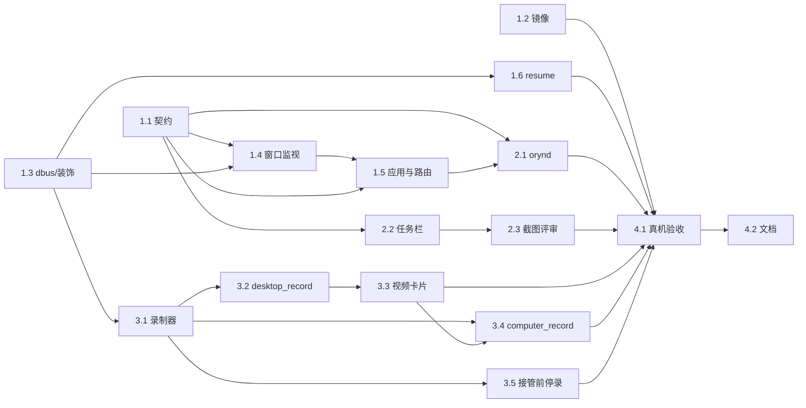

# M25 — 远程桌面变成真桌面：模拟任务栏、常用应用、无障碍树、录屏（实施计划）

> 本文自包含：执行者不需要读过产生它的对话。行号只是提示（取自 `462a0d4`），动手前按符号重读。工作区由多个会话共用，提交时只带本步骤改的行。
> 步骤编号用「阶段.序号」，例如 2.3 是阶段 ② 的第 3 步。

## Context

**要求**：远程桌面（线程右面板的 Desktop 标签，以及 `/assistant/computer` 的「桌面」页签，两处共用 `OrbDesktop`）现在只能看一个浏览器，要改成能用的桌面（B 层），并让桌面对 agent 有实际用处（C 层）。设计参考 Amp 的 Desktop 标签：画面下方居中一条「模拟任务栏」，放应用图标；窗口带标题栏，浮在中性背景上。

**现状**（读代码确认）：

- orbd 只起 Xvnc `:1` 和 openbox，Chromium 按需启动且全机只有一个（`internal/orbdrt/desktop.go`）。`assets/openbox-rc.xml` 没有根菜单、面板和终端；Chromium 最大化且不带窗口装饰。镜像里装了 LibreOffice 等程序，但用户没有入口打开。
- orbd 不起 session dbus。实测（日志 0417）：没有 session dbus 时，omp computer 的 `capabilities()` 报 `ax:false`，`win.ax()` 抛 `AxUnsupported`，agent 只能靠截图加坐标操作。
- orbd 里没有任何 EWMH / X11 客户端代码。

**终态**：

- Desktop 标签的画面下方有一条网页绘制的任务栏，依次是 Chromium、终端、VS Code、文件管理器、文本编辑器、LibreOffice。应用在运行时图标下有圆点；点击可以启动、切到前台或最小化；一个应用有多个窗口时点击弹出窗口列表。没有对应图标的窗口归到末尾的「其它窗口」。
- 窗口都带标题栏（最小化、最大化、关闭），桌面背景是中性浅灰。
- 有 session dbus 和 AT-SPI，omp computer 能读到上述应用的无障碍树。
- 线程的工作目录（有仓库时缺省是 `$HOME/workspace/repo`，也可能是项目自定义的 workdir）里有 `.oryn/desktop/resume` 时，每次显示栈启动、工作区也就绪之后执行一次（参考 Amp 的 `.agents/desktop/resume`）。
- agent 能录桌面：线程里用 `desktop_record` 工具，对话中出现可直接播放的视频卡片；助手的电脑用 `computer_record`，录完存进文件库。

**已定的取舍**（实现时不再改）：

- **继续用 X11，不换 Wayland**：omp computer 在 Wayland 下所有按窗口输入都抛 `BackgroundUnavailable`，X11 下 GTK3 窗口还能后台输入。被否的方案：照搬 Amp 的 labwc + Wayland，会让 computer use 退化，CDP 前门和 noVNC 也得重做。
- **终端用 xfce4-terminal**：Amp 截图里的 foot 只支持 Wayland。xfce4-terminal 是 GTK3（VTE），不需要 OpenGL，实测无障碍树可读。被否的方案：alacritty、kitty 需要 OpenGL 3.3，Xvnc 下只能软件渲染，没验证过。
- **文件管理器 `pcmanfm`、编辑器 `mousepad`**：都是 GTK3，各约 2MB。Arch 没有 `pcmanfm-gtk3` 这个包名，实测 `pcmanfm` 1.4.0 就是 GTK3 版。
- **VS Code 用微软官方 tarball**：从 `https://update.code.visualstudio.com/api/update/linux-{x64,arm64}/stable/latest` 取 `url` 与 `sha256hash`，下载后校验，解压到 `/opt/vscode`。1.147.0 解压后 1.1GB。被否的方案：pacman 的 `code`（Code - OSS，用 Open VSX，部分微软扩展装不了）。
- **不装 Firefox、Blender**：Firefox 与 Chromium 重复；orb 没有 GPU，Blender 视口只能软件渲染。
- **任务栏由网页绘制**，放在 noVNC 画面下方，不画进远端桌面：图标清晰，触屏可点，也不占 1280×800 的远端画面。被否的方案：在 X 里跑 tint2 之类的面板，会占远端画面，手机上也难点中。
- **应用清单由镜像决定**：镜像里放一份 `/usr/local/share/oryn/desktop-apps.json` 与图标目录，orbd 读取后上报，图标经 orynd 转给网页。图标是镜像里已安装应用自带的，网页包里不打包任何第三方商标图标（Simple Icons 已经去掉了 VS Code 和 Chromium；仓库没有许可证，不打包 GPL 的图标主题）。没有清单的镜像（自定义镜像）任务栏里只有内置的 Chromium。
- **窗口与应用状态进 `desktop.state` 全量快照**，存进 `orb_desktops` 的两个 JSON 列，与 `control` 同一套镜像机制：orb 不在 `ready` 时不对外给出。orbd 对只有窗口变化的上报合并，至少间隔 500ms。被否的方案：只放内存叠加到视图上。`orbs.View` 的调用方有 `internal/api/orbs.go`、`internal/coord/machines.go`、`internal/threads/convert.go` 和 WS 推送四条路径，叠加容易漏一条。
- **EWMH 用纯 Go 的 `github.com/jezek/xgb`**：监听根窗口的 PropertyNotify，用 ClientMessage 激活、关闭窗口。项目按 `CGO_ENABLED=0` 构建，xgb 不依赖 cgo。被否的方案：调用 `wmctrl` / `xprop -spy`，每次变化或操作都要起一个进程，还要解析文本输出。
- **Agent 操作中（`control.state == agent`）时**，任务栏的启动和窗口操作先走现有的「接管」流程。orbd 也拒绝这种状态下的启动和窗口操作，返回 409 `control_agent`，免得新窗口抢走 agent 的焦点。
- **无障碍环境**：orbd 起 `dbus-daemon --session`，套接字是 `$HOME/.oryn/desktop/run/bus`；`XDG_RUNTIME_DIR=$HOME/.oryn/desktop/run`（权限 0700）。给桌面相关进程和 agent 设 `DBUS_SESSION_BUS_ADDRESS`、`GTK_A11Y=atspi`、`ACCESSIBILITY_ENABLED=1`；VS Code 额外带 `--force-renderer-accessibility`。Chromium 不加这个参数：网页内容由 browser 工具经 CDP 读取。找不到 `dbus-daemon` 时桌面照常启用，只是没有无障碍树，记一行警告。
- **录屏**：每台 orb 同时最多一个录制。ffmpeg x11grab，帧率 15，`libx264 -preset veryfast -crf 28 -pix_fmt yuv420p -movflags +faststart`，分辨率取开始时的根窗口尺寸，最长 10 分钟后自动停止。文件放在 `$HOME/recordings/<UTC yyyyMMdd-HHmmss>.mp4`，只保留最近 20 个。停止时往 ffmpeg 的 stdin 写 `q`，等它收尾，最多等 10 秒，超时 SIGKILL，并在结果里注明文件可能不完整。录制中途远端分辨率变了，ffmpeg 会出错退出，录制就此结束，结果照常给出。
- **录屏结果的去向**：线程里，视频留在 orb 上，`desktop_record` 的卡片内嵌 `<video>` 播放（文件地址取 `orbFileSource(...).downloadUrl`）。助手的电脑上，`computer_record` 停止后把视频存进文件库，`Source` 与 `computer_download` 相同；超过 `transferMax` 时视频只留在电脑上，结果里说明。
- 记为 M25，在 `main` 上按步骤原子提交；阶段顺序 ① → ② → ③ → ④。

## Non-goals

- A 层的活动时间线、当前一步视图、终端页签，以及助手的电脑接入 Portal：主人已决定不做。
- 多个线程或助手对话抢同一个桌面时的租约：这轮不做，在 `docs/features.md` 写进已知限制。
- 「agent 正在用电脑」的实时指示：没有可靠信号（computer 是 eval 的 prelude，不是独立工具），不做。
- 工具卡显示截图：eval 卡片已经用 `ResultImages` 显示 computer 截图（`web/src/tool-render/tools/eval.tsx`），不再做。
- Firefox、Blender，按需安装应用，桌面里的中文输入法，声音，多显示器，录音，把视频贴进 PR。
- VS Code 账号登录与设置同步：设置只留在这台 orb 的 `$HOME/.config/Code` 里。
- 给 agent 加启动应用的 CLI：omp computer 的 `apps.open` 走 XDG 桌面项就能打开应用，有了 dbus 就能用。

## 假设

- A1 镜像增加约 1.2GB（主要是 VS Code）可以接受。Firecracker 根盘由 `scripts/build-fc-rootfs.sh` 按实际用量自动定大小，不用改。不成立时影响步骤 1.2。
- A2 openbox 处理 `_NET_ACTIVE_WINDOW` 时会把最小化的窗口还原到前台（EWMH 规定的行为）。不成立时步骤 1.5 的「激活」要先发 `_NET_WM_STATE` 去掉 `_NET_WM_STATE_HIDDEN`。
- A3 关掉 LibreOffice 首次启动的欢迎对话框，靠 `/usr/lib/libreoffice/share/registry/` 下的一个 xcd 文件就够了，内容是 `org.openoffice.Setup/Product/ooSetupLastVersion` 等于镜像里的版本号，加上 `org.openoffice.Office.Common/Misc/ShowTipOfTheDay=false`。不成立时只影响步骤 1.2 的验收截图。
- A4 GTK3 应用只要有 `DBUS_SESSION_BUS_ADDRESS` 和 `GTK_A11Y=atspi`，就会自己经 dbus 拉起 `at-spi-bus-launcher`（探针里就是这样拿到总线的）。不成立时步骤 1.3 要由 orbd 自己拉起 `/usr/lib/at-spi-bus-launcher`。
- A5 每个 orbd 进程在 orb 进入 `ready` 之前都会收到一次 `setup.run` 或 `resume.run`（`DesktopHooks.BeforeReady` 的注释写明它在 setup / resume 成功之后调用），因此「`runSetupLocked` 返回过一次」可以当作「工作区已就绪」。不成立时步骤 1.6 只看 home 脚本的那条路径会永远等不到触发，要改成另找就绪信号。

## 通用约定

- 工作目录 `/root/Projects/Ling/Oryn`，分支 `main`。每个步骤一个提交，格式 `<type>(<scope>): <gitmoji> <中文 subject>`，带 `Co-authored-by: Wine Fox <fox@ling.plus>`；只提交本步骤改的行。
- 每个阶段结束用 `record-agent-log` 记一条（做了什么、为什么）。
- 改 Go 的步骤读 `skill://go`；改 `web/` 的步骤读 `skill://react` 与 `skill://typescript`；改镜像的步骤读 `skill://containers`；写迁移读 `skill://sqlite`；写验收脚本读 `skill://web-testing`。
- 改到 `web/` 的步骤，结束时必须通过 `cd web && bun run check && bun run test`。改到 Go 的步骤，结束时必须通过该步骤「验收」里列的 `go test`。改了 `schema/openapi.yaml` 或 `internal/store/{migrations,queries}` 的步骤，先跑 `make gen` 和 `make lint-spec`；提交之后再跑 `make check-gen`。
- 迁移：现在最高是 `0050_project_secrets.sql`，本计划用 0051，被占用就顺延。用 goose 格式，Down 必须能执行。`queries/*.sql` 里的注释只用英文。
- 界面遵守 `docs/design/web-guidelines.md`：颜色只用 `web/src/index.css` 的 token，弹层走 `web/src/components/ui/Floating.tsx`，确认走 `confirmAction`（`web/src/lib/confirm.ts`），新文案同时加进 `web/src/i18n/locales/zh-CN.json` 与 `en.json`。图标只用 `web/src/components/ui/icons.tsx` 里登记过的，缺的就按 Phosphor 深导入补登记（应用图标例外，来自 orb，见步骤 2.2）。
- 测试替身：`cmd/fakedesk` 按 argv[0] 扮演 Xvnc、openbox、chromium。本计划给它加 `dbus-daemon`、`ffmpeg` 和一个通用应用替身 `fakeapp-gui`。需要真实 X 的测试，只在 PATH 里有 `Xvfb` 时运行，否则 `t.Skip`（开发机有 `/usr/bin/Xvfb`）。

## 阶段 0 — 入库

**步骤 0.1** 把本计划存成 `docs/plan-m25.md` 并提交（`docs(plan): 📝 M25 远程桌面任务栏、应用与录屏计划`）。

## 阶段 ① — 契约、镜像与 orbd

交付：契约冻结；镜像里有应用、清单与图标；orbd 起 dbus 与 AT-SPI，上报窗口与应用，能启动应用、操作窗口、执行 resume 脚本。这一阶段只改服务端，单独合入也不影响现有界面。

### 步骤 1.1 — 契约：桌面应用、窗口、操作与 hello 特性

依赖：无。
文件：改 `schema/openapi.yaml`，新建 `internal/store/migrations/0051_desktop_windows.sql`，改 `internal/store/queries/desktop.sql`，`make gen` 生成的文件随本步提交。
产出：

- schema `OrbDesktopApp {id: string（^[a-z][a-z0-9-]{0,31}$）, name: string（≤64）, running: boolean, launching: boolean}`。
- schema `OrbDesktopWindow {id: string（X 窗口 id 的十进制）, appId?: string, title: string（≤200）, active: boolean, minimized: boolean}`。
- `OrbDesktop` 与 `LinkCtlDesktopStateParams` 各加可选字段 `apps: OrbDesktopApp[]`（≤16）和 `windows: OrbDesktopWindow[]`（≤32）。旧 orbd 不发这两个字段。
- `POST /api/v1/orbs/{id}/desktop/apps/{app}/launch` → `200 Orb`。错误码：`409 control_agent`、`404 app_not_found`、`409 orbd_outdated`、`503 orb_unavailable`。
- `POST /api/v1/orbs/{id}/desktop/windows/{window}/{action}`，`action ∈ {activate, minimize, close}` → `200 Orb`。错误码：`404 window_not_found`、`409 control_agent`、`409 orbd_outdated`。
- `GET /api/v1/orbs/{id}/desktop/apps/{app}/icon` → `200`，`image/png` 或 `image/svg+xml`，`Cache-Control: private, max-age=86400`。这个接口不唤醒 orb：orb 不在 ready 时回 `409 orb_unavailable`。
- hello 特性字符串 `desktop-apps`：orbd 有上述本机路由时声明。
- 迁移 0051：`orb_desktops` 加 `apps TEXT` 与 `windows TEXT`（JSON，可空）。`UpsertOrbDesktopState` 带上这两列（用 `sqlc.narg`）。
做什么：在 `docs/protocol.md` 的 M8 节后面加「M25：桌面应用与窗口」小节，写出上面的字段、路由和错误码。
验收：`make gen && make lint-spec` 退出码 0；`go build ./...` 通过；提交后 `make check-gen` 退出码 0。

### 步骤 1.2 — 镜像：应用、无障碍、清单与图标

依赖：无。本步只改 `images/orb/`，和 1.1 没有共用文件，可以与 1.1 并行。
文件：改 `images/orb/Dockerfile`、`images/orb/smoke-test.sh`；新建 `images/orb/desktop-apps.json`、`images/orb/desktop-icons.sh`、`images/orb/libreoffice-oryn.xcd`；改 `scripts/build-orb-image.sh`（把新文件复制进构建上下文 `build/orb-context/<arch>/`）。
产出：

- pacman 追加 `xfce4-terminal mousepad pcmanfm xorg-xsetroot`。`dbus`、`at-spi2-core` 已在镜像里（chromium 的依赖），显式写进包列表，免得上游依赖变化后被带走。
- VS Code：用 Dockerfile 里现有 `fetch` 函数的同一种写法（下载后校验摘要），改用 VS Code 的更新 API 取 `url` 与 `sha256hash`；架构 `amd64 → linux-x64`、`arm64 → linux-arm64`。解压到 `/opt/vscode`，建软链 `/usr/local/bin/code → /opt/vscode/bin/code`，写入 `/usr/share/applications/code.desktop`（`Exec=code %F`、`Icon=/opt/vscode/resources/app/resources/linux/code.png`），让 omp computer 的 `apps.list` 能找到它。
- `desktop-apps.json` 复制到 `/usr/local/share/oryn/desktop-apps.json`。数组按任务栏顺序排列，每项 `{id, name, exec: string[], wmClass: string[], desktopFile, icon}`。id 与 WM_CLASS 取自探针实测：
  - `chromium`：`exec` 为空，由 orbd 走现有的浏览器启动；`wmClass ["Chromium"]`；`chromium.desktop`。
  - `terminal`：`["xfce4-terminal"]`；`["Xfce4-terminal"]`；`xfce4-terminal.desktop`。
  - `vscode`：`["code", "--force-renderer-accessibility"]`；`["code"]`；`code.desktop`。
  - `files`：`["pcmanfm"]`；`["Pcmanfm"]`；`pcmanfm.desktop`。
  - `editor`：`["mousepad"]`；`["Org.xfce.mousepad"]`；`org.xfce.mousepad.desktop`。
  - `libreoffice`：`["libreoffice", "--nologo"]`；`["libreoffice-startcenter", "libreoffice-writer", "libreoffice-calc", "libreoffice-impress", "libreoffice-draw", "libreoffice-math", "libreoffice-base", "Soffice"]`；`libreoffice-startcenter.desktop`。
  - `icon` 是图标文件名，指向 `/usr/local/share/oryn/desktop-icons/` 下的文件。
- `desktop-icons.sh` 在构建时运行：对每项读 `/usr/share/applications/<desktopFile>` 的 `Icon=`。值是绝对路径就直接用；否则在 `/usr/share/icons/hicolor/` 下找同名的 `scalable/apps/<名>.svg`，找不到就取 `256x256`、`128x128`、`64x64`、`48x48` 里第一个存在的 PNG，再不行就用 `/usr/share/pixmaps/<名>.png`。找到的文件复制成 `/usr/local/share/oryn/desktop-icons/<id>.<svg|png>`，并回写清单的 `icon` 字段。任何一项找不到图标，构建就失败。
- `libreoffice-oryn.xcd`：按假设 A3 关掉首次启动的欢迎对话框；`ooSetupLastVersion` 在构建时用 `libreoffice --version` 填入。
- `smoke-test.sh`：命令清单加 `xfce4-terminal mousepad pcmanfm code dbus-daemon xsetroot`；用 `jq -e` 校验清单；逐项检查图标文件存在。
做什么：按上面改。Dockerfile 里写注释说明为什么用 xfce4-terminal 而不是 foot。
验收：`make image` 退出码 0，镜像冒烟（`--network none`）最后一行没有报错。`docker run --rm --entrypoint jq oryn-orb:dev -r '.[].id' /usr/local/share/oryn/desktop-apps.json` 输出 6 行：`chromium terminal vscode files editor libreoffice`。

### 步骤 1.3 — orbd：dbus、无障碍环境、背景色与窗口装饰

依赖：无代码依赖；真机验收要用 1.2 的镜像。
文件：改 `internal/orbdrt/desktop.go`（`runDisplayOnce`）、`internal/orbdrt/runtime.go`（`baseEnv`）、`internal/orbdrt/assets/openbox-rc.xml`、`cmd/fakedesk/main.go`、`internal/orbdrt/desktop_test.go`。
产出：

- `(*desktop).busPath() string` 返回 `$HOME/.oryn/desktop/run/bus`；`(*desktop).runtimeDir() string` 返回 `$HOME/.oryn/desktop/run`。
- `baseEnv()` 在桌面启用时，在已有的 `DISPLAY` 之外再加 `DBUS_SESSION_BUS_ADDRESS=unix:path=<busPath>`、`XDG_RUNTIME_DIR=<runtimeDir>`、`GTK_A11Y=atspi`、`ACCESSIBILITY_ENABLED=1`。agent、受管服务、computer 执行器（`internal/orbdrt/computer.go` 用 `baseEnv`）都会拿到。
做什么：

- `runDisplayOnce` 的顺序：Xvnc 就绪 → 建 runtimeDir（权限 0700），删除残留的 bus 套接字 → `spawn("dbus", "dbus-daemon", ["--session", "--address=unix:path=<busPath>", "--nofork", "--nopidfile"])`，等套接字可以连上，最多等 5 秒 → 起 openbox → `xsetroot -solid "#e5e5e3"`（一次性命令，失败只记日志）。dbus 退出不算显示失效（不重启 Xvnc），只记警告；显示重启时 dbus 跟着重启。找不到 `dbus-daemon` 就跳过，只记一行警告。
- `openbox-rc.xml`：删掉 Chromium 不带装饰的规则，保留最大化；加 `class="code"` 最大化；其它窗口按默认装饰居中放置。顶部注释改成新的约定。
- fakedesk 加 `dbus-daemon` 身份：解析 `--address=unix:path=`，在该路径上 listen，挂起直到 SIGTERM。
验收：`go test ./internal/orbdrt/ -run 'TestDesktopDisplaySupervision|TestDesktopDbus' -count=1` 通过。新测试 `TestDesktopDbus` 断言三件事：fake dbus 的套接字存在；agent 进程环境里有 `DBUS_SESSION_BUS_ADDRESS=unix:path=` 加 busPath；PATH 里去掉 `dbus-daemon` 后 `displayReady` 仍为真。

### 步骤 1.4 — orbd：窗口监视（xgb）与快照字段

依赖：1.1（`OrbDesktopWindow`、`LinkCtlDesktopStateParams.windows`），1.3（显示生命周期里的挂载点）。
文件：新建 `internal/orbdrt/deskwin.go`、`internal/orbdrt/deskwin_test.go`；改 `internal/orbdrt/desktop.go`（`snapshotLocked`、`runDisplayOnce`）；`go.mod` / `go.sum` 加 `github.com/jezek/xgb`。
产出：

- `type winInfo struct { id uint32; class []string; title string; active, minimized bool; pid int }`。
- `type wmClient interface { Watch(ctx context.Context, onChange func([]winInfo)) error; Activate(id uint32) error; Minimize(id uint32) error; Close(id uint32) error }`。
- `newXWM(display string) wmClient` 是 xgb 实现：订阅根窗口的 `PropertyChangeMask`，关心 `_NET_CLIENT_LIST`、`_NET_ACTIVE_WINDOW`，以及每个客户窗口的 `_NET_WM_NAME`、`WM_NAME`、`_NET_WM_STATE`、`WM_CLASS`、`_NET_WM_PID`（对客户窗口也订阅 PropertyChangeMask）。激活发 `_NET_ACTIVE_WINDOW` ClientMessage（source indication = 2）；关闭发 `_NET_CLOSE_WINDOW`；最小化发 `WM_CHANGE_STATE`（IconicState）。
- `desktop.wins []winInfo`（受 `mu` 保护）。`snapshotLocked` 把它转成 `Windows`：用清单（步骤 1.5）把 WM_CLASS 映射成 `appId`，标题超过 200 字符就截断，最多 32 个，按 `_NET_CLIENT_LIST` 的顺序排列。
做什么：显示就绪后，在 openbox 起来之后启动 Watch；显示失效时随 ctx 取消，并清空 `wins`。只有窗口变化的上报，经 `unlockAndEmit` 前的合并闸门，至少间隔 500ms（用 `time.AfterFunc` 合并）；其它字段变化时立即上报，不合并。
验收：`go test ./internal/orbdrt/ -run 'TestDeskWin' -count=1` 通过。
- `TestDeskWinFake` 用假 `wmClient` 断言：快照里的窗口顺序、`appId` 映射、标题截断；1 秒内 10 次窗口变化最多产生 3 次上报。
- `TestDeskWinRealX` 在有 `Xvfb` 时启动 `Xvfb :<随机>` 和 `openbox`，开两个 `xmessage` 窗口，断言 Watch 回调里有两个 class 为 `Xmessage` 的窗口；对第一个 Minimize 后 `minimized=true`，Activate 后 `active=true` 且 `minimized=false`（这一条验证假设 A2）；Close 后列表剩一个窗口。没有 `Xvfb` 时 Skip。

### 步骤 1.5 — orbd：应用清单、启动、窗口操作、图标路由

依赖：1.1（路由与错误码），1.4（`wmClient`、`wins`）。
文件：新建 `internal/orbdrt/deskapps.go`、`internal/orbdrt/deskapps_test.go`；改 `internal/orbdrt/desktopapi.go`（`deskRoutes`）、`internal/orbdrt/runtime.go`（hello 加 `desktop-apps`）、`internal/orbdrt/desktop.go`（`snapshotLocked` 填 `Apps`）、`cmd/fakedesk/main.go`（`fakeapp-gui` 身份：挂起直到 SIGTERM）。
产出：

- `type deskApp struct { ID, Name string; Exec, WMClass []string; Icon string }`。`loadDeskApps(path string) []deskApp` 读取清单。文件不存在或解析失败时只返回内置的 `chromium`，图标为空，记一行日志。路径缺省为 `/usr/local/share/oryn/desktop-apps.json`，测试用环境变量 `ORYN_DESKTOP_APPS` 覆盖。
- 快照字段 `Apps`：每个应用的 `running` 表示有 `appId` 等于它的窗口；chromium 另外看 `browser == running`。`launching` 从发起启动起为真，直到出现这个应用的窗口，或过了 20 秒。
- 本机路由（`deskRoutes`）：
  - `POST /desktop/apps/{id}/launch`：`control.state == agent` → 409 `control_agent`；未知 id → 404 `app_not_found`；id 为 chromium → 走 `startBrowser`；否则用 `spawn` 起 `Exec`。工作目录是 `$HOME/workspace`，不存在就用 `$HOME`；环境用 `baseEnv`。进程组独立，不随 orbd 的请求结束。每次点击都启动一个新实例，「切到已有窗口」由网页决定。返回快照。
  - `POST /desktop/windows/{wid}/{action}`：control 检查同上；窗口不在 `wins` 里 → 404 `window_not_found`；否则调用对应的 `wmClient` 方法，返回快照。
  - `GET /desktop/apps/{id}/icon`：按扩展名回 `image/svg+xml` 或 `image/png`；没有图标 → 404。
- hello 在 `r.desk != nil` 时追加 `desktop-apps`。
验收：`go test ./internal/orbdrt/ -run 'TestDeskApps' -count=1` 通过。用例覆盖：清单缺失只剩 chromium；用 fakeapp-gui 启动后 `launching=true`，假 wmClient 报告窗口后变成 `running=true`、`launching=false`；`control=agent` 时 launch 与窗口操作都回 409 `control_agent`；未知 id 回 404；图标的 Content-Type 正确。

### 步骤 1.6 — orbd：桌面 resume 脚本

> 修订（执行前，2026-11-22）：原文写死 `$HOME/workspace/.oryn/desktop/resume`，并在显示就绪时立即执行，有两处错误。① `internal/orbdrt/setup.go` 的 `runSetupLocked` 定工作目录：项目自定义 workdir 优先，有仓库时缺省是 `$HOME/workspace/repo`，都没有才是 `$HOME/workspace`。② `Runtime.Run` 先启动显示栈，首次 checkout 在之后的 `setup.run` 里才完成；显示就绪那一刻仓库里的脚本可能还不存在。改成下面的写法。

依赖：1.3（显示生命周期）。
文件：改 `internal/orbdrt/desktop.go`、`internal/orbdrt/setup.go`（`runSetupLocked` 返回时通知桌面）；新建 `internal/orbdrt/deskresume.go`、`internal/orbdrt/deskresume_test.go`。
产出：
- `desktop.displayGen uint64`（受 `mu` 保护）：`runDisplayOnce` 每次走到 openbox 起来就加 1。
- `desktop.resumedGen uint64`：最近一次已执行 resume 的显示代数。
- `(*desktop).workspaceReady(workdir string)`：由 `runSetupLocked` 在返回前调用（成功、失败都调；`setup.run`、`resume.run` 都调），记下当时的 `r.workdir`，并标记「工作区已就绪」。
做什么：
- 触发条件：显示已就绪、工作区已就绪、`displayGen > resumedGen`，三者同时成立时执行一次，然后 `resumedGen = displayGen`。显示就绪和 `workspaceReady` 两处都检查一次条件，谁后到谁触发。
- 效果：冻结（docker pause）后唤醒，代数不变，不会重复执行，已开的应用原样保留；停机再启动是新的 orbd 进程，代数从头算，等 `resume.run` 返回后执行；显示栈崩溃重启，代数加 1，工作区已就绪，立即重新执行；同一代数里又来一次 `setup.run`（例如 repo-update），不重复执行。
- 脚本查找：按顺序找第一个存在且可执行的 `<workdir>/.oryn/desktop/resume`、`$HOME/.oryn/desktop/resume`。`workdir` 取 `workspaceReady` 记下的值。前者的工作目录是 `workdir`，后者是 `$HOME`。
- 执行：独立进程组，环境用 `baseEnv`，输出进桌面日志 `resume.log`。orbd 最多等 60 秒，超时只记「仍在运行」，不杀进程（脚本可能拉起了常驻应用）；退出码非 0 记警告。显示失效时不额外处理，X 一断开，它起的 GUI 进程会自己退出。
验收：`go test ./internal/orbdrt/ -run 'TestDeskResume' -count=1` 通过。用例全部用假显示栈和直接调用 `workspaceReady`，不需要真的 setup：
- 显示先就绪、`workspaceReady` 后到：在 `workspaceReady` 之后执行。
- `workspaceReady` 先到、显示后就绪：在显示就绪之后执行。
- workdir 是 `$HOME/workspace/repo` 与自定义目录两种情况：都执行 `<workdir>` 下的脚本，`$HOME/workspace` 下的同名脚本不执行。
- 只有 home 脚本时执行它，工作目录是 `$HOME`。
- 脚本不可执行时跳过。
- 同一代数里第二次 `workspaceReady` 不重复执行；显示重启（代数加 1）后再执行一次。
- 脚本里 `sleep 120` 不阻塞 `displayReady`。

## 阶段 ② — 控制面与网页任务栏

交付：线程 Desktop 标签和助手的电脑「桌面」页签都有任务栏。

### 步骤 2.1 — orynd：镜像列、三个 REST 处理器

依赖：1.1（契约），1.5（本机路由）。
文件：改 `internal/orbs/desktop.go`（`ApplyDesktopState` 写入 apps、windows）、`internal/orbs/view.go`（`DesktopView` 读出；orb 不在 ready 时与 `Control` 一样置 nil）、`internal/desktop/sync.go`（新方法）、`internal/api/desktop.go`（三个处理器）、`internal/orbs/desktop.go`（常量 `FeatureDesktopApps = "desktop-apps"`）。测试放在 `internal/desktop/` 与 `internal/orbs/` 现有的测试文件旁边。
产出：

- `(*desktop.Service).LaunchApp(ctx, orbID, appID string) error`、`WindowAction(ctx, orbID, windowID, action string) error`：先 `EnsureUsable(..., FeatureDesktop, wake=true, wakeWait)`，link 没有声明 `desktop-apps` → `ErrOrbdOutdated`；然后 `orbdCall`，把返回的快照交给 `ApplyDesktopState`；orbd 的 `control_agent`、`app_not_found`、`window_not_found` 原样映射成 409 / 404。
- `(*desktop.Service).AppIcon(ctx, orbID, appID string) (contentType string, body io.ReadCloser, err error)`：`EnsureUsable(..., wake=false)`，不可用回 409 `orb_unavailable`。
验收：`go test ./internal/desktop/ ./internal/orbs/ ./internal/api/ -count=1` 通过。新用例：镜像列的写入与读出；orb 冻结后视图里 `apps`、`windows` 为空；旧 orbd（hello 没有 `desktop-apps`）回 409 `orbd_outdated`；错误码映射正确。

### 步骤 2.2 — 网页：任务栏组件与 mock

依赖：1.1（`make gen` 之后 `Schemas["OrbDesktopApp"]` 等类型可用）。不依赖 2.1：开发阶段用 mock，2.1 只是让真后端可用，两步可以并行。
文件：新建 `web/src/components/desktop/DesktopDock.tsx`、`web/src/components/desktop/DesktopDock.test.tsx`；改 `web/src/components/desktop/DesktopPanel.tsx`（`DesktopView` 里舞台下方挂任务栏；删掉舞台中央的「启动浏览器」按钮，它的作用由任务栏的 Chromium 图标代替）、`web/src/api/queries.ts`（`useOrbDesktopApp(orbId)`、`useOrbDesktopWindow(orbId)` 两个 mutation，与 `useOrbBrowser` 同形，都走 `mutateOrb`）、`web/src/mock/desktop.ts`（mock 的 orb 带 apps 和 windows，launch 后 300ms 出现窗口，窗口操作立即生效）、`web/src/i18n/locales/{zh-CN,en}.json`。
产出：`DesktopDock({ orb, controlLocked, onTakeOver }: { orb: Orb; controlLocked: boolean; onTakeOver: () => Promise<void> }): ReactNode`。
做什么：

- 位置与外观：舞台（`desktop-stage`）正下方居中一条胶囊（`rounded-full border border-border bg-panel shadow-xs`），高 `h-11`，图标 22px（compact 断点 20px），图标间距 `gap-1`。超出宽度时横向滚动。`orb.desktop.apps` 为空（旧 orbd）时不渲染任务栏，并恢复中央的「启动浏览器」按钮，保持旧行为。
- 图标：``（同源 Cookie，与 `blobUrl` 同一种做法），`alt` 为应用名，加载失败时换成占位图标 `appWindow`。这个图标要先在 `icons.tsx` 登记：Phosphor 的 `AppWindow`，深导入 `@phosphor-icons/react/dist/csr/AppWindow`。悬停显示名称。运行中的应用，图标下方有一个 4px 的 `bg-accent` 圆点；`launching` 时图标上叠一个 `Spinner`；拥有活动窗口的应用，图标底色 `bg-hover`。
- 点击：
  - 应用没在运行 → launch。
  - 有一个窗口：是活动窗口且没有最小化 → minimize；否则 → activate。
  - 有多个窗口 → 弹出 `Floating` 菜单，每行一个窗口标题（点击 activate，行尾 ✕ close），末行「新建窗口」（launch）。
  - 右键或长按任意运行中的图标 → 同一个菜单。
  - 末尾的「其它窗口」图标（`appWindow`）只在有不属于任何应用的窗口时出现，点击一律弹菜单。
- `controlLocked`（`control.state == agent`）时，点击先 `confirmAction("接管桌面后再打开？")`，确认后 `await onTakeOver()`，再执行原操作。
- 错误用现有的 `ErrorText` 显示在横幅区。`control_agent` 不会出现在这里，因为已先接管。
- 键盘：任务栏是 `role="toolbar"`，用方向键切换焦点，Enter 执行点击，Shift+F10 打开菜单。
验收：`cd web && bun run check && bun run test` 通过。`DesktopDock.test.tsx` 覆盖：旧 orbd 不渲染任务栏；运行中有圆点；单窗口的活动 / 非活动两种点击分别发出 minimize / activate；多窗口弹菜单；`controlLocked` 时先确认再接管、再 launch；图标加载失败换成占位图标。

### 步骤 2.3 — 截图评审

依赖：2.2。
文件：改 `web/scripts/screenshots.ts`（新增场景 `desktop.dock`：线程 Desktop 标签与助手的电脑「桌面」页签，各两种状态：单窗口、多窗口菜单展开），在 `docs/ui-audit/inventory.md` 登记。
做什么：运行 `cd web && ORYN_SHOTS_DIR=/tmp/oryn-shots/m25dock bun run shots:all --only desktop`，出亮 / 暗 × 390 / 1280 的截图，自己看图；再按 `skill://oil-ui` 的「存量已有界面润色评审」派一位没有上下文的评审者，只给截图和本步骤说明。评审指出的问题在本步骤内改完。
验收：截图文件齐全（8 张）；评审结论里没有未处理的问题；`bun run check && bun run test` 通过。

## 阶段 ③ — 录屏

交付：线程里的 agent 能录桌面，视频在对话里直接播放；助手的电脑上录的视频存进文件库。

### 步骤 3.1 — orbd：录制器、本机路由与 orbd.sock 方法

依赖：1.3（显示生命周期）。不依赖阶段 ②。
文件：新建 `internal/orbdrt/deskrecord.go`、`internal/orbdrt/deskrecord_test.go`；改 `internal/orbdrt/desktopapi.go`（路由与 sock 分派）、`internal/orbsock/orbsock.go`（方法常量与结果类型）、`internal/orbdrt/selfsetup.go`（把新方法加进 sock 允许列表，与 `MethodDesktopBrowserStart` 同一处）、`cmd/fakedesk/main.go`（`ffmpeg` 身份：写一个以 `ftyp` 开头的小文件到最后一个参数指定的路径，读到 stdin 的 `q` 后退出）。
产出：

- `orbsock.MethodDesktopRecordStart = "desktop.record.start"`、`MethodDesktopRecordStop = "desktop.record.stop"`。
- `orbsock.DesktopRecording { Path string; Bytes int64; DurationMs int64; Width, Height int; Truncated bool; StoppedBy string }`，`StoppedBy ∈ {"agent", "limit", "error"}`。
- 本机路由 `POST /desktop/record/start` → `200 {path}`；已在录制 → 409 `already_recording`；显示未就绪 → 409 `not_ready`。`POST /desktop/record/stop` → `200 DesktopRecording`；没有在录、但上一次录制是因上限或出错停的且还没被取走 → 返回那一次（取走后清空）；否则 409 `not_recording`。
- 录制参数、文件位置、10 分钟上限、保留 20 个、停止方式，都照「已定的取舍」里的录屏条目。
做什么：录制器挂在 `desktop` 上；显示失效时按 `StoppedBy="error"` 收尾。sock 方法与本机路由共用同一个实现。
验收：`go test ./internal/orbdrt/ -run 'TestDeskRecord' -count=1` 通过。用例：用 fake ffmpeg 走完 start → stop，`Path` 存在、`Bytes > 0`；重复 start 回 409；把上限改成 200ms 后自动停止，下一次 stop 拿到 `StoppedBy=limit`；第 21 个录制产生后最旧的那个被删除。

### 步骤 3.5 — orbd：人工输入前结束录制（3.1 之后补的）

> 补充（3.1 已提交后，2026-11-22）：录制器录的是整个 `:1`，原先只会因为上限、显示失效、ffmpeg 退出而停止。`desktop_ask_user` 本来就是让人在桌面上登录、输入验证码、确认支付的，用户接管（`user`）或 agent 请求人工操作（`ask`）时画面会放开人工输入，这些输入会被录进视频，再经卡片或文件库交出去。

依赖：3.1、3.2、3.4 的 Go 部分（这里要改它们给模型的文字）。
文件：改 `internal/orbdrt/deskrecord.go`、`internal/orbdrt/deskcontrol.go`、`internal/orbdrt/deskrecord_test.go`、`internal/orbsock/orbsock.go`、`internal/orbdrt/assets/oryn-orb.ts`、`internal/coord/computer.go`。
产出：
- `StoppedBy` 增加取值 `"control"`（常量 `orbsock.RecordStoppedByControl`）。
- 错误码 `control_user`（常量 `orbsock.CodeControlUser`）：控制状态是 `user` 或 `ask` 时，start 回 409 `control_user`（sock 用同一个码）。
做什么：
- **触发**：录制进行中，控制状态变成 `user` 或 `ask`；或者从 `agent` 变回 `idle`（回合结束后，面板也会放开输入）。这三种情况都结束录制，`StoppedBy="control"`，结果留给下一次 stop 取走，与 `limit` 一样。助手的电脑上，控制状态通常一直是 `idle`，在 `idle` 里开始录制仍然允许；这时用户同时在面板里操作，输入会被录进去，写进文档的已知限制。
- **顺序**：先让 ffmpeg 退出（`q`，等待时长同录制器的收尾等待，超时 SIGKILL），之后才把新的控制状态交给 `onState` 或上报给控制面。网页只在看到新状态后才放开输入，所以人工输入不会进入画面。等 ffmpeg 退出时不能持有 `d.mu`：先在锁内算出新状态并判断需要停录，然后解锁、停录，再按原顺序上报（经 `emitMu`，不能乱序）。`takeControl`、`observeAgentFrame`（`ask` 登记、`agent_end`）、`agentExited` 都要走这条路径。
- **文字**：`oryn-orb.ts` 和 `coord/computer.go` 给模型的文字，按 `control_user` 和 `stoppedBy=control` 写成可操作的说明，例如「用户正在操作桌面，录制已结束或不能开始；等用户交还后需要时重新录」。
验收：`go test ./internal/orbdrt/ ./internal/coord/ -run 'TestDeskRecord|TestDesktop|TestDeskControl|TestComputerRecord|TestDesktopRecordTool' -count=1` 通过。新用例用假录制器（fake ffmpeg 读到 `q` 后先睡 300ms 再退出），覆盖以下情况：
- agent → user（`takeControl`）：录制以 `control` 结束，并且 `onState` 收到 `user` 状态的时刻晚于 ffmpeg 退出。
- agent → ask（`desktop_ask_user` 的 select 帧）：同上。
- agent → idle（终结的 `agent_end`）：录制以 `control` 结束。
- `user` 和 `ask` 状态下 start 都回 409 `control_user`。
- `idle` 状态下 start 成功。
`bun build --no-bundle internal/orbdrt/assets/oryn-orb.ts --outdir /tmp/m25-ext` 退出码 0。

### 步骤 3.2 — 线程工具 `desktop_record`

依赖：3.1（sock 方法与 `DesktopRecording` 的字段名）。
文件：改 `internal/orbdrt/assets/oryn-orb.ts`（在 `registerDesktopAsk` 旁边加 `registerDesktopRecord`，注册条件相同），以及该文件里桌面指引的提示词。
产出：工具 `desktop_record`，参数 `{action: "start" | "stop"}`，`approval: "read"`，`loadMode: "essential"`。经 `ORYN_ARTIFACT_SOCK` 发 `desktop.record.start` / `desktop.record.stop`，传输与 `artifactSockCall` 相同。stop 的结果：`details = DesktopRecording`；给模型的文本写明路径、时长，并说明「视频已经在对话里展示给用户」。
做什么：在桌面指引里加一句：改了界面、需要让用户看到实际效果时，先 `desktop_record start`，在桌面上演示一遍，再 `desktop_record stop`；录制最长 10 分钟。
验收：`go test ./internal/orbdrt/ -run 'TestAgentAssetsAndExtensionArg|TestDesktopRecordTool' -count=1` 通过。新测试 `TestDesktopRecordTool` 照 `internal/github/presets_test.go` 的 `registeredOrbTools` 写法，从 `assets/oryn-orb.ts` 里取出注册的工具名，断言含 `desktop_record`。`bun build --no-bundle internal/orbdrt/assets/oryn-orb.ts --outdir /tmp/m25-ext` 退出码 0（仓库没有对这个文件做类型检查，这里只验语法）。

### 步骤 3.3 — 网页：`desktop_record` 视频卡片

依赖：3.2（工具名与 `details` 结构）。
文件：新建 `web/src/tool-render/tools/desktop-record.tsx`、`web/src/tool-render/tools/desktop-record.test.tsx`；改 `web/src/tool-render/registry.ts`（登记 `desktop_record`）、`web/src/tool-render/types.ts`、`web/src/components/transcript/MessageView.tsx`、i18n。
产出：`ToolRenderHost` 加两项可选能力（渲染器不能知道自己在哪个线程，见 `types.ts` 文件头）：`orbFileUrl?(path: string): string | null` 与 `openOrbFile?(path: string): void`。`MessageView.tsx` 在非只读时注入：前者返回 `orbFileSource(<线程的 orbId>, ctx.threadId).downloadUrl(path)`，orb 已删除时返回 null；后者调用 `uiStore.getState().openFile(ctx.threadId, path)`（与同文件里「打开文件」菜单项同一个动作）。分享页不注入。
做什么：
- start 的卡片：一行「开始录制桌面」。
- stop 的卡片：标题显示时长（`m:ss`）和大小。下方是内嵌 `<video controls preload="metadata">`，最大高度 240px，`src` 取 `host.orbFileUrl(details.path)`。
- 有 `Truncated` 时加一条提示「录制未正常收尾，视频可能不完整」。
- `host.orbFileUrl` 不存在（分享页）或返回 null（orb 已删除）时，不渲染视频，只显示文件路径和「视频保存在线程的环境里，环境删除后随之删除」。
- 视频加载出错时显示错误文字；有 `host.openOrbFile` 时再给一个「在文件中打开」按钮，调用它打开该路径。
验收：`cd web && bun run check && bun run test` 通过。测试覆盖：stop 卡片渲染出 video 且 src 等于 `host.orbFileUrl` 的返回值；有 Truncated 时显示提示；没有 host 能力时只显示路径。

### 步骤 3.4 — 助手工具 `computer_record` 与卡片

依赖：3.1（本机路由与返回结构），3.3（`ToolRenderHost` 的扩展方式与 `MessageView.tsx` 的注入位置，本步在同一处再加一项）。
文件：改 `internal/coord/computer.go`（`computerToolDefs` 加定义，`computerTool` 分派），新建 `internal/coord/computer_record_test.go`；改 `web/src/tool-render/registry.ts`（`COMPUTER_OWN_TOOLS` 加 `computer_record`，登记渲染器）、`web/src/tool-render/types.ts`、`web/src/components/transcript/MessageView.tsx`；新建 `web/src/tool-render/tools/computer-record.tsx`、`computer-record.test.tsx`；i18n。
产出：宿主工具 `computer_record {action: "start" | "stop"}`，只给全局助手。
- start：`useComputer` 之后，经 `s.orbDoAt(..., orbRequest{method: POST, path: "/desktop/record/start"})` 调用本机路由。
- stop：调用 `/desktop/record/stop`，拿到 `DesktopRecording`。`Bytes ≤ transferMax` 时，用 `toolComputerDownload` 的同一条路径（`/fs/file` 加 `s.lib.Put`，`Source: library.SourceAssistant`，scope 为本对话）存进文件库，结果的 `details` 带 `{recording: DesktopRecording, libraryFileId}`；超过上限时不存，`details` 只带 `recording`，文本说明视频留在电脑的哪个路径。
- 网页卡片：`ToolRenderHost` 再加可选能力 `libraryFileUrl?(id: string): string`，`MessageView.tsx` 在非只读时注入 `assistantFileContentUrl(id)`（文件库面板 `web/src/components/assistant/LibraryPanel.tsx` 用的同一个函数）。有 `libraryFileId` 且有这项能力时，内嵌 `<video>` 的 src 取它；否则显示电脑上的路径和「去电脑的文件页签查看」。
验收：`go test ./internal/coord/ -run 'TestComputerRecord' -count=1` 通过（用 coord 现有的假 Machines，覆盖存进文件库、超过上限不存两种情况）；`cd web && bun run check && bun run test` 通过。

## 阶段 ④ — 真机验收与文档

### 步骤 4.1 — 真机验收脚本

依赖：1.2–1.6、2.1–2.2、3.1–3.5。
文件：新建 `web/scripts/m25-accept.ts`；`web/package.json` 加 `"accept:m25": "bun scripts/m25-accept.ts"`。写法照 `web/scripts/m8-accept.ts`：对 dev 部署（`make image` 之后的 `oryn-orb:dev` + docker provider）逐项执行，每项打印 `C<n> PASS|FAIL` 和证据，失败时截图。
项目：
- C1 新建线程，打开 Desktop 标签，任务栏出现 6 个图标，图标都加载成功（`naturalWidth > 0`）。
- C2 逐个点击 6 个应用：20 秒内对应图标出现运行圆点；`docker exec` 进 orb 跑 `xprop -root _NET_CLIENT_LIST`，窗口数量相符。
- C3 VS Code 窗口：点图标最小化，再点还原。
- C4 多窗口菜单：终端再开一个窗口，菜单里有两行。
- C5 在 orb 里用 omp RPC 执行 eval，`computer.capabilities()` 的 `ax` 为真，`(await computer.window({app:"xfce4-terminal"})).ax({maxDepth:3})` 返回非空。驱动方式与日志 0417 的探针相同（`oryn_tool_call`）。
- C6 让线程执行 `desktop_record start`，等 3 秒，再 `stop`；对话里出现 video，`duration > 2`。
- C7 助手对话执行 `computer_record start/stop`，文件库里多一个 mp4。
- C8 agent 回合进行中点任务栏，弹出接管确认。
- C9 新建一个托管项目：在临时目录 `git init`，提交可执行的 `.oryn/desktop/resume`（内容是 `xfce4-terminal --title=m25-resume &`），用 `oryn project create --push` 推成托管项目。在这个项目里新建线程，打开 Desktop 标签：60 秒内出现标题为 `m25-resume` 的窗口，且 `docker exec` 进 orb 确认窗口所在进程的 cwd 等于线程工作目录（`readlink /proc/<pid>/cwd`，结果应为 `$HOME/workspace/repo`）。再冻结并唤醒这个 orb：`m25-resume` 窗口仍然只有一个。最后停机再启动：等到 ready 后又出现一个 `m25-resume` 窗口。
- C10 截图：Desktop 标签 1280 宽亮色，打开 VS Code 与终端各一个窗口，存到 `docs/assets/desktop-dock-light.png`。
验收：`cd web && bun run accept:m25` 打印 C1–C10 全部 PASS。

### 步骤 4.2 — 文档

依赖：4.1。
文件：
- `docs/features.md`：「远程桌面与人机控制」节加任务栏、应用、无障碍、resume 脚本、录屏，以及已知限制（多个线程共用桌面时没有租约，同时操作 GUI 会互相干扰）；「助手的电脑」节加 `computer_record`；「开发镜像」节加应用清单。
- `docs/protocol.md`：步骤 1.1 加的小节补上 `desktop.record.*` sock 方法。
- `README.md`：工作台段落里提到的「远程桌面」补一句任务栏与应用，配 4.1 的截图。
- `docs/deploy.md`：镜像体积增加约 1.2GB 的说明。
验收：`grep -n "desktop_record\|desktop-apps\|resume" docs/features.md docs/protocol.md` 都有命中；`cd web && bun run check` 通过。

## 步骤依赖

可以并行的组合及理由：
- 1.1 与 1.2：前者改 schema、迁移和生成物，后者只改 `images/orb/` 和构建脚本，没有共用文件。
- 1.3 与 1.2：前者改 Go 和 openbox 配置，后者改镜像，没有共用文件。
- 2.2 与 2.1：2.2 只依赖生成的 TS 类型和 mock，2.1 只改 Go。
- 3.1 与阶段 ②：3.1 只改 orbdrt 和 orbsock，阶段 ② 改的是 orbs、desktop、api 和 web。
- 3.2 与 3.4 的 Go 部分：前者只改 `oryn-orb.ts`，后者只改 `internal/coord/`。3.4 的网页部分要等 3.3，因为两者都改 `types.ts` 和 `MessageView.tsx`。

其余组合一律串行。

## 回退点

- 阶段 ① 做完：服务端已上报 `apps` / `windows`，但网页还不用它们，界面与现在一样。迁移 0051 只加可空列，Down 是删列。
- 阶段 ② 做完：任务栏可用。旧 orbd 没有 `apps` 字段，界面退回中央的「启动浏览器」按钮。
- 阶段 ③ 是纯新增的工具，不调用就不起作用。
- 任何阶段都可以停：已合入的部分各自完整；未开始的阶段只缺对应功能，不留下半截接口。

## 修订记录

- 2026-11-22（执行前）：步骤 1.6 改成按实际工作目录找脚本，并在显示栈与工作区都就绪之后按显示代数去重执行；新增假设 A5；验收 C9 改为新建真实托管项目来验证，不再往固定路径预埋脚本。原因见步骤 1.6 开头的修订说明。
- 2026-11-22（3.1 已提交后）：新增步骤 3.5，用户接管、agent 请求人工操作、回合结束时先结束录制再放开人工输入，并在 `user` / `ask` 状态下拒绝开始录制。原因：录制器录的是整个显示，会把登录、验证码等人工输入录进视频。4.1 依赖 3.5；3.3、3.4 的卡片要能显示 `stoppedBy=control`。
