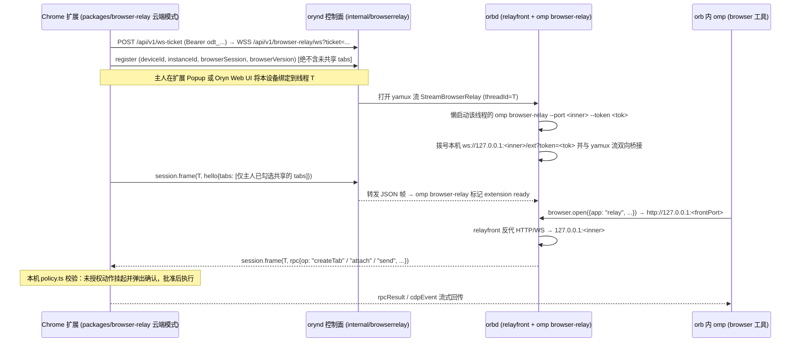

# M27 — 客户端浏览器中继（复用 `browser-relay` 驱动本机 Chrome）：实施计划

> 编号按现状取 M27（`docs/plan-m26.md` 是最后一份）、迁移号取 `0055`（`0054_research.sql` 是最后一个）。动手时若被占用则顺延，并同步改本文里的 `m27`、`M27`、`0055`、`TestE2EM27`。
> 本文自包含：执行者不需要读过产生它的对话。行号只作提示，动手前按符号重读。工作区由多个会话共用，提交时只带本步骤改的行。
> 涉及两个仓库：Oryn（`/root/Projects/Ling/Oryn`）与 Oryn Core（`/root/Projects/Ling/oryn-core`，仅扩展包 `packages/browser-relay`，`omp` 二进制无需改动）。

- **Goal**：让运行在远端 orb 中的 agent 能够安全、可控地操作用户本机 Chrome 浏览器（复用真实登录态、本机内网与住宅 IP），同时保持与现有 orb 云桌面浏览器（M8）互不干扰。
- **Approach**：复用 `oryn-core` 已有的两套原生资产——在 **orb 内**按需拉起自带的 `omp browser-relay`（95KB CDP 多路复用合成器，与 `omp` 同二进制零版本漂移），在 **用户电脑**改造原生 Chrome MV3 扩展 `packages/browser-relay` 增加「Oryn 云端共享模式」（配对码认证、Popup 选 Tab 与审批、本机策略过滤、直连 `orynd` WSS）；`orynd` 作为纯认证路由与流桥接层，把扩展与 orb 内的 `/ext` JSON 协议经现有 `yamux` link 联通。
- **Rollback point**：阶段 0 是只读验证无代码变更；阶段 1（迁移 `0055` + OpenAPI/协议冻结）可独立回退（Down 迁移还原表与 `CHECK` 约束）；阶段 2–5 均受「未绑定任何扩展时行为完全不变」约束，关闭/解绑或吊销扩展设备后现有 orb 桌面（M8）与普通 `browser.open()` 零受影响。

---

## 1. 已确认的产品与架构决定

| 编号 | 决定 | 说明 |
|---|---|---|
| D1 | **扩展直连 `orynd`** | 改造 `oryn-core/packages/browser-relay` 扩展，内置云端共享模式（配对码认证、Popup 管理、本机策略过滤、直接 WSS 连 `orynd`）。不强制运行 `oryn-desktop` 或 `oryn` CLI，Web/Desktop 全平台通用，未共享标签页元数据绝不离开浏览器。 |
| D2 | **安全模型：点选现有 Tab + 新建 Tab 不限站 + 默认交互授权而非硬拒绝** | ① 未被主人点选共享的**现有 Tab** 对云端完全不可见且不可操作；② **新建 Tab（`createTab`）**不做域名/站点硬限制（仅排除浏览器内部受保护页），**默认需用户授权确认**（允许一次 / 本会话总是允许 / 拒绝）而非一刀切拒绝；③ 高危 CDP 操作与跨边界动作同样**默认走本机交互授权**而非直接硬拒（仅远端 `reload` 指令与本机路径泄露类元数据默认屏蔽）。 |
| D3 | **与云桌面（M8）并存，显式按需调用** | `browser.open()` 默认仍走 orb 云桌面 Chromium（`browser.cdpUrl`）；线程绑定本机浏览器后通过系统提示词/上下文告知 agent，需要操作本机浏览器时显式传 `app: "relay"`（以及 `browser.targets({ app: "relay" })`）。 |
| D4 | **先冻结计划，审定后再分阶段实施** | 本文档审定后再按步骤原子提交推进。 |

### 被否决的备选方案（防日后重议）

1. **在用户本机跑 `RelayBridge`（`omp browser-relay`）并把 `/cdp` 隧道进 orb**：否决。用户电脑没有 Bun/`omp` 运行时；`oryn-core` 的 `probe.ts` 严格校验 `ompRelayVersion === VERSION`，客户端与 orb 版本极易漂移；用 Go/Rust 重写 95KB `bridge.ts` 维护成本不可接受；且在合成后的 `/cdp` 层做 Tab 级权限隔离远比在 `/ext` JSON 协议层复杂脆弱。
2. **以 `oryn-desktop` 或 `oryn` CLI 作为强制本机代理进程**：否决。强绑定桌面 App 会导致纯 Web 用户无法使用，强绑定 CLI 需要终端常驻；且未共享 Tab 元数据仍需离开浏览器，而“点选当前标签页”本就必须在 Chrome 扩展 Popup 里做最顺手。
3. **直连用户 Chrome `--remote-debugging-port=9222`**：否决。Chrome 136+ 已禁止对默认 User Data Dir 启用该参数，且全量 CDP 暴露用户全部登录态与文件系统，无 Tab 级隔离。
4. **一刀切硬拒绝 `createTab` 或高危 CDP**：否决。会阻塞真实工作流（如 agent 需打开新页面辅助登录、OAuth 跳转或排查 Cookie）；改由本机交互式授权弹窗按次/按会话放行。

---

## 2. 现状锚点（已核对源码；行号作提示）

**Oryn 仓库（`/root/Projects/Ling/Oryn`）**

- **设备配对与吊销**：
  - `internal/auth/devices.go:29-49`：`ValidDeviceKind` 当前仅接受 `"cli" | "desktop" | "mobile"`；配对流走 `StartPairing` / `PendingPairing` / `ApprovePairing` / `PollPairing`，明文令牌为 `odt_<verifier>`。
  - `internal/store/migrations/0001_init.sql:42-63`：`devices.kind` 与 `device_pairings.kind` 均有 `CHECK (kind IN ('cli', 'desktop', 'mobile'))`，扩展第四种类型 `"browser_extension"` 需在迁移 `0055` 重建/放宽约束。
  - `internal/api/devices.go:20-138`：`/api/v1/devices/pair/{start,approve,poll}`、`/api/v1/devices` 与 `RevokeDevice`；`RevokeDevice` 会触发 `auth.Revocations` 广播，供实时 WS 立即断连。
- **orb link 双向多路复用流**：
  - `internal/link/header.go:12-46`：流类型常量（`StreamCtl / StreamAgent / StreamEgress / StreamBlob / StreamPortal / StreamFS / StreamDesk / StreamLibrary / StreamSSH`）与 `StreamHeader`（含 `T`、`ThreadID` 等）。
  - `internal/orbs/link.go:69-101`：`HandleStream` 注册 `orbd -> orynd` 流处理器；`orbLink.sess.Open` 支持 `orynd -> orbd` 主动开流（参考 `internal/desktop/ws.go:109` 的 `DialDesk`）。
- **orbd 运行时与 agent 配置注入**：
  - `internal/orbdrt/runtime.go:840-870`：`hello()` 上报 `AgentVersion`（已缓存 `omp` 版本号！）与 `Features` 列表；`onRequest` 分派 ctl RPC。
  - `internal/orbdrt/agent.go:686-703`：`agentStart` 依次追加项目配置、记忆覆盖层与 `r.desktopOverlayPath()` 的 `--config` 参数。
  - `internal/orbdrt/desktop.go:215-227`：`desktopOverlay` 写入 `browser.cdpUrl: "http://<cdpAddr>"`。
  - `internal/orbdrt/cdpfront.go:18-133`：CDP 前门模式参考（loopback 监听 + HTTP/WS 代理 + 控制状态拦截）。
  - `internal/orbdrt/assets/oryn-orb.ts:24-60`：`before_agent_start` 向系统提示词注入 orb 与桌面环境指引。
- **客户端 WS 与服务装配**：
  - `internal/desktop/ws.go:19-129`：一次性 `ws-ticket` 换取、主体吊销复核（`PrincipalValid` + `Revocations` 订阅）与 WS↔yamux 流桥接的标准范式。
  - `internal/realtime/hub.go:58-102`：Web/App 客户端实时事件推送 Hub。
  - `internal/server/server.go:100-154`：控制面所有 Service 的统一装配点。
  - `Makefile:14-56`：`make gen`（`gen-go` + `gen-sqlc` + `gen-web`）、`make check-gen`、`make lint-spec`、`make build`、`make test`、`make web`。

**Oryn Core 仓库（`/root/Projects/Ling/oryn-core`）**

- **Browser Relay 协议与服务端**：
  - `packages/coding-agent/src/tools/browser/relay/protocol.ts:10-166`：`ExtToRelayMessage`（`hello / cdpEvent / detached / framesHidden / tabCreated / tabUpdated / tabRemoved / rpcResult / ping`）与 `RelayToExtMessage`（`rpc{attach, detach, send, createTab, removeTab, activateTab, group, ungroup, findDownload} / pong / reload`）。
  - `packages/coding-agent/src/tools/browser/relay/server.ts:124-246`：`startRelayServer({ port, token, cdpToken, group })`，暴露 `/ext?token=...`、`/json/version`、`/json/list`、`/cdp`。
  - `packages/coding-agent/src/cli/browser-relay-cli.ts:57-111`：`omp browser-relay --port <p> --token <tok>` 可直接以独立进程在 orb 内拉起。
  - `packages/coding-agent/src/tools/browser/relay/daemon.ts:69-151` & `probe.ts:120-146`：只要 `browser.relayUrl` 的 `/json/version` 返回 `503` 且 body 带 `ompRelayVersion`（与当前 `omp` 版本一致）、`extensionSeen: false`、`uptimeMs >= 35000`，`omp` 既不会自动另起本地 daemon，也会**立即快速失败**而不干等 35 秒。
  - `packages/coding-agent/src/tools/browser.ts:205-253`：仅配置 `browser.relayUrl`（不设 `browser.relay: true`）时，无 `app` 的 `browser.open()` 继续走 `browser.cdpUrl`（云桌面），显式 `app: "relay"` 则走 `browser.relayUrl`。
- **原生 Chrome MV3 扩展**：
  - `packages/browser-relay/extension/manifest.json`：MV3，现有权限 `["debugger", "tabs", "tabGroups", "storage", "alarms", "scripting", "downloads"]` + `host_permissions: ["<all_urls>"]`。
  - `packages/browser-relay/extension/background.ts:207-431`：已有完整 `chrome.debugger` 归属检查、foreign-frames、分组、下载配对与保活逻辑；但 `buildHello()` 全量上报所有 tab、`runRpc()` 无校验透传任意 `tabId/method`，**必须加本机策略层后才可接入云端**。

---

## 3. 核心架构与冻结契约

### 3.1 端到端数据与控制链路



### 3.2 本机安全策略契约（`packages/browser-relay/extension/policy.ts`）

云端模式下，**所有安全裁决在扩展本机执行**（本地模式仍保持原有行为 100% 兼容）：

| 类别 | 具体消息 / 操作 | 云端模式处理规则 |
|---|---|---|
| **标签页可见性** | `hello.tabs` / `tabCreated` / `tabUpdated` / `tabRemoved` | 仅上报**属于该 `threadId` 授权集合**（用户点选共享的现有 tab + 该会话获批新建的 tab）的快照；其余所有现有标签页**彻底过滤**，不向云端发送标题、URL、数量或变更事件。`hello.attachedTabIds` 同样按授权集合过滤；`hello.downloadsProtocol` 置 `undefined`（不向云端暴露本机下载文件路径）。 |
| **系统级硬拦截** | 远端下发 `{ t: "reload" }` | **直接丢弃**（禁止云端触发本机扩展重载）。 |
| **系统级硬拦截** | `findDownload` | **拒绝**（返回明确错误：云端模式不支持读取本机下载路径）。 |
| **系统级硬拦截** | `chrome://` / `chrome-extension://` / `devtools://` / `edge://` / `about:`（`about:blank` 除外） | **拒绝**（浏览器内置特权页不可附着/操作）。 |
| **现有 Tab 操作** | `attach` / `detach` / `send` / `activateTab` / `removeTab` / `group` / `ungroup` 针对**未在授权集合内的现有 `tabId`** | **默认拒绝**（云端根本看不到未共享 tabId，防伪造 tabId 越权探测；用户需主动在扩展 Popup 点选「共享此标签页」后才加入授权集合）。 |
| **新建 Tab** | `createTab`（任意 `http://` / `https://` / `about:blank` URL，**不做域名白名单限制**） | **默认进入待审批授权队列**（不直接硬拒）：Badge 提示 + Chrome 通知 + Popup 审批卡，展示目标线程名与目标 URL，提供「允许这次」「本会话总是允许新建 Tab」「拒绝」三个按钮。批准后创建 tab、自动将该 `tabId` 加入本会话授权集合并标记来源为 `created`；超时（默认 120s）或点拒绝则返回明确错误 `User denied createTab`。 |
| **已共享 / 已新建 Tab 内的普通 CDP** | DOM 观察、点击、输入、截图、普通导航（`Page.navigate` 到 `http/https`）、控制台、页面 JS 执行等 | 直接放行执行（用户共享该 Tab 或批准新建即授权操作该 Tab）。 |
| **高危 / 越界操作（交互式授权）** | ① `createTab` / `Page.navigate` 指向 `file://`；② 跨站跳离已共享现有 Tab 的初始主域名（eTLD+1，仅针对用户共享的**现有 Tab**，新建 Tab 不限）；③ 凭据批量读取/嗅探类 CDP（`Storage.getCookies`、`Network.getAllCookies`、`Network.getCookies`、`Network.requestWillBeSentExtraInfo`、`Network.responseReceivedExtraInfo`）；④ 跨目标/浏览器级 CDP（`Target.*`、`Browser.*`、`SystemInfo.*`） | **默认进入待审批授权队列**（而非一刀切硬拒）：Popup 清晰展示操作摘要（例如「线程 X 请求读取当前标签页 Cookies」或「请求跳转到 `accounts.google.com`」），提供「允许这次」「本会话对此类操作总是允许」「拒绝」。 |
| **一键撤销 / 熔断** | 用户在 Popup 取消共享某个 Tab / 解绑线程 / 点「立即断开」 | 立即对受影响 Tab 执行 `chrome.debugger.detach` + `ungroup`，向云端补发 `tabRemoved`（或关闭会话），挂起中的审批请求立刻返回拒绝。 |

### 3.3 线协议契约（冻结）

#### A. 扩展 ↔ `orynd` WebSocket（`GET /api/v1/browser-relay/ws?ticket=<wsTicket>`）

- 鉴权：扩展持设备令牌（`Authorization: Bearer odt_...`）调用现有 `POST /api/v1/ws-ticket` 换一次性票据，再拨号 `/api/v1/browser-relay/ws?ticket=...`。服务端校验 `Principal.Kind == auth.KindDevice` 且设备 `kind == "browser_extension"`、复核 `PrincipalValid` 并订阅 `auth.Revocations`（吊销即以 `4401` 断开）。
- 单连接承载多会话（一个浏览器可按需共享不同 Tab 给不同线程），JSON 帧格式：
  - 扩展 → `orynd`：
    - `{"t":"register","instanceId":"...","browserSession":"...","browserVersion":"Chrome/136...","userAgent":"...","extVersion":"0.2.0"}`
    - `{"t":"session.state","threadId":"thr_...","sharedTabCount":2,"pendingApprovals":0,"autoApproveCreateTab":false}`
    - `{"t":"session.frame","threadId":"thr_...","payload":{/* 标准 ExtToRelayMessage */}}`
    - `{"t":"session.bind","threadId":"thr_..."}` / `{"t":"session.unbind","threadId":"thr_..."}`（允许用户在 Popup 主动发起绑定/解绑）
    - `{"t":"ping"}`
  - `orynd` → 扩展：
    - `{"t":"registered","deviceId":"dev_...","deviceName":"...","threads":[/* 当前可绑定的活跃工作线程摘要 */]}`
    - `{"t":"threads.update","threads":[...]}`（活跃线程变化时推送，供 Popup 下拉选择）
    - `{"t":"session.open","threadId":"thr_...","threadTitle":"...","projectName":"..."}`（绑定生效，要求扩展发该线程过滤后的 `hello`）
    - `{"t":"session.close","threadId":"thr_...","reason":"unbound|orb_stopped|revoked"}`
    - `{"t":"session.frame","threadId":"thr_...","payload":{/* 标准 RelayToExtMessage */}}`
    - `{"t":"pong"}`
- 读消息上限：`64 MiB`（兼容大截图 base64）；发送队列满（`16 MiB`）时丢弃并断开重连，防慢客户端拖垮控制面内存。

#### B. `orynd` ↔ `orbd` link 协议

- `internal/link/header.go` 新增：`StreamBrowserRelay = "browser_relay"`（`StreamHeader{T: "browser_relay", ThreadID: "<threadId>"}`）。
- `orbd` 在 `hello.Features` 新增 `"browser-relay"`（仅非 Coordinator；支持普通 orb 与 Runner）。
- 流方向：**`orynd` → `orbd` 主动开流**（当线程 T 绑定了在线扩展且目标 orb `Connected` + `HasFeature("browser-relay")` 时打开；解绑、扩展断连、orb 冻结/断开时关闭流）。
- 流内容：**换行分隔的 JSON（NDJSON）**，每行一条标准 `RelayToExtMessage`（`orynd -> orbd` 无，方向反过来！注意看清方向）：
  - `orynd → orbd` 写入的是扩展发来的 `ExtToRelayMessage`（如 `hello`、`rpcResult`、`cdpEvent`、`tabCreated`...），`orbd` 原样通过 WS 发送给 orb 内的 `omp browser-relay` `/ext` 端点；
  - `orbd → orynd` 写入的是 `omp browser-relay` 发出的 `RelayToExtMessage`（如 `rpc`、`pong`），`orynd` 包装成 `session.frame` 发给扩展。
  - 每行上限 `64 MiB`；心跳由扩展↔`orynd` 与 `yamux KeepAlive` 各自维护。

#### C. `orbd` ↔ `omp` / `omp browser-relay`（orb 内）

- `orbd` 为每个启动的普通工作线程分配一个本机 loopback 前门端口 `127.0.0.1:<frontPort>`（`relayfront`，启动时监听 `127.0.0.1:0`），写出线程级覆盖层 `~/.oryn/threads/<threadId>/browser-relay.yml`：
  ```yaml
  browser:
    relayUrl: "http://127.0.0.1:<frontPort>"
  ```
  **不设置 `browser.relay: true`**（保持 `browser.cdpUrl` 云桌面为默认）。
- `orbd` 在 `agentStart` 时追加 `--config <browser-relay.yml>`，并设置环境变量 `ORYN_BROWSER_RELAY_STATE=<stateJsonPath>` 供 `oryn-orb.ts` 读取当前绑定状态（绑定设备名、已共享 Tab 数）。
- `relayfront` 行为：
  - 无活动 `StreamBrowserRelay` 时：`GET /json/version` 直接返回 `503` + `{"ompRelayVersion":"<r.agentVersion>","error":"No local Chrome extension bound to this thread. Bind one in Oryn thread header or the Chrome extension popup.","extensionSeen":false,"uptimeMs":60000,"ompRelayCdpClients":0}`（让 `omp` 的 `probe.ts` 0ms 快速失败，不自启 daemon、不等 35s）。
  - 收到 `StreamBrowserRelay` 时：懒启动本线程专属的 `omp browser-relay --port <innerPort> --token <perSessionSecret>`（等待 stdout 出现 `browser relay listening`），以无 `Origin` 头拨号 `ws://127.0.0.1:<innerPort>/ext?token=<perSessionSecret>` 并桥接 NDJSON 流；`relayfront` 将本线程的 HTTP/WS 请求反向代理到 `127.0.0.1:<innerPort>`。
  - 流关闭时：关闭 `/ext` WS，触发 `omp browser-relay` 标记扩展断开；空闲 30s 后优雅 `SIGTERM` 回收该线程的 `omp browser-relay` 子进程（不留孤儿进程）。

#### D. 控制面 REST API 与 Realtime 事件（`schema/openapi.yaml`）

- 扩展 `DeviceKind` 枚举：`"cli" | "desktop" | "mobile" | "browser_extension"`。
- 新增 REST 端点：
  - `GET /api/v1/browser-relay/clients`：列出当前在线的已配对浏览器扩展客户端（`deviceId`, `name`, `browserVersion`, `connectedAt`, `bindings: [{threadId, sharedTabCount, pendingApprovals}]`）。
  - `PUT /api/v1/threads/{id}/browser-relay`：绑定指定线程到某个在线扩展设备（body: `{"deviceId":"dev_..."}`）。
  - `DELETE /api/v1/threads/{id}/browser-relay`：解除该线程的本机浏览器绑定（幂等）。
  - `GET /api/v1/threads/{id}/browser-relay`：查询该线程当前本机浏览器绑定与状态（`bound`, `deviceId`, `deviceName`, `online`, `sharedTabCount`, `pendingApprovals`）。
- Realtime Hub（`internal/realtime`）新增推送事件：
  - `browser_relay.state`（按线程订阅者推送：`threadId`, `bound`, `deviceId`, `deviceName`, `online`, `sharedTabCount`, `pendingApprovals`），以及 `browser_relay.clients`（全局在线扩展变化）。

---

## 4. 全局约束、Non-goals 与假设

### 全局约束
- 所有新增 API 必须先写进 `schema/openapi.yaml`，再跑 `make gen` 生成 Go (`internal/apigen`) 与 TS (`web/src/api`)，并通过 `make lint-spec` 与 `make check-gen`。
- SQLite 迁移仅使用编号 `0055_browser_relay.sql`（含 Up 与 Down），并同步更新 `sqlc` 查询与 `make gen-sqlc`。
- 本机扩展策略过滤测试必须覆盖「未共享 Tab 零泄露」、「伪造 `tabId` 拒绝」、「`createTab` 默认挂起授权」、「高危 CDP 默认挂起授权」、「远端 `reload` 静默丢弃」、「一键断开立即 detach」。
- 保持 `oryn-core/packages/browser-relay` 原有本地模式（连接 `127.0.0.1:9224`）100% 向后兼容。

### Non-goals（本里程碑明确不做）
- 不上架 Chrome Web Store（本里程碑产出可加载的 unpacked 目录与 `.zip` 包，由 Oryn 设置页提供下载/加载指引；商店发布留待后续发版流程）。
- 不支持 Firefox / Safari 扩展（`chrome.debugger` 依赖 Chromium 家族：Chrome / Edge / Brave / Arc）。
- 不支持把用户本机下载目录的文件自动同步上传回 orb（`findDownload` 在云端模式显式禁用，避免泄露本机路径；后续如需要另做受控文件上传）。
- 不修改 `oryn-desktop`（Tauri）或 `oryn` CLI 添加本地中继进程（D1 已定扩展直连 `orynd`）。

### 假设与依赖映射
- **A1**：orb 镜像里已安装的 `omp` 二进制（`oryn-v19.0.1-6`）可直接执行 `omp browser-relay --port <p> --token <t>` 并正常提供 `/ext` 与 `/json/version` —— **受影响步骤：Step 0（最先验证）、Step 3**。若为假，则需在 `oryn-core` 补齐 CLI 入口并升级 `core/source.json`。
- **A2**：在 `browser.cdpUrl` 与 `browser.relayUrl` 同时配置且 `browser.relay` 未启用时，`omp` 普通 `browser.open()` 走 `cdpUrl`，`browser.open({ app: "relay" })` 走 `relayUrl` —— **受影响步骤：Step 0（最先验证）、Step 3**。
- **A3**：Chrome MV3 Service Worker 连远端 `wss://`（带 20s 应用层 ping + 30s `chrome.alarms` 唤醒）的保活行为与本地 `ws://127.0.0.1` 一致 —— **受影响步骤：Step 4、Step 6**。

---

## 5. 分阶段实施步骤与并行关系

> **并行性说明**：
> - Step 0 必须最先运行（消灭最大架构风险 A1/A2）。
> - Step 1 冻结数据库迁移、OpenAPI、Go/TS 生成类型与 `link.StreamBrowserRelay` 契约，是后续并行的前置门禁。
> - **Step 2（`orynd` 控制面）**、**Step 3（`orbd` 运行时）** 与 **Step 4（`oryn-core` Chrome 扩展改造）** 彼此完全隔离于不同包/仓库，在 Step 1 契约冻结后**三路严格可并行**（`orbd` 与 `orynd` 仅通过 Step 1 冻结的 `StreamBrowserRelay` + NDJSON 约定交互；扩展仅通过冻结的 `/api/v1/browser-relay/ws` 与 `/api/v1/devices/pair/*` 交互）。
> - Step 5（Web UI 绑定面板与设置页扩展指引）依赖 Step 1（生成 TS 类型）与 Step 2（后端 API）；可与 Step 3/4 并行开发，集成验证在 Step 6 汇聚。

---

### Step 0 — 前置风险验证（Spike：验证 A1 & A2）
- **Depends on**：无（最高风险未知项，优先于一切编码）。
- **Files**：无仓库修改（只读验证脚本/临时命令）。
- **Consumes**：当前环境 `oryn-core` / `omp` 二进制。
- **Produces**：确认 `omp browser-relay --port <p> --token <t>` 可在 Linux 正常启动并响应 `/json/version`（503/200）；确认同时配置 `browser.cdpUrl` 与 `browser.relayUrl` 时默认路由与 `app: "relay"` 路由符合 A2。
- **Do**：
  1. 启动 `omp browser-relay --port 19224 --token testtok`，请求 `GET http://127.0.0.1:19224/json/version`，核实返回 `503` 与 `RelayUnavailableInfo` JSON 字段（特别是 `ompRelayVersion`）。
  2. 核实 `omp --version` 输出格式与 `ompRelayVersion` 是否完全一致（决定 Step 3 中 `relayfront` 合成 503 body 时填的字段值）。
  3. 核实 `oryn-core` 打包产物 `core/source.json` 对应的 `omp` 是否含 `browser-relay` 子命令。
- **Accept**：执行验证命令后，`/json/version` 返回 HTTP `503` 且 JSON 含 `ompRelayVersion` 与 `extensionSeen:false`，并且 `omp browser-relay --help` 退出码 `0`。

---

### Step 1 — 冻结契约：SQLite 迁移 `0055` + 设备类型扩展 + OpenAPI + Link 流头
- **Depends on**：Step 0。
- **Files**：
  - create `internal/store/migrations/0055_browser_relay.sql`
  - create `internal/store/queries/browser_relay.sql`
  - modify `internal/auth/devices.go`（`ValidDeviceKind` 增加 `"browser_extension"`）
  - modify `internal/link/header.go`（新增 `StreamBrowserRelay = "browser_relay"`）
  - modify `schema/openapi.yaml`（`DeviceKind` 枚举 + `/api/v1/browser-relay/*` + `/api/v1/threads/{id}/browser-relay` + Realtime/Link schema）
  - generated `internal/apigen/*`, `internal/store/db/*`, `web/src/api/*`
  - test `internal/auth/auth_test.go`, `internal/link/link_test.go`
- **Consumes**：现有 `0001_init.sql`、`0054_research.sql`、`schema/openapi.yaml`。
- **Produces**：
  - 表 `thread_browser_relay_bindings (thread_id TEXT PRIMARY KEY REFERENCES threads(id) ON DELETE CASCADE, device_id TEXT NOT NULL REFERENCES devices(id) ON DELETE CASCADE, created_at INTEGER NOT NULL, updated_at INTEGER NOT NULL)`；
  - `devices.kind` 与 `device_pairings.kind` 允许 `'browser_extension'`；
  - 冻结的 `apigen` Go 类型、`db.Queries` 方法、`web/src/api` TS 类型与 `link.StreamBrowserRelay`。
- **Do**：
  1. 编写迁移 `0055_browser_relay.sql`：以 SQLite 表重建方式放宽 `devices` 与 `device_pairings` 的 `CHECK` 约束加入 `'browser_extension'`（保留现有数据与索引，并在 Down 迁移除表且还原约束）；创建 `thread_browser_relay_bindings` 表。
  2. 在 `internal/store/queries/browser_relay.sql` 定义 `UpsertThreadBrowserRelayBinding`、`GetThreadBrowserRelayBinding`、`DeleteThreadBrowserRelayBinding`、`ListThreadBrowserRelayBindingsByDevice`、`DeleteThreadBrowserRelayBindingsByDevice`。
  3. 更新 `internal/auth/devices.go` 的 `ValidDeviceKind` 与错误提示文案。
  4. 更新 `internal/link/header.go` 增加 `StreamBrowserRelay = "browser_relay"`。
  5. 更新 `schema/openapi.yaml`，运行 `make gen` 生成代码并核对 `make lint-spec`、`make check-gen`。
- **Accept**：
  - `make lint-spec` 退出码 `0` 且无 error；
  - `make check-gen` 退出码 `0`；
  - `go test ./internal/auth/... ./internal/store/... ./internal/link/...` 全部 `PASS`。

---

### Step 2 — `orynd` 控制面中继服务（`internal/browserrelay` + API + Hub）
- **Depends on**：Step 1（消费 `db.Queries`、`apigen` 类型、`link.StreamBrowserRelay`）。
- **Files**：
  - create `internal/browserrelay/service.go`（在线扩展连接注册表、线程绑定管理、orb 流桥接编排、吊销断连）
  - create `internal/browserrelay/ws.go`（`GET /api/v1/browser-relay/ws?ticket=...` 处理器、帧路由、限流与背压）
  - create `internal/browserrelay/bridge.go`（扩展会话 ↔ `orbs.Service.OpenBrowserRelayStream` NDJSON 双向桥接、重连重放 `session.open`）
  - create `internal/browserrelay/service_test.go`
  - modify `internal/orbs/link.go`（新增 `FeatureBrowserRelay = "browser-relay"` 与 `DialBrowserRelay(ctx, orbID, threadID)`）
  - modify `internal/realtime/hub.go`（新增 `EmitBrowserRelayState` / `EmitBrowserRelayClients` 推送方法）
  - create `internal/api/browser_relay.go`（实现 `ListBrowserRelayClients` / `GetThreadBrowserRelay` / `BindThreadBrowserRelay` / `UnbindThreadBrowserRelay`）
  - modify `internal/server/server.go`（装配 `BrowserRelay *browserrelay.Service`，挂载 WS 路由与 `auth.Revocations` / `orbs` 生命周期钩子）
- **Consumes**：Step 1 产出的 `db.Queries`、`apigen`、`link.StreamBrowserRelay`，以及 `auth.Tickets`、`auth.Service`、`orbs.Service`、`threads.Service`、`realtime.Hub`。
- **Produces**：
  - `browserrelay.Service` 完整控制面能力；
  - `GET /api/v1/browser-relay/ws` 与 4 个 REST 端点可用；
  - 设备吊销、线程删除、orb 冻结/重连时自动清理或重连桥接流。
- **Do**：
  1. 实现扩展 WS 认证与注册：仅接受 `Principal.Kind == auth.KindDevice` 且设备 `Kind == "browser_extension"`；同一 `deviceId` 新连接顶替旧连接（发 `4409`）；订阅 `Revocations`，设备被吊销时立即关连接（`4401`）并清理绑定。
  2. 实现绑定与桥接状态机：
     - 绑定持久化于 `thread_browser_relay_bindings`（控制面重启或扩展闪断重连后自动恢复，无需重复绑）；
     - 线程绑定且扩展在线且对应 orb `Connected` 并具备 `browser-relay` 特性时，调 `orbs.DialBrowserRelay` 打开 yamux 流，向扩展发 `session.open`，双向流式转发 `session.frame`；
     - orb 唤醒/重连就绪事件（`EventLinkUp`）触发检查该 orb 下线程是否有活跃绑定并自动重连流；
     - 限制单连接待发缓冲 `16 MiB`、单帧 `64 MiB`，防止控制面 OOM。
  3. 同步活跃工作线程列表给在线扩展（`registered` 与 `threads.update`），仅包含未归档/非隐藏的工作线程 ID、标题与项目名，供 Popup 选择。
  4. 编写单元测试：覆盖鉴权拦截（非扩展设备拒绝、吊销断连）、绑定/解绑生命周期、扩展与伪造 `orbd` 流双向帧透传、orb 重连自动恢复、慢连接背压断开。
- **Accept**：`go test -race ./internal/browserrelay/... ./internal/orbs/... ./internal/api/...` 全部 `PASS`。

---

### Step 3 — `orbd` 运行时前门与 `omp browser-relay` 子进程管理
- **Depends on**：Step 1（消费 `link.StreamBrowserRelay`）。（与 Step 2、Step 4 可并行）
- **Files**：
  - create `internal/orbdrt/browserrelay.go`（`relayFront` HTTP/WS 前门、`omp browser-relay` 子进程按线程懒启停与空闲回收、NDJSON 流 ↔ `/ext` WS 桥接、状态文件写出）
  - create `internal/orbdrt/browserrelay_test.go`
  - modify `internal/orbdrt/runtime.go`（`hello()` 追加 `"browser-relay"` 特性；注册接收控制面发来的 `StreamBrowserRelay` 流；`shutdown` 时清理所有 relay 子进程）
  - modify `internal/orbdrt/agent.go`（`agentStart` 为非协调线程分配 `relayFront` 端口、写出 `browser-relay.yml` 并追加 `--config`、注入 `ORYN_BROWSER_RELAY_STATE` 环境变量）
  - modify `internal/orbdrt/assets/oryn-orb.ts`（`before_agent_start` 读取 `ORYN_BROWSER_RELAY_STATE`，仅当本机浏览器已绑定在线时向系统提示词追加简短指引：告知可用 `browser.open({ app: "relay", ... })` 与 `browser.targets({ app: "relay" })` 访问主人共享的本机标签页或新建标签页，默认 `browser.open()` 仍走云端桌面）
- **Consumes**：Step 1 的 `link.StreamBrowserRelay`；orb 内 `omp` 二进制的 `browser-relay` 子命令与 `r.agentVersion`。
- **Produces**：
  - 每个工作线程独立的 loopback `browser.relayUrl`；
  - 绑定前后热生效（无需重启正在运行的 `omp`）；
  - 未绑定时 0ms 快速返回符合 `probe.ts` 契约的 503。
- **Do**：
  1. 实现线程级 `relayFront`（监听 `127.0.0.1:0`）：
     - 未接通流时：`GET /json/version` 返回 `503` + `RelayUnavailableInfo{ompRelayVersion: r.agentVersion, extensionSeen: false, uptimeMs: 60000, ompRelayCdpClients: 0}`；其它路径返回 `503`。
     - 接通 `StreamBrowserRelay` 后：若尚未运行子进程，生成 32 字节随机 token，以 `omp browser-relay --port <freePort> --token <tok>` 启动子进程（环境变量继承安全基础环境，不暴露 Oryn 密钥），等待 ready 日志（上限 15s）；拨号 `ws://127.0.0.1:<freePort>/ext?token=<tok>`（不带 `Origin` 头，禁用自更新），将 `StreamBrowserRelay` 的 NDJSON 行与 WS 文本帧双向转发；`relayFront` 将本线程 HTTP/WS 请求反向代理到 `127.0.0.1:<freePort>`（复用 `cdpfront.go` 的 HTTP/WS 透传能力或 `httputil.ReverseProxy` + WS hijack）。
     - 流关闭后立即关闭 `/ext` WS 并刷新状态文件为离线；启动 30s 空闲计时器，无新流连入则 `SIGTERM`（超时 `SIGKILL`）回收子进程，防止孤儿进程。
  2. `agentStart` 写出 `~/.oryn/threads/<threadId>/browser-relay.yml`（仅含 `browser:\n  relayUrl: "http://127.0.0.1:<port>"`，**不写** `browser.relay: true`），追加到 `--config` 列表（排在 `desktop.yml` 之后也不冲突，因为字段名不同）。
  3. 更新 `oryn-orb.ts` 并在 `orbd` 测试中验证提示词注入仅在绑定在线时生效。
  4. 编写 `browserrelay_test.go`（用假 relay HTTP/WS server 模拟 `omp browser-relay`）：覆盖未绑定快速 503、流接通后转发 `/json/version` 与 `/cdp`、流断开后清理与进程回收、多线程端口隔离。
- **Accept**：`go test -race ./internal/orbdrt/...` 全部 `PASS`。

---

### Step 4 — `oryn-core/packages/browser-relay` 扩展升级（云端共享模式 + 本机策略引擎 + Popup 授权 UI）
- **Depends on**：Step 1（消费冻结的 `/api/v1/devices/pair/*` 与 `/api/v1/browser-relay/ws` 协议）。（与 Step 2、Step 3 可并行）
- **Files**（均在 `/root/Projects/Ling/oryn-core/packages/browser-relay/`）：
  - modify `extension/manifest.json`（加 `"notifications"` 权限与 `"action": { "default_popup": "popup.html" }`，保留 `"options_page": "options.html"`）
  - create `extension/policy.ts`（纯函数 + 状态机本机策略引擎，零 Chrome API 强耦合，便于 Bun 单元测试）
  - create `extension/policy.test.ts`（策略引擎完整单测）
  - create `extension/oryn-cloud.ts`（Oryn 服务器配对状态机、`ws-ticket` 换取、WSS 连接管理、重连退避、多线程会话路由）
  - create `extension/popup.html` & `extension/popup.ts`（Popup 交互界面：连接状态、配对引导、选择绑定线程、一键共享/取消共享当前标签页、已共享列表、待审批授权卡片、一键停止/断开）
  - modify `extension/background.ts`（支持 `mode: "local" | "oryn"`：本地模式 100% 沿用现有逻辑；云端模式挂载 `oryn-cloud.ts` + `policy.ts` + Popup 消息桥接 + Chrome 通知提醒）
  - modify `extension/options.html` & `extension/options.js`（支持在「本地 `omp` 模式」与「Oryn 云端模式」间切换、查看/解绑已配对 Oryn 服务器地址、调整默认审批偏好）
  - modify `scripts/build-extension.ts` & `package.json`（构建脚本同时打包 `popup.js` / `popup.html` 与单元测试脚本，产出 `dist/extension/` 与 `dist/oryn-browser-relay-extension.zip`）
- **Consumes**：Step 1 冻结的配对与 WSS 帧格式；现有 `extension/background.ts` 的 `chrome.debugger` / `foreign-frames.ts` / `debugger-ownership.ts`。
- **Produces**：向后兼容本地模式、完整支持 Oryn 云端安全共享模式的 Chrome MV3 扩展包及可分发 zip。
- **Do**：
  1. 实现 `extension/policy.ts` 并写满单测（先于接入 `background.ts`）：
     - 会话隔离结构 `ThreadSessionPolicy{ threadId, sharedTabs: Map<tabId, { origin, source: "shared" | "created" }>, autoApproveCreateTab: boolean, autoApproveCategories: Set<ApprovalCategory>, pendingApprovals: Map<approvalId, PendingApproval> }`；
     - 严格实现 §3.2 全部规则：
       - `filterHello` / `filterTabEvent` 丢弃一切不在 `sharedTabs` 中的现有标签页，剥离 `downloadsProtocol`；
       - `authorizeRpc(threadId, rpc)` 返回 `allow | deny(reason) | prompt(approvalRequest)`：
         - 远端 `reload` → 丢弃；`findDownload` → `deny`；`chrome://`/`chrome-extension://`/`devtools://` → `deny`；
         - 非 `createTab` 且 `tabId` 不在 `sharedTabs` → `deny`；
         - `createTab`（http/https/about:blank）→ 若 `autoApproveCreateTab` 为真则 `allow`，否则返回 `prompt`；
         - `file://` 导航/建页、共享现有 Tab 的跨主域名导航、高危凭据/跨目标 CDP（`Storage.getCookies`、`Network.getAllCookies`、`Network.getCookies`、`Network.requestWillBeSentExtraInfo`、`Network.responseReceivedExtraInfo`、`Target.*`、`Browser.*`、`SystemInfo.*`）→ 若对应 category 已本会话授权则 `allow`，否则返回 `prompt`；
         - 其余针对已授权 Tab 的操作 → `allow`。
     - 审批决议处理：`approve_once` / `approve_session` / `deny` / 超时自动 `deny`（默认 120s）。
  2. 实现 `extension/oryn-cloud.ts`：
     - 配对：`POST <serverUrl>/api/v1/devices/pair/start`（`kind: "browser_extension"`，`name` 默认 Chrome + 主机/平台识别）→ 用 `chrome.tabs.create({ url: verifyUrl })` 打开批准页并展示 8 位配对码 → 轮询 `pair/poll` → 保存 `deviceToken` 到 `chrome.storage.local`。
     - 连接：用 `Bearer <deviceToken>` 调 `POST /api/v1/ws-ticket` → 拨号 `wss://<host>/api/v1/browser-relay/ws?ticket=<ticket>`；收到 `4401`（设备被吊销）时清除本地令牌、切回未配对态并停止重连；收到 `session.open` 时仅发过滤后的 `hello`；当用户在 Popup 勾选/取消共享某个 Tab 时，立即向对应会话发 `tabCreated` / `tabRemoved`（取消共享时同时 `chrome.debugger.detach` + `ungroup`）。
     - 待审批提醒：进入 `pendingApprovals` 时更新扩展 Badge 为 `!`（橙红色）并发送一条 `chrome.notifications.create` 系统通知，点击通知唤起提示；同时把 `pendingApprovals` 数量经 `session.state` 推给 `orynd`，让 Oryn Web UI 也能同步提示「请在 Chrome 扩展中确认授权」！
  3. 实现 `extension/popup.html` & `popup.ts`：
     - 简洁无依赖原生 HTML/CSS/TS（与现有 `options.html` 风格一致，体积小、零打包臃肿）：
       - 顶部：连接状态灯 + 服务器地址 + 「设置」按钮 + 「立即断开」熔断按钮；
       - 配对视图（未配对时）：输入服务器地址 → 显示配对码与「打开批准页」按钮；
       - 主视图（已配对）：
         - 待审批区块（置顶高亮）：列出待确认请求（线程名、操作说明、目标 URL），每条带「允许」「本会话允许」「拒绝」按钮；
         - 目标线程选择器（下拉列出在线活跃工作线程 + 一键绑定/解绑）；
         - 当前标签页大按钮：「共享当前标签页」/「取消共享当前标签页」；
         - 已共享标签页列表（显示 favicon/标题/域名 + 单个停止按钮 + 「停止全部共享」按钮）。
  4. 运行构建脚本生成 `dist/extension/` 并验证扩展 assets 完整性。
- **Accept**：
  - `cd /root/Projects/Ling/oryn-core/packages/browser-relay && bun test` 全部 `PASS`（含全部策略隔离与审批状态机用例）；
  - `cd /root/Projects/Ling/oryn-core/packages/browser-relay && bun run check && bun run build` 退出码 `0` 且产物含 `dist/extension/manifest.json`、`popup.html`、`popup.js`、`background.js`。

---

### Step 5 — Oryn Web UI：线程本机浏览器状态/绑定控制 + 设备与扩展指引
- **Depends on**：Step 1（生成的 `web/src/api` 类型）与 Step 2（REST API 与 Realtime 事件）。
- **Files**：
  - modify `web/src/realtime/socket.ts`（订阅并分发 `browser_relay.state` 与 `browser_relay.clients` 事件）
  - create `web/src/components/BrowserRelayControl.tsx`（线程页头/工具区轻量入口：显示本机 Chrome 绑定状态、已共享 Tab 数、待审批提醒徽章、选择在线扩展绑定/一键解绑）
  - create `web/src/components/BrowserRelayControl.test.tsx`
  - modify `web/src/pages/ThreadPage.tsx`（仅对普通工作线程挂载 `BrowserRelayControl`，并在有待审批请求时展示清晰提示条「Agent 正在等待你在 Chrome 扩展中确认授权」）
  - modify `web/src/pages/SettingsPage.tsx`（设备列表中为 `browser_extension` 显示浏览器图标与标签，支持一键吊销；并增加「本机浏览器扩展」安装/配对说明区块）
  - modify `web/src/components/PairApproval.tsx`（配对批准页识别 `kind === "browser_extension"` 并展示清晰的「Chrome 浏览器扩展」类型文案与风险提示）
- **Consumes**：Step 1 生成的 `web/src/api` 类型与 Step 2 的 REST/WS 事件。
- **Produces**：用户在 Oryn Web / Desktop App 中可直观看到在线扩展、绑定到当前线程、感知待审批状态与随时解绑/吊销设备。
- **Do**：
  1. 在 `PairApproval.tsx` 与 `SettingsPage.tsx` 补齐 `browser_extension` 设备类型展示（i18n 中英文同步）。
  2. 在 `socket.ts` 接入 `browser_relay.state` / `browser_relay.clients` 事件。
  3. 实现 `BrowserRelayControl.tsx` 并挂载到 `ThreadPage.tsx`（无在线扩展时仅收纳在低调菜单项/提示中，不破坏现有页头简洁度；绑定后显示绿色状态点 + 已共享 Tab 计数，有待审批时显示琥珀色提醒，点开可直接切换设备或一键解绑）。
  4. 编写前端组件测试（覆盖未绑定、选择设备绑定、实时更新共享 Tab 数、待审批提醒展示、解绑与设备吊销文案）。
- **Accept**：
  - `cd web && bun run test -- BrowserRelayControl` 与 `cd web && bun run build` 均退出码 `0`；
  - `cd web && bun run check`（`biome check . && tsc --noEmit`）退出码 `0`。

---

### Step 6 — 端到端集成测试、真机联调验收与文档更新
- **Depends on**：Step 2、Step 3、Step 4、Step 5 全部完成。
- **Files**：
  - create `internal/server/e2e_m27_test.go`（全链路 E2E：`orynd` + 模拟 `orbd` + 模拟扩展客户端）
  - modify `docs/protocol.md`（记录 `/api/v1/browser-relay/*`、`StreamBrowserRelay` 与设备类型 `browser_extension`）
  - modify `docs/features.md` & `README.md`（补充本机浏览器中继功能说明与扩展加载/配对指引）
- **Consumes**：全部前序步骤产物。
- **Produces**：可重复运行的自动化 E2E 回归套件 + 真 Chrome 端到端冒烟验收记录 + 同步更新的文档。
- **Do**：
  1. 编写 `TestE2EM27`（`internal/server/e2e_m27_test.go`），覆盖以下可判定用例：
     - **M27-1 配对与鉴权**：`browser_extension` 走完 `pair/start → approve → poll`，成功连上 `/api/v1/browser-relay/ws`；普通 `cli/desktop` 设备令牌连接该 WS 被拒绝。
     - **M27-2 未共享 Tab 隐私隔离**：扩展侧有多个现有 Tab，只共享其中 1 个；验证经 `orynd → orbd` 到达 `omp browser-relay` 的 `/json/list` 只含该 1 个 Tab，对未共享 `tabId` 发 RPC 被本机拒绝。
     - **M27-3 `createTab` 默认审批流**：模拟远端发 `createTab`，验证进入待审批态且 Web/API `pendingApprovals == 1`；用户点拒绝返回错误；用户点批准后 Tab 创建成功并纳入本会话可操作集合。
     - **M27-4 与云端桌面并存**：验证 `browser.cdpUrl` 与 `browser.relayUrl` 同时存在时，默认 `browser.open()` 仍走云桌面，显式 `app: "relay"` 走本机浏览器；未绑定时 `relayFront` 立即返回 503（不阻塞 35s）。
     - **M27-5 熔断与吊销**：在 `Settings` 吊销扩展设备后，扩展 WS 以 `4401` 断开、线程绑定立即失效、`orbd` 断开 `/ext` 并回收 `omp browser-relay` 子进程。
  2. 真机冒烟验收：在真实 Chrome 中加载 `oryn-core/packages/browser-relay/dist/extension`，配对连上本地 `orynd`，绑定一个运行真实 `omp` 的 orb 线程，验证：
     - 点选共享一个已登录页面 → agent 用 `browser.targets({ app: "relay" })` 仅看到该共享页并成功 `observe` / 交互；
     - agent 请求 `browser.open({ app: "relay", url: "https://example.com" })` → Chrome 弹出授权提示 → 批准后打开新 Tab 并完成操作；
     - 点「立即断开」→ Chrome 顶部调试黄条立刻消失，agent 收到断连错误。
  3. 更新 `docs/protocol.md`、`docs/features.md`、`README.md`。
- **Accept**：
  - `go test -race ./internal/server -run TestE2EM27` 全部 `PASS`；
  - `make check-gen && make lint-spec && make build && make web` 全部退出码 `0`；
  - 真 Chrome 冒烟三项场景全部亲测通过并记录输出日志。
