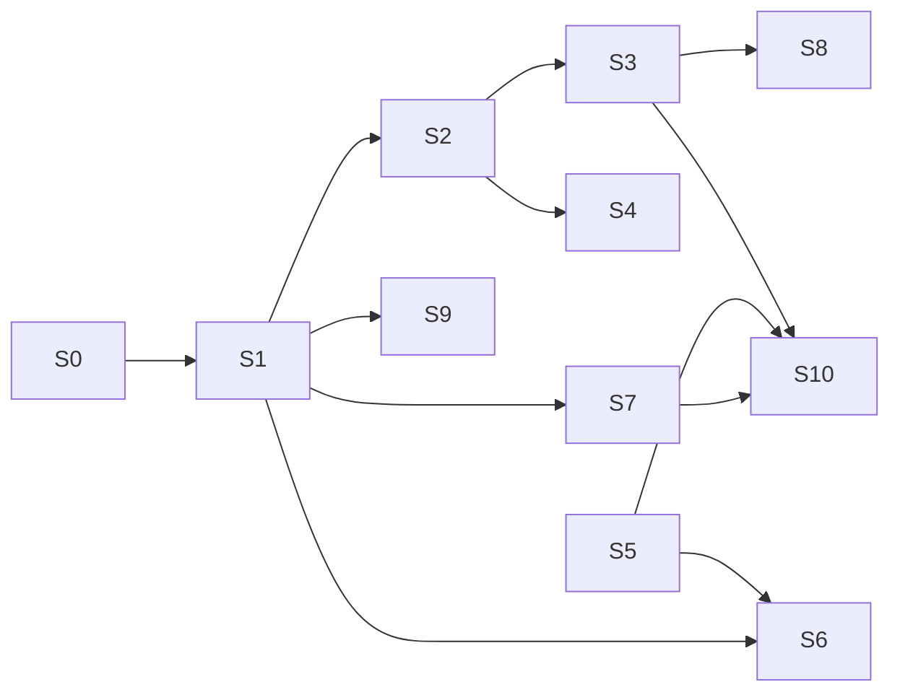

# M34 — 画布多版方案（方案组）：实施计划

> 状态：调研完成，四项决策已由主人确认（2026-11-27）。行号只作提示，动手前按符号重读。
> 调研底稿：`agent://DesignBackendMap`、`agent://DesignViewerMap`，日志「设计画布多版方案：现状调研与待决问题」。
> 本文自包含；工作区由多个会话共用，提交时只带本步骤改的行。

## Context

主人要求：设计功能要能原生出多版方案并排对比。这里有两种来源：一是方向牌（`design_directions` 发的 3 张牌各做一版）；二是模型不用方向牌、自己判断需要多版的时候。

现状（已核对源码）：

- **HTML 画框画布**：每个画框是一个独立 HTML 文件，各自的 `:root` 变量天然隔离。`guide.go` 的 canvas 主题已经把「同一页面的几种方案」列为画布的用途，不给坐标的画框会自动向右排。但画布上没有「方案」这个结构：不知道哪些画框是同一屏的不同方案，也没法选定。
- **TSX 设计画布**：
  - `theme.css` 由引擎的 `styles.css` 全局导入一次（`plugin-frames.mjs` 的 `orynDesignCss`、`entry.tsx:9`），所有帧共用一套 token，没有按帧的作用域。
  - 帧在 `src/frames/` 下扁平存放。新帧一律加到 `Canvases[0]`（`design.go` 的 `sealOps`）。
- **`artifact_designs.direction` 是单值**：`design_direction` 每次都会覆盖它。它的读取方只把它当布尔值（`site.go` 的 `withProbe`、`design.go` 的 `agentDesignHead`），用来开关后 8 条审美规则，从不读里面的调色板。
- **交付、原型、样机都假设只有一个最终设计**：导出工程、`oryn design eject`、部署到 box、原型、`MockupDialog`。备选版会被一起带进产物。
- **前端没有方案相关的界面**：没有分组、选定，也没有方向牌 UI。画框上没有右键菜单，画框动作挂在 `FrameLabel` 的名称行上。
- **技能文本自相矛盾**：`oryn-design/SKILL.md` 第 2 节第 4 步写「用户明说要比较时，才把三张牌各做一版首屏并排」，但同一份技能又要求「一套主题」「只能在发出的牌里挑」，也没说并排怎么落地。

核心问题：缺的是「方案」这个一等概念，也就是**一组帧，可以带自己的一套 token**。方向牌只是 token 的来源之一；模型自己做的结构、文案、交互方案可以没有独立 token。

## 已定决策（主人确认）

- D1 粒度：**方案组**。一个方案组里有 2–4 个方案；每个方案是一组帧（可以只有首屏），可以各带一套 token。
- D2 选定之后：落选方案的画框移到「备选方案」画布页保留。导出、eject、部署、原型、样机一律排除它们（不是缺省排除：显式点名也拒绝，源码也不打包）。选中方案的 token 由 agent 提升为主题。
- D3 模型可以主动出多版：方向不确定、需求模糊或有明显取舍时，主动出 2–3 版并说明差别。结构、文案、交互上的方案都算。
- D4 范围：TSX 设计画布（orb 线程）与 HTML 画框画布（全局助手、Runner）都做。

## 方案选择

**选定**：方案组记在 `canvas.json`（两种画布共用一套结构、一套操作、一套前端）。
- 设计画布另有 `src/variants.json` 作为工作副本里的真源，由封存同步进 `canvas.json`。
- 方案的 token 是 `src/themes/<名>.css` 里的一条 `:root[data-oryn-theme="<名>"] { --color-…: … }` 规则。引擎在每帧的 `<html>` 上写 `data-oryn-theme`。
- Tailwind v4 的工具类引用的是 `var(--color-*)`，主题变量输出在 `@layer theme` 里，不在层里的覆盖规则必然胜出。所以 `bg-accent` 这类类名在各个方案里照用，不需要新的类名（S0 探针确认）。

**否决**：
- 每个方案一份 `@theme` 文件，由引擎转换成作用域规则：Go（eject）和 JS（引擎）都要实现同一个 CSS 转换器，多一份要双端同步的解析器。直接让方案主题文件写成普通的作用域 CSS，两端都只需要 `@import`。
- 帧目录分层（`src/variants/<组>/<方案>/frames/`）：要改帧发现、帧 id 规则、`designFrameIDs` 和所有 `src/frames/<id>.tsx` 的路径假设，影响面最大。
- 在帧声明里写 `export const frame = { variant: "home/b" }`：组名、方案名、说明、主题没有地方放，最后还是要一个清单，而且会有两处真源。
- 选定后由控制面直接改写 `src/theme.css`：控制面写出来的版本没有重新构建，静态产物会和源码不一致。主题提升交给 agent，在下一个回合里构建、封存。

## 冻结契约

### C1 `canvas.json` 的方案组（两种画布共用）

顶层新增 `groups`（可省略，缺省为 `[]`）。只要文档里有 `groups`，规范化输出就写 `format: 3`；解析接受 1–3。

```json
"groups": [{
  "id": "home", "canvas": "canvas-1", "name": "首页首屏",
  "variants": [
    {"id": "a", "name": "冷静克制", "note": "大留白，单列", "theme": "calm", "pages": ["home-a"]},
    {"id": "b", "name": "暖调杂志", "note": "", "theme": "", "pages": ["home-b", "pricing-b"]}
  ],
  "picked": null, "pickedBy": null
}]
```

- `id`、`variants[].id`、`theme`：`^[a-z0-9][a-z0-9-]{0,31}$`；`theme` 可以是空串，表示没有独立主题。
- 组 id 在 `groups` 里唯一；方案 id 在本组里唯一。
- `canvas`：方案组所在的画布页，必须存在，也是落选画框改选回来时回到的页。
- `name`：1–60 字；`note`：0–200 字。
- 数量上限：每组 2–4 个方案（只在 add 和 set `variants` 时校验）；每个方案 1–24 个画框；`MaxGroups = 20`。
- `pages` 里的画框必须存在；一个画框最多属于一个方案。
- 级联：删除画框时把它从方案里移除；方案变空就删掉这个方案；组里一个方案都不剩就删掉这个组；`picked` 指向的方案被删掉时，`picked` 和 `pickedBy` 都置为 null。
- `picked`：null 或本组某个方案的 id。`pickedBy`：选定者的线程 id；用户选的为 null。`pickedBy` 由服务端盖章，提交方给的值一律忽略（同 `stampNotes`）。
- **落选画框**：组已选定（`picked` 非 null）时，本组其它方案的画框都算落选。这个集合只由 `groups` 推导，和画框当前在哪个画布页无关。Go 里叫 `canvas.Doc.Archived() map[pageID]bool`，TS 里叫同名函数。

操作（`canvas.ParseOps` / `canvas-doc.ts`，新增类型 `group`）：

| 操作 | HTML 画框画布 | 设计画布 |
|---|---|---|
| `add {type:"group", id, canvas?, name, variants}` | 允许 | 拒绝：「方案组由 src/variants.json 维护」 |
| `set {id, name?, variants?, picked?}` | 允许 | 只允许 `picked`，其余字段拒绝 |
| `remove {id}` | 允许（画框保留） | 拒绝 |
| `ApplySeal` | — | 可以 add、set（`name`、`variants`），也可以 remove |

`ExpandPicks(doc, ops) []Op`：Go 与 TS 双端实现，纯函数。对批里每条带 `picked` 的 `set group`，紧跟其后插入搬移操作：
1. 「备选方案」画布页的 id 固定为 `alternates`，名字取 `canvas.AlternatesName = "备选方案"`；不存在就先 add。
2. 新落选、但不在 `alternates` 页上的画框作为一个整体平移到 `alternates` 页：左边缘 = 该页现有画框的最右边缘 + `PageGap*4`（页上没有画框时为 0），上边缘 = 该页现有画框的最小 y（没有时为 0）。
3. 改选时，新选中方案里位于 `alternates` 页的画框按同样规则整体平移回组的 `canvas` 页。
4. 选中方案原本就不在 `alternates` 页的画框不动。

服务端在 live 路径和 agent 路径应用之前都要跑一遍 `ExpandPicks`。客户端提交前也调用同一个函数，这样乐观状态与服务端的回显一致。重复展开要幂等：插入的搬移操作写的是目标值，提交方自己带的同值操作不会改变结果。

**修订（S1 执行中，2026-11-27）**：C1 原文没写搬移画框用哪个操作，而现有规则又不允许 set 画框的 `canvas`。补充约定如下：
- 画框的 `canvas` 改为可以 set（HTML 画框和设计画框都可以）。改的时候级联：其它画布页上吸附着它的形状，`from`/`to` 置 null（与 remove 的处理相同）。旧向量「set 不能改画框的 canvas」改成「set 画框 canvas 指向不存在的页被拒」。
- `ExpandPicks` 产出的是 `set canvas`、`set x`、`set y` 三条操作。
- 组 id 与画布页、画框、标注共用一个 id 命名空间（set 和 remove 只凭 id 寻址）。S4 封存时如果组 id 撞上已有 id，回 invalid。
- group 的 set 沿用现有的 `{op:"set", id, key, value}` 形状，`key` 取 `name`、`variants`、`picked`、`pickedBy`。set `picked` 时，Apply 先把 `pickedBy` 置 null；随后由 S7 在服务端剔除提交方给的值，再盖章。

### C2 设计画布的工作副本契约

`src/variants.json`（可选）：

```json
{"groups": [{"id": "home", "name": "首页首屏", "variants": [
  {"id": "a", "name": "冷静克制", "note": "…", "theme": "calm", "frames": ["home-a"]},
  {"id": "b", "name": "暖调杂志", "frames": ["home-b"]}
]}]}
```

- 校验与 C1 相同，只是这里写帧 id，不写画框 id。
- 帧必须存在于 `src/frames/`；`theme` 非空时，`src/themes/<theme>.css` 必须存在。
- 未知字段一律报错。
- 不写 `picked`：选定状态只存在 `canvas.json` 里。
- Go（封存）和 JS（引擎）各实现一遍校验，共用测试向量 `schema/testdata/design-variants.json`，做法同 `canvas-ops.json`。

`src/themes/<名>.css`：只写一条 `:root[data-oryn-theme="<名>"] { … }` 规则，变量名与 `theme.css` 的 token 一致。
- 方案用了独立主题时，`theme.css` 仍然必须存在，作为基础主题定义完整的 token 名，否则 Tailwind 不会生成对应的工具类。
- 引擎在 `theme.css` 的 import 之后按文件名顺序 `@import` 每个 `src/themes/*.css`。
- 主题文件的选择器与文件名对不上时，构建给出警告，不报错。

运行时：引擎从 `variants.json` 推导出「帧 → 主题」，`mount` 在渲染前设置 `document.documentElement.dataset.orynTheme`。帧不属于任何带主题的方案时，不写这个属性。

封存（`seal_design`）按 `src/variants.json` 同步 `canvas.json` 的 `groups`，帧 id 经画框的 `source` 映射成画框 id：
- 已有组：更新 `name` 和 `variants`。`picked` 仍指向存在的方案时保留 `picked`/`pickedBy`，否则置 null。
- 清单里没有的组：删除。
- 新组的 `canvas`：取 `Canvases[0]`。

新加进方案的帧要自动排位，不走「接在右边」：
- 新组：放在 `Canvases[0]` 现有画框的下方，上边缘 = 现有最大下边缘 + `PageGap*4`。每个方案占一列，列宽取该方案里最宽的帧，列间距为 `PageGap*2`；列内的帧按清单顺序从上往下排，帧间距为 `PageGap`。
- 已有组里新加的帧：接在该方案最下面那个画框的下方。

### C3 方向牌：`design_direction` 加 `theme` 参数

`design_direction {id, pick?, theme?}`，三种用法：

| 参数 | 行为 | 返回 |
|---|---|---|
| `pick` | 同现状：选定主方向，写 `direction` | 设计画布：`@theme` 文本，写进 `theme.css`；HTML 画布：`:root` 文本 |
| `pick` + `theme` | 把这张牌记为方案主题 `themes[theme]`，**不动** `direction` | 设计画布：`design.ScopedThemeCSS(theme, d)`，即 `:root[data-oryn-theme="<theme>"] {…}`，写进 `src/themes/<theme>.css`；HTML 画布：`:root` 文本，放进这个方案每个画框的 `<style>` |
| `theme` | 提升：把 `themes[theme]` 复制成 `direction` | 与 `pick` 相同。主题没有记录时回 invalid：「这个主题不是来自方向牌，把它的变量直接抄进 src/theme.css 即可」 |

- 迁移 `0073_artifact_design_themes.sql`：`ALTER TABLE artifact_designs ADD COLUMN themes TEXT NOT NULL DEFAULT '{}'`。内容是名字到 Direction JSON 的映射，最多 12 项，超出时淘汰最早写入的。
- 审美开关改为 `aesthetic = direction != "" || themes != "{}"`，在 `withProbe` 与 `agentDesignHead` 两处改。

### C4 落选画框不参与检查

- `orbsock.DesignHead` 新增 `Archived []string`：落选画框对应的帧 id，按字典序。
- orbd 的 `design.check` 与回合结束的强制续跑都跳过这些帧；检查缓存的匹配条件要加上这个集合。
- 控制面的 `check_artifact` 对 HTML 画布同样跳过落选画框。

### C5 选定通知 agent

- **设计画布**：便签投递（`notes.go`）增加第三类待处理项：`picked != nil && pickedBy == nil`，且键 `pick:<组>:<方案>` 不在 `delivered` 里。
  - 用户选定的操作落成版本时，照常经 `markNotesDirty` 标脏。
  - `notesMessage` 计数里加上这一类；`design_notes` 列出「方案组『X』用户选定了『Y』」，并附上提升步骤。
  - ack 成功后把这个键记进 `delivered`。
- **HTML 画布**（没有自动投递）：选定后查看器给出一个可以关掉的提示条，按钮是「让 Agent 统一到此方案」。点击后用现有的 `sendGeneratedPrompt` 发给 `sendTargets` 选出的线程，提示词走 i18n。

### C6 交付范围

落选画框一律排除，不只是缺省不选。想交付落选方案，就先在画布上改选它。

| 交付物 | 规则 |
|---|---|
| 样机导出（后端 `selectMockupPages`） | 不传 `frames` 时排除落选画框；显式 `frames` 里含落选画框时回 invalid：「<画框名> 是方案组『X』的落选方案，先改选它再导出」 |
| `MockupDialog` | 不列出落选画框 |
| 导出工程（zip）、`oryn design eject`、部署到 box | 落选帧的 `src/frames/<id>.tsx` 不进工程文件，`oryn-frames.json` 不列出它们；`src/variants.json` 去掉落选方案（组里只剩选中方案）；只被落选方案引用的 `src/themes/<名>.css` 不打包。部署走 eject，规则自动相同 |
| 原型 | `resolveStartPage` 与原型可达的帧都排除落选画框；指向落选帧的 `<Link>` 不跳转（同指向不存在的帧） |

因为落选帧的入口文件不在工程里，直接访问 `#/<落选帧 id>` 只会走到「没有这个帧」，不需要另加 `hidden` 列表。

导出工程同时要支持方案主题：
- `oryn-frames.json` 的帧项新增 `theme?: string`。
- `eject/main.tsx` 切换路由时设置 `document.documentElement.dataset.orynTheme`。
- `designengine` 生成 `styles.css` 时，在 `theme.css` 之后逐个 `@import` 打包进工程的 `src/themes/*.css`。

### C7 提示词里带上方案信息

`handoffPrompt` 与 `commentsPrompt` 在画框行尾追加 `, variant <组>/<方案> "<方案名>"[, picked | , archived]`。这是固定的英文字面值，与现有数据块行的约定一致。

## 实施步骤

统一口径（除特别写明外）：
- Go：`go build ./...` 无输出，`go test <包>` 打印 `ok`。
- Web：`cd web && bun run check` 退出码为 0，`cd web && bun run test -- <文件名片段>` 全绿。
- 生成物：`make gen` 之后 `make check-gen` 退出码为 0。

### S0 探针：方案主题能否覆盖

- Depends on：无（它回答风险最大的未知）。
- Do：在临时目录里装引擎（`internal/designengine/engine/package.json`，`npm ci`），按 C2 准备工作副本：
  - `theme.css` 定义 `--color-accent: #0f766e`；
  - `src/themes/warm.css` 写 `:root[data-oryn-theme="warm"]{--color-accent:#c2410c}`；
  - 两帧 `a`、`b` 都用 `bg-accent font-display`；
  - 手工在 `styles.css` 的占位处加两条 `@import`，在 `entry.tsx` 的 mount 里写死 `b` 帧的属性。
  
  分别跑 `vite build` 和 dev，用 Chromium `--dump-dom` 或截图核对计算样式。探针代码不入库。
- Accept：两种模式下 `a` 帧的 `background-color` 都是 `rgb(15, 118, 110)`，`b` 帧都是 `rgb(194, 65, 12)`；改 `warm.css` 之后 dev 在 2 s 内热更。结论写进本文「探针结论」。
- 失败分支：
  - 层序不对，覆盖失效：主题文件改成 `@layer theme { :root[data-oryn-theme=…] {…} }`。
  - 仍然失效：改为引擎把主题注入到 `@theme` 之后的同一层。C2 的文件格式不变。

### S1 画布文档：方案组与选定

- Depends on：S0（只依赖它的结论，不依赖代码）。
- Files：`internal/artifacts/canvas/{doc,ops}.go`、`doc_test.go`、`web/src/lib/artifacts/canvas-doc.ts`、`canvas-doc.test.ts`、`schema/testdata/canvas-ops.json`。
- Produces：
  - Go：`canvas.Group`、`canvas.Variant`、`Doc.Groups`、`TypeGroup`、`MaxGroups`、`AlternatesID = "alternates"`、`AlternatesName`、`(Doc) Archived() map[string]bool`、`ExpandPicks(Doc, []Op) []Op`。
  - TS：同名的类型与 `archivedPages(doc)`、`expandPicks(doc, ops)`。
- Do：按 C1 实现解析、规范化输出（format 3）、操作、级联与权限。设计画布上的拒绝规则由 `reader.seal` 区分。
- Accept：`go test ./internal/artifacts/canvas/` → `ok`；`bun run test -- canvas-doc` 全绿。向量文件新增至少 10 例，必须覆盖：
  - 设计画布 add group 被拒；
  - 删画框后的级联；
  - 选定后画框平移到新建的 `alternates` 页；
  - 改选时画框搬回组的 `canvas` 页；
  - `ExpandPicks` 重复展开结果不变；
  - 第 5 个方案被拒。

### S2 方案清单 `src/variants.json` 的解析

- Depends on：S1（复用 C1 的字段规则与常量）。
- Files：`internal/artifacts/design/variants.go` 与测试，`internal/designengine/engine/variants.mjs`，`schema/testdata/design-variants.json`。
- Produces：
  - Go：`design.ParseVariants(raw []byte, frames []string, themes []string) (Variants, error)`。
  - JS：`parseVariants(text, frameIds, themeNames)`。返回结构相同：`{groups:[{id,name,variants:[{id,name,note,theme,frames}]}]}`，另附 `frameTheme: Record<frameId, theme>`。
- Accept：`go test ./internal/artifacts/design/` → `ok`。
  - 同一份向量也由 Go 测试经 `node` 跑一遍 JS 实现（`exec.LookPath("node")` 找不到时 `t.Skip`），逐例比较输出或错误路径。
  - 向量里至少包括：未知字段、重复帧、缺主题文件、1 个方案、5 个方案、合法的三方案。

### S3 引擎：方案主题与帧属性

- Depends on：S2（`parseVariants`）、S0（导入方式）。
- Files：`internal/designengine/engine/{plugin-frames.mjs,entry.tsx}`，以及 `designengine` 里登记嵌入文件和版本号的地方（`TestEmbeddedFilesComplete`、`TestVersionMatchesContent` 会提示）。
- Do：
  - `orynDesignCss` 在 `theme.css` 之后按文件名 `@import` `src/themes/*.css`；监听 `src/themes/` 的增删，重新加载 styles 模块。
  - `frameEntry(id, hasLayout, theme)` 把主题传给 `mount`；`mount` 在渲染前设置或清除 `documentElement.dataset.orynTheme`。
  - build 时 `variants.json` 不合法直接报错，信息里带路径。
  - dev 时 `variants.json` 有变化就重写入口并整页重载（同 `onFrameSetChange`）。
- Accept：
  - `go test ./internal/designengine/` → `ok`。
  - `ORYN_TEST_CHROMIUM=1 ORYN_TEST_DESIGN_ENGINE_MODULES=<engine node_modules> go test ./internal/orbdrt/ -run 'TestDesignCheckChromium'` → `ok`。新增一例 `TestDesignVariantThemeChromium`：两帧不同主题，计算样式与 S0 的判据一致。

### S4 封存同步方案组与排位

- Depends on：S1（`ApplySeal` 的 group 操作）、S2（`ParseVariants`）。
- Files：`internal/artifacts/design.go`（`sealOps` 及其调用方）、`design_test.go`。
- Do：
  - 封存时读版本里的 `src/variants.json`（没有就视为空清单），按 C2 生成 group 的 add、set、remove 操作。
  - 新加进方案的画框按 C2 给出 x、y。
  - 校验失败时封存回 `invalid`，信息原样给出。
- Accept：`go test ./internal/artifacts/ -run 'TestSeal'` → `ok`。新增的测试要断言：
  - 三方案新组的列坐标；
  - 已选定的组重封存后 `picked` 仍保留；
  - 方案被删掉后 `picked` 置 null；
  - 帧 id 撞车加了 `-2` 后缀时，映射到正确的画框 id。

### S5 `design_direction` 的主题记录与审美开关

- Depends on：无代码依赖（与 S1–S4 改的是不同文件；C3 已冻结）。
- Files：`internal/store/migrations/0073_artifact_design_themes.sql`、`internal/store/queries/artifacts.sql`（新增 `SetArtifactDesignThemes`）、`make gen-sqlc` 的生成物、`internal/artifacts/{directions.go,site.go,design.go}`、`internal/artifacts/design/deal.go`（`ScopedThemeCSS`）、`internal/coord/profile.go`（工具定义）、`internal/orbdrt/assets/oryn-orb.ts`（orb 的工具定义）。
- Do：按 C3 实现。三种用法的参数组合不合法时回 invalid，并说明正确用法。
- Accept：`go test ./internal/artifacts/ -run 'TestDesignDirection'` → `ok`，三种用法各至少一例；另有一例断言只有 `themes`、没有 `direction` 时 `design_head` 的 `aesthetic` 为真。`make check-gen` 退出码为 0。

### S6 落选画框不参与检查

- Depends on：S1（`Archived`）、S5（同样改 `agentDesignHead`，避免并行冲突）。
- Files：`internal/orbsock/orbsock.go`、`internal/artifacts/{design.go,check.go}`、`internal/orbdrt/design.go`、`internal/orbdrt/assets/oryn-orb.ts`（只有在续跑判断要用帧集合时才改）、对应测试。
- Do：按 C4 实现；落选画框经 `source` 映射成帧 id。
- Accept：`go test ./internal/orbdrt/ -run 'TestDesignCheck' ./internal/artifacts/ -run 'TestCheck'` → `ok`。新增断言：
  - 落选帧不在检查结果里；
  - 落选帧有问题时 `status` 仍为 `clean`；
  - `Archived` 变化后缓存失效。

### S7 选定通知

- Depends on：S1（groups 与 `pickedBy`）。
- Files：`internal/artifacts/{notes.go,live.go}`（`stampNotes` 扩展为同时给 `picked` 盖章；live 路径和 agent 路径都调用 `ExpandPicks`）、`notes_test.go`、`live_test.go`。
- Do：按 C5 的设计画布部分实现。
- Accept：`go test ./internal/artifacts/ -run 'TestNotes|TestLive'` → `ok`。新增断言：
  - 用户选定后去抖投递，消息里有选定计数；
  - ack 之后 `delivered` 含 `pick:home:b`；
  - agent 自己选定（`pickedBy` 非 null）时不投递；
  - 提交方伪造的 `pickedBy` 被覆盖。

### S8 交付范围与导出工程的主题

- Depends on：S1（`Archived`）、S3（主题文件格式）。
- Files：`internal/artifacts/export.go`、`internal/designengine/{eject.go,project.go}`、`internal/designengine/eject/main.tsx`、对应测试。
- Do：按 C6 的后端部分实现。过滤放在 `export.go` 组装工程文件的地方（读版本 `src/**` 的那段），由 `canvas.Doc.Archived()` 经 `source` 得到落选帧 id；样机的拒绝放在 `selectMockupPages`。
- Accept：`go test ./internal/artifacts/ -run 'TestExport|TestMockup' ./internal/designengine/ ./internal/orbdrt/ -run 'TestDesignEject'` → `ok`。新增断言：
  - 不带 `frames` 的样机不含落选画框；显式 `frames` 里含落选画框时回 invalid；
  - 导出 zip 的文件清单里没有落选帧的 `src/frames/<id>.tsx`，也没有只被落选方案引用的主题文件；导出的 `src/variants.json` 只剩选中方案；`oryn-frames.json` 的帧与 `theme` 正确；
  - `TestDesignEject`：eject 出的目录同样没有落选帧文件；在 eject 目录 `npm ci && npm run build` 成功（`variants.json` 与帧文件一致），构建产物里没有落选帧的模块；
  - 生成的 `styles.css` 只含打包进来的 `src/themes/*.css` 的 import。

### S9 前端：方案组的显示、选定与排除

- Depends on：S1（TS 类型与 `expandPicks`）。
- Files：
  - `web/src/components/artifacts/canvas/`：新建 `GroupOverlay.tsx`；改 `CanvasEditor.tsx`、`FrameLabel.tsx`、`Prototype.tsx`、`handoff.ts`。
  - `web/src/components/artifacts/{MockupDialog.tsx,ArtifactViewer.tsx}`。
  - `web/src/lib/artifacts/prompt.ts`。
  - `web/src/i18n/locales/{zh-CN,en}.json`。
  - `web/src/mock/artifacts.ts`：加一个三方案的示例画布。
- Do：
  - `GroupOverlay`：画在当前画布页上，组内画框的外接框用虚线包住。屏幕坐标、字号不随缩放，同 `FrameLabel`。
    - 组标题：「方案组 · 名字」。
    - 每个方案最上面的画框上方有方案标签：名字，`note` 作为 title。
    - 未选定的组：每个方案都有「选定此方案」按钮。选定后在选中方案上显示「已选定」徽标，其它方案改为「改选此方案」。
  - 点击选定：提交 `expandPicks(doc, [{op:"set", id, picked}])`，走现有画布操作通道，落成一个用户版本；不弹确认框，靠版本历史撤销。
  - `FrameLabel` 名字前加方案标记（如「B」）。
  - 原型和样机按 C6 处理；提示词按 C7 处理。
  - HTML 画布按 C5 给出提示条。
- Accept：`cd web && bun run check` → 退出码 0；`bun run test -- canvas-doc prompt handoff MockupDialog Prototype GroupOverlay` 全绿（`GroupOverlay.test.tsx` 新建，断言按钮状态与提交的操作）。另外在 `bun run dev:mock` 打开示例画布，用浏览器验证选定、画框搬到「备选方案」页、改选搬回三个动作，截图附在提交说明里。

### S10 指引、技能与文档

- Depends on：S3、S5、S7（文本要描述的是最终行为）。
- Files：`internal/orbdrt/assets/oryn-design/{SKILL.md,SKILL-runner.md}`、`internal/coord/skilldocs/design.md`、`internal/artifacts/guide.go`（canvas 主题）、`docs/features.md`（Artifacts 节）、`docs/protocol.md`（`canvas.json` format 3、group 操作、`design_direction` 参数、`DesignHead.archived`）、`README.md`（只在功能列表措辞需要时改）。
- Do：
  - SKILL 第 2 节第 4 步改写成 D3 的规则：
    - 何时主动出多版：方向不确定、需求模糊、有明显取舍。
    - 最多 4 版；每版一句话说明差别；细枝末节的差别不出多版。
    - 用户在画布上选或回复编号；用户说「你定」或无人值守时，agent 自己用 `set group picked` 选，并写明理由。
  - SKILL 第 3 节加 `src/variants.json` 与 `src/themes/` 的契约。
  - SKILL 第 4 节加 `design_direction` 的 `theme` 用法：「三张都做」的流程，以及收到选定通知后的提升步骤。提升步骤：方向牌主题调用 `design_direction {theme}` 写 `theme.css`；自拟主题把变量抄进 `theme.css`；保留方案组，不删落选帧。
  - 删掉「一套主题」与「只有用户明说要比较时才并排」这两处冲突措辞。
  - `guide.go` 写 HTML 画布的 group 操作。
  - 助手和 Runner 版的指引用 HTML 画框的写法：每个方案的帧各放自己的 `:root`。
- Accept：`go test ./internal/artifacts/ ./internal/coord/ ./internal/orbdrt/` → `ok`（指引嵌入与技能下发的现有测试）；`rg -n "一套主题|用户明说要比较" internal/orbdrt/assets internal/coord/skilldocs` 无输出。

## 并行关系

- S1 与 S5 可以并行：文件不相交，C1 和 C3 已冻结。
- S2 依赖 S1 的常量，串行。
- S3、S4 都依赖 S2：S3 改 `designengine/engine/`，S4 改 `artifacts/design.go`，文件不相交，可以并行。
- S6 依赖 S5，因为两者都改 `agentDesignHead`。
- S7、S9 只依赖 S1，与 S3、S4 文件不相交，可以并行。
- S8 依赖 S3。
- S10 放在最后。



## 验证（全部步骤完成后各跑一次）

- `go build ./...`；`go test ./internal/artifacts/... ./internal/designengine/ ./internal/orbdrt/ ./internal/coord/` → 全部 `ok`。
- `cd web && bun run check && bun run test` → 退出码 0。
- `make check-gen` → 退出码 0。
- 端到端：`bun run accept:m29` 仍然全过。
  - 新增 `scripts/m34-variants-accept.ts`（`package.json` 加 `accept:m34`），在真实 orb 上验证：
    1. 让 agent「三张牌都做首屏」，得到三个方案并排、各自强调色不同的画框；
    2. 在查看器里选 B，落选画框搬到「备选方案」页；
    3. 下一回合 agent 收到通知，`theme.css` 等于 B 的 token；
    4. 样机导出不含落选画框，显式点名落选画框被拒；导出工程的 zip 清单里没有落选帧，部署到 box 后访问 `#/<落选帧 id>` 显示「没有这个帧」。

## 探针结论

2026-11-27 实测（探针代码不入库，临时目录已删）。环境：本机现有的引擎依赖（tailwindcss 4.3.5、vite 7.3.8、@tailwindcss/vite 4.3.5、react 19.1.1）、`/usr/bin/chromium`。

- **S0 通过，不走失败分支。** 工作副本：`theme.css` 的 `@theme` 定义 `--color-accent: #0f766e`、`--font-display: "Georgia", serif`；`src/themes/warm.css` 是 `:root[data-oryn-theme="warm"]{--color-accent:#c2410c;--font-display:"Courier New", monospace}`。在 `orynDesignCss` 的占位替换里，`theme.css` 之后加了 `@import` 主题文件；在 `mount` 里给 `b` 帧写了 `data-oryn-theme="warm"`。
  - 构建：主题文件原样进了产物 CSS，不在任何 layer 里。Tailwind 的 token 在 `@layer theme{:root,:host{…}}` 里。用 `--dump-dom` 取计算样式：`a` 帧是 `rgb(15, 118, 110)` / `Georgia, serif`，`b` 帧是 `rgb(194, 65, 12)` / `"Courier New", monospace`。
  - dev：两帧的计算样式与构建一致。把 `warm.css` 的强调色改成 `#1d4ed8` 后，`b` 帧 104 ms 热更为 `rgb(29, 78, 216)`，`a` 帧不变。
  - 结论：主题文件经 `@import` 之后，由 Tailwind 的依赖跟踪负责改动时的热更；**新建或删除主题文件**仍要按 C2 重新加载 styles 模块（同 `theme.css` 的现有做法）。

## 回退点

- S1–S9 每一步单独提交。
- 迁移 `0073` 只加一列（带缺省值），旧代码会忽略它；回滚代码不需要回滚数据库。
- `format: 3` 的 `canvas.json` 旧代码读不了。所以 S1 合入之后、S9 合入之前，前端和后端必须同版本部署；服务端升级、Web 同源下发，这个条件天然满足。
- 已经写成 format 3 的版本，回滚代码后会打不开，要改回 format 2。这是唯一一处不可逆。

## 风险

- 一个设计画布里方案帧太多时，实时预览只覆盖离视口最近的 6 帧（`MAX_LIVE`），其余显示静态帧，构建后才更新。本期不改这个上限。
- 选定之后的主题提升依赖 agent 下一回合执行。在这之前，未参与比较的帧仍然是旧的基础主题。查看器的提示条和通知文本都要写明「Agent 统一主题后其余帧才会跟上」。
- 方案主题文件的选择器写错时只有警告；变量缺失由 `token-undefined` 探针规则兜底。
- 导出时去掉落选帧文件：如果保留下来的帧或 `src/components/**` 引用了落选帧文件，导出的工程会构建失败。S10 要在技能里写明「帧之间不互相 import，共用的部分放进 `src/components/`」；S8 的 eject 构建验收会抓到违反这条规则的情况。

## 不做

- 转录里的方向牌卡片 UI（工具结果仍走通用渲染）。
- 方案间同步滚动或像素级对比视图。
- 跨画布页的方案组，以及组的嵌套。
- 调整实时预览帧数上限。
