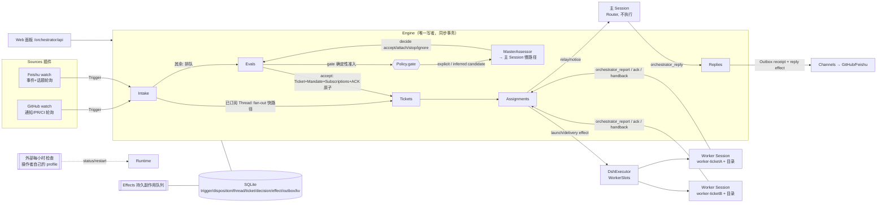

# 调研：deepseek-ai/dsh-superagent-prototype 与 DeepSeek「Super-agent」设计

> 调研日期：2026-11-16。只读分析，没有改动 Oryn 仓库。
> **一手来源**：仓库 <https://github.com/deepseek-ai/dsh-superagent-prototype>，`main` 分支只有一个提交 `8c32a9d`（2026-10-31 20:06 +0800，"feat: add the dsh-superagent research prototype"），MIT 协议，共 216 个文件，TS 源码约 1.4 万行。下文写作 `src/...` 的路径都相对于这个提交，链接前缀为 `https://github.com/deepseek-ai/dsh-superagent-prototype/blob/8c32a9dc5d72c033816c6a8110b37f40cf94fba4/`。
> **配套文章**：*Exploring Super-agent Design: Towards a More Autonomous Agent System*，作者 Yujia Qiao / DeepSeek Harness 团队，2026-11-01 发在 X：<https://x.com/DeepSeekHarness/status/2116857257245987236>。X 拒绝自动访问，所以文章内容经过两层转述：中文回译全文 <https://digest.hustwj.com/articles/超级智能体设计探索：迈向更自主的智能体系统>（该页自述：中文原稿 → X 上的英文机翻 → 再回译成中文）；英文摘录与评述 <https://zby.github.io/commonplace/sources/exploring-super-agent-design-towards-a-more-2116857257245987236.ingest.html>。凡引用文章的地方都标 **〔文章·转述〕**，数字以两处转述一致为准。
> **标注约定**：〔源码〕〔文档〕表示我在仓库里读到并核实过；〔文章·转述〕见上；[推断] 是我自己的判断。

---

## ① 这是什么

### 1.1 仓库本身〔文档〕
- README 的定位：*"a proactive coding agent for one GitHub repository, packaged as a bundle for DeepSeek Harness"*。它监听 GitHub，Feishu 可选；有被允许的人提出需求时，建一个工作项，在独立的 agent session 和独立目录里完成，再回到原对话交付（比如提一个 PR）。另有一个 Web 面板，只列需要人处理的事。
- 免责声明：*"Research prototype for reference only, not an official DeepSeek product"*。公开版和内部版不同，**文章里的一部分设计是未来方向，原型里没有实现**。
- 形态：它是 DeepSeek Harness（`dsh`，基于 Cordis 的插件化 agent 平台，`npx @deepseek-ai/dsh web`，官网 <https://www.deepseek.com/harness/en/>，源码 <https://github.com/deepseek-ai/deepseek-harness>）的一个 **bundle 插件**，要求 `engines.dsh: ^0.2.1-alpha.2`（见 `package.json`）。它包含三个插件：主插件、`github-watch`、`feishu-watch`，外加两个 agent preset，即 `dsh-superagent-router` 和 `dsh-superagent-worker`（见 `cordis.patch.yml`）。
- 核心原则（`docs/000-philosophy.md`）：**"Take as little human attention as possible, and give as much value as possible."** 消息、通知、提问、设置项、面板元素、文档段落都算消耗注意力，带来的价值抵不过这份消耗就删掉。

### 1.2 文章对 Super-agent 的定义〔文章·转述〕
- 问题：单任务 agent 能力已经够用，多任务时的瓶颈变成**人的注意力**。作者的经验是一个人同时最多跟进 3–5 个活跃会话。给单会话 agent 加上 CLI、MCP 或连接器也不解决问题：遇到耗时操作仍会阻塞，上下文混杂，本机一离线就停。
- 定义：agent 不再依附于某个由人驱动的会话，而是一个**连续存在的实体**，跨会话保留上下文，并发推进多个任务，任务之间互不干扰。
- **四个特征**：
  - **Continuous（连续）**：用户在原本工作的地方（IM、GitHub 评论）交互，感觉面对的始终是同一个 agent。
  - **Productive（高产）**：并发处理，上一条还没完成就能接下一条。
  - **Proactive（主动）**：监听环境事件，值得做才动手，否则保持安静。
  - **Persistent（持久）**：常驻在线，连着真实环境，出异常能自动恢复。
- 论点：单个 ReAct 循环无法同时具备这四点，它们必须来自外围的系统架构。
- **五个模块**：两级架构 Router/Worker、事件驱动 Trigger、全双工多渠道交互、计算/状态/环境三者分离、外部 Watchdog。
- 文章明确说"没有提出新理论"，只是把计算机系统里的经典思想（快/慢路径、批处理、缓存/局部性、推测执行、存算分离、控制回路）搬到 agent 上。
- 文章的一个产品判断：**"会话应当是系统的实现细节，而不是用户的心智负担"**。让用户手动管理会话，是从 LLM API 沿袭下来的惯性。

### 1.3 文章模块与原型实现的对照
| 文章模块 | 原型里是否实现 | 证据 |
|---|---|---|
| 两级 Router / Worker | ✅ 主 Session（`orchestrator`）加上每个 Ticket 一个 Executor Session（`worker-<ticketId>`） | `src/app/sessions.ts`, `src/executor/dsh.ts` |
| 两阶段过滤（程序化 gate，再交语义 assessment） | ✅ | `src/policy.ts` 中的 `gate`，`src/app/assessment.ts` |
| 订阅与直通（Subscription fan-out） | ✅ | `src/core/intake.ts`, `src/core/tickets.ts` |
| Inline & Spill / Chain of Recall | ✅ 卡片截断加 read pointer，资源图里的 ID 可逐跳读取 | `src/app/cards.ts`, `src/app/resources.ts` |
| 推测执行（"静默复现并修复"） | ⚠️ 部分实现：accept mode `observe/auto` 加 rule，见默认规则 `copy` / `visual` | `src/policy.ts:63-64` |
| 异步 ReAct（start/stop） | ⚠️ 近似实现：前台命令 5 秒后转入后台 job，job 结束时唤醒 session。文章说 DSH 已实现这套机制，但默认没开 | `cordis.patch.yml` |
| 多渠道（IM 简短，GitHub 结构化） | ✅ 回复有 100 词硬上限，GitHub 消息有固定前缀行 | `prompts/replies.md`, `src/infra/text.ts` |
| 计算/状态/环境分离、BYOM 守护进程 | ❌ 原型只在单机上运行：一个 dsh profile，配 SQLite | `docs/006-deployment.md` |
| Watchdog Session | ⚠️ 只有简化版：在操作者自己的 dsh profile 里设一个每小时定时提示词，调用 `scripts/dsh-superagent status/restart` | `docs/006-deployment.md` 的 "Hourly check" 一节 |
| 长期记忆 | ❌ 文章自己列为开放问题 | — |

---

## ② 功能清单（按能力域）

| 能力域 | 原型提供的能力 | 来源 |
|---|---|---|
| **对话** | 没有聊天窗口。交互发生在 GitHub Issue/PR 评论、review 线程和 Feishu 话题里。每个请求只确认**一次**（`orchestrator_ack`，≤100 词，内容要说出改什么、预期结果是什么）；工作期间不说话；结果就绪、需要决策、无法完成时才再开口。follow-up 直接发给负责该 Ticket 的 worker | `docs/000`, `prompts/replies.md` |
| **记忆** | 没有专门的记忆组件。Router 的"记忆"由三部分构成：一个长期存在的 LLM Session（带 compaction）；SQLite 里的 Trigger、Thread、Decision、Ticket；资源图 + Chain of Recall 按需召回。Ticket 内的连续性来自 Mandate 不变、Subscriptions 和 Inputs。文章 8.1 节把"数月级长期记忆"列为主要瓶颈 | `docs/007` Persistence，〔文章·转述〕§3.3/§8.1 |
| **主动性与定时** | Source 产出 Trigger；accept mode 有 `off / observe（默认）/ auto` 三档；proactive rule 用自然语言写，每个启用的 rule 都必须给出 matched=true/false 的判断；`observe` 模式只记录 "would accept"。**明确拒绝**"Eval 给自己排延时触发"：需要等待的条件应实现为一个 Source（例如"N 小时没人认领"这个 Source 自己轮询）。原型不内建 cron | `docs/002` Accept mode，`docs/001` Rejected concepts |
| **工具与连接器** | `SourceKind` 插件协议（`src/sources/kind.ts`），已实现 GitHub（轮询通知、订阅的 Issue/PR、CI、PR 合并或关闭）和 Feishu（事件消费、历史恢复、话题轮询、图片读取）。Worker 通过带 agent 身份的 `gh` / `lark-cli` wrapper 访问外部（`src/infra/commands.ts`, `environment.ts`），可配置被禁命令 | `docs/008-cookbook.md`（如何新增 Source） |
| **多 agent** | 两级结构：Router 只做路由、不执行；Worker 各自独立，可以再开 subagent（`standard` preset）。Worker 之间**没有点对点通信**：冲突靠多个 Worker 订阅同一个 Thread 自行发现；跨任务的事实由 Router 通过 `orchestrator_ticket_note`（≤100 词，不赋予任何权限）转达 | `docs/004` Principles，〔文章·转述〕§2.2 |
| **多端与消息渠道** | 入口：GitHub、Feishu（群聊、私聊、仅 @ 或全部消息）。出口：Channel（Feishu 话题回复、GitHub 评论、review 线程回复）。dsh Web 侧栏里有 "Superagent" 面板，中英双语 | `docs/005-panel.md` |
| **媒体生成** | 无 | — |
| **搜索与研究** | Worker 有 `web_search` / `web_fetch`（preset 里 `fetch: false`）。assessment 阶段只能做有界的 Thread 窗口读取和仓库读取（`orchestrator_eval_read`） | `cordis.patch.yml`, `src/app/assessment.ts` |
| **个性化与人格** | 三个可编辑的团队提示词段落：Communication、Ticket scope、Delivery requirements；团队技能（例如用 `identities` 技能说明"哪个 Feishu 用户对应哪个 GitHub 账号"）；所有内置提示词都能覆盖，并记录 base 版本（上游默认改动时提示 **Default updated** 并给出 diff）；提示词有版本，每次模型请求都读取最新版本 | `docs/004-prompts.md`, `src/app/prompts.ts` |
| **安全与权限** | 确定性 gate：允许名单、admission 表、bot 名单、强度 explicit/inferred；Mandate 不可变，记录 Policy 版本和准入依据；恢复执行前重新校验；Policy 变更会作废进行中的 Eval，并通知受影响的 Ticket；外部文本一律视为数据；回复按 purpose 分权；Worker 拿不到"向人提问 / present / 改 profile / 开其它 session"之类工具。**但它没有沙箱**：worker 以操作者 OS 用户身份、`danger-full-access` 运行，文档明说 wrapper "not a security boundary" | `docs/002`, `docs/003` Execution variables, `docs/006` Permissions |
| **扩展生态** | 新增 SourceKind，覆盖提示词 part，在 `skills/` 下加 skill，借用 dsh 的 preset / 插件体系 | `docs/008-cookbook.md` |
| **评测** | 原型**没有** LLM 质量评测 harness。注意代码里的 `Eval` 指"准入评估"，不是 benchmark。测试有 vitest 领域与运行时测试、`model-surface.spec.ts`（模型可见的工具、提示词、技能都要过 schema 一致性检查和每个角色的体积预算）、`cards.spec.ts`（内置文本必须陈述的规则）。文章里有合成负载实验，见 ③.10 | `tests/`, `docs/007` Tests |

---

## ③ 架构与关键机制

### 3.1 总体架构

〔文档〕`docs/007-architecture.md` 第一张图和 Engine 一节。

### 3.2 领域模型：从 Trigger 到 Ticket 的数据流〔文档〕〔源码〕
`docs/001-domain.md` 定义的流程：**Source → Trigger → Thread →（Subscription fan-out → Ticket）/（Eval → Decision → Ticket + Mandate）→ Assignment → Executor**，结果经 **Channel** 回到 Source。

关键类型都在 `src/core/model.ts`：
- `Trigger`（第 23 行）：`{id, source, threads: ThreadRef[] /*[0] 为主 Thread*/, actor, human, addressed?: 'mention'|'direct', at, text, channel?, url?, meta}`。`text` 和 `meta` 标注为**不可信数据**。同一个 Trigger 可以属于多个 Thread（Correlation 只补充上下文，不参与路由）。
- `Thread`（第 157 行）：`{key, ref, subscriptions: ticketId[], context?: ticketId[]（只读跟随）, correlated, pending: triggerId[]（debounce 缓冲）, evaluating?: Evaluation, expired?, meta}`。**同一个 Thread 同时最多跑一个 Eval**，期间到达的 Trigger 合并进下一批，这就是文章说的 batching。
- `Evaluation`：`{triggerIds, primary, strength, actor, basis, policyVersion, deadline, delivered?, pausedAt?}`。deadline 从候选送达主 Session 的时刻开始计算，暂停期间顺延。
- `Decision`：`kind ∈ ignore|accept|stop|unavailable`（另有历史值 reopen），`reason: Reason[]`（结构化 code），`audit`（rule 判断、direction、证据）。
- `Mandate`（第 126 行）：`{strength, policyVersion, basis: MandateBasis, actor, scope}`，**不可变**。范围扩大必须新开 Ticket。`MandateBasis.via ∈ addressed|followup|admission|bot|listed`，供恢复执行前 `revalidate` 使用。
- `Ticket`（第 277 行）：`{mandate, channels, ended?:{by: executor|human, outcome: completed|merged|closed|dropped|stopped}, attention?:{question, triggerId?}, assignments[], inputs: TicketInput[], undelivered[], follows?: {thread, own, closed?}[], origin, execution:{name, directory, assignment}}`。
- `Assignment`（第 218 行）：`pending→running→ended`，`report?: {state: progress|waiting|ready|blocked|failed|dropped, summary}`。一个 Ticket 在生命周期里可以有多个 Assignment（重试、重启都会新建）。
- `TicketInput`：`trigger`（带 `readAt` 已读追踪）、`policy-changed`、`resumed`、`text`、`note`。
- `TriggerDisposition`：`fanout / context / handbacks / acked / requeued / filtered`，是审计记录，也决定 follow-up 归谁（`followupOwners`，第 75 行）。

### 3.3 主循环
系统**不是**单个 agent loop，而是"确定性调度器 + 多个 LLM Session"：
1. **Passes**（`src/app/passes.ts`）：每 2 秒执行一次，有命令请求时立即执行，同一时刻只有一个 pass。顺序是：处理到期 effects，再调 `Engine.evaluateDue()`（为每个有排队 Trigger 的 Thread 开一个 Eval；超时的重新排队，连续第三次超时记为 `unavailable`；暂停期间被人回复的已结束 Ticket 在恢复后续跑）。
2. **Effects 持久副作用队列**（`src/app/effects.ts`）：命令在事务里 `enqueue(kind,key,payload)`，提交后才执行。同一 kind+key 只有一行，可以合并。失败按指数退避，抛出 `Later` 表示推迟但不计失败。kind 有 `assessment / launch / delivery / relay / notice / reply`，各自有并发上限和重试策略（表见 `docs/007` Effects）。
3. **主 Session（Router）**：收到候选卡片、worker 报告、follow-up 通知、job 结束等消息后被"steer"进当前回合（DSH inbox），用 `orchestrator_route` **一次调用批量**处理 1–20 个决策。有 **noWait 守卫**（`src/app/sessions.ts:77`）：拒绝 `sleep`、超过 30 秒的 shell timeout、超过 5 秒的 job 等待，因为 Router 一个步骤卡住，后面所有候选都会被拖住。
4. **Worker**：收到 assignment 消息后自主工作，用 `orchestrator_report` 汇报状态。turn 结束时如果后台还有 job 或 subagent 在跑，worker 继续占着 slot，结果出来时再唤醒它（每个 turn 之后最多再给 30 分钟）。
5. **出站**：`Outbox.send` 在同一事务里写 receipt 并排一个 `reply` effect。**同一 Ticket 发往同一对话的消息严格保序**（确认消息一定在结果消息之前）；Source 关闭时消息等待，对话不存在了才丢弃，并保留丢弃原因。

### 3.4 规划 / 执行 / 反思
- **Router 不做规划**：`prompts/shared.md`、`prompts/dispatch.md` 反复约束它不加需求、不写实现计划、不加验收清单，路由备注不超过 30 词。文章的理由（〔文章·转述〕§2.1）：Super-agent 的 Router 只分派**彼此独立**的任务，和 Agent Team 的 Team Lead 拆解紧耦合任务是两回事，所以 Router 可以用更轻量的模型。
- **Worker 负责规划、执行和自检**（`prompts/work.md`、`prompts/team/scope.md`）：自己读原始来源判断范围，实现、自测、自审、提交、推送、开 PR，跟进 CI 和 review 直到 ready。"按影响停，不按工作量停"：涉及接口或调用方影响、模块职责变化、需要设计决策时，停下来留一个 draft PR 并报 `blocked`。proactive Ticket 则报 `dropped`，不发任何消息。
- **"反思"体现为诚实交付规则**：开了 PR 不等于 ready；draft 必须标为未完成；UI 改动必须有真实的 Before/After 截图，否则不能报 ready；可行方案反复失败就停。自动 reviewer 在每个 PR 上最多跑 3 轮。
- **准入阶段的结构化"反思"**（`src/app/assessment.ts:21` `AssessmentSchema`、`prompts/admission.md`）：每个启用的 rule 都要给出 `rule_assessments[{rule_id, matched, reason}]`，还要给 `direction{implementation_requested, target_basis, requires_design_decision, evidence}`，以及 `intent_evidence`（三项事实的原文引用：讨论对象是本项目、有明确的变更意图、方向已定）。最后由 host 侧的 `assessmentOutcome` 用代码二次判定，模型的说法不直接生效。

### 3.5 多 agent 编排：订阅、直通与 follow-up 归属
- **快路径 / 慢路径**〔文章·转述〕§3.2，〔文档〕`docs/002`：
  - **已订阅 Thread**：后续消息由代码直接透传给订阅它的 Ticket 的 worker，不再经过 Router。
  - **未订阅**：进入 Eval，由 Router 判断。
  - 订阅是**多对多**的：accept 时订阅源 Thread；绑定 PR 时订阅 PR Thread；worker 可以 `orchestrator_thread_follow` 只读跟随相关 Thread。
- **follow-up 归属**：人在 Ticket 自有 Thread 上发的消息**由该 worker 决定**，不进 Eval。范围内的就处理并 ack；超出范围的用 `orchestrator_trigger_handback` 交还，每条只能交还一次，附一句理由；Router 收到 `follow_up` 通知后只能执行 stop。Ticket 结束时，未读、未 ack、未交还的 follow-up 自动回到 Eval（这是"未读释放"规则）。
- **attach 的约束**：只有消息明确引用了 Ticket 的 PR、Issue、源消息或 ack，才允许挂到已有 Ticket 上；话题相似不算。挂错了会让 Ticket 订阅整个 Thread，这时 worker 用 `orchestrator_thread_unrelated` 退订。
- **并发**：`WorkerSlots`（`src/executor/dsh.ts:171`）有 `maxWorkers` 个常规槽位，**另外给人类消息或状态查询预留 1 个额外槽位**，并且唤醒优先于新任务启动，保证新工作不会挤掉人对已有工作的继续推进。
- **Worker 工具白名单**（`src/app/sessions.ts:61` `WORK_TOOLS`）：文件、搜索、shell/job、web、skill、todo、subagent。排除了向人提问、present、改 profile、排期、开或发消息给其它 Session、编辑外部文档。Ticket 结束后工具调用一律拒绝。

### 3.6 工具 / 环境 / 沙箱
- 每个 Ticket 一个目录，位于 `<stateDir>/work/<短名>`。首次 Assignment 前运行一次 **prepare 命令**（`sh`，超时 10 分钟，典型用法是 `git worktree add -b agent/$DSH_SUPERAGENT_NAME`），命令读取执行变量 `DSH_SUPERAGENT_*`。变量由 Executor 和各 Source 注册，**不含凭据**（`src/app/execution-environment.ts`）。
- Preset 设定（`cordis.patch.yml`）：worker 的 shell 前台命令 5 秒后转后台、job 等待最多 5 秒；tool-result pruner 阈值 8192（头 4096、尾 1024）；compaction；subagent 使用 `standard` preset。
- **隔离很弱**〔文档〕`docs/006`：两个 preset 都是 `danger-full-access`，以操作者 OS 用户运行，能按路径执行任意程序，能读整个 home 目录。文档建议用专门的 OS 账户来隔离。文章 §5 提出 compute / state / env 分离和 BYOM 守护进程，但原型没有实现。
- 凭据问题在〔文章·转述〕§8.4 列为开放问题：需要一种"**能用凭据却看不到凭据**"的机制；云端 loop 一旦被提示词注入攻破，所有连着的端点都可能被接管。

### 3.7 记忆与上下文：Inline & Spill 与 Chain of Recall
- 〔文章·转述〕§3.3：上下文窗口被当作缓存。**Inline** 把近期可能用到的内容直接放进窗口；**Spill** 把超出预算的内容留在窗口外，窗口里只留指针。做法是从 ID 加摘要起步，按局部性内联相邻内容（前 50 字、前后消息、被回复消息），长内容截断并附续读指针。
- 〔源码〕原型里的具体实现：
  - 候选卡片：Trigger 文本最多 4000 字符；Thread 窗口取前 5 条加 Trigger 前后各 5 条，每条 400 字符（紧邻两条放宽到 1200）；其余消息只留 50 字符的 stub，可通过 `orchestrator_eval_read` 按 id 展开；`related_tickets` 最多 8 个（`docs/007` "Result shapes and assessment context"）。
  - 资源图（`src/app/resources.ts:24` `RESOURCES`）：`tickets / triggers / threads / decisions / thread/<key> / trigger/<id> / ticket/<id>/{assignments,inputs,transcript,report/<id>,...}`。**每个页面上出现的 id 都能通过某个资源读到**，模型可以一跳一跳往下走，这就是 Chain of Recall。文本页默认 4000 字符、上限 8000；列表默认 20 条、上限 50；分页用 `next_offset`。
  - 权限化读取：Executor 只能读自己 Ticket 相关的对象，页面上**不会显示它无权读取的 id**。
  - Worker 消息内联：首条消息带标题、最多 1500 字符的 assignment 和源 Trigger 卡片；后续 Input 最多 600 字符加 `replies_to`，只在被截断时才附 read pointer。
- 长期记忆：没有实现（〔文章·转述〕§8.1）。

### 3.8 长时任务
- **Ticket 跨越多个 Assignment**，状态由 Ticket 自己定义，不跟随 DSH Session。重启时：运行中的 Assignment 记为 "host restarted"，新 Assignment 带一条 **recovery note**，要求 worker 在重复任何外部动作前先检查目录、git 历史和 GitHub；按 Ticket 从旧到新依次恢复。
- **结束后仍可续**：Ticket 结束时保留 Subscriptions（包括已合并或已关闭的 PR）。之后人在这些 Thread 上发消息，会**沿用原 Mandate 直接恢复**（恢复前 revalidate），不经 Eval；bot 和 CI 消息不会唤醒它。Source 在 Ticket 结束后还会继续轮询订阅的 Thread **两周**。
- PR 驱动的完成判定 `followsDone`：Ticket 自己开的 PR 全部关闭，或者它没开 PR 而跟随的 PR 都已关闭，Ticket 才结束。
- 暂停处理（Pause processing）：停止派发、Eval、投递和回复，Source 继续记录；Eval 的 deadline 按暂停时长顺延。
- 失败分类：provider 或网络的瞬时故障（408/429/5xx、连接被拒/重置/超时）重试 3 次并退避；其余失败 Ticket 进入 `person / failed`，此后 CI 和 bot 输入只记录、不投递，人发消息或点"重试"后解除。

### 3.9 人机交互
- **Ticket 阶段表**（`src/core/stage.ts:9` `ticketStage`，`docs/003`）：从上往下取第一条匹配，类别互斥且穷尽：
  `person/delivery（投递失败）> person/answer（有 Attention）> person/review（ready）> person/blocked|failed > working/queued > idle（waiting）> working`。
- **结构化提问**：worker 在 `orchestrator_report` 的 `human_action` 字段里放**一个**具体问题（≤1000 字符；省略表示保留原问题，传 null 表示清除）。如果问题由某条人类消息引出，就带上 `question_for_trigger_id`，回到那条消息所在的对话去问。Router 原样转发问题（`orchestrator_reply purpose=attention`），提问期间已授权的工作可以继续。
- **回复分权**（`prompts/replies.md`）：`result` 要求 Ticket 已 ready；`attention` 要求有当前的结构化问题；`answer` 要求 worker 报过对应的 `reply_to_trigger_id`，**这个权限只能用一次**。IM 回复硬上限 100 词（中文按分词计），不许用分条或连发来绕过。
- **面板三问**（`docs/005`）：现在有没有需要我处理的？系统是否健康、在做对的事？某件工作从 Trigger 到 Eval 到 Ticket 的完整历史是什么？原则包括"健康状态不占空间"、"计数等于它链接的列表长度"、"每个概念只在一个地方出现"。
- 人可以随时直接进入 Worker Session 写消息，工具仍然可用，这就是接管。

### 3.10 评测〔文章·转述〕§7
- **端到端消融**：约 300 条消息（其中约 20 条工作请求，其余是闲聊、追问、取消、CI），编码工作用一个只消耗时间的 mock 工具代替，每种设计跑 5 次。

  | 设计 | 完成时间 p50/p95（分钟） | 每轮 cache-read tokens |
  |---|---|---|
  | Super-agent | 12.4 / 15.7 | 23.2M |
  | 去掉直通 | 12.6 / 15.5 | 31.8M（+37%，Router 决策多约 30%） |
  | 单会话 + subagent，中性提示词 | 20.4 / 29.5 | 6.1M（5 次运行中一次都没委派） |
  | 单会话 + subagent，委派优先提示词 | 13.8 / 29.0 | 10.8M（5 次里有 1 次自己动手，形成长尾） |

  结论：两级架构在**系统层面强制不在 Router 里执行**，因此更快更稳定，代价是 token 是单会话的 2–4 倍。直通不提升完成时间，但能明显省 Router 的 token。
- **Router 批处理压测**：真实 Router 模型配 mock Worker。到达速率从 1/分钟升到 40/分钟时，平均批大小从 1.0 升到 2.8，单次请求耗时从 2.5 秒升到 3.9 秒，**每个决策的摊销时间从 6.4 秒降到 1.6 秒**。所以在团队规模下，单个 Router 不必分片。
- 局限（文章和 commonplace 评述都提到）：合成负载，不衡量编码质量；没有公开原始数据和模型配置。

---

## ④ 与 Oryn「控制面 + 每线程隔离 orb + agent 内核」的映射

### 4.1 概念映射

| dsh-superagent | Oryn 现状 | 映射说明 |
|---|---|---|
| 主 Session / Router（`orchestrator`，只路由不执行，配 noWait 守卫） | **全局助手**（目前只操作设置、线程、文件库、artifact）；`@host` 协调宿主沙箱 | 全局助手最自然的升级方向就是 **Router**：成为常驻的、唯一对外的那个 agent |
| Executor Session + Ticket 目录 + prepare 命令 | **Oryn 线程 + 独占 orb**；`.oryn/setup` / `resume`、快照、预热池；Runner 加 `--worktree` | 一一对应，而且 Oryn 的隔离强得多（容器、Sysbox、Firecracker） |
| Source / Trigger / Channel | GitHub App webhook 加 30 秒补拉；"新 issue / 打标签 / @Agent 账号"触发规则会**新建线程**；Telegram 和推送**只做出站通知** | Oryn 有事件入口，但没有统一的 Trigger 表和"Thread（事件流）"实体；Telegram 还不是输入 Source |
| Subscription fan-out | 线程关联的 PR：有写权限者的 review、评论、CI 失败在 15 秒窗口内合并成一条消息送进线程；agent 自己发的内容带不可见标记，不会回流 | 这本质上就是**一对一的订阅直通**。缺的是多对多订阅、只读跟随、交还给 Router，以及 IM 话题这类 Source |
| Policy gate / Mandate / accept mode | GitHub 触发规则（确定性），定时任务 | 缺"语义准入 + observe 模式 + 不可变授权 + 版本化 Policy" |
| Ticket 阶段表 / Attention / `human_action` | 侧栏"需要你"分组、`/inbox`（等你处理 / 已完成未读 / 出错 / 运行中）、`desktop_ask_user`、通知上的一触作答 | Oryn 的 UI 层已经很接近，缺的是**结构化的跨线程问答 + 回到原渠道提问** |
| Effects / Outbox 持久队列 | orynd 里的调度和推送（Go + SQLite） | 可以直接套用这种模式 |
| Prompt 覆盖 + base 跟踪 + 版本 | 中央 Agent 配置（全局层 / 项目层 / 仓库层）、`/omfg` 写回 | 可以借鉴"Default updated"的 base 跟踪 |
| 外部 Watchdog | 无（orb 有冻结、唤醒、生命周期管理） | 新增 |
| Compute / State / Env 分离、BYOM | orynd 负责状态，orb 负责环境，orbd 出站长连接，**本机 Runner 就是 BYOM** | 架构上 Oryn **已经走在文章 §5 前面**。不同之处在于 Oryn 的 agent loop 跑在 orb 里（每线程一个 omp），文章把 loop 放在云端、环境放在端点 |
| "能用凭据却看不到凭据"（文章 §8.4 的开放问题） | 出站代理注入短期仓库令牌，真实令牌不进 orb | **Oryn 已经有解法**，这是 Oryn 相对原型的结构性优势 |
| Space 协调（拆解阶段目标，并发创建子线程） | Space | 文章明确区分了 **Agent Team**（拆解紧耦合任务）和 **Router**（分派独立任务）。Space 对应前者，全局助手应当是后者，两者不要合并 |

[推断] 命名冲突：dsh 的 "Thread" 指**事件流**（一个 Issue、PR 或 IM 话题），Oryn 的"线程"指**工作会话 / orb 实例**，语义上对应 dsh 的 Ticket 加 Executor Session。Oryn 引入时建议把 dsh 的 Thread 叫"话题（Topic）/ 事件流"，Ticket 叫"任务（Task）"，并保持"一个 Task 绑定一个或多个 Oryn 线程"。

### 4.2 可以直接借鉴的部分（按价值排序）

1. **把全局助手结构性地定位为 Router**（价值最高）。
   - 做法：给全局助手的 omp 会话一个专用 preset，**拿掉执行类工具**（bash、编辑仓库文件）。它的工具只有"读对象图、建或派任务、给任务发 note、stop、reply、改设置"，并加上 noWait 守卫。
   - 依据：〔文章·转述〕§7.1 的实验，单会话靠提示词约束委派，结果不稳定（中性提示词下 5 次一次都没委派）；结构上禁止执行才稳定。
   - 现成条件：`@host` 沙箱本来就只开放 `read`/`write`，天然适合当 Router。
   - 代价：token 比单会话多 2–4 倍；Router 是单点（文章说批处理足以支撑团队规模）。
2. **统一的事件入口 Trigger → 话题 → 订阅**。
   - 在 orynd 加几张表：`source / trigger / topic / subscription(task↔topic, context flag) / decision / task(mandate)`。
   - 把 GitHub webhook、Telegram 入站、定时器、artifact 评论、推送上的作答都归一成 Trigger。
   - 已订阅的走代码直通，发往线程（复用现有"15 秒合并成一条消息"的机制）；未订阅的才交给全局助手判断。
   - 收益：省 Router 的 token（文章 +37% 对比）；同一个任务可以跨 GitHub、Telegram、Web 延续（"连续性"）。
3. **两阶段准入 + `observe` 模式 + 不可变 Mandate**。
   - 主动性（看群、看 issue、定时巡检后决定要不要动手）先在 `observe` 模式下记录"本来会做什么"，用户确认后再切到 `auto`。
   - Mandate 记录 Policy 版本、依据和匹配到的规则；恢复执行前 revalidate。Policy 改了，只**通知**受影响的任务，不取消它们。
   - 这比"让模型自己决定要不要行动"更可审计，也给自托管用户一个渐进放权的路径。
4. **follow-up 归属 + handback**：人在任务话题上的追问由该线程的 agent 判断，超出范围的交还全局助手。规则要精简实现：`docs/002` 的完整规则非常复杂，Oryn 只需要"归属 / 交还一次 / 结束时释放未读"三条。
5. **结构化 Attention（`human_action`）+ 回到原渠道提问 + 回复分权**。
   - 线程 agent 用一个结构化字段提出唯一的问题。全局助手或 orynd 把它投递到提问发生的渠道（Web、Telegram、推送按钮），并接入已有的"一触作答"和"别处作答后撤回按钮"。
   - `result / answer / attention` 三种回复由代码校验前置条件，`answer` 权限只能用一次，防止 agent 刷屏。
   - IM 100 词硬上限可以直接用在 Telegram 通知上。
6. **Inline & Spill + Chain of Recall 的工具设计**。
   - 全局助手读线程、Space、artifact、定时、成本时，统一用"卡片 + 截断指针 + 页面内 id 可读 + next_offset"这一套，并做**按权限过滤 id**。
   - 这是 Hindsight 长期记忆（M16）之外、成本最低的"近期记忆"，和 M16 互补：Chain of Recall 负责近期的对象图，Hindsight 负责长期的语义记忆。
7. **持久 Effects 队列 + Outbox receipt**：所有"决策之后的外部动作"（启动 orb、投递消息、推送、Telegram）都先落库再执行。同一任务发往同一会话的消息保序；Source 关闭时等待；对话不存在时丢弃并记录原因；连续失败 3 次才报系统问题。orynd 现有的推送和调度可以收敛到这个模式。
8. **WorkerSlots 为人预留额外槽位**：Oryn 的 orb 并发或预热池在满载时，给"人对已有线程的追问"保留优先槽位。
9. **外部 Watchdog**。
   - 在 orynd 层面跑一个独立的、由定时器驱动的 watchdog 会话，**和全局助手分开**。它检查基础设施健康（orb 卡死、provider 报错、恢复失败），也用模型判断"线程有没有实质进展、有没有偏离目标"。
   - 原型的退出码分级（0 正常 / 1 可重启 / 2 部件错误不重启 / 3 等待设置）值得照搬。
   - 风险：watchdog 的修复权限要受限（文章没有给出边界），比如只能报告和重启，不能改提示词。
10. **Prompt 覆盖的 base 跟踪**：Oryn 中央 Agent 配置覆盖内置提示词时记下 base；上游默认变化时提示"默认已更新"并给出三方 diff。
11. **"注意力预算"作为产品准则**：面板和通知只显示需要人处理的事，健康状态不占位置，计数必须等于它链接的列表长度。这和 Oryn 现有的 inbox 理念一致，可以写进 `docs/design/web-guidelines.md`。

### 4.3 不适合或需要改造的部分
- **安全模型不能照搬**：原型以操作者 OS 用户、`danger-full-access` 运行，wrapper 不构成边界。Oryn 已有 orb 隔离和出站令牌注入，应保留 Oryn 的做法，不要退回"同机多目录"。
- **"Worker 从不直接和人交互"与 Oryn 的产品形态冲突**：Oryn 用户经常直接在线程里对话。[推断] 建议用两种模式：用户手动开的线程是直接对话模式；全局助手派出的"任务线程"默认走 Router 汇报，用户点进去仍可接管（原型同样允许人直接向 Executor Session 写消息）。
- **单仓库、单 GitHub 账号、GitHub 通知轮询**：Oryn 是多项目，并且以 webhook 为主，Source 应按项目实例化。原型改进程级 PATH 和 git 配置的做法不适合控制面。
- **规则复杂度**：follow-up 归属、释放、revalidate 的细则（`docs/002`、`docs/003`）是为团队 IM 噪声场景打磨出来的。Oryn 的首要用户是个人或小团队自托管，应分阶段裁剪。第一步只做"订阅直通 + 交还 + observe"。
- **Router 不做任务拆解**：Oryn 的 Space 会拆解阶段目标，这是 Agent Team 模式。不要把 Space 的协调职责并进全局助手。让全局助手派任务时可以选"单线程任务"或"开一个 Space"。
- **提示词全英文、密度很高**：原型的内置提示词每行一句，几十条规则，用一套模型可见面的体积预算测试来防止漂移。Oryn 借鉴时应同时借鉴 `model-surface.spec.ts` 这种**提示词 + 工具 schema 的一致性和体积测试**，否则规则会不断膨胀。
- **没有数据清理**：原型明说 trigger、decision、outbox 等表无限增长。Oryn 引入 Trigger 表时要同时设计保留期和归档。
- **成本**：两级架构的 token 是单会话的 2–4 倍（〔文章·转述〕§7.1）。Oryn 已有成本统计，应给 Router 单独设预算和成本归属，并为 Router 选轻量模型（文章说 Router 用轻量模型就够）。
- **Loop 放在哪里**：文章主张 loop 上云、环境留在端点，Oryn 的 loop 在 orb 里。[推断] 对每线程 agent 不建议改，冻结和唤醒已经解决了持久性问题；但全局助手 / Router 应当常驻在控制面（`@host`），不依赖任何 orb 的生命周期，这和文章 §5.1 一致。

### 4.4 建议的落地切片（[推断]，供 Main 汇总）
1. **M-a**：全局助手改成 Router 专用 preset（去掉执行工具，加 noWait 守卫和对象图读取工具，采用 Inline & Spill 卡片），新增"派任务给线程"和"线程 → 助手报告（`report{state, summary, human_action}`）"协议。
2. **M-b**：orynd 增加 Trigger / 话题 / 订阅 / Decision / Mandate 表和 Effects / Outbox 队列；GitHub webhook 与 Telegram 入站接入；已订阅的直通，未订阅的交给 Router。
3. **M-c**：主动准入规则（自然语言 rule + 逐条 matched 判断 + `observe` → `auto`），面板上加"本来会做"审阅列表。
4. **M-d**：外部 Watchdog 会话、健康退出码、线程进展判断。
5. **与 M16 Hindsight 的接口**：Router 的 Chain of Recall 负责近期对象图，Hindsight 负责长期语义记忆。Router 处理 Trigger 时两者都可以召回。

---

## 附：关键源码索引（commit 8c32a9d）
- 领域类型：`src/core/model.ts`（Trigger:23, followupOwners:75, MandateBasis:116, Mandate:126, Thread:157, Assignment:218, TicketInput:235, Ticket:277, waitsForPerson:349）
- 端口：`src/core/ports.ts`（Policy:17, Candidate:30, Executor:59, Outbox:76, DomainEvents:86）
- Engine：`src/core/engine.ts:24`；各部分：`intake.ts`, `evals.ts`, `tickets.ts`, `assignments.ts`, `replies.ts`；阶段表 `stage.ts:9`
- Policy / gate：`src/policy.ts:191`；默认规则 `src/policy.ts:63-64`
- 准入评估：`src/app/assessment.ts`（AssessmentSchema:21, MasterAssessor:89）
- 持久队列：`src/app/effects.ts:46`；出站：`src/app/outbox.ts:22`
- 执行器：`src/executor/dsh.ts`（WorkerSlots:171, DshExecutor:207）；后台 job：`src/executor/background.ts`
- Session 与守卫：`src/app/sessions.ts`（WORK_TOOLS:61, noWait:77）
- 工具：`src/app/tools/main.ts`（orchestrator_route:127）、`src/app/tools/executor.ts`（orchestrator_report:75）
- 资源图：`src/app/resources.ts:24`；卡片：`src/app/cards.ts`
- Source 协议：`src/sources/kind.ts`；GitHub：`src/sources/github*.ts`；Feishu：`src/sources/feishu*.ts`
- Preset：`cordis.patch.yml`；提示词：`prompts/*.md`, `prompts/team/*.md`；技能：`skills/dsh-superagent-{github,feishu}/SKILL.md`
- 文档：`docs/000`–`008`；安装引导：`SETUP.md`（由 agent 一次问一个问题来完成安装，这个模式本身也值得借鉴）
