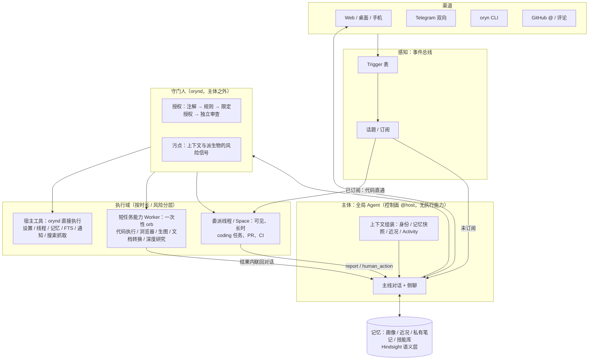

# 全局助手 → Superagent：综合调研与架构构思

> 日期：2026-11-16。性质：调研与构思，不是实施计划；落地前要按 `docs/plan-m*.md` 的格式另写计划。
> 分报告（结论都附来源，外部事实有官方 / 媒体 / 推断标注）：
> - 现状：[research-AssistantNow.md](research-AssistantNow.md)（代码事实带 `文件:行`）
> - DeepSeek dsh-superagent：[research-DshSuperagent.md](research-DshSuperagent.md)（源码提交 `8c32a9d`）
> - Grok / Muse：[research-GrokMuse.md](research-GrokMuse.md)（Muse 判定为 Meta 的个人 agent App，依据见该报告 B⓪）
> - ChatGPT App：[research-ChatGPT.md](research-ChatGPT.md)
> - Hermes Agent：[research-HermesAgent.md](research-HermesAgent.md)（源码提交 `f8acc268`）
>
> 本文里外部产品的事实全部转引自分报告，没有逐条重新核实；本文自己的判断标 [判断]。

---

## 1. 核心问题

表面问题是"给全局助手加哪些功能"。没说出来的核心问题是：

**全局助手在 Oryn 的对象模型里是什么？**

现在它是 `threads` 表里 `kind=assistant` 的一个线程，和工作线程同级，只是工具不同（`internal/threads/coordinator.go:19-23`）。这一点决定了它的所有限制：

- 它没有跨对话的身份，记忆只剩每个对话的转录；
- 它只在被叫醒的回合里存在，没有常驻的感知与主动性；
- 它的权限等于它的工具表，没有"谁授权了什么、授权到什么范围"的概念；
- 它的"手"只有派生别的线程（`create_thread`），自己什么都做不了（`profile.go:16` "you cannot run commands or browse"）。

五个参考对象在 2026 年收敛到了**同一个形状**（[判断]，依据见第 2 节）：

> 一个常驻的**主体**（身份 + 记忆 + 注意力闸门 + 授权），坐在若干**隔离执行域**之上；主体本身轻、可随时对话，执行下放给带完整工具的环境；外面包一层**事件感知**和**多渠道出入口**；所有越出隔离域的动作经过**主体之外的守门人**。

Oryn 的下半身（每线程隔离 orb、出站凭据替身注入、定时、GitHub 事件、Artifacts、推送、远程桌面、成本统计）已经比任何参考对象都扎实；缺的是上半身：**主体对象、记忆、事件总线、授权层、渠道**。所以这不是"加功能"，而是把全局助手从"一种线程"提升为"线程之上的那一层"。

---

## 2. 五个参考对象各自最强的一点

| 对象 | 它真正的贡献 | 对 Oryn 的直接映射 |
|---|---|---|
| **dsh-superagent** | 用结构而不是提示词保证"主体不亲自执行"：Router/Worker 两级、noWait 守卫、Trigger→Thread→订阅直通、`observe→auto` 两档准入、不可变 Mandate、Effects/Outbox 持久副作用队列、Chain of Recall 卡片 | 全局助手 ≈ Router，线程 + orb ≈ Worker；PR 评论与 CI 合并进线程已是一对一订阅直通；出站令牌注入正好解答了它的开放问题"能用凭据却看不到凭据" |
| **Grok Bot** | 产品抽象：**持久 Bot 是一等对象**，主 Bot 协调专职 Bot；**能力账号级共享、上下文（记忆、例程）角色级私有**；Routine = Skill + 触发器；独立审核模型 + 自然语言审批规则；电脑可见度三级（状态 / 预览 / 接管） | 全局助手升级成"主 Bot"；Space、线程分别是项目组与一次任务；远程桌面直接承接三级可见度 |
| **Muse（Meta）** | 安全架构：agent 不可信、能力在宿主侧；**Sentinel 是出网和连接器动作的唯一授权方**；凭据替身；**污点出网**（读过用户数据的进程出网必须审批）；审批走带外通道，有一次 / 会话 / 任务 / 限时 / 永久五种范围；记忆和人格是用户可读写的 Markdown；主动消息先评估"值不值得打扰" | orb ≈ runtime cell，orynd ≈ 宿主侧服务，egress 代理 ≈ authd + Sentinel 的一半；Oryn 已有替身注入，缺的是"授权方"和"审批范围" |
| **ChatGPT** | 收敛路径本身：Pulse、Atlas、Group chats、Canvas、GPTs 先后下线，最终是 **dots 常驻主体 + Work/Codex 委派线程 + 统一 Memory + Plugins**；四层叠加只能收紧的权限栈（连接权限→Custom Rules→Standing authorization→独立 Auto-review）；Activity View；`wake me` 自我调度；记忆写入纪律（空闲后抽取、用过外部内容的会话不进记忆） | 明确告诉我们**不要**做的：独立每日 feed、独立浏览器产品、独立编辑面板 |
| **Hermes Agent** | 学习闭环的工程细节：**回合后 cache 一致的后台评审分叉**（只放行技能 / 记忆工具，成本主要是缓存读取）；技能是过程性记忆，带使用台账、只追加账本、curator 归档、读后才能写；常驻小记忆（MEMORY.md 2200 字符 + USER.md 1375 字符，冻结快照）+ FTS 全历史检索（含中文 trigram）；一个 agent 多入口的网关；cron 的零成本前置门 `wakeAgent` | Oryn 已有 FTS5 trigram 全文索引（README"收件箱与命令面板"）；omp 已有 skill 体系，学到的技能可经中央 Agent 配置下发到所有 orb |

---

## 3. 架构构思

### 3.1 一个前提修正：交互面与执行域是两个维度

调研中容易出现一个假二选一："给助手一台专属 orb 让它自己干活"，还是"让它只当 Router 派活"。二者不互斥：

- **交互面**：用户始终在**同一个助手对话**里提需求、看结果。搜索、生图、跑一段代码的结果，应当就地出现在这条对话里，而不是"已为你开了线程 T-xxx"。
- **执行域**：实际干活在哪里跑，按风险和时长分层。

dsh 的实验（Router 结构性禁止执行时更快更稳）是**合成负载、coding 被 mock** 的结果（[research-DshSuperagent.md](research-DshSuperagent.md) §3.10），只证明"长任务并发调度应下放"，不能证明"消费型体验里的即时能力应该取消"。所以下面的设计把"主体不亲自执行"落实为**主体进程里没有执行能力**，而不是**用户感受不到执行**。

### 3.2 分层结构

各层的现状与缺口：

| 层 | Oryn 现有 | 缺口 |
|---|---|---|
| **主体** | `kind=assistant` 线程；`@host` 沙箱（Landlock + seccomp + 网络命名空间，`internal/coordhost/child.go`）；`--no-tools --tools read,write` | 不是一等对象；没有主线 / 侧聊；系统提示词纯静态（`internal/coord/profile.go:62`），`Profile` 没有动态上下文字段（`threads/coordinator.go:55-62`） |
| **执行域 1：宿主工具** | 25 个宿主工具 + 不可信包裹 + 来源头行 + 审计 + 限速（`internal/coord/tools.go:34-107`） | 没有搜索 / 抓取、记忆、全文检索、主动通知、`wake_me`、读审计表 |
| **执行域 2：短任务 Worker** | orb 预热池、快照、Firecracker；artifact 渲染用的沙箱 Chromium | 没有"一次性能力调用 → 结果回到调用方对话"的通道（现在只有开完整线程） |
| **执行域 3：委派线程** | `create_thread` / `send_message` / 线程回报（`internal/coord/reports.go`）；Space | 回报是自由文本，没有结构化 `state / summary / human_action`；没有 follow-up 归属与交还 |
| **感知** | GitHub webhook + 30 秒补拉、触发规则建线程；定时；artifact 评论到达助手 | 没有统一 Trigger 表、话题、订阅；Telegram 不是输入源 |
| **守门人** | egress 代理替身注入（`proxy` 模式）；Git 单仓库放行；限速 + 审计 | 没有授权方、审批范围、独立审查；"工具即权限"（`internal/coord/coord.go:1-8` 的"不设闸门"决定） |
| **记忆** | M16 Hindsight（仅工作线程与 Runner）；近况 / 画像只有 `.agent-logs/0133-0138` 原型 | 助手被 overlay 强制 `memory.backend: off`，M16 非目标明确排除（`docs/plan-m16.md:37,178`） |
| **渠道** | Web 首屏 / `/assistant`；推送；Telegram 只能回复通知（`internal/notify/telegram.go:507`） | Telegram 不能直接对话 / 开新话题；CLI 没有助手入口 [推断]；没有主动通知主人的工具 |

### 3.3 为什么主体留在 `@host`，而不是给它一台 orb

[判断] 主体同时持有 Simon Willison 说的"致命三要素"里的两项：**私有数据**（所有线程、记忆、画像）和**不可信内容**（`read_thread` 读回的 orb 输出、PR 评论、网页）。再给它第三项"对外通信"（shell、网络、浏览器），注入就能直接变成外泄。Muse 和 dots 的解法都是**让主体所在的域没有直接出口，出口只经守门人**。

`@host` 的现有沙箱正好就是这个形状：唯一出口是回环上的模型代理端口。保留它，执行能力全部经宿主工具或 Worker 提供，每一次越界都在 orynd 里可见、可拦、可审计。

代价：
- 所有协调对话共用一个沙箱、一个子进程（`docs/protocol.md:949`，`plan-m13.md:76`），主体对象化之后要么维持"单主人单沙箱"，要么为每个主体分 HOME；
- 协调宿主依赖 Landlock / 命名空间，不满足时 fail-closed，助手整体不可用（`docs/protocol.md:867`）。作为"核心"，这条可用性风险要在部署文档里升级为硬前置条件或提供降级方案。

### 3.4 短任务能力 Worker（执行域 2）

这是本文最主要的新机制，用来同时满足"像 ChatGPT 一样就地给结果"和"主体不执行"：

- 主体调用 `run_capability{kind: code|browser|image|research|convert, input, files}`；
- orynd 从预热池取一台一次性 orb（或专用的能力镜像），执行，结果（文本、文件、截图、artifact）回到**调用方对话**作为工具结果；
- orb 用完即销毁；不出现在线程列表，但在 Activity 里有一行可追溯；
- 读入的内容一律不可信包裹；Worker 的出网走现有 egress，按能力类型给不同放行表（研究 Worker 可出网、代码 Worker 默认断网）。

[判断] 这一层对 Oryn 的成本最低，因为 orb 生命周期、快照、预热池、egress、artifact 都是现成的；新增的只是"不带转录的一次性调用"这种 orb 用法与回传协议。

### 3.5 守门人（授权层）

综合 Muse Sentinel、dots 四层权限、Hermes 审批、dsh Mandate：

1. **工具注解**：每个宿主工具、能力、MCP 工具带 `readOnly / destructive / openWorld`（MCP 标准注解）。
2. **规则**：用户用自然语言写"哪类动作：直接做 / 你明确要求时做 / 先问 / 交给我"（dots Custom Rules）。
3. **限定授权**：一次 / 会话 / 任务 / 限时 / 永久，绑定到具体目标与用途，越界即重新授权；"授权起草 ≠ 授权发送"。授权落库后不可变，记下策略版本（dsh Mandate）。
4. **独立审查**：只对 write 与越出沙箱的动作启用；审查模型只看精简转录和精确的动作请求，不看主体推理；被拒后禁止绕路，连续 N 次拒绝中断回合（dots Auto-review）。
5. **审批走带外**：审批卡由 orynd 直接推到 Web / 推送 / Telegram 按钮，答复直接回到 orynd，不经对话；模型无法伪造"用户已同意"。Oryn 已有"一触作答、别处作答后撤回按钮"的通知基础。
6. **污点**（Muse tainted egress 的近似）：**只是风险信号，不是授权边界**。
   - 来源：orynd 知道哪些宿主工具结果做了 `wrapUntrusted`。
   - 粒度是上下文，不是回合：不可信内容一旦进入某个对话的模型上下文，这个对话就带上污点，直到这段上下文被丢弃（新会话或 `clear_context`）才解除。压缩不算解除，因为压缩摘要本身就是从被污染的内容派生的。
   - 派生物继承污点：从被污染上下文写出的私有笔记、记忆候选、近况条目、技能候选、artifact、委派给线程的提示词都带污点标签，之后被读回任何上下文时，该上下文也随之带上污点。
   - 作用：带污点时，限定授权与"直接做"类规则不能自动放行外发类动作（发消息到外部渠道、写 GitHub、写全局记忆、开对外分享），只能逐次带外审批；污点同时作为独立审查的输入。
   - 限制：全局助手经常读线程内容，实际上大部分对话都会带污点，所以安全性不能靠"没污点就放行"。真正的边界是第 3、5 条：外发类动作默认需要带外审批，限定授权只能由用户亲手授予且严格绑定目标与范围。污点只会让放行变严，从不放宽。

记忆写入授权仍按 `.agent-logs/0065` 的结论：模型发起的写入一律先进候选队列，pinned / preference 需主人确认，或用 `ownerQuote` 在主人亲手输入的消息中逐字核验。污点只决定候选的风险标注，不能替代这套闸门。

### 3.6 记忆

把 ChatGPT 的四层、Hermes 的常驻 + 检索、Muse 的文件化、Oryn 已有的近况设计（0133-0138）合并：

| 层 | 内容 | 写入 | 读取 | 实现基础 |
|---|---|---|---|---|
| L0 身份 | 名字、人格、边界（`SOUL.md` / `IDENTITY.md` 式），用户可编辑 | 用户；agent 改了要告知 | 常驻 | 已有助手身份 / 头像设置 |
| L1 显式记忆 | "记住……" | 同步；主人亲手输入才直接生效 | 常驻，有字符预算，冻结快照 | 新增 |
| L2 画像 + 近况 | 偏好、进行中的事；近况按"事情"组织，一行概览全局可见（0138） | 后台空闲后合成；用过外部内容的会话不参与（ChatGPT `disable_on_external_context`） | 常驻，有预算 | 0133-0138 原型；可放 Hindsight mental model |
| L3 历史检索 | 全部线程转录 | 不写 | 工具（FTS） | **已有** FTS5 trigram，只差一个宿主工具 |
| L4 私有笔记 / Activity | 主体自己的进行中职责、决定 | 主体自写 | 只给主体；用户可逐条看和删（dots 被批评的点） | 新增 |
| P 技能库 | 过程性知识："主人怎么发版""怎么开 Space" | 回合后评审分叉产出，进候选；curator 归档 | 索引常驻，全文按需；**下发到所有 orb** | omp skill + 中央 Agent 配置下发 |
| S 语义层 | 跨项目事实 | 全局写入先进候选队列（M16 Q4） | 召回 | M16 Hindsight 网关与候选队列（`migrations/0036_memory.sql`） |

需要主人重新决定的：M16 把全局助手排除在 Hindsight 之外（Q5）。主体对象化之后，[判断] 全局助手应当成为**全局记忆候选的主要生产者与审批入口**，而不是唯一的局外人。

### 3.7 感知与主动性

- **统一 Trigger**：GitHub webhook、定时到点、Telegram / CLI 入站、artifact 评论、线程回报、审批答复，全部先落 `trigger` 表，再按话题分派。
- **订阅直通**：已订阅的话题由代码直接送到对应线程（复用现有 15 秒合并），不经主体；dsh 实测这能省约 37% Router token。
- **主动的三种形态**（吸取 Pulse 下线的教训，不做独立 feed）：
  1. 监控任务：有状态，带终止条件，`notifyPolicy: always | on_change | never`；
  2. 事件触发例程：Routine = Skill + Trigger，先在 `observe` 模式只记录"本来会做什么"，确认后切 `auto`；
  3. 后台只读巡检：只能用技术上只读的工具，产出写进私有笔记，下次对话或摘要推送时提出。
- **零成本前置门**：定时 / 例程先跑确定性检查（"CI 红了吗？"），不满足就不唤醒模型（Hermes `wakeAgent`）。
- **打扰预算**：`PROACTIVE_PREFERENCES`（想听什么 / 永远别说什么 / 什么时候 / 怎么说）+ 安静时段；推送前先判断"有没有实质新信息或是否需要你"。
- **自我调度**：`wake_me(at | after, reason)`，实现为一次性 `thread` 型定时（现有 `set_schedule` 已能做，只是没有这个语义入口）。

### 3.8 渠道

- **一个主体，多个入口；各渠道对话独立、记忆共享**（dots / Hermes）。
- Telegram 升级为双向：直接发消息即进入助手主线，或 `/new` 开侧聊；只有绑定的主人能驱动；渠道内容不可信包裹；IM 回复限长（dsh 100 词）。
- 渠道是"转交任务"，不是"镜像对话"：GitHub 里 @助手只回一句确认，工作和结果留在 Oryn（Grok @bot）。
- CLI：`oryn ask` / `oryn assistant attach`，复用 `thread attach` 的流式通道。
- 主线 + 侧聊、非轮流对话（Muse）：可以连发多条、随时插话；后台结果、审批卡、例程运行、artifact 卡片都落在同一条时间线上。

### 3.9 持久副作用与可追溯

- **Effects / Outbox**：所有"决定之后的外部动作"（开 orb、投递、推送、Telegram、GitHub 写）先落库再执行，同一目标保序，失败退避（dsh）。
- **run → step → delivery**：区分"已受理 / 已执行 / 已送达"（Muse）；判断"任务跑没跑"查运行表，不查调度配置。
- **主体能读自己的审计**：现在 `coord_actions` 对助手不可见（research-AssistantNow §3.3），回答"你昨天替我做了什么"需要它。
- **Watchdog**：独立于主体的定时会话，只能报告与重启，不能改提示词或授权（dsh）。

### 3.10 自我进化

- **回合后评审分叉**（Hermes）：每 N 个用户轮或 N 次工具迭代，在回复送达后，用同模型、同系统提示、同工具表重放对话，只放行技能 / 记忆工具；产出进候选队列；用量记到主体。评审 prompt 的规范可直接照搬：只记有据的事实、偏好写进技能、不沉淀否定性结论（"X 工具坏了"）、读后才能写。
- **技能治理**：使用台账、只追加账本可单条回滚、14 天 stale / 30 天归档、pin / lock。
- **效果度量**：Muse 的"可度量地没有帮助的改动会被撤销"需要指标；Oryn 的成本 / 产出统计（`internal/stats`）可以提供"技能调用后任务是否 shipped、是否返工"。
- **成本控制**：评审路由到便宜模型；定时与子 agent 不触发评审；按主体设预算（Hermes 估每次约 3 万 token；dsh 两级结构 2-4 倍 token）。

---

## 4. 不建议做的

| 不做 | 原因 |
|---|---|
| 独立的每日简报 feed | ChatGPT Pulse 2026-06 下线，主动更新并入定时任务 |
| 让主体直接拿 shell / 网络 / 浏览器 | 致命三要素在同一个域里凑齐；dsh 原型 `danger-full-access` 就是反例 |
| 在共享环境里分出多个 Bot 当作安全边界 | Grok Bot 官方文档自己承认这不是边界 |
| 生成物 / 分享链接默认公开 | Grok Build 与 Muse 都因此泄露过；Oryn 发布前已有密钥扫描，默认私有要保持 |
| 代表用户做承诺不经审批 | Muse Marketplace 事故（透露住址、擅自接受低价） |
| 照搬 dsh 完整的 follow-up 归属规则 | 为团队 IM 噪声场景打磨，过于复杂；第一步只要"订阅直通 + 交还一次 + 结束释放未读" |
| 把 Space 的拆解职责并进主体 | dsh 明确区分 Router（分派独立任务）与 Agent Team（拆解紧耦合任务）；主体派任务时可选"单线程"或"开一个 Space" |
| 照搬 Hermes 的"同一 profile 全量可检索" | 没有用户隔离；Oryn 若走向团队要按用户分库 |
| eBPF / LSM 级污点追踪 | 自托管内核环境差异大；在宿主工具层近似，且只作风险信号（3.5 第 6 条） |
| 模型生成任意界面（Intelligent UI） | 依赖专门训练；先做受控组件或 MCP Apps 宿主 |

---

## 5. 建议的推进顺序 [判断]

每一步都能单独交付、单独回退；顺序按"先消除结构性瓶颈，再加能力，再放权"。

| 阶段 | 目标 | 内容 | 依赖 |
|---|---|---|---|
| **S0 决策** | 定对象模型与边界 | 第 6 节的决策；更新威胁模型（主体 / Worker / 守门人三个域） | — |
| **S1 有记忆、有上下文的主体** | 助手"知道你是谁、最近在做什么" | 主体对象（身份、主线 + 侧聊）；`Profile` 增加动态上下文块（日期时区、近况一行概览、Activity 摘要），复用 `RefreshAgent`；L1 / L4 记忆 + 候选闸门；L3 FTS 宿主工具；读审计表 | S0 |
| **S2 随处可达** | 助手不再只是"Web 里的一个页面" | `notify_owner` 与 `wake_me`；Telegram 双向；CLI 入口；Activity View（进行中 / 已排程 / 待你决定） | S1 |
| **S3 有手** | 就地给结果 | 宿主工具：搜索 / 抓取（egress 新增放行路由）；短任务能力 Worker（代码、浏览器、生图、研究）；结构化线程回报 `state / summary / human_action` | S1；守门人的最小版本（注解 + 外发默认带外审批 + 污点标注）必须同时上 |
| **S4 有边界的自主** | 敢让它主动 | 完整授权层（规则、限定授权、独立审查）；Trigger 表 + 话题 + 订阅直通；例程 `observe → auto`；Effects / Outbox；打扰预算 | S3 |
| **S5 会成长** | 越用越懂你 | 回合后评审分叉 → 技能候选 → 下发到 orb；L2 画像 / 近况后台合成；技能 curator；Watchdog；MCP Apps 宿主 / 连接器 | S1、S4 |

S1 是"迈向 superagent 的第一步"里性价比最高的一段：几乎全部基于现有积木（`RefreshAgent`、宿主工具通道、FTS5 索引、M16 候选队列），却直接解决"助手不知道我是谁"这个最大的单点。

---

## 6. 需要主人拍板的决策

| # | 问题 | 选项 | 推荐与理由 |
|---|---|---|---|
| D1 | 主体的对象模型 | A. 维持 `kind=assistant` 线程，只加字段；B. 新增一等"Agent / 主体"对象，对话变成它的主线与侧聊 | **B**。A 会让记忆、授权、渠道、Activity 都挂在"某个对话"上，换对话就丢；所有参考产品都以持久主体为一等对象 |
| D2 | 全局助手是否接入记忆（推翻 M16 Q5） | A. 维持不接入，另走近况 / 画像路线；B. 接入 Hindsight，并成为全局记忆候选的主要生产者与审批入口 | **B**，但 L0 / L1 / L4 留在 orynd 自己的表里（小、常驻、可逐条编辑），Hindsight 只承担语义召回 |
| D3 | 主体的执行方式 | A. 主体专属 orb，自己有 shell / 浏览器；B. 主体无执行能力，经宿主工具 + 短任务 Worker + 委派线程三层执行，结果回到同一对话 | **B**。交互体验与 A 相同，但致命三要素不在同一个域里 |
| D4 | 主动性默认档 | A. 新例程默认 `auto`；B. 默认 `observe`，看过"本来会做什么"后再放权 | **B**。自托管用户直接为 token 与误操作买单 |
| D5 | 多主体（专职 Bot） | A. 现在就支持多个；B. 先单主体，对象模型预留 | **B**。Grok 也给 Bot 数设了上限；先把一个做对 |
| D6 | 第一批外部渠道 | Telegram / CLI / GitHub @ / 邮件 / 企业 IM | **Telegram + CLI**。Telegram 已有出站与配对，CLI 已有 attach 流式通道 |
